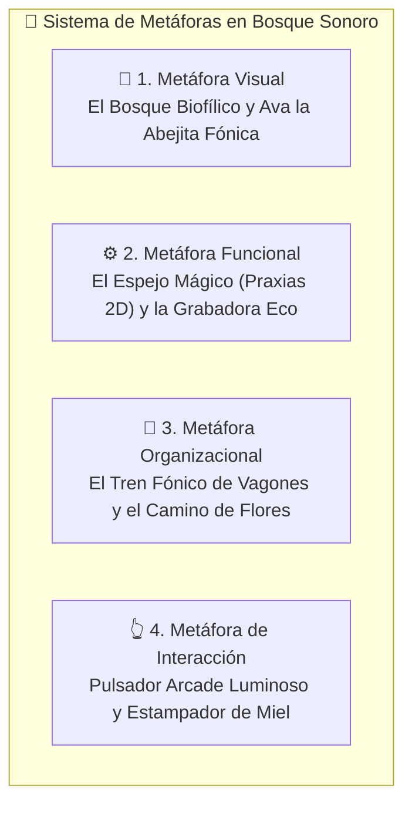

# 🎨 Guía de Diseño IHC y Metáforas Pediátricas ("Bosque Sonoro")

Esta skill proporciona las especificaciones y principios ergonómicos, cognitivos y de interacción para diseñar, evaluar o refactorizar interfaces dirigidas a **niños preescolares (3 a 5 años)** con audición funcional y dificultades de articulación fonética.

---

## 🎭 1. Las 4 Metáforas de Interfaz (Eje No-Textual)

Para niños pre-lectores en etapa preoperacional (Piaget), las metáforas sustituyen el texto instructivo por correspondencias con su mundo físico conocido (*Actividad 6; Druin, 2002; Cates, 2002*):

### 1.1. Metáfora Visual: El Bosque Biofílico y Ava la Abejita
- **Concepto:** Un entorno forestal cálido, con árboles, flores y cielo diurno, que reduce el estrés sensorial y promueve la concentración (*Biophilic Design*).
- **Mascota Ava:** Guía antropomórfica empática. No es un elemento decorativo: es el **agente pedagógico y fonoaudiológico**. Ava modela con su rostro la posición de los labios y la lengua antes de cada ejercicio.
- **Iconografía Pura:** Objetos cotidianos de alta familiaridad (animales del bosque, frutas peruanas, juguetes). Prohibido el uso de símbolos abstractos (ej. ruedas dentadas para configuración).

### 1.2. Metáfora Funcional: El Espejo Mágico y la Grabadora Eco
- **El Espejo Mágico Interior (Canvas 2D):** Representa un espejo de tocador fonoaudiológico. Permite al niño ver en corte sagital cómo se posiciona la lengua respecto al paladar y los dientes para pronunciar sonidos difíciles (`/r/`, `/rr/`, `/s/`, `/l/`, `/ch/`).
- **La Grabadora Eco / El Loro del Bosque:** Graba la fonación del menor y la reproduce de inmediato (*Self-Playback Contingente*), permitiendo el bucle de autodiscriminación auditiva (*Furlong et al., 2018; Strömbergsson et al., 2026*).
- **El Molinillo / Vela Soplada:** En minijuegos de respiración, el niño sopla al micrófono y el molinillo gira o las hojas vuelan según el flujo de aire captado por la Web Audio API.

### 1.3. Metáfora Organizacional: El Tren Fónico y el Camino de Flores
- **El Convoy de Vagones de Van Riper:** En lugar de menús desplegables o árboles de carpetas, la progresión fonoaudiológica se organiza como vagones de un tren sobre rieles:
  1. *Vagón 1: Praxias y Gimnasia Bucofacial.*
  2. *Vagón 2: El Sonido Aislado (Fonema).*
  3. *Vagón 3: La Pareja Sonora (Sílaba).*
  4. *Vagón 4: Las Palabras Mágicas.*
  5. *Vagón 5: Frases y Rimas Cantadas.*
  6. *Vagón 6: Minijuegos de Fonación y Aventura.*
- **El Camino de Flores:** El avance en una sesión se visualiza como flores que se abren o huellas que se iluminan al caminar, prescindiendo de barras de porcentaje (`%`) o fracciones numéricas (`3/10`).

### 1.4. Metáfora de Interacción: Pulsador Arcade y Sello Festivo
- **Pulsador Arcade Luminoso:** El control de grabación es un pulsador colosal circular con textura de botón físico real. Al tocarlo emite un pulso luminoso y un sutil sonido orgánico (campanilla suave) que indica "te escucho".
- **Tira Silábica Karaoke:** Representada como piedras sobre un arroyo o flores luminosas que se encienden al ritmo de la emisión silábica (ej. *pla-ta-no*).
- **Estampador Festivo:** Al articular con éxito, una gota de miel o una estrella cae con una animación alegre sobre el tarro de Ava.

---

## 📏 2. Directrices de Ergonomía Motriz Pediátrica

Los niños de 3 a 5 años poseen una motricidad fina inmadura, propensa a temblores leves y toques con la palma de la mano (*Hourcade, 2008; Du et al., 2023; Liu et al., 2026*):

| Parámetro | Estándar Obligatorio | Justificación Científica |
| :--- | :--- | :--- |
| **Touch Target Mínimo** | **$\ge 48\times 48\text{ dp}$** | Umbral básico WCAG 2.2 AA (Criterio 2.5.8). |
| **Touch Target Recomendado** | **$64\text{ a }76\text{ px}$** | Rango óptimo en preescolares (*Du et al., 2023; Hourcade, 2008*). |
| **Botón Principal de Fonación** | **$80\text{ a }100\text{ px}$** | Blanco colosal centralizado para activación sin fatiga. |
| **Separación Inter-Elementos** | **$\ge 16\text{ px}$** | Prevención de activación involuntaria por toque adyacente. |
| **Zona de Resguardo Palmar** | **Márgenes de $24\text{ a }32\text{ px}$** | Rechazo de toques accidentales causados por sujetar la tableta con la palma. |
| **Orientación y Factor de Forma** | **Landscape horizontal 16:9 fijo** | Optimizado para tabletas de 10"–12" sobre mesa de aula o regazo. |

---

## 🗣️ 3. Paradigma Voice-First y Eliminación Radical del Texto

1. **Cero Texto para el Infante:**
   - Queda prohibido mostrar rótulos como *"Presiona para hablar"*, *"Siguiente"*, *"Articula el fonema /r/"* o mensajes de error escritos.
   - Todo comando se transmite por:
     1. **Locución grabada y empática de Ava** en español peruano neutro / norma culta de Lima.
     2. **Demostración animada** (Ava pulsa el botón en pantalla como modelado vicario).
     3. **Metáforas visuales autoexplicativas**.
2. **Latencia Fonoacústica Contingente:**
   - La retroalimentación visual al hablar debe activarse en **$<300\text{ ms}$** desde la captación acústica (Web Audio API VAD). Una latencia mayor rompe la contingencia operante y confunde al menor (*Saeedi et al., 2024*).

---

## 🎮 4. Gamificación No Punitiva y Algoritmo DDA

- **Cero Castigo:**
  - Prohibido el uso de buzzers estridentes, pantallas grises, cruces rojas o reducción de vidas/corazones.
  - El error articulatorio nunca se sanciona; se trata como una **aproximación fónica en progreso** (*Mora et al., 2024*).
- **Mecanismo de Rescate y Andamiaje Adaptativo (DDA):**
  - **Intento 1 fallido:** Ava anima y modela con calma (*"¡Casi lo tienes! Escucha cómo lo hago yo: /r/"*).
  - **Intento 2 fallido:** Ava activa automáticamente el *Espejo Mágico 2D* mostrando la lengua contra el paladar.
  - **Intento 3 fallido:** El sistema reduce dinámicamente el umbral de exigencia fonética o transiciona al menor a un ejercicio preparatorio de respiración/soplo sin penalización alguna.

---

## 🔒 5. Gobernanza Asimétrica: Compuerta Cognitiva (MathGate)

- Las interfaces administrativas, la calibración técnica del micrófono y el **Dashboard Clínico TEPROSIF-R** son de uso exclusivo del adulto mediador (docente, terapeuta SLP o padre).
- **Implementación de MathGate:** Para acceder a la consola o salir de la sesión guiada, el sistema solicita resolver un desafío aritmético sencillo en números arábigos (ej. *"¿Cuánto es 4 + 3?"*).
- Un niño de 3 a 5 años (etapa preoperacional) no puede superar esta compuerta de manera fortuita, garantizando que permanezca dentro de la experiencia lúdica protegida.

