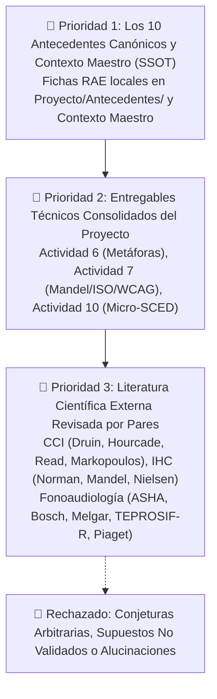

# 🧠 Marco Metodológico para la Toma y Justificación de Decisiones ("Bosque Sonoro")

Este protocolo rige la justificación de cualquier propuesta, rediseño, componente, parámetro técnico o cambio clínico en la aplicación fono-lúdica pediátrica **Bosque Sonoro**. Ninguna decisión de diseño, código o fonoaudiología debe adoptarse de forma arbitraria ("porque queda bien" o "por convención general"); **toda decisión debe estar sustentada en la evidencia científica**.

---

## 🏛️ 1. Jerarquía de Evidencia Científica (Evidence Priority Pyramid)

Cuando el agente analice problemas, proponga interfaces, elija umbrales fonoacústicos o diseñe flujos, debe buscar y citar sus fundamentos siguiendo este orden estricto de prelación:



### 📚 Prioridad 1: Los 10 Antecedentes Indexados del Repositorio
Consulta directa en [`Proyecto/Antecedentes/Antecedentes.md`](file:///d:/.Antigravity/IHC/Proyecto/Antecedentes/Antecedentes.md):

1. **Huertas & Roque (2023):** Diagnóstico de retrasos fonético-fonológicos en preescolares de Lima Metropolitana. Justifica la necesidad social, la prevalencia de dislalias en Lima y el rol de las docentes de inicial.
2. **Condori & Larico (2022):** Eficacia de los juegos verbales tradicionales en la expresión oral y articulación preescolar.
3. **Pucuhuaranga (2016):** Canciones, trabalenguas y rimas infantiles como motor lúdico para superar dificultades de pronunciación.
4. **Mora et al. (2024):** Eficacia clínica del programa lúdico-fonológico en dislalias funcionales (rehabilitación articulatoria sin causa orgánica).
5. **Peña et al. (2024, *Nature Scientific Reports*):** Intervención con tabletas interactivas en el desarrollo de habilidades comunicativas tempranas en la primera infancia.
6. **Saeedi et al. (2024, *Nature Scientific Reports*):** Serious Game *Ava* para Trastornos de los Sonidos del Habla (SSD). Identificación de 23 problemas de usabilidad pediátrica y diseño de mecánicas no punitivas.
7. **Du et al. (2023):** Criterios rigurosos de diseño de interacción y experiencia de usuario (UI/UX) en aplicaciones para fonoaudiología pediátrica.
8. **Furlong et al. (2018):** Análisis de calidad y efectividad fonoaudiológica de aplicaciones móviles infantiles; erradicación de sesgos fonéticos (*schwa* `[ə]`) y requisitos de modelado acústico humano.
9. **Strömbergsson et al. (2026):** Entrenamiento del habla asistido por voz (*Pop2*), concordancia inter-evaluador y acuerdo entre reconocimiento de voz (ASR) y evaluador fonoaudiológico humano.
10. **Liu, Chen & Razak (2026, *MDPI*):** Criterios de calidad e interacción niño-computadora (CCI) en aplicaciones para educación preescolar; control de fatiga cognitiva y ergonomía motriz.

---

## 📋 2. Estructura Obligatoria de la Matriz de Decisiones de Diseño

Cada vez que se proponga o modifique una funcionalidad, pantalla o token, debe documentarse utilizando la **Matriz Canónica de 5 Campos**:

| Campo | Descripción Requerida |
| :--- | :--- |
| **1. ID y Nombre de la Decisión** | Código identificador correlativo (ej. `DEC-01`, `DEC-02`) y título descriptivo de la decisión. |
| **2. Problema / Reto Clínico o de IHC** | Brecha o dificultad detectada en niños de 3 a 5 años (ej. motricidad fina limitada, incapacidad lectora, frustración por error). |
| **3. Fundamentación Científica (Cita Formal)** | Autor, año y principio científico que respalda la decisión (priorizando los 10 antecedentes o autores CCI/IHC). |
| **4. Implementación Empírica en el Prototipo** | Cómo se materializa exactamente en la interfaz, el código o el flujo lúdico (dimensiones, tokens, componentes, eventos). |
| **5. Indicador / Verificación Objetiva** | Métrica cuantitativa observable para validar la efectividad (ej. latencia $<300\text{ ms}$, target $\ge 64\text{ px}$, tasa de abandono $<5\%$). |

### Plantilla de Ejemplo Canónico:
```markdown
> ### Decisión [DEC-XX]: [Nombre del Componente o Regla]
> - **Problema:** Los niños de 3 a 5 años carecen de habilidades de lectura y experimentan frustración motriz al tocar botones pequeños.
> - **Fundamentación:** *Du et al. (2023)* y *Hourcade (2008)* demuestran que los touch targets en preescolares deben superar los 48 dp, recomendando 64-76 px, mientras que *Liu et al. (2026)* exige eliminar interfaces basadas en texto para evitar sobrecarga extrínseca (Sweller).
> - **Implementación:** Botón de micrófono transformado en un pulsador arcade visual de 80×80 px con retroalimentación sonora y halo luminoso pulsante, guiado 100% por la voz de Ava.
> - **Indicador:** Cero toques fallidos fuera del área sensible en pruebas con preescolares; tasa de éxito de activación $\ge 95\%$.
```

---

## 🚫 3. Filtro de Validación de Decisiones (Checklist de Anti-Patrones)

Antes de dar por válida una decisión o cambio, verificar que **cumple con los 5 filtros**:

- [ ] **Filtro Sensorial:** ¿La decisión asume correctamente que el niño tiene **audición normal/funcional** y que su dificultad es **motriz-articulatoria o fonológica**? (VETO si asume sordera).
- [ ] **Filtro de Lectura:** ¿La pantalla del niño está **100% libre de texto instructivo** o etiquetas técnicas?
- [ ] **Filtro Afectivo:** ¿La interacción es **no punitiva** (cero cruces rojas, cero vidas perdidas, cero timbres molestos)?
- [ ] **Filtro Ergonómico:** ¿Los elementos interactivos respetan el tamaño mínimo de **$48\times 48\text{ dp}$ (ideal $64\text{--}76\text{ px}$)** y separación $\ge 16\text{ px}$?
- [ ] **Filtro de Evidencia:** ¿La justificación cita explícitamente al menos uno de los 10 antecedentes locales o un autor científico reconocido?

