# 📑 Repositorio de Antecedentes: Aplicación Fono-Lúdica para la Articulación Fonética en Preescolares

> [!INFO] Ficha Técnica del Artículo de Investigación
> **Título Oficial:** *Aplicación fono-lúdica enfocada en la mejora de la articulación fonética en aplicaciones educativas en estudiantes de nivel preescolar de Lima Metropolitana*
> **Línea de Investigación:** Interacción Humano-Computador (IHC), Tecnología Educativa y Fonoaudiología Pediátrica.
> **Población Objetivo:** Estudiantes de nivel preescolar / educación inicial (3 a 5 años) de Lima Metropolitana.
> **Propósito de esta Sección:** Compendio exhaustivo de las **10 fuentes científicas y académicas** que sustentan el estado del arte, la justificación diagnóstica, la evidencia de efectividad fono-lúdica y la arquitectura de software e interacción de la investigación.

---

## 🧭 Mapa de Articulación del Estado del Arte (Los Tres Pilares)

```mermaid
graph TD
    Articulo["📱 Aplicación Fono-Lúdica para la Articulación Fonética en Preescolares (Lima Metropolitana)"]

    P1["🏛️ Pilar 1: Contexto, Diagnóstico y Procesos Fonológicos en Preescolar"]
    P2["🎲 Pilar 2: Efectividad de Juegos Verbales y Programas Fono-Lúdicos"]
    P3["💻 Pilar 3: Arquitectura Móvil, Usabilidad Infantil e IHC"]

    Articulo --> P1
    Articulo --> P2
    Articulo --> P3

    P1 --> F1["[[Proyecto/Antecedentes/Ficha - Huertas y Roque (2023) - Dificultades Fonológicas en Docentes Inicial|1. Huertas & Roque (2023)]]<br>Tesis PUCP: Docentes Lima vs Piura (N=199)<br>Justifica la realidad en Lima y los PSF a superar"]

    P2 --> F2["[[Proyecto/Antecedentes/Ficha - Condori y Larico (2022) - Juegos Verbales y Expresión Oral|2. Condori & Larico (2022)]]<br>Tesis UJCM: Correlación r=0.612 en fonología infantil"]
    P2 --> F3["[[Proyecto/Antecedentes/Ficha - Pucuhuaranga (2016) - Juegos Verbales y Articulación Verbal|3. Pucuhuaranga (2016)]]<br>Horizonte de la Ciencia: Cuasiexperimento (46.86% superación)"]
    P2 --> F5["[[Proyecto/Antecedentes/Ficha - Mora et al. (2024) - Programa Lúdico Fonológico y Dislalia Funcional|4. Mora et al. (2024)]]<br>Univ. Ciencia y Tec.: Programa fono-lúdico (74% normalizado)"]
    P2 --> F10["[[Proyecto/Antecedentes/Ficha - Pena et al. (2024) - Intervencion con Tabletas y Habilidades Comunicativas en Preescolares (Nature)|5. Peña et al. (2024)]]<br>Nature npj Science of Learning: Tabletas y TEPROSIF (N=152)"]

    P3 --> F4["[[Proyecto/Antecedentes/Ficha - Saeedi et al. (2024) - Serious Game Ava y Trastornos del Habla|6. Saeedi et al. (2024)]]<br>Nature Scientific Reports: Serious Game Ava, Nielsen y PSSUQ"]
    P3 --> F6["[[Proyecto/Antecedentes/Ficha - Du et al. (2023) - Diseno de Apps para Fonoaudiologia Pediatrica|7. Du et al. (2023)]]<br>IJLCD: 37 SLPs y 5 Pautas IHC de diseño infantil sin anuncios"]
    P3 --> F7["[[Proyecto/Antecedentes/Ficha - Furlong et al. (2018) - Analisis de Calidad y Eficacia de Apps en Trastornos del Habla (MARS)|8. Furlong et al. (2018)]]<br>PLOS ONE: Revisión de 132 apps con escala MARS y antipatrones"]
    P3 --> F8["[[Proyecto/Antecedentes/Ficha - Strombergsson et al. (2026) - Entrenamiento del Habla con App Pop2TalkNordic y Desafios IHC|9. Strömbergsson et al. (2026)]]<br>IJLCD: App Pop2TalkNordic, DDA y prevención de frustración"]
    P3 --> F9["[[Proyecto/Antecedentes/Ficha - Liu et al. (2026) - Criterios de Calidad en Interaccion Nino-Computadora (CCI)|10. Liu, Chen & Razak (2026)]]<br>Computers (MDPI): Marco Ecológico de Calidad CCI (9 Dimensiones)"]
```

---

## 📊 Matriz Comparativa Integral de los 10 Antecedentes

| # | Fuente / Autoría | Tipo y Revista / Universidad | Muestra y Contexto | Diseño Metodológico | Variables Centrales | Aporte Clave a Nuestro Artículo |
| :-: | :--- | :--- | :--- | :--- | :--- | :--- |
| **1** | **[[Proyecto/Antecedentes/Ficha - Huertas y Roque (2023) - Dificultades Fonológicas en Docentes Inicial\|Huertas & Roque (2023)]]** | Tesis de Maestría (PUCP, Lima) | 199 docentes de inicial (99 Lima Metropolitana, 100 Piura) | Cuantitativa, no experimental, descriptivo-comparativo (Mann-Whitney) | VI: Contexto geográfico VD: Conocimiento en desarrollo fonológico, PSF y dificultades | Justifica la necesidad en **Lima Metropolitana** y define la tipología de **Procesos de Simplificación Fonológica (PSF)** que la app abordará. |
| **2** | **[[Proyecto/Antecedentes/Ficha - Condori y Larico (2022) - Juegos Verbales y Expresión Oral\|Condori & Larico (2022)]]** | Tesis de Licenciatura (UJCM, Moquegua) | 9 estudiantes de 5 años (muestra censal) | Cuantitativa, no experimental, correlacional ($r$ de Pearson) | VI: Juegos verbales (trabalenguas, rimas, adivinanzas) VD: Expresión oral fonológica | Evidencia correlación positiva y significativa (**$r = 0.612, p = 0.008$**) entre los juegos verbales y la dimensión fonológica infantil. |
| **3** | **[[Proyecto/Antecedentes/Ficha - Pucuhuaranga (2016) - Juegos Verbales y Articulación Verbal\|Pucuhuaranga (2016)]]** | Artículo Científico (*Horizonte de la Ciencia*, UNCP) | 50 niños de 5 años (23 exp., 27 control) | Aplicada, experimental, **cuasi experimental** con pre/post-test y grupo control | VI: Programa de juegos verbales VD: Articulación verbal (omisiones, sustituciones, distorsiones) | Demuestra causalidad: **46.86% de superación de errores articulatorios**. Provee la **secuencia bucofacial (6 pasos)** y el **banco de 32 palabras test de Bosch & Melgar**. |
| **4** | **[[Proyecto/Antecedentes/Ficha - Saeedi et al. (2024) - Serious Game Ava y Trastornos del Habla\|Saeedi et al. (2024)]]** | Artículo Científico (*Nature Scientific Reports*) | 30 SLPs (Delphi), 6 evaluadores IHC, 22 SLPs (PSSUQ) y 10 niños con SSD | Desarrollo de software (SDLC) + Evaluación de Usabilidad en IHC | VI: Serious video game móvil (*Ava*) con Speech-to-Text VD: Usabilidad (Nielsen, PSSUQ) y fonología infantil | Provee el **blueprint de ingeniería y diseño IHC**: interfaz sin texto para niños no lectores, reconocimiento de voz (STT), refuerzo sin castigo y heurísticas de Nielsen. |
| **5** | **[[Proyecto/Antecedentes/Ficha - Mora et al. (2024) - Programa Lúdico Fonológico y Dislalia Funcional\|Mora et al. (2024)]]** | Artículo Científico (*Univ., Ciencia y Tecnología*) | 38 niños de 4 y 5 años con dislalia funcional | Cuantitativa, aplicada, experimental pre/post-test (Wilcoxon $p=0.01$) | VI: Programa lúdico fonológico VD: Dislalia funcional (fonemas $/r, s, l, z/$, sinfones y diptongos) | Demuestra que el enfoque fono-lúdico **elimina las dislalias graves (0%) y normaliza el habla en el 74%**. Aporta **5 mecánicas lúdicas de aula** (carreras de fonemas, bingo, memoria). |
| **6** | **[[Proyecto/Antecedentes/Ficha - Du et al. (2023) - Diseno de Apps para Fonoaudiologia Pediatrica\|Du et al. (2023)]]** | Artículo Científico (*Int. J. Lang. Commun. Disord.*) | 37 fonoaudiólogos pediatras (23 usuarios, 14 diseñadores de apps) | Cualitativa empírica, marcos CFIR, iRPD y análisis temático TIDRC | VI: Prácticas y co-diseño de apps móviles en fonoaudiología VD: Directrices de diseño IHC y adopción clínica | Establece **5 pautas de diseño IHC infantil**: eliminación de anuncios distractores, controles de back-end para el docente/padre, biofeedback articulatorio y personalización. |
| **7** | **[[Proyecto/Antecedentes/Ficha - Furlong et al. (2018) - Analisis de Calidad y Eficacia de Apps en Trastornos del Habla (MARS)\|Furlong et al. (2018)]]** | Artículo Científico (*PLOS ONE*) | 132 aplicaciones móviles únicas evaluadas en iOS y Android | Revisión sistemática PRISMA con escala estandarizada MARS (ICC = 0.72) | VI: Apps comerciales para trastornos del habla VD: Calidad técnica, usabilidad y potencial terapéutico | Benchmark de calidad (solo 14% de apps tienen beneficio clínico). Identifica **antipatrones fonéticos comerciales** (palabras contaminadas, falta de filtrado silábico). |
| **8** | **[[Proyecto/Antecedentes/Ficha - Strombergsson et al. (2026) - Entrenamiento del Habla con App Pop2TalkNordic y Desafios IHC\|Strömbergsson et al. (2026)]]** | Artículo Científico (*Int. J. Lang. Commun. Disord.*) | 4 niños preescolares (4 a 6 años) con SSD | Experimental de caso único (SCED) con línea base múltiple | VI: Videojuego móvil *Pop2TalkNordic* con ASR VD: Precisión de fonemas meta y experiencia de usuario (UX) | Alerta sobre la **frustración infantil ante bucles de error por ASR**. Recomienda implementar **Ajuste Dinámico de Dificultad (DDA)** y **recompensas por esfuerzo**. |
| **9** | **[[Proyecto/Antecedentes/Ficha - Liu et al. (2026) - Criterios de Calidad en Interaccion Nino-Computadora (CCI)\|Liu, Chen & Razak (2026)]]** | Artículo de Revisión (*Computers*, MDPI) | 103 reportes empíricos analizados en 9 dimensiones (2014-2026) | Scoping Review bajo directrices PRISMA-ScR con matriz de 927 celdas | VI: Aplicaciones educativas preescolares VD: Criterios de calidad en Child–Computer Interaction (CCI) | Fundamenta el **Marco Ecológico de Calidad CCI en 4 capas y 9 dimensiones**: usabilidad técnica, adecuación al desarrollo, diseño pedagógico, mediación adulta y gobernanza ética. |
| **10** | **[[Proyecto/Antecedentes/Ficha - Pena et al. (2024) - Intervencion con Tabletas y Habilidades Comunicativas en Preescolares (Nature)\|Peña et al. (2024)]]** | Artículo Científico (*Nature npj Science of Learning*) | 152 preescolares (~42 meses) y 101 infantes (~24 meses) | Cuantitativa, experimental con diseño de grupos equivalentes pre/postest ciego | VI: Intervención lúdica con tableta táctil VD: Comprensión lingüística (TECAL), procesos fonológicos (**TEPROSIF**) y vocalización | Demuestra ganancias causales significativas en **comprensión auditiva ($p=0.031$) y vocalización activa**. Valida la batería **TEPROSIF** y el patrón de **vocalización con autoescucha inmediata**. |

---

## 📂 Índice de las 10 Fichas de Resumen Individuales

1. 📄 **[[Proyecto/Antecedentes/Ficha - Huertas y Roque (2023) - Dificultades Fonológicas en Docentes Inicial|Ficha 01: Huertas & Roque (2023) - Conocimiento Docente y Dificultades Fonológicas en Lima y Piura (PUCP)]]**
2. 📄 **[[Proyecto/Antecedentes/Ficha - Condori y Larico (2022) - Juegos Verbales y Expresión Oral|Ficha 02: Condori & Larico (2022) - Juegos Verbales y su Influencia en la Expresión Oral Fonológica (UJCM)]]**
3. 📄 **[[Proyecto/Antecedentes/Ficha - Pucuhuaranga (2016) - Juegos Verbales y Articulación Verbal|Ficha 03: Pucuhuaranga (2016) - Cuasiexperimento de Juegos Verbales en la Articulación Verbal y Banco Fonético]]**
4. 📄 **[[Proyecto/Antecedentes/Ficha - Saeedi et al. (2024) - Serious Game Ava y Trastornos del Habla|Ficha 04: Saeedi et al. (2024) - Serious Game 'Ava', Speech-to-Text y Evaluación Heurística de Usabilidad (Nature)]]**
5. 📄 **[[Proyecto/Antecedentes/Ficha - Mora et al. (2024) - Programa Lúdico Fonológico y Dislalia Funcional|Ficha 05: Mora et al. (2024) - Programa Lúdico Fonológico para Mejorar la Dislalia Funcional en Educación Inicial]]**
6. 📄 **[[Proyecto/Antecedentes/Ficha - Du et al. (2023) - Diseno de Apps para Fonoaudiologia Pediatrica|Ficha 06: Du et al. (2023) - Perspectivas de Fonoaudiólogos Diseñadores de Apps y Pautas IHC Pediátricas]]**
7. 📄 **[[Proyecto/Antecedentes/Ficha - Furlong et al. (2018) - Analisis de Calidad y Eficacia de Apps en Trastornos del Habla (MARS)|Ficha 07: Furlong et al. (2018) - Calidad y Eficacia de Apps en Trastornos del Habla con Escala MARS (PLOS ONE)]]**
8. 📄 **[[Proyecto/Antecedentes/Ficha - Strombergsson et al. (2026) - Entrenamiento del Habla con App Pop2TalkNordic y Desafios IHC|Ficha 08: Strömbergsson et al. (2026) - App Pop2TalkNordic, Desafíos de ASR y Ajuste Dinámico de Dificultad (SCED)]]**
9. 📄 **[[Proyecto/Antecedentes/Ficha - Liu et al. (2026) - Criterios de Calidad en Interaccion Nino-Computadora (CCI)|Ficha 09: Liu, Chen & Razak (2026) - Criterios de Calidad en Interacción Niño-Computadora (CCI Quality Ecology Framework)]]**
10. 📄 **[[Proyecto/Antecedentes/Ficha - Pena et al. (2024) - Intervencion con Tabletas y Habilidades Comunicativas en Preescolares (Nature)|Ficha 10: Peña et al. (2024) - Intervención Lúdica con Tabletas, Batería TEPROSIF y Vocalizaciones en Preescolar (Nature)]]**

---

## 🔬 Síntesis Teórica y Metodológica Consolidada para el Artículo

La articulación de estas 10 fuentes consolida el marco de antecedentes para el artículo científico:

1. **La Realidad Educativa y Lingüística (Pilar Contextual):**
   - **Huertas & Roque (2023)** proporcionan el diagnóstico empírico en **Lima Metropolitana**, constatando la alta prevalencia de Procesos de Simplificación Fonológica (PSF) en preescolares y la necesidad de intervenciones sistemáticas antes del ingreso a primaria.
2. **La Eficacia Pedagógica del Enfoque Fono-Lúdico (Pilar Educativo/Fonoaudiológico):**
   - **Condori & Larico (2022)** validan la correlación significativa ($r = 0.612$) entre juegos verbales y desarrollo fonológico.
   - **Pucuhuaranga (2016)** y **Mora et al. (2024)** demuestran causalmente que dinámicas lúdicas y bucofaciales eliminan las dislalias funcionales graves y logran entre **46.86% y 74% de normalización articulatoria**, aportando baterías concretas de juegos (carreras de fonemas, bingo sonoro, adivinanzas) y bancos fonéticos en español.
   - **Peña et al. (2024)** en *Nature* confirman que las aplicaciones en tabletas táctiles aumentan significativamente la comprensión y las vocalizaciones en preescolares de nivel socioeconómico vulnerable, validando el uso de la batería **TEPROSIF** para la medición de resultados.
3. **El Rigor Tecnológico, Usabilidad Infantil e Interacción Humano-Computador (Pilar IHC):**
   - **Liu, Chen & Razak (2026)** en *Computers* proporcionan el **Marco Ecológico de Calidad CCI (9 dimensiones en 4 capas)** para justificar el ajuste niño-interfaz y la mediación docente.
   - **Saeedi et al. (2024)** en *Nature* y **Du et al. (2023)** en *IJLCD* aportan la arquitectura del serious game infantil: interfaces no textuales (audio-guiadas), integración de reconocimiento de voz (STT), biofeedback de posicionamiento lingual y ausencia absoluta de publicidad distractora.
   - **Furlong et al. (2018)** en *PLOS ONE* aportan la escala **MARS** para medir la calidad del software y alertan sobre los errores fonéticos de las apps comerciales actuales.
   - **Strömbergsson et al. (2026)** en *IJLCD* entregan la directriz más crítica de experiencia de usuario (UX): implementar **Ajuste Dinámico de Dificultad (DDA)** y **recompensas por esfuerzo** para garantizar que los niños no queden atrapados en bucles de frustración ante fonemas complejos.

---
[[Proyecto/Proyecto|⬅️ Volver a la Nota Central del Proyecto]] | [[Interacción Humano Computador|Curso Principal 🖥️]]
