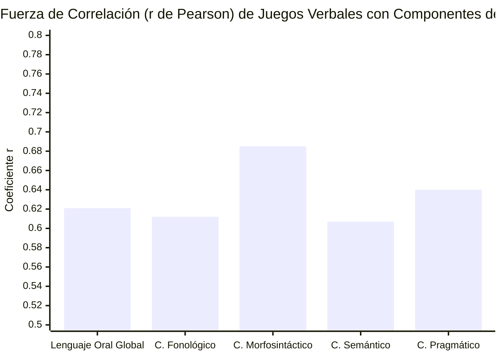

# Ficha de Antecedente: Condori Ramos & Larico Blanco (2022)

> [!INFO] Referencia Bibliográfica Formal (APA 7)
> Condori Ramos, Y. N., & Larico Blanco, M. B. (2022). *Aplicación de juegos verbales para desarrollar la expresión oral en niños y niñas de la Institución Educativa Huayruruni 1049, 2021* [Tesis de licenciatura en Educación Inicial, Universidad José Carlos Mariátegui]. Repositorio Institucional UJCM.

---

## 🎯 Síntesis Ejecutiva

La investigación determina la relación e influencia de la aplicación de los juegos verbales (adivinanzas, trabalenguas y rimas) en el desarrollo de la expresión oral en niños y niñas de 5 años de la I.E. Huayruruni 1049. A través de un diseño correlacional con medición mediante fichas de observación estandarizadas (18 ítems por variable), el estudio comprobó una **correlación positiva y moderada estadísticamente significativa ($r = 0.621, p = 0.000$)** entre los juegos verbales y la expresión oral global, y de manera específica con el **componente fonológico ($r = 0.612, p = 0.008$)**, demostrando que la práctica lúdica estructurada promueve la fluidez articulatoria, la discriminación auditiva y la superación de bloqueos de pronunciación.

---

## 🔬 Metodología y Diseño de Investigación

- **Tipo de Investigación:** Básica, enfoque cuantitativo, método deductivo-hipotético.
- **Diseño:** No experimental, transversal, nivel descriptivo-correlacional.
- **Población y Muestra:** 9 estudiantes de 5 años (muestra censal) de la Institución Educativa Huayruruni 1049.
- **Técnicas e Instrumentos de Recolección:**
  - *Técnica:* Observación sistemática en aula.
  - *Instrumento V1 (Juegos Verbales):* Ficha de observación de juegos verbales adaptada por Tania Rojas (2017) a partir de Rodríguez & Ketchum (2001); 18 ítems, escala de frecuencia de 3 puntos (*Nunca = 1, Casi siempre = 2, Siempre = 3*). Dimensiones: Adivinanzas, Trabalenguas y Rimas.
  - *Instrumento V2 (Expresión Oral):* Ficha de observación del lenguaje oral adaptada por Tania Rojas (2017) a partir de Condemarín & Medina (1995); 18 ítems, escala de 3 puntos. Dimensiones: Componente Fonológico, Morfosintáctico, Semántico y Pragmático.
  - *Validez y Confiabilidad:* Validez de contenido certificada por juicio de expertos (pertinencia, relevancia y claridad); consistencia interna evaluada mediante coeficiente Alfa de Cronbach.
- **Procesamiento de Datos:** IBM SPSS Statistics v.25; análisis de normalidad (Kolmogorov-Smirnov) y coeficiente de **Correlación de Pearson** ($r$) con significancia bilateral ($p < 0.05$).

---

## 📊 Hallazgos y Correlaciones Estadísticas

| Hipótesis Contrastada | Variable / Dimensión | Coeficiente Pearson ($r$) | Significancia ($p$) | Decisión Estadística |
| :--- | :--- | :---: | :---: | :--- |
| **Hipótesis General** | **Juegos Verbales $\leftrightarrow$ Lenguaje Oral Global** | **$r = 0.621$** | **$p = 0.000$** | **Aceptada** (Relación moderada positiva) |
| **Hipótesis Específica 1** | **Juegos Verbales $\leftrightarrow$ Componente Fonológico** | **$r = 0.612$** | **$p = 0.008$** | **Aceptada** (Relación moderada positiva) |
| **Hipótesis Específica 2** | Juegos Verbales $\leftrightarrow$ Componente Morfosintáctico | $r = 0.685$ | $p = 0.001$ | Aceptada (Relación moderada positiva) |
| **Hipótesis Específica 3** | Juegos Verbales $\leftrightarrow$ Componente Semántico | $r = 0.607$ | $p = 0.004$ | Aceptada (Relación moderada positiva) |
| **Hipótesis Específica 4** | Juegos Verbales $\leftrightarrow$ Componente Pragmático | $r = 0.640$ | $p = 0.009$ | Aceptada (Relación moderada positiva) |

### Diagnóstico Inicial en Niños de 5 años
- **Nivel en Juegos Verbales:** Regular en un 44.4%, Alto en un 33.3%, Bajo en un 22.3%.
- **Nivel en Expresión Oral:** Regular en un 55.6%, Alto en un 22.2%, Bajo en un 22.2%.
- **Dimensión Fonológica:** El 55.6% se encontraba en nivel regular y el 11.1% en nivel bajo, caracterizado por sustituciones y omisiones articulatorias.

---

## 💬 Citas y Extractos Clave

> [!QUOTE] Función de los Juegos Verbales en la Fonología Infantil (p. 1, citando a Cherres, 2018)
> *"Los juegos verbales, los cuales comprenden poesías, rimas, trabalenguas, chistes, dramatizaciones, adivinanzas y refranes, pueden aportar significativamente a la mejora de la expresión oral del estudiante, de manera que el emplear los juegos verbales favorecerá proporcionalmente la evolución de diferentes habilidades en los niños como: la expresión oral, la discriminación auditiva y la conciencia fonológica."*

> [!QUOTE] Importancia Articulatoria de los Trabalenguas y Rimas (p. 14, citando a Peña, 2019 y Tamayo, 2013)
> *"Los trabalenguas tienen un papel relevante, pues existe un juego de palabras que poseen sonidos similares, conformando dificultad para la rápida dicción... ejercita la pronunciación, articulación y fluidez del lenguaje... En tanto que las rimas permiten la repetición de fonemas secuenciales que fortalecen la conciencia auditiva."*

> [!QUOTE] Teoría Sociocultural y el Juego (p. 21, citando a Vigotsky, 1998)
> *"El desarrollo del lenguaje del niño se da de lo social a lo individual... El juego infantil es un mecanismo que permite la expresión, además de ser una herramienta de conocimiento, socialización, compensación, regulación y afectividad."*

---

## 💡 Aporte y Articulación con el Proyecto

**Artículo:** *Aplicación fono-lúdica enfocada en la mejora de la articulación fonética en aplicaciones educativas en estudiantes de nivel preescolar de Lima Metropolitana*

- **Sustento del Enfoque Fono-Lúdico:** Proporciona respaldo empírico contundente de que las actividades basadas en **juegos verbales** generan una correlación estadísticamente robusta ($r = 0.612$) en el componente fonológico infantil.
- **Tipología de Mecánicas de Juego en la App:** Justifica la inclusión de tres dinámicas centrales en la aplicación móvil:
  1. *Trabalenguas gamificados:* Para entrenar la destreza motora bucofacial y la agilidad de coarticulación.
  2. *Rimas interactivas:* Para reforzar la discriminación auditiva fonémica y la rima silábica (*onset-rime*).
  3. *Adivinanzas por voz:* Para enlazar el reconocimiento léxico-semántico con la emisión fonética clara.
- **Validación del Enfoque Formativo:** Reitera que los niños en etapa preescolar (5 años) que reciben estimulación lúdica reducen la timidez y elevan significativamente su nivel comunicativo sin la presión de métodos mecanicistas aburridos.

---
[[Proyecto/Antecedentes/Antecedentes|⬅️ Volver a Antecedentes del Proyecto]] | [[Proyecto/Proyecto|Proyecto 🚀]]
