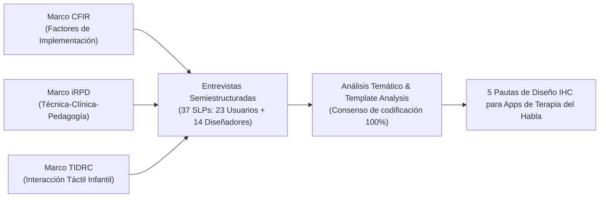

# Ficha de Antecedente: Du et al. (2023) - IJLCD

> [!INFO] Referencia Bibliográfica Formal (APA 7)
> Du, Y., Lubniewski, K., Price, L., Breslin, G., Thomson, P., Jinadasa, N., & Soni, N. (2023). “They Can’t Believe They’re a Tiger”: Insights from pediatric speech-language pathologist mobile app users and app designers. *International Journal of Language & Communication Disorders*, 58(5), 1717–1737. https://doi.org/10.1111/1460-6984.12898

---

## 🎯 Síntesis Ejecutiva

Primer estudio empírico cualitativo a gran escala que investiga las prácticas clínicas, necesidades y directrices de diseño tecnológico de **37 fonoaudiólogos pediatras (SLPs)** con roles duales como usuarios clínicos ($n=23$) y diseñadores de sus propias aplicaciones móviles ($n=14$). Utilizando los marcos teóricos **CFIR** (*Consolidated Framework for Implementation Research*), **iRPD** (*Research, Practice, and Design for iPad Apps*) y **TIDRC** (*Touchscreen Interaction Design Recommendations for Children*), el estudio analizó 284 apps comerciales y sintetizó un marco de directrices de diseño en 5 dimensiones (gestión de datos, diseño visual-auditivo, contenido, interacción y personalización). El trabajo destaca la necesidad de diseñar aplicaciones centradas en el niño pero apoyadas por el clínico/padre, con interfaces libres de publicidad distractora, retroalimentación multimodal y biofeedback articulatorio.

---

## 🔬 Metodología y Marcos Teóricos

- **Participantes:** 37 fonoaudiólogos colegiados especializados en atención pediátrica (EE.UU., China, Malasia y Suecia):
  - *23 SLP App Users:* Clínicos en escuelas públicas/privadas, hospitales infantiles, clínicas universitarias y telepráctica.
  - *14 SLP App Designers:* Clínicos que además han liderado el diseño y desarrollo de aplicaciones móviles comerciales para terapia.
- **Categorización del Corpus Analizado:** 284 aplicaciones móviles clasificadas en:
  1. *Speech-language apps:* Terapia directa de fonemas, articulación y lenguaje (ej. *Articulation Station*, *Little Stories Pro*).
  2. *AAC apps:* Sistemas de comunicación aumentativa y alternativa (ej. *Proloquo2Go*).
  3. *Recreational / game apps:* Videojuegos de causa-efecto y motivación (ej. *Cut the Rope*, *Finger Drums*, *ChatterPix*).
- **Procedimiento de Análisis:** Dos rondas de codificación cualitativa mediante *Thematic Analysis* y *Template Analysis* con doble ciego y verificación cruzada inter-evaluadores.

---

## 🎨 Las 5 Pautas de Diseño e Interacción Humano-Computador (IHC)

El estudio sintetiza recomendaciones prácticas directamente aplicables al desarrollo de software fono-lúdico:

| Dimensión de Diseño | Requerimientos Clínicos / IHC Identificados | Directrices Técnicas para Desarrolladores |
| :--- | :--- | :--- |
| **1. Gestión de Datos (Data Management)** | Automatizar la medición del progreso y reducir la carga administrativa del clínico/padre. | • Seguimiento automático de aciertos/errores en cada sesión. • Controles en segundo plano (*back-end*) para ajustar número de ensayos, nivel de pistas (*cues*) y ritmo de presentación. • Generación de reportes exportables para padres y educadores. |
| **2. Diseño Visual y Auditivo (Visual-Audio Design)** | Evitar la sobrecarga sensorial en niños preescolares y ofrecer modelos articulatorios claros. | • **Child-driven interface:** Botones grandes, claros y de interacción táctil intuitiva. • **Biofeedback fónico:** Animaciones que representen la posición de la lengua y órganos bucofaciales para fonemas difíciles como $/r/$. • Estética limpia: Evitar animaciones caóticas, destellos o ruidos molestos que distraigan a niños neurodivergentes (ej. TEA). • Opciones de alto contraste visual (ej. fondos oscuros con texto/iconos amarillos para deterioro visual cortical). |
| **3. Diseño de Contenidos (Content Design)** | Adecuación curricular y lingüística a la edad preescolar. | • Bancos de palabras clasificados por posición del fonema (inicial, medial, final) y complejidad silábica. • Instrucciones guiadas por voz (*spoken read-aloud*) para niños no lectores. • Filtros faciales divertidos (ej. transformarse en tigre o perro) para desinhibir la expresión oral. |
| **4. Diseño de Interacción (Interaction Design)** | Transformar el software de pantalla pasiva en experiencia interactiva compartida. | • Mecánicas de **arrastrar y soltar (*drag-and-drop*)** y selección directa. • Refuerzos positivos contingentes e inmediatos (*“¡Buen trabajo!”, “¡Lo lograste!”*). • Uso activo del micrófono del dispositivo para grabación y autoescucha inmediata (*playback*). • Modo *"Easy Play"* de baja demanda motora para infantes pequeños. |
| **5. Personalización (Customisation)** | Sostener la motivación intrínseca a largo plazo. | • Selección de avatares, temas favoritos y personajes elegidos por el infante. • Capacidad de incorporar fotos del entorno real del niño (su mascota, su habitación) dentro de las actividades. |

---

## ⚖️ Factores Influyentes en la Adopción de Apps

1. **Factores Éticos y Publicidad:** Los clínicos rechazan enérgicamente las aplicaciones con publicidad emergente (*ads*), pop-ups o compras dentro de la app (*in-app purchases*). La publicidad distrae al niño, destruye la intención terapéutica y genera riesgos éticos de privacidad.
2. **Factores Socioculturales y Localización:** Existe una grave carencia de apps diseñadas y calibradas para idiomas distintos al inglés. Las adaptaciones directas suelen fracasar si no respetan el sistema fonológico y las particularidades culturales locales del habla infantil.
3. **Rol del Juego Intrínseco:** El juego no debe ser un mero "premio" externo al final de una tarea aburrida, sino que el aprendizaje articulatorio debe estar embebido de manera intrínseca en la mecánica lúdica (*gameplay*).

---

## 💬 Citas y Extractos Clave

> [!QUOTE] La Falacia de la Práctica Articulatoria Mecánica (p. 1725)
> *"When working on articulation, the conventional therapy practice is showing children a picture to elicit the given sound. This interaction is 'very robotic', but new technology can allow us to have sounds and maybe videos and different types of games... promoting equity and access to play using digital tools during therapy."*

> [!QUOTE] Rechazo a la Publicidad en Software Infantil Terapéutico (p. 1728)
> *"Some SLPs were worried about children clicking on inappropriate items during app use. School SLP P6 stated: 'I cannot have ads. That is just not a therapeutic tool'... Ads take away children’s attention from the task at hand and reduce the effectiveness of the app within the therapy session."*

> [!QUOTE] Enfoque de Diseño Centrado en el Niño y Apoyado por el Clínico (p. 1732)
> *"Taking a new design approach that is child-centred but clinician-supported is critical... During an experiment or efficacy study about apps, children are frequently seen as only a tester with limited agency, rather than being an informant or a participatory design partner in user-centred design research."*

---

## 💡 Aporte y Articulación con el Proyecto

**Artículo:** *Aplicación fono-lúdica enfocada en la mejora de la articulación fonética en aplicaciones educativas en estudiantes de nivel preescolar de Lima Metropolitana*

- **Marco Canónico de Requisitos de IHC:** Proporciona la justificación teórica y empírica para todas las decisiones de diseño de interfaz de la app:
  - Interfaz orientada a preescolares no lectores (audio-guía y significantes gráficos sin dependencia de texto).
  - Integración de autoescucha y grabación por micrófono como herramienta de biofeedback auditivo.
  - Exclusión total de publicidad para cumplir con los estándares de seguridad y ética infantil.
- **Modelo "Child-Centred, Clinician/Parent-Supported":** Orienta la arquitectura de la app fono-lúdica hacia una interacción dual: el niño disfruta de un videojuego interactivo con avatares y mecánicas motivadoras, mientras la app registra en segundo plano las métricas articulatorias para consulta de la docente de inicial o de los padres.

---
[[Proyecto/Antecedentes/Antecedentes|⬅️ Volver a Antecedentes del Proyecto]] | [[Proyecto/Proyecto|Proyecto 🚀]]
