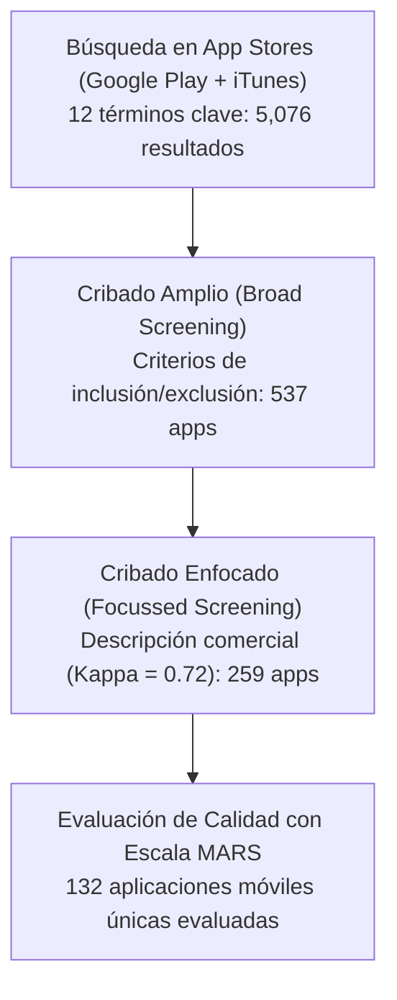
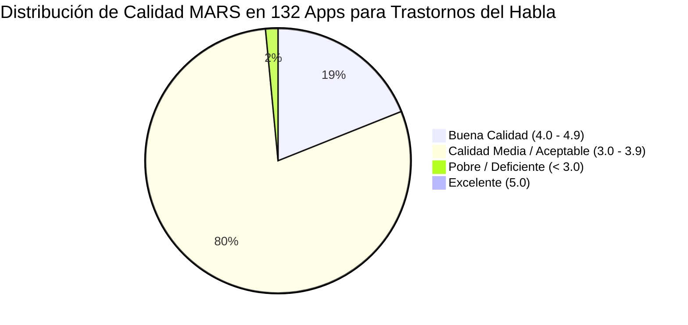

# Ficha de Antecedente: Furlong et al. (2018) - PLOS ONE

> [!INFO] Referencia Bibliográfica Formal (APA 7)
> Furlong, L., Morris, M., Serry, T., & Erickson, S. (2018). Mobile apps for treatment of speech disorders in children: An evidence-based analysis of quality and efficacy. *PLOS ONE*, 13(8), e0201513. https://doi.org/10.1371/journal.pone.0201513

---

## 🎯 Síntesis Ejecutiva

Revisión sistemática pionera y rigurosa bajo directrices **PRISMA** que evalúa la calidad técnica, usabilidad y potencial de cambio conductual/terapéutico de las aplicaciones móviles para trastornos del habla infantil en las tiendas *Google Play* y *Apple App Store*. De un universo inicial de 5,076 aplicaciones, se tamizaron y evaluaron exhaustivamente **132 aplicaciones móviles únicas** mediante la escala estandarizada **MARS (*Mobile Application Rating Scale*)**. Los resultados revelaron que la calidad general promedio es apenas moderada ($3.7 / 5.0$), **ninguna aplicación alcanzó la calificación de excelente (5.0)**, y solo **19 aplicaciones (14%)** demostraron un beneficio terapéutico comprobado con base en principios de práctica clínica basada en evidencia. El estudio cataloga los graves errores de diseño lingüístico, fonético y pedagógico predominantes en el mercado comercial.

---

## 🔬 Metodología y Protocolo de Evaluación

- **Plataformas Analizadas:** Google Play (Android) y Apple App Store (iOS en iPad e iPhone).
- **Herramienta de Evaluación de Calidad:** *Mobile Application Rating Scale (MARS)* (Stoyanov et al., 2015), escala de 5 puntos evaluada por dos fonoaudiólogas investigadoras independientes con alta confiabilidad inter-evaluador ($\text{ICC} = 0.72$):
  1. *Engagement (Compromiso / Motivación):* 5 ítems (interactividad, personalización, diversión).
  2. *Functionality (Funcionalidad):* 4 ítems (rendimiento, facilidad de uso, navegación y gestos).
  3. *Aesthetics (Estética):* 3 ítems (diseño visual, gráficos, distribución y diagramación).
  4. *Information Quality (Calidad de Información):* 7 ítems (precisión clínica, evidencia empírica).
  5. *Subjective Quality (Calidad Subjetiva):* Recomendación de uso y calificación por estrellas.
  6. *Perceived Impact (Impacto Percibido):* Potencial para incrementar la precisión fonética o reducir errores articulatorios.

---

## 📊 Hallazgos y Métricas de Calidad de Software

1. **Puntuación Promedio Global:** $3.7 \pm 0.3$ (rango entre 2.5 y 4.6).
2. **Dimensiones Mejor y Peor Valoradas:**
   - *Funcionalidad* obtuvo la puntuación más alta en la mayoría de las apps (pocos cierres forzados en iOS, aunque 6 apps en Google Play crasheaban en el primer minuto).
   - *Alineación con Evidencia Terapéutica e Impacto Conductual* fue la más deficiente: **solo el 14% (19 de 132 apps)** evidenció mecanismos válidos para promover una mejora articulatoria sostenida.
3. **Las 5 Apps con Mejor Puntuación:**
   - *Articulation Station Pro* (4.6)
   - *Apraxia RainbowBee* (4.5)
   - *Articulation Scenes* (4.5)
   - *Speech with Milo Articulation Board Game Pro* (4.4)
   - *Articulate it! Pro* (4.4)
4. **Barrera Económica:** Las aplicaciones de mejor calidad tenían precios elevados (entre \$29.99 y \$89.99 AUD / aprox. \$20 a \$60 USD), inaccesibles para familias de bajos recursos, mientras que las apps gratuitas estaban saturadas de anuncios intrusivos.

---

## ⚠️ Errores Críticos Identificados en Apps Comerciales

El estudio identificó fallas graves que invalidan el valor de muchas aplicaciones y que deben evitarse en un nuevo diseño:

1. **Contaminación Fonética en Palabras Meta:** En muchas apps, el fonema a evaluar aparece repetido en la misma palabra (ej. usar *"cake"* para evaluar $/k/$ inicial, teniendo el fonema $/k/$ tanto al inicio como al final), lo que confunde la retroalimentación del niño.
2. **Inadecuación del Vocabulario:** Uso de términos complejos ajenos al vocabulario infantil (ej. *"misnomer"* para evaluar el grupo $/sn/$ medial).
3. **Ausencia de Filtrado por Estructura Silábica:** No permiten aislar palabras monosilábicas o bisilábicas sencillas de palabras polisilábicas complejas.
4. **Inserción Antinatural de Vocales Neutras (Schwa):** Al modelar consonantes aisladas, muchas apps pronuncian [kə] en lugar del sonido fonético puro $[k]$.
5. **Modelos de Voz Sintética Robotizada:** El uso de voces artificiales de baja calidad deforma la percepción auditiva del infante, impidiendo una discriminación acústica precisa.
6. **Frases Transportadoras Incoherentes:** Apps que usan estructuras repetitivas artificiales que carecen de sentido semántico (ej. *"I keep bake, I keep raccoon"* para el fonema $/k/$).

---

## 💬 Citas y Extractos Clave

> [!QUOTE] Desconexión entre Estética Comercial y Beneficio Clínico (p. 9)
> *"The total MARS score describes the overall quality of an app which does not necessarily correlate with therapeutic benefit. An app can achieve a high total MARS score assuming it functions adequately, is engaging and aesthetically pleasing; however, it may not always be clinically useful."*

> [!QUOTE] La Falta de Base de Evidencia en Tiendas Digitales (p. 9)
> *"High quality apps are sometimes obscured by a large number of irrelevant or low quality ones. Ambiguous titles, broad marketing descriptions and reviews from potentially questionable sources mean that consumers are sometimes at risk of purchasing apps which might be of little therapeutic value... other studies have also identified a mismatch between the commercial and scientific domains of mHealth."*

> [!QUOTE] Requisitos de Personalización y Complejidad (p. 8)
> *"Apps rated of good quality provided numerous options for customisation including the ability to choose the position of the phoneme in the target words, the syllable structure of the target words and the level of linguistic complexity."*

---

## 💡 Aporte y Articulación con el Proyecto

**Artículo:** *Aplicación fono-lúdica enfocada en la mejora de la articulación fonética en aplicaciones educativas en estudiantes de nivel preescolar de Lima Metropolitana*

- **Lista de Antipatrones de Diseño Fonético que la App Evitará:**
  - Evitar palabras donde el fonema meta coexista en múltiples posiciones.
  - Seleccionar estrictamente vocabulario preescolar infantil validado culturalmente para **Lima Metropolitana**.
  - Emplear audio de alta definición grabado por locutores humanos nativos, evitando síntesis de voz robotizada o agregados vocálicos parásitos.
- **Instrumento de Evaluación de Usabilidad en IHC:** Proporciona la **escala MARS** como métrica estandarizada que puede emplearse en el artículo para evaluar multidimensionalmente la calidad del prototipo de software (engagement, funcionalidad, estética e información).
- **Oportunidad de Innovación Social:** Evidencia que las pocas aplicaciones de calidad son anglosajonas y de costo prohibitivo (\$30 a \$90), fundamentando el valor pedagógico y social de desarrollar una **aplicación fono-lúdica accesible y contextualizada en español** para preescolares de Lima Metropolitana.

---
[[Proyecto/Antecedentes/Antecedentes|⬅️ Volver a Antecedentes del Proyecto]] | [[Proyecto/Proyecto|Proyecto 🚀]]
