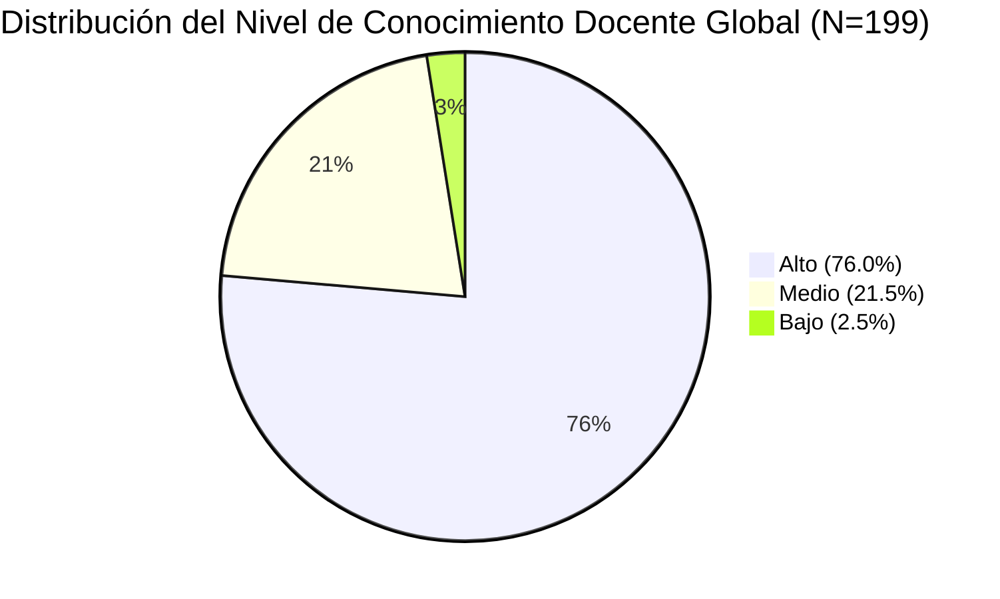

# Ficha de Antecedente: Huertas Domínguez & Roque Palacios (2023)

> [!INFO] Referencia Bibliográfica Formal (APA 7)
> Huertas Domínguez, K., & Roque Palacios, J. A. (2023). *Conocimiento sobre el desarrollo y dificultades fonológicas en docentes del nivel inicial de instituciones educativas privadas de Piura y Lima Metropolitana* [Tesis de maestría, Pontificia Universidad Católica del Perú]. Repositorio Institucional PUCP.

---

## 🎯 Síntesis Ejecutiva

La investigación evalúa y compara el nivel de conocimiento que poseen los docentes de educación inicial de instituciones privadas de **Lima Metropolitana** y **Piura** acerca del desarrollo fonológico, los Procesos de Simplificación Fonológica (PSF), la conciencia fonológica y las dificultades fonológicas en preescolares. Mediante una muestra de 199 docentes evaluadas con un cuestionario de 23 ítems validado por juicio de expertas ($\alpha = 0.771$), el estudio concluyó que no existen diferencias estadísticamente significativas globales entre ambas ciudades ($U = 4620.500, p = 0.272$), ubicándose la mayoría en un nivel alto (76%) o medio (21%). No obstante, resalta la necesidad imperiosa de herramientas prácticas para la detección e intervención temprana en el aula preescolar, pues los PSF no superados derivan en trastornos de lectoescritura.

---

## 🔬 Metodología y Diseño de Investigación

- **Tipo de Investigación:** Básica, enfoque cuantitativo.
- **Diseño:** No experimental, transversal, descriptivo-comparativo mediante diseño de encuestas.
- **Población:** 32,072 docentes de nivel inicial de colegios privados de Lima y Piura.
- **Muestra:** 200 docentes seleccionadas por muestreo no probabilístico intencional (100 de Piura y 100 de Lima Metropolitana; 199 válidas: 99 Lima y 100 Piura). Criterio de inclusión: docentes peruanas en ejercicio durante 2022 en aulas de 3, 4 y 5 años.
- **Instrumento:** *Cuestionario sobre el desarrollo y dificultades fonológicas en preescolares* (Huertas & Roque, 2022), administrado en Google Forms.
  - 23 ítems dicotómicos distribuidos en 4 dimensiones:
    1. *Desarrollo fonológico* (ítems 1 al 6).
    2. *Procesos de simplificación fonológica (PSF)* (ítems 7 al 12).
    3. *Conciencia fonológica* (ítems 13 al 17).
    4. *Dificultades fonológicas* (ítems 18 al 23).
  - **Validez:** De contenido por juicio de 6 expertas en fonoaudiología infantil.
  - **Confiabilidad:** KR-20 / Alfa de Cronbach de $\alpha = 0.771$ (77.1% de consistencia interna).
- **Procesamiento Estadístico:** SPSS Statistics v.27; estadísticos descriptivos (frecuencias, porcentajes) y prueba no paramétrica **U de Mann-Whitney** para contraste de hipótesis ($\alpha = 0.05$).

---

## 📊 Hallazgos y Resultados Principales

1. **Hipótesis General ($p = 0.272$):** Se acepta la hipótesis nula ($H_0$). El nivel de conocimiento general sobre desarrollo y dificultades fonológicas es estadísticamente equivalente entre docentes de Lima Metropolitana (rango promedio = 103.33) y Piura (rango promedio = 96.71).
2. **Desarrollo Fonológico ($p = 0.000 < 0.05$):** Se encontró diferencia estadísticamente significativa en esta dimensión específica ($U = 3516.5, Z = -4.138$), con un rango promedio superior en docentes de Piura (114.34 vs 85.52 en Lima).
3. **Procesos de Simplificación Fonológica (PSF) ($p = 0.636$):** Sin diferencias significativas entre ciudades. El 60.8% de docentes se situó en nivel alto, 32.2% en nivel medio y 7.0% en bajo.
4. **Conciencia Fonológica ($p = 0.191$):** Sin diferencias significativas. El 73.4% obtuvo nivel alto.
5. **Dificultades Fonológicas ($p = 0.869$):** Sin diferencias significativas. El 79.4% se ubicó en nivel alto.
6. **Contraste con la Realidad Clínica:** Aunque los docentes muestran buen nivel conceptual, el estudio advierte una paradoja frente a los reportes del Ministerio de Salud (MINSA, 2020), que alertan un incremento sustantivo de trastornos del habla en preescolares tras el confinamiento, evidenciando una brecha entre el saber teórico del docente y la falta de instrumentos lúdicos-tecnológicos para la ejercitación guiada en los infantes.

---

## 💬 Citas y Extractos Clave

> [!QUOTE] Justificación del Desarrollo Fonológico Preescolar (p. 3)
> *"Gran parte del profesorado no cuenta con información acerca de las señales que permiten detectar a los niños con dificultades de lenguaje. Este conocimiento del desarrollo fonológico es indispensable si se quiere evitar dificultades en el lenguaje oral que posteriormente repercuten en otras habilidades que el niño necesitará para tener un buen desempeño escolar... para el cual es de suma importancia el dominio consciente de los sonidos del habla que posean los niños para dar paso al proceso de conversión del fonema en grafema."*

> [!QUOTE] Causas de los Procesos de Simplificación Fonológica (p. 16, citando a González, 1989)
> *"Los infantes simplifican las palabras que producen por tres causas probables: (1) capacidad de memoria limitada que les impediría recordar la palabra adulta completa; (2) limitación en la representación mental de la palabra; y (3) limitadas capacidades articulatorias condicionadas por la maduración neuromuscular, de allí que no logran producciones adultas hasta desarrollar la destreza adecuada."*

> [!QUOTE] Dimensiones de los PSF a erradicar hacia los 5-6 años (p. 20)
> *"En los procesos relacionados con la estructura de la sílaba y de la palabra se suprimen codas o se reducen grupos consonánticos... En los de asimilación un fonema se hace igual a otro... En los de sustitución se cambia un fonema por otro (p. ej. oclusivización de fricativos). Estos procesos son esperados hasta los 4 años de edad."*

---

## 💡 Aporte y Articulación con el Proyecto

**Artículo:** *Aplicación fono-lúdica enfocada en la mejora de la articulación fonética en aplicaciones educativas en estudiantes de nivel preescolar de Lima Metropolitana*

- **Fundamentación del Contexto Geográfico:** Aporta evidencia directa sobre la realidad educativa de los colegios de **Lima Metropolitana**, justificando que las soluciones deben diseñarse teniendo en cuenta el ecosistema pedagógico de la capital.
- **Definición de Requisitos Fonéticos:** Entrega la tipología exacta de los **Procesos de Simplificación Fonológica (PSF)** que los niños de 3 a 5 años cometen con mayor frecuencia (omisión de codas, reducción de sinfones consonánticos, sustitución de fricativas por oclusivas). Estos patrones deben constituir los niveles de progresión y mecánicas de validación en la app educativa.
- **Identificación de la Brecha:** Demuestra que, a pesar de que los docentes identifican conceptualmente las dificultades fonológicas, carecen de intervenciones sistemáticas automatizadas en aula, lo cual valida la propuesta de crear una **aplicación fono-lúdica** como herramienta complementaria interactiva.

---
[[Proyecto/Antecedentes/Antecedentes|⬅️ Volver a Antecedentes del Proyecto]] | [[Proyecto/Proyecto|Proyecto 🚀]]
