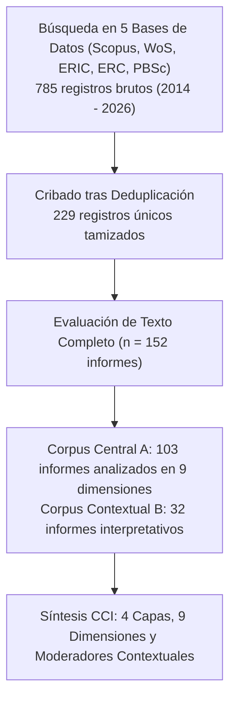
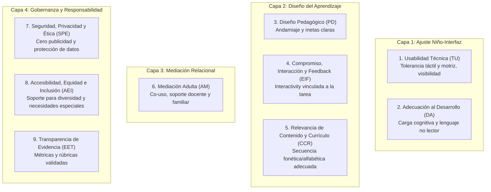

# Ficha de Antecedente: Liu, Chen & Abdul Razak (2026) - MDPI Computers

> [!INFO] Referencia Bibliográfica Formal (APA 7)
> Liu, W., Chen, X., & Abdul Razak, R. (2026). Child–Computer Interaction Quality Criteria for Preschool Educational Applications: A PRISMA-ScR-Informed Scoping Review. *Computers*, 15(8), 485. https://doi.org/10.3390/computers15080485

---

## 🎯 Síntesis Ejecutiva

Revisión de alcance exhaustiva (*Scoping Review*) bajo directrices **PRISMA-ScR** que analiza 103 reportes empíricos centrales (de un universo de 785 registros en 5 bases de datos académicas internacionales entre 2014 y 2026) para responder qué hace que una aplicación móvil sea verdaderamente apta para niños en edad preescolar. El estudio desmantela la etiqueta comercial de "app educativa" como un indicador insuficiente de calidad y propone el **Marco Ecológico de Calidad en Interacción Niño-Computadora (CCI Quality Ecology Framework)**, el cual articula **9 dimensiones operativas agrupadas en 4 capas**: Ajuste Niño-Interfaz, Diseño del Aprendizaje, Mediación Relacional (adulto/docente) y Gobernanza/Ética. Es el marco de referencia contemporáneo más completo para diseñar y evaluar interfaces interactivas infantiles.

---

## 🔬 Metodología y Protocolo PRISMA-ScR

- **Bases de Datos Analizadas:** Scopus, Web of Science, ERIC, Education Research Complete, Psychology and Behavioral Sciences Collection.
- **Criterios de Inclusión:** Publicaciones académicas en inglés enfocadas en aplicaciones para educación inicial/preescolar, evaluando usabilidad, diseño, desarrollo cognitivo, mediación adulta, contenido, privacidad o accesibilidad.
- **Estructura del Corpus:** 103 reportes Central A (26 ensayos controlados aleatorizados, 15 cuasiexperimentales, 12 cualitativos, 10 análisis de contenido de app stores y 10 desarrollos iterativos basados en diseño).
- **Proceso de Codificación:** Matriz de 927 celdas (103 reportes $\times$ 9 dimensiones) con codificación dicotómica estricta (*Yes / Partial / No*) con verificación ciega de casos limítrofes y consenso inter-evaluadores.

---

## 🏛️ El Marco Ecológico de Calidad CCI (4 Capas y 9 Dimensiones)

El estudio organiza la calidad del software infantil en un ecosistema iterativo multidimensional:

### Frecuencias de Reporte y Subcriterios Operacionales (N = 103)

| Capa del Marco | Dimensión de Calidad | Frecuencia (Yes + Partial) | Subcriterios Operacionales para la App Móvil |
| :--- | :--- | :---: | :--- |
| **Ajuste Niño-Interfaz** | **Usabilidad Técnica (TU)** | 72.8% (75/103) | Tolerancia a toques accidentales y gestos infantiles imprecisos, simplicidad de navegación, reducción de carga cognitiva, controles visibles. |
| **Ajuste Niño-Interfaz** | **Adecuación al Desarrollo (DA)** | 90.3% (93/103) | Ajuste a habilidades motrices preescolares, lenguaje adaptado a no lectores, ritmo no apresurado y metas evolutivas significativas. |
| **Diseño del Aprendizaje** | **Diseño Pedagógico (PD)** | 94.2% (97/103) | Andamiaje progresivo (*scaffolding*), progresión lógica de dificultad, retroalimentación que guíe la comprensión y no solo premie. |
| **Diseño del Aprendizaje** | **Compromiso e Interacción (EIF)** | 93.2% (96/103) | Interacción significativa directamente ligada al aprendizaje, bucles de retroalimentación inmediata, gamificación sin distracciones. |
| **Diseño del Aprendizaje** | **Contenido Curricular (CCR)** | 90.3% (93/103) | Rigor disciplinar (fonemas del español), progresión gradual de unidades fónicas y relevancia cultural/lingüística. |
| **Mediación Relacional** | **Mediación Adulta (AM)** | 65.0% (67/103) | Herramientas de co-uso entre niño y adulto (docente/padre), paneles de reporte de avance y preguntas para extender el juego fuera de pantalla. |
| **Gobernanza** | **Seguridad, Privacidad y Ética (SPE)** | 28.2% (29/103) | **Cero publicidad (no ads)**, sin compras integradas (*in-app purchases*), cumplimiento de normativas de privacidad y ética infantil. |
| **Gobernanza** | **Accesibilidad e Inclusión (AEI)** | 59.2% (61/103) | Accesibilidad sensorial (alto contraste, audio-guía), adaptación a niños con retrasos del lenguaje y gratuidad o bajo costo de acceso. |
| **Gobernanza** | **Transparencia de Evidencia (EET)** | 84.5% (87/103) | Rúbricas explícitas de evaluación, justificación del software mediante pruebas empíricas y transparencia de características. |

---

## 💬 Citas y Extractos Clave

> [!QUOTE] La Etiqueta 'Educativa' es Insuficiente (p. 2)
> *"The label educational app is a weak quality signal. Two apps may both contain letters, numbers, stories, puzzles, or rewards while differing sharply in usability, pedagogical coherence, accessibility, privacy protection, and evidential support... learning depends not only on the content presented but also on whether the child can understand, navigate, manipulate, and discuss the activity."*

> [!QUOTE] La Pantalla Pasiva vs. Interacción con Sentido (p. 3)
> *"This is why screen-time alone is an incomplete frame for app quality. The same number of minutes may involve passive tapping, scaffolded problem solving, adult–child conversation, adaptive feedback, open-ended creation, or repetitive reward loops. Treating these experiences as equivalent hides the design decisions that matter most."*

> [!QUOTE] La Usabilidad como Prerrequisito Pedagógico (p. 12)
> *"For preschool users, an interface problem can quickly become a learning problem... An app designed for this age group must therefore be judged not only by its subject matter but also by whether its controls, pacing, representations, feedback, and task demands fit children’s developing capacities."*

---

## 💡 Aporte y Articulación con el Proyecto

**Artículo:** *Aplicación fono-lúdica enfocada en la mejora de la articulación fonética en aplicaciones educativas en estudiantes de nivel preescolar de Lima Metropolitana*

- **Marco Teórico de Interacción Humano-Computador (IHC) para el Artículo:** Proporciona el marco conceptual más actualizado (2026) para justificar la arquitectura de la app fono-lúdica. Permite al artículo estructurar su diseño y evaluación bajo las 4 capas de calidad:
  1. *Ajuste Niño-Interfaz:* Controles táctiles grandes adaptados a la psicomotricidad fina de preescolares de 3 a 5 años; navegación auditiva que elimina la barrera del texto escrito.
  2. *Diseño de Aprendizaje Fono-Lúdico:* Andamiaje secuencial (de fonemas aislados a sílabas y palabras compuestas); retroalimentación inmediata que indica al niño cómo colocar la lengua/labios.
  3. *Mediación Adulta:* Panel para la docente de educación inicial de Lima Metropolitana, permitiéndole supervisar qué fonemas requieren mayor refuerzo en clase.
  4. *Gobernanza Ética:* Garantía de una aplicación completamente segura, libre de publicidad engañosa y con protección de datos infantiles.
- **Rúbrica de Validación para el Proyecto:** Brinda los 9 dominios operativos que se pueden emplear en la fase de discusión y evaluación de la app para demostrar que cumple con los más altos estándares científicos de calidad en tecnología educativa infantil.

---
[[Proyecto/Antecedentes/Antecedentes|⬅️ Volver a Antecedentes del Proyecto]] | [[Proyecto/Proyecto|Proyecto 🚀]]
