# Ficha de Antecedente: Mora et al. (2024)

> [!INFO] Referencia Bibliográfica Formal (APA 7)
> Mora Espinoza, L. M., Mora Espinoza, C. de los Á., Quintero Espinoza, C. V., Villon Gonzabay, W. O., & Yagual Montoya, V. V. (2024). Programa lúdico fonológico para mejorar la dislalia funcional en niños de educación inicial. *Universidad, Ciencia y Tecnología*, 28(Especial), 259–267. https://doi.org/10.47460/uct.v28iSpecial.819

---

## 🎯 Síntesis Ejecutiva

Investigación experimental y aplicada publicada en 2024 que evalúa la efectividad de un **programa lúdico fonológico** diseñado específicamente para tratar la dislalia funcional en **38 niños y niñas de educación inicial (4 a 5 años)**. A través de evaluaciones estandarizadas en pretest y postest que midieron fonemas aislados, mezclas consonánticas (sinfones) y diptongos, el estudio demostró un impacto terapéutico contundente: los casos de **dislalia grave se redujeron del 21% al 0%**, la dislalia moderada cayó del **47% al 5%**, y el porcentaje de niños con **ausencia total de dislalia aumentó drásticamente del 0% al 74%** ($p = 0.01$ en la prueba de rangos con signo de Wilcoxon). El estudio estructura una batería de 5 juegos didácticos (imitación, bingo de sonidos, cuentacuentos, carreras de fonemas y memoria) que proporcionan el modelo de dinámicas lúdicas para aplicaciones educativas.

---

## 🔬 Metodología y Diseño de Investigación

- **Tipo y Enfoque:** Cuantitativo, experimental y aplicado.
- **Diseño Metodológico:** Preexperimental con pretest y postest en un grupo de estudio de medidas repetidas.
- **Población y Muestra:** 38 niños y niñas de 4 y 5 años con diagnóstico inicial de dislalia funcional (dificultad en la articulación de fonemas sin causa orgánica aparente).
- **Dimensiones y Variables Evaluadas:**
  - *Variable Independiente:* Programa lúdico fonológico (conjunto de juegos interactivos y motivadores).
  - *Variable Dependiente:* Nivel de dislalia funcional (articulación de fonemas específicos, mezclas/sinfones y diptongos; inteligibilidad del habla).
  - *Tipificación de Errores:* Omisión, sustitución, distorsión y adición de fonemas en posiciones inicial, medial y final.
  - *Fonemas Críticos Evaluados:* Fonemas de alta precisión motora: $/r/, /s/, /l/, /z/$.
  - *Mezclas y Sinfones Evaluados:* Plátano/planta ($Pl$), brisa/brazo ($Br$), tren/tres ($Tr$), grito/grande ($Gr$), fresa/frío ($Fr$).
  - *Pruebas de Inteligibilidad:* Capacidad de comprensión del discurso del niño ante oyentes no familiarizados.
- **Análisis Estadístico:**
  - Prueba de normalidad de **Shapiro-Wilk** ($gl = 38$): evidenció distribución no normal en todas las dimensiones ($p < 0.05$; dislalia funcional $p = 0.039$, fonemas $p = 0.001$, mezclas $p = 0.002$, diptongos $p = 0.013$).
  - Prueba no paramétrica de **Wilcoxon para muestras emparejadas**: arrojó $p = 0.01 < 0.05$, rechazando la hipótesis nula ($H_0$) y confirmando diferencias significativas atribuibles al programa lúdico.
  - Prueba de **Kruskal-Wallis**: confirmó que el programa fue estadísticamente efectivo para todos los subgrupos sin importar su nivel de severidad inicial.

---

## 🎲 Batería de Juegos del Programa Lúdico Fonológico

El artículo describe 5 juegos fono-lúdicos diseñados para el aula preescolar, cuya mecánica es directamente trasladable a mini-juegos digitales para la app móvil:

| Juego | Objetivo Fonoaudiológico | Mecánica / Dinámica del Juego | Características de Valor para la App |
| :--- | :--- | :--- | :--- |
| **1. Juego de Imitación de Sonidos** | Evaluar y ejercitar la capacidad motriz para reproducir sonidos específicos. | Los niños imitan sonidos emitidos por el educador o avatar: onomatopeyas de animales, objetos o instrumentos musicales. | Permite detectar y corregir errores de sustitución, omisión y distorsión mediante modelado auditivo y visual. |
| **2. Bingo de Sonidos** | Identificar la pronunciación y discriminación correcta de fonemas. | Tarjetas con imágenes de objetos asociados a fonemas específicos. Al escuchar el sonido, deben asociarlo a la ilustración. | Estimula la asociación rápida grafema-fonema-imagen en dinámicas grupales o individuales gamificadas. |
| **3. Cuentacuentos Participativo** | Evaluar la producción y coarticulación de fonemas en contexto natural. | Durante la narración de un cuento interactivo, los niños completan frases o repiten palabras clave con los sonidos meta. | Fomenta la integración en habla espontánea y fluida, evitando el habla aislada o artificial. |
| **4. Carrera de Fonemas** | Reconocer y autocorregir errores específicos de articulación. | Circuito gamificado por estaciones; para avanzar de casilla, el niño debe pronunciar correctamente el nombre del objeto meta. | **Mecánica clave para serious game:** Progresión por niveles, superación de retos y estímulo motivacional continuo. |
| **5. Memoria de Palabras** | Evaluar discriminación auditiva, memoria de trabajo fonológica y articulación. | Clásico juego de memoria tipo *Memory Match*; al voltear y emparejar cartas, el niño debe nombrar el objeto en voz alta. | Ejercita la memoria fonológica y la precisión articulatoria en un formato altamente estructurado y familiar. |

---

## 📊 Resultados Comparativos Pretest vs. Postest

```mermaid
xychart-beta
    title "Evolución del Nivel de Dislalia Funcional Pretest vs. Postest (% de Niños)"
    x-axis ["Dislalia Grave", "Dislalia Moderada", "Dislalia Leve", "Ausencia de Dislalia"]
    y-axis "% de Estudiantes" 0 --> 100
    bar [21, 47, 32, 0]
    bar [0, 5, 21, 74]
```

*(Primera barra = Pretest | Segunda barra = Postest tras el programa lúdico)*

### Métricas Cuantitativas Detalladas (N=38)
- **Dislalia Grave:** Pasó de **21% (8 niños) a 0% (0 niños)** (eliminación total de cuadros severos).
- **Dislalia Moderada:** Se redujo de **47% (18 niños) a solo 5% (2 niños)**.
- **Dislalia Leve:** Disminuyó de **32% a 21%**.
- **Ausencia de Dislalia (Habla Normalizada):** Aumentó drásticamente de **0% a 74% (28 niños completamente rehabilitados)**.
- **Mezclas y Grupos Consonánticos (Sinfones):** La ausencia de dificultades en mezclas ($Pl, Br, Tr, Gr, Fr$) subió de 0% a más del 70%.
- **Diptongos:** El 76% de los niños alcanzó dominio total de diptongos en el postest, eliminando los errores graves al 100%.

---

## 💬 Citas y Extractos Clave

> [!QUOTE] Justificación del Enfoque Lúdico en la Dislalia (p. 260)
> *"El juego de palabras es un recurso valioso para mejorar las situaciones de dislalia en niños de 4 años... Los problemas de dislalia son alteraciones en la pronunciación de fonemas y un problema de articulación, las cuales van a mejorar si se interviene a tiempo la ejecución de actividades que involucren el paladar, la mandíbula, los labios y la lengua."*

> [!QUOTE] Impacto Emocional y Autoestima (p. 261)
> *"Los niños con dislalia pueden tener problemas para hacerse entender, lo cual puede llevar a frustración y problemas de comunicación. Esto puede impactar su autoestima y su capacidad para interactuar socialmente, además de influir negativamente en su rendimiento académico. A pesar de estas dificultades, la dislalia es un trastorno tratable, y con la intervención adecuada, la mayoría de los niños pueden mejorar significativamente su articulación y pronunciación."*

> [!QUOTE] Efectividad y Personalización de la Intervención (p. 266)
> *"La reducción drástica en los casos de dislalia grave (de 21% a 0%) y moderada (de 47% a 5%) indica que los juegos no solo lograron disminuir las dificultades más severas, sino que también promovieron un ambiente de aprendizaje interactivo y motivador... Una de las observaciones más destacadas es la mejora en la inteligibilidad del habla de los niños... con un aumento al 74% en ausencia de dislalia."*

---

## 💡 Aporte y Articulación con el Proyecto

**Artículo:** *Aplicación fono-lúdica enfocada en la mejora de la articulación fonética en aplicaciones educativas en estudiantes de nivel preescolar de Lima Metropolitana*

- **Conceptualización del Término 'Fono-Lúdico':** Este estudio legitima teórica y empíricamente el término central de su artículo: la unión entre estimulación **fonológica/articulatoria** y dinámicas **lúdico-educativas**.
- **Diseño de Mecánicas de Juego para la App (Gamificación):** Las 5 dinámicas (carrera de fonemas con avance por casillas, memoria fonética con retroalimentación sonora, cuentacuentos interactivo, imitación y bingo) constituyen los **mini-juegos específicos** que su aplicación educativa puede digitalizar.
- **Corpus Fonético de Mezclas (Sinfones):** Entrega la lista de grupos consonánticos problemáticos en preescolares hispanohablantes ($Pl, Br, Tr, Gr, Fr$) con palabras familiares del entorno infantil (*Plátano, Brazo, Tren, Fresa, Grito*), ideales para diseñar los niveles de dificultad del videojuego serio.
- **Validación del Impacto Terapéutico:** Demuestra que las intervenciones lúdicas no son mero entretenimiento, sino herramientas clínicas y pedagógicas capaces de llevar la inteligibilidad del habla al 74% de normalización, lo cual respalda la hipótesis central de su artículo de investigación en Lima Metropolitana.

---
[[Proyecto/Antecedentes/Antecedentes|⬅️ Volver a Antecedentes del Proyecto]] | [[Proyecto/Proyecto|Proyecto 🚀]]
