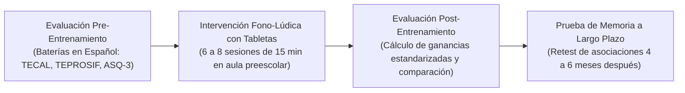

# Ficha de Antecedente: Peña et al. (2024) - Nature npj Science of Learning

> [!INFO] Referencia Bibliográfica Formal (APA 7)
> Peña, M., Vásquez-Venegas, C., Cortés, P., Pittaluga, E., Herrera, M., Pino, E. J., Escobar, R. G., Dehaene-Lambertz, G., & Guevara, P. (2024). A brief tablet-based intervention benefits linguistic and communicative abilities in toddlers and preschoolers. *npj Science of Learning*, 9(1), 38. https://doi.org/10.1038/s41539-024-00249-3

---

## 🎯 Síntesis Ejecutiva

Estudio experimental de alto rigor publicado en *Nature npj Science of Learning* por un consorcio de neurocientíficos e ingenieros (Pontificia Universidad Católica de Chile, Universidad de Concepción y NeuroSpin/INSERM Francia) que evalúa el impacto causal de una intervención fono-lúdica basada en tabletas digitales en **152 niños en edad preescolar (~42 meses / 3.5 años)** y **101 infantes (~24 meses)** de centros educativos públicos de nivel socioeconómico bajo y medio. A través de un diseño de grupos equivalentes con pretest y postest ciego utilizando baterías estandarizadas en español (**TECAL**, **TEPROSIF** de Pavez et al. y **ASQ-3**), el estudio comprobó que el juego en tableta incrementa significativamente la comprensión auditiva del lenguaje ($p = 0.031$), el vocabulario receptivo ($p = 0.019$) y la **frecuencia de vocalizaciones fonéticas activas**. Además, demostró que los niños retuvieron las asociaciones fónicas en la memoria a largo plazo (4 a 6 meses después) con precisiones superiores al 77%.

---

## 🔬 Metodología y Diseño Experimental

- **Población y Muestra:**
  - *Experimento 1 (Toddlers):* 101 niños de ~24 meses (46 Control, 55 Estudio). Baterías: ASQ-3 y CDI MacArthur-Bates.
  - *Experimento 2 (Preschoolers):* 152 niños de ~42 meses (80 Control, 72 Estudio). Baterías: **TECAL** (Comprensión Auditiva del Lenguaje: vocabulario, morfología y sintaxis), **TEPROSIF** (Test para Evaluar Procesos de Simplificación Fonológica) y ASQ-3.
  - Contexto: Jardines infantiles públicos de sectores vulnerables urbanos; fonoaudiólogos evaluadores a ciegas (*blinded assessors*).
- **Arquitectura de Software y Dinámica Fono-Lúdica:**
  - **Sistema de Aplicación Dual:**
    1. *App del Niño:* Videojuego en tableta táctil guiado por una educadora virtual (avatar) con lenguaje interactivo, mirada directa y refuerzo contingente.
    2. *App Tutor / Educador:* Aplicación en segundo plano que permite el monitoreo remoto, calibración de dificultad y registro de datos fónicos por la docente.
  - **Estructura del Ensayo en Tres Fases:**
    1. *Fase de Codificación:* Presentación contingente de la imagen y estímulo sonoro de la palabra o fonema.
    2. *Fase de Reconocimiento:* Selección táctil de la opción correcta con refuerzo social inmediato (aplausos, animaciones).
    3. *Fase de Vocalización Activa (Preschoolers):* La app incita al niño a vocalizar en voz alta la palabra meta (*“¡Uy, se fue! ¡Llama al pato!”*). El micrófono graba el intento del niño y, como refuerzo auditivo inmediato, **la app reproduce la propia voz del niño grabada**.

---

## 📊 Hallazgos Principales y Ganancias Lingüísticas

```mermaid
xychart-beta
    title "Ganancias Estandarizadas en Preescolares (TECAL - Experimento 2)"
    x-axis ["Vocabulario Receptivo", "Total Comprensión TECAL", "Morfología", "Sintaxis"]
    y-axis "Puntuación Estandarizada Z" 1.8 --> 2.3
    bar [2.15, 2.13, 2.14, 2.01]
    bar [2.01, 2.07, 2.04, 2.01]
```

*(Primera barra = Grupo Estudio con Tableta | Segunda barra = Grupo Control)*

1. **Ganancias Significativas en Preescolares (Experimento 2):**
   - El grupo de estudio superó significativamente al grupo control en el subtest de **Vocabulario TECAL** ($Z = -2.34, p = 0.019$, tamaño del efecto $r = -0.12$).
   - Superación significativa en la puntuación total de **Comprensión del Lenguaje TECAL** ($Z = -2.15, p = 0.031$, $r = -0.18$).
   - Regresiones múltiples robustas y ANCOVA demostraron que ni la edad, el sexo, la educación materna ni el nivel socioeconómico explicaban las mejoras, confirmando la **relación causal atribuible al software lúdico**.
2. **Incremento de Vocalizaciones:** La tasa de intentos de vocalización fonética aumentó significativamente a lo largo de las sesiones en los preescolares ($p < 0.001$), demostrando que la interacción con la tableta estimula activamente el aparato fonoarticulador en lugar de provocar pasividad.
3. **Memoria a Largo Plazo Extraordinaria:** En la evaluación de retención realizada de **4 a 6 meses después**, los preescolares reconocieron las asociaciones aprendidas con un **77% de precisión** (frente al 50% de azar), evidenciando que el aprendizaje mediado por tableta se consolida en estructuras cognitivas estables.

---

## 💬 Citas y Extractos Clave

> [!QUOTE] La Pantalla Interactiva como Herramienta de Estimulación Lingüística (p. 2)
> *"Interactive technologies are appealing and engaging to young children who perceive them as play... A tablet-based game is a low-cost tool for supporting early childhood educators' activities, it is attractive for young children, and parents and caregivers are fairly adept at using the technology... If interactive technologies are used in a regulated way, they may provide stimulation support in educational environments where human resources are scarce."*

> [!QUOTE] El Valor de la Fase de Vocalización y Reproducción de Voz (p. 3)
> *"For preschool-aged participants, each trial additionally included a vocalization phase. During this phase, the children were prompted to verbalize the word name of the object or letter-sound... The application recorded the children's vocalizations... and for accurate responses, the application played back the child's vocalization."*

> [!QUOTE] Transferencia Más Allá de la Pantalla (p. 7)
> *"Crucially, toddlers and preschoolers who played the game showed transfer to language and communication abilities (evaluated with standard batteries), a generalization that extends beyond training ability as the holy grail of any intervention study."*

---

## 💡 Aporte y Articulación con el Proyecto

**Artículo:** *Aplicación fono-lúdica enfocada en la mejora de la articulación fonética en aplicaciones educativas en estudiantes de nivel preescolar de Lima Metropolitana*

- **Coincidencia Demográfica y Metodológica Plena:** Es el antecedente experimental más cercano y prestigioso (Nature Portfolio, 2024), realizado en población infantil hispanohablante de centros públicos preescolares urbanos, idéntica a la población de **Lima Metropolitana**.
- **Alineación de Instrumentos con el TEPROSIF:** Emplea el **TEPROSIF** (*Test para Evaluar Procesos de Simplificación Fonológica*), validando el uso de esta misma batería para medir la reducción de dislalias en la evaluación empírica del artículo.
- **Patrón de Interacción Clave (Vocalización + Autoescucha Inmediata):** Proporciona la evidencia científica de que la fase de **vocalización activa frente al micrófono con auto-reproducción inmediata (*playback*)** es la mecánica que más motiva al niño a modular y corregir su propia producción fonética.
- **Arquitectura de Software Dual:** Justifica el desarrollo de dos módulos en la app:
  1. *Interfaz lúdica infantil:* Gamificada con avatares, videos contingentes y refuerzo social.
  2. *Interfaz de supervisión pedagógica (Tutor App):* Para que la docente de educación inicial en Lima registre el avance articulatorio de cada alumno sin interrumpir su juego.

---
[[Proyecto/Antecedentes/Antecedentes|⬅️ Volver a Antecedentes del Proyecto]] | [[Proyecto/Proyecto|Proyecto 🚀]]
