# Ficha de Antecedente: Pucuhuaranga Espinoza (2016)

> [!INFO] Referencia Bibliográfica Formal (APA 7)
> Pucuhuaranga Espinoza, T. N. (2016). Juegos verbales en el desarrollo de la articulación verbal de niños y niñas de cinco años de edad. *Horizonte de la Ciencia*, 6(11), 191–204. Redalyc: 570960869017.

---

## 🎯 Síntesis Ejecutiva

Estudio cuasi-experimental de nivel tecnológico que comprueba de forma rigurosa la influencia de un programa de juegos verbales en la superación de errores de articulación verbal (dislalias simples por omisión, sustitución y distorsión) en 50 niños y niñas de 5 años de la I.E. N° 465 "Sagrado Corazón de Jesús" de Huancayo. Tras la aplicación de una secuencia de actividades fonatorias y juegos lingüísticos en el grupo experimental ($n=23$), se logró que el **46.86% de los errores articulatorios fueran superados significativamente (avance)**, en contraste radical con el grupo control ($n=27$) donde solo el 17.89% superó errores y el 81.30% se mantuvo estancado sin progresos. El estudio valida una metodología fonoarticulatoria de 6 fases y un banco fonético estandarizado de 32 palabras de prueba.

---

## 🔬 Metodología y Diseño de Investigación

- **Tipo y Nivel:** Investigación aplicada, nivel tecnológico, método experimental.
- **Diseño Metodológico:** Cuasi experimental con pre-test y post-test con dos grupos intactos (Grupo Experimental = sección Azucena, $n=23$; Grupo Control = sección Orquídea, $n=27$).
- **Muestra:** 50 infantes de 5 años evaluados al inicio mediante pre-test para determinar la línea base de dislalias funcionales.
- **Instrumento de Medición Fonológica:**
  - *Ficha de Registro de Desarrollo Fonológico* diseñada por la autora integrando aportes de **Laura Bosch (1983)** y la prueba de articulación de **María Melgar (1976)**.
  - Evalúa la emisión espontánea y dirigida de fonemas consonánticos, sinfones (grupos consonánticos) y diptongos en tres posiciones articulatorias: inicial (I), medial (M) y final (F).
  - Tipificación de errores: **Omisiones (O)**, **Sustituciones (S)** y **Distorsiones (D)**.
  - Estimulación visual mediante 16 tarjetas ilustradas con 32 palabras clave.
- **Secuencia Metodológica de Intervención (6 Fases):**
  1. *Ejercicios bucofaciales:* Praxias linguales, labiales y mandibulares.
  2. *Posicionamiento de órganos fonadores:* Guía del punto y modo de articulación.
  3. *Expresión demostrativa:* Modelado por parte de la docente / facilitador.
  4. *Reproducción grupal con acompañamiento:* Rimas y juegos orales en coro.
  5. *Reproducción en pequeños grupos sin acompañamiento.*
  6. *Reproducción individual:* Validación fonética directa de cada niño.

---

## 📊 Resultados Comparativos Cuasiexperimentales

```mermaid
xychart-beta
    title "Comparación del Impacto Articulatorio en Post-Test (% de Casos)"
    x-axis ["Superaron Errores (Avance)", "Se Mantuvieron Igual", "Retroceso"]
    y-axis "% de Errores del Habla" 0 --> 100
    bar [46.86, 50.72, 2.42]
    bar [17.89, 81.30, 0.81]
```

*(Leyenda: Primera barra = Grupo Experimental con Juegos Verbales | Segunda barra = Grupo Control sin Intervención)*

### Estadígrafos de Errores del Habla (Pre-test vs. Post-test)

| Grupo | Momento | Omisiones (O) | Sustituciones (S) | Distorsiones (D) | Total Errores | % Avance Significativo |
| :--- | :---: | :---: | :---: | :---: | :---: | :---: |
| **G. Experimental (Azucena)** | Pre-test | 78 | 120 | 5 | 203 | — |
| **G. Experimental (Azucena)** | **Post-test** | **21** ($\downarrow 73\%$) | **126** | **3** | **150** | **46.86% superados** |
| **G. Control (Orquídea)** | Pre-test | 33 | 88 | 0 | 121 | — |
| **G. Control (Orquídea)** | Post-test | 22 | 89 | 0 | 111 | 17.89% superados |

- **Decisión Estadística:** Con $\alpha = 0.05$ y 2 grados de libertad, se rechazó la hipótesis nula, demostrando con 95% de confianza que los juegos verbales incrementan de manera causal la precisión articulatoria verbal.
- **Fonemas con Mayor Dificultad Identificados en Preescolar:** Vibrante simple $[r]$ y múltiple $[rr]$; sinfones laterales y centrales $[fl, ll, gl, br, fr, tr, kl, bl]$; y diptongos decrecientes $[ei, au]$.

---

## 🗣️ Banco Fonético de las 32 Palabras a Prueba (Bosch & Melgar)

Este corpus fónico es ideal para programar el reconocimiento de voz y las tarjetas interactivas de la app:

| Tarjeta | Palabras a Prueba | Sonidos Evaluados (I, M, F) | Tarjeta | Palabras a Prueba | Sonidos Evaluados (I, M, F) |
| :---: | :--- | :--- | :---: | :--- | :--- |
| **1** | Cara / Diente | `k`, `r` / `d`, `nt` | **9** | Globo / Libro | `gl`, `b` / `br` |
| **2** | Gorro / Fruta | `g`, `rr` / `fr` | **10** | Barco / Tres | `b`, `rk` / `s` final |
| **3** | Mosca / Fuego | `sk`, `k` / `f`, `ue`, `g` | **11** | Estrella / Jabón | `st`, `str` / `j`, `n` |
| **4** | Plancha / Cielo | `pl`, `ch` / `z` | **12** | Blanco / Peine | `bl`, `nc` / `ei`, `n` |
| **5** | Piedra / Flecha | `p`, `ie`, `dr` / `fl`, `z` | **13** | Clavos / Taza | `kl`, `s` / `t`, `z` |
| **6** | Lápiz / Bolsa | `l` / `ls` | **14** | Cristal | `st` |
| **7** | Silla / Rojo | `s`, `ll` / `rr`, `j` | **15** | Espalda | `sp`, `p`, `d` |
| **8** | Jaula / Negro / Tambor / Niño | `au`, `l` / `gr` / `mb`, `rr` / `n`, `ñ` | **16** | Bufanda / Chaqueta | `f`, `nd` / `t` |

---

## 💬 Citas y Extractos Clave

> [!QUOTE] Repercusión en la Lectoescritura (p. 192)
> *"Las dificultades de pronunciación de las palabras que practican los niños y niñas repercutirá inicialmente en el aprendizaje de la lecto escritura ya que ellos escribirán como pronuncian y posteriormente en el proceso de textualización y comprensión lectora... por ello es fundamental su atención e importancia al desarrollo de la articulación verbal debido a que aprovecharemos los primeros años de vida donde el cerebro tiene la máxima plasticidad."*

> [!QUOTE] La Articulación Verbal como Proceso Motor y Sensorial (p. 192, citando a Gallardo, 2009 y Félix, 1999)
> *"La correcta pronunciación está relacionada con el desarrollo de la articulación verbal que es el proceso de interacción de los procesos motores y sensoriales que intervienen en la producción del habla... Hay una variedad de errores que los niños suelen cometer por incapacidad para unir correctamente las sílabas o para emplearlas debidamente en la expresión del lenguaje."*

> [!QUOTE] Procedimiento de los Juegos Verbales (p. 193)
> *"La secuencia metodológica empleada en el desarrollo de los juegos verbales consistió en: ejercicio buco faciales, posicionamiento de los órganos fonadores, expresión demostrativa, reproducción grupal con acompañamiento, reproducción en pequeños grupos sin acompañamiento y reproducción individual."*

---

## 💡 Aporte y Articulación con el Proyecto

**Artículo:** *Aplicación fono-lúdica enfocada en la mejora de la articulación fonética en aplicaciones educativas en estudiantes de nivel preescolar de Lima Metropolitana*

- **Algoritmo de Intervención Fonoarticulatoria para la App:** La secuencia de 6 etapas de Pucuhuaranga puede digitalizarse como el flujo de navegación de la app educativa:
  1. *Calentamiento lúdico:* Animación con praxias bucofaciales (inflar mejillas, mover la lengua).
  2. *Avatar guía demostrativo:* Muestra la posición correcta de labios y lengua (órganos fonadores).
  3. *Repetición guiada (Listen & Repeat):* El niño escucha la palabra modelo con audio de alta fidelidad.
  4. *Desafío de voz interactivo:* El niño emite la palabra frente al micrófono con feedback visual inmediato.
- **Corpus Fónico Validado:** Provee las 32 palabras de prueba exactas y la lista prioritaria de fonemas críticos en niños peruanos de 5 años ($[r, rr]$, sinfones $[bl, cl, fl, gl, pl, br, cr, dr, fr, gr, tr]$ y diptongos), resolviendo el contenido curricular del software.
- **Métricas de Evaluación de Impacto:** Define las variables de medición clínica (reducción de sustituciones, omisiones y distorsiones) que servirán para validar la eficacia pedagógica de la app.

---
[[Proyecto/Antecedentes/Antecedentes|⬅️ Volver a Antecedentes del Proyecto]] | [[Proyecto/Proyecto|Proyecto 🚀]]
