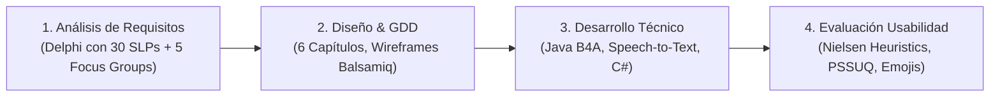
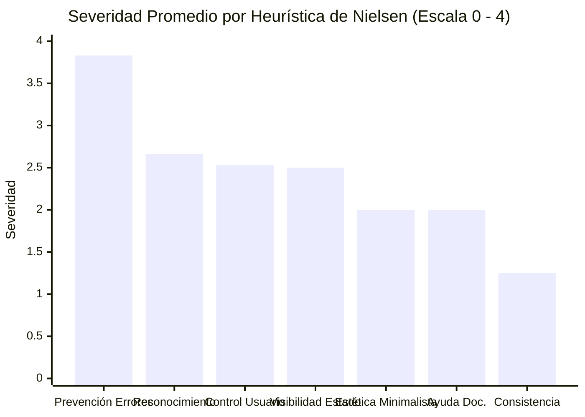

# Ficha de Antecedente: Saeedi et al. (2024) - Nature Scientific Reports

> [!INFO] Referencia Bibliográfica Formal (APA 7)
> Saeedi, S., Ghazisaeedi, M., Ramezanghorbani, N., Seifpanahi, M.-S., & Bouraghi, H. (2024). Design and evaluation of a serious video game to treat preschool children with speech sound disorders. *Scientific Reports*, 14(1), 17299. https://doi.org/10.1038/s41598-024-68119-x

---

## 🎯 Síntesis Ejecutiva

Publicación de alto impacto en *Nature Scientific Reports* que documenta el diseño, desarrollo e inspección de usabilidad de **"Ava"**, un videojuego serio móvil (Android) concebido para el tratamiento en el hogar de niños preescolares (3 a 6 años) con Trastornos de los Sonidos del Habla (Speech Sound Disorders - SSD). El sistema combina el enfoque fonoaudiológico tradicional de **Van Riper** (progresión jerárquica de fonema $\rightarrow$ sílaba $\rightarrow$ palabra $\rightarrow$ oración) con condicionamiento operante lúdico (recompensas de miel y estrellas sin castigo) y tecnología de **reconocimiento de voz (Google Speech-to-Text)** con $>90\%$ de precisión. La evaluación en Interacción Humano-Computador abarcó inspección heurística de Nielsen con 6 expertos (23 problemas únicos identificados), evaluación estandarizada PSSUQ con 22 fonoaudiólogos (satisfacción global de 6.14/7 y calidad de interfaz de 6.25/7) y pruebas directas con 10 niños mediante escalas de emojis (100% de valoración estética positiva).

---

## 🔬 Metodología y Ciclo de Vida del Software (SDLC)

- **Fase 1: Análisis y Requisitos Fonoaudiológicos:**
  - Panel Delphi de 2 rondas con 30 especialistas en patología del habla (SLPs).
  - Se establecieron los contenidos fonéticos: **23 consonantes**, **138 sílabas** (consonante + 6 vocales), **564 palabras** organizadas según posición del fonema (10 iniciales, 10 mediales y 10 finales por consonante) y **69 oraciones** animadas graduales.
- **Fase 2: Diseño de Juego y GDD (Game Design Document):**
  - GDD estructurado en 6 capítulos: introducción, mecánicas centrales, submecánicas, recursos (assets visuales y sonoros), tablas de progreso/premios y descripción de fases.
  - Bocetos iniciales a mano alzada y wireframes interactivos en *Balsamiq Mockups*.
  - Entorno visual inmersivo ambientado en un bosque animado; avatar guía: una abeja interactiva.
- **Fase 3: Desarrollo Tecnológico:**
  - Plataforma objetivo: Android / Smartphone (Java en B4A).
  - Reconocimiento de voz en la nube mediante API de *Google Speech-to-Text*, calibrado para tolerar omisiones y sustituciones infantiles con retroalimentación correctiva auditiva.
  - Dualidad de ayuda: ayuda textual para padres de familia y asistencia por voz/auditiva para los niños no lectores.
- **Fase 4: Evaluación de Usabilidad en IHC:**
  1. *Evaluación Heurística:* 6 expertos evaluaron los 10 principios de Jakob Nielsen (fase de navegación independiente + consolidación).
  2. *Cuestionario PSSUQ (Post-Study System Usability Questionnaire):* 22 SLPs calificaron 16 ítems en escala Likert (1 a 7).
  3. *Pruebas con Usuarios (10 niños con SSD):* Protocolo de observación durante sesiones de 30-45 min y escala visual de 5 emojis (😃 🙂 😐 🙁 😡).

---

## 📊 Hallazgos y Métricas de Usabilidad (IHC)

### 1. Evaluación Heurística (10 Principios de Nielsen - 6 Expertos)
Se identificaron **23 problemas únicos de usabilidad** con una severidad promedio de **2.29** (rango 0 a 4):
- **Problema más severo:** *Prevención de errores (Error Prevention)*, con severidad media de **3.83** (crítico): la app no indicaba visualmente la longitud o número de palabras de la oración esperada, aumentando los fallos del niño.
- **Heurística con mayor número de problemas:** *Control y libertad del usuario (User Control and Freedom)* (5 problemas, severidad 2.53): el juego no permitía cancelar acciones en curso o regresar fácilmente a niveles anteriores sin reiniciar.
- **Distribución de severidad:** 70% cosméticos y menores (leves), 17% mayores y solo 13% catastróficos.
- Principios con 0 problemas detectados: *Correspondencia con el mundo real* y *Flexibilidad/eficiencia de uso*.

### 2. Resultados del Cuestionario PSSUQ (22 Especialistas SLPs)

| Subescala PSSUQ | Ítems | Puntuación Media (/7) | Interpretación Clínica/Técnica |
| :--- | :---: | :---: | :--- |
| **Calidad de Interfaz (INTERQUAL)** | Ítems 13 a 15 | **6.25** | **Máxima puntuación:** Interfaz visual agradable, motivadora y atractiva para infantes. |
| **Utilidad del Sistema (SYSUSE)** | Ítems 1 a 6 | **6.13** | Facilidad de uso, aprendizaje rápido y valor funcional en terapia del habla. |
| **Calidad de la Información (INFOQUAL)** | Ítems 7 a 12 | **5.84** | Claridad en los mensajes en pantalla y recuperación ante fallos. |
| **Satisfacción Global (Overall Satisfaction)** | Ítem 16 | **6.14** | Aceptación masiva por parte de los fonoaudiólogos para uso doméstico. |
| **Promedio General del Sistema** | Total 16 ítems | **6.09 / 7** | Usabilidad altamente satisfactoria ($>87\%$). |

### 3. Resultados de Pruebas con Preescolares (10 Niños con SSD)
- **100% de los niños** consideró que el juego es "hermoso" visualmente.
- **90%** afirmó que le gustó jugar con la aplicación.
- **80%** manifestó agrado por practicar su pronunciación mediante la app.
- **Observaciones críticas de diseño para preescolares:**
  - Los niños de 3 años no lograron completar las tareas solos y requirieron asistencia parental constante.
  - Al momento de grabar su voz, los niños pequeños no reconocían intuitivamente que debían presionar el icono del micrófono; se requirió incorporar un indicador sonoro y de animación pulsante.
  - La ausencia de penalizaciones negativas (no restar puntos) fue clave para evitar llanto, frustración o abandono de la terapia.

---

## 💬 Citas y Extractos Clave

> [!QUOTE] Justificación de la Terapia Móvil y Serious Games en SSD (p. 2)
> *"Speech Sound Disorder (SSD) is one of the most common communication disorders among children, and 10–15% of preschool children experience it... Digital games can increase children’s motivation to continue the treatment and provide appropriate feedback during the treatment process... 48.15% of the games could be used at home under the supervision of parents."*

> [!QUOTE] Enfoque Fono-Lúdico sin Frustración (p. 7-8)
> *"To prevent disappointment, if children do not pronounce the words correctly, no negative points will be given to them, they will simply not receive honey. Also, a golden star is given to children for one-third of the words that are pronounced correctly... To avoid impacting the child’s self-confidence, no points are deducted in the event of a mistake, and the child is simply asked to repeat the desired action."*

> [!QUOTE] Importancia del Diseño No Lector en IHC (p. 13)
> *"Due to the young age of the Ava game users and their inability to read, we tried to communicate with the children and guide them during the game by listening and speaking. In this game, we also tried to pay careful attention to the user experience (UX) related to how the user interacts with the game."*

---

## 💡 Aporte y Articulación con el Proyecto

**Artículo:** *Aplicación fono-lúdica enfocada en la mejora de la articulación fonética en aplicaciones educativas en estudiantes de nivel preescolar de Lima Metropolitana*

- **Arquitectura de Software y Modelo Fono-Lúdico:** Provee el blueprint tecnológico directo para la aplicación:
  1. *Estructura en 4 niveles evolutivos:* (1) Discriminación de sonidos consonánticos $\rightarrow$ (2) Sílabas $\rightarrow$ (3) Palabras con posición fonética inicial/medial/final $\rightarrow$ (4) Oraciones mediante animaciones.
  2. *Reconocimiento de Voz integrado:* Uso de APIs STT para validar la articulación sin intermediación humana obligatoria.
- **Principios de Diseño de Interfaz Centrados en Preescolares (IHC):**
  - *Eliminación de la dependencia de texto:* Navegación guiada por audio y significantes visuales animados (*spoken help* y *visual cues*).
  - *Gamificación positiva sin frustración:* Recompensas intrínsecas (estrellas, coleccionables), ausencia de puntuaciones punitivas o pantallas de derrota que destruyan la autoestima del infante.
- **Marco de Evaluación Riguroso para el Artículo:**
  - El artículo puede replicar este esquema metodológico de evaluación de usabilidad: **Inspección Heurística de Nielsen** por parte de ingenieros de software / evaluadores de usabilidad, validación con docentes/especialistas mediante **PSSUQ**, y pruebas de experiencia de usuario con niños de preescolar mediante **escalas de emojis**.

---
[[Proyecto/Antecedentes/Antecedentes|⬅️ Volver a Antecedentes del Proyecto]] | [[Proyecto/Proyecto|Proyecto 🚀]]
