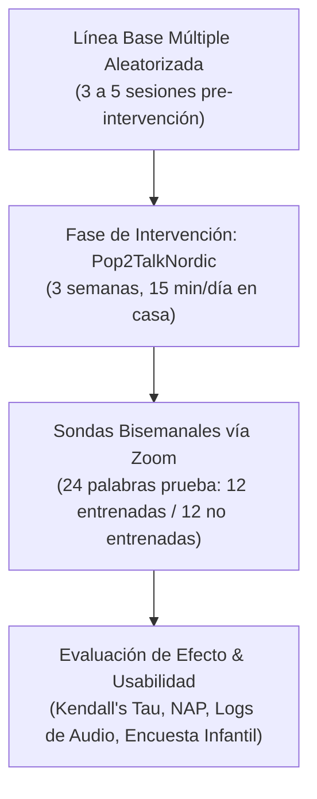
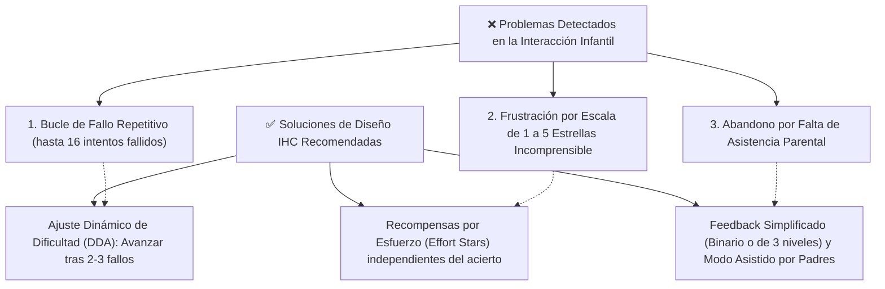

# Ficha de Antecedente: Strömbergsson et al. (2026) - IJLCD

> [!INFO] Referencia Bibliográfica Formal (APA 7)
> Strömbergsson, S., Edlund, E., Pettersson, M., Phan, N., & Kurimo, M. (2026). Self-Supervised App-Based Speech Training for Children With Speech Sound Disorder—A Single-Case Experimental Design Study. *International Journal of Language & Communication Disorders*, 61, e70163. https://doi.org/10.1111/1460-6984.70163

---

## 🎯 Síntesis Ejecutiva

Estudio experimental de caso único (**SCED** con diseño de línea base múltiple entre sujetos) que evaluó el impacto de la aplicación móvil de entrenamiento fono-lúdico **"Pop2TalkNordic"** (videojuego con mecánicas tipo *Candy Crush* y reconocimiento automático del habla ASR) en 4 niños suecos de **4 a 6 años** con Trastornos de los Sonidos del Habla (patrones de *stopping* de fricativas y *velar fronting*). La intervención constó de 3 semanas de entrenamiento en el hogar (15 min/día, 5 días/semana). El estudio arrojó **lecciones críticas para la Interacción Humano-Computador (IHC)**: el entrenamiento no supervisado no logró generalizar mejoras a palabras no entrenadas, la retroalimentación automática por estrellas (1 a 5) tuvo baja correlación con la precisión articulatoria real, y los bucles de fallo reiterado provocaron frustración infantil, demostrando la necesidad imperativa de incorporar **Ajuste Dinámico de Dificultad (DDA)** y **recompensas basadas en el esfuerzo**.

---

## 🔬 Metodología y Diseño Experimental (SCED)

- **Participantes:** 4 niños preescolares (4;4 a 6;2 años) diagnosticados con trastornos fonológicos específicos de desarrollo:
  - *Adam (4;6 años):* Oclusivización de fricativas (*stopping*) y reducción de sinfones consonánticos.
  - *Benjamin (4;4 años), Carl (4;11 años) y Doris (6;2 años):* Anteriorización velar (*velar fronting*, $/k, g/ \rightarrow [t, d]$) y reducción de grupos consonánticos.
- **Diseño del Software (*Pop2TalkNordic*):**
  - Videojuego de puzles tipo *Candy Crush*: el niño destruye caramelos mientras escucha repetidamente la palabra meta (exposición auditiva pasiva de 4 a 6 veces por nivel).
  - Al completar el nivel, la app reproduce la palabra con voz adulta y solicita al niño emitirla por el micrófono.
  - El motor de reconocimiento de voz (ASR) califica la pronunciación con una puntuación de 1 a 5 estrellas.
- **Métricas Cuantitativas Evaluadas:**
  - *Porcentaje de Precisión del Fonema Meta (TA%):* Evaluado auditivamente a ciegas por fonoaudiólogas colegiadas con alta confiabilidad inter-evaluador ($\text{acuerdo} = 89.5\%, \kappa = 0.69$).
  - *Análisis de No Solapamiento de Pares (NAP)* y *Kendall's Tau* para medir la tendencia intra e interfase.

---

## 📊 Hallazgos Clínicos y de Usabilidad Infantil

### 1. Resultados en la Producción Fonética
- Ninguno de los 4 niños logró una mejora articulatoria generalizada hacia palabras no entrenadas.
- En palabras entrenadas directamente en la app, 2 niños (Adam y Carl) mostraron mejoras sutiles ($\text{NAP} = 70\%$, efecto moderado), mientras que Benjamin y Doris no mostraron progresos significativos ($\text{NAP} = 23\%$ y $50\%$).
- La dosis real de producción emitida por los niños fue de solo **7 a 14 esfuerzos articulatorios por sesión** (promedio de 7.1 a 9.0 minutos de juego real), lejos de la dosis clínica recomendada de 50 a 100 producciones por sesión.

### 2. Inconsistencia de la Retroalimentación por Estrellas (ASR)
El análisis cruzado entre las estrellas otorgadas por el algoritmo ASR y la evaluación perceptual de las fonoaudiólogas reveló una **discrepancia crítica**:
- La distribución de 1 a 5 estrellas fue casi idéntica para palabras correctamente articuladas que para palabras con errores (un 56% de las producciones correctas recibió solo 1 estrella, y un 16% de las producciones erróneas recibió 5 estrellas).
- Esto se debió a que el motor ASR evaluaba la palabra de forma holística para aprendizaje de segunda lengua y no estaba entrenado en la fineza fonética de desórdenes del habla infantil.

---

## ⚠️ Lecciones Esenciales de IHC para Aplicaciones Fono-Lúdicas

El artículo expone los principales problemas de experiencia de usuario (UX) que experimentan los niños preescolares y cómo solucionarlos:

1. **Evitar Trampas de Frustración (Dynamic Difficulty Adjustment - DDA):** En el estudio, Benjamin intentó la misma palabra 16 veces seguidas sin poder superar el nivel, lo que provocó risa nerviosa, frustración y rechazo a seguir jugando. **Solución:** La app debe implementar un avance asistido que cambie automáticamente de palabra o reduzca la dificultad tras 2 o 3 intentos no logrados.
2. **Recompensas Basadas en el Esfuerzo (*Effort-Based Rewards*):** No condicionar las estrellas o premios únicamente a la perfección acústica; otorgar "estrellas de esfuerzo" o insignias por intentar hablar, manteniendo alta la motivación intrínseca.
3. **Escala de Feedback Simplificada:** Los preescolares no comprenden los matices de una escala de 1 a 5 estrellas. Es preferible un feedback binario claro (*Logrado / ¡Casi lo tienes, intentémoslo otra vez!*) o de 3 niveles comprensibles.
4. **Variabilidad Acústica y Pares Mínimos:** La app no debe limitarse a un único modelo de voz adulta; debe ofrecer múltiples ejemplos de pronunciación y confrontar palabras mediante pares mínimos (ej. *taza* vs. *casa*) para que el niño reconozca el contraste fonológico.
5. **Acompañamiento Parental Estructurado:** Los niños de 3 a 5 años no pueden mantener un aprendizaje completamente autónomo y no supervisado; la app debe orientar al padre o docente con pautas para validar las grabaciones en el hogar.

---

## 💬 Citas y Extractos Clave

> [!QUOTE] Frustración por Falta de Progresión Asistida (p. 14)
> *"We hypothesise that limited interest in the game, compounded by relatively strict automated feedback, produced a poor user experience for some children... in one of Benjamin’s sessions, the same word was attempted 16 times, with attention waning... repeated 1-star outcomes on successive attempts are likely to be frustrating."*

> [!QUOTE] Recomendación de Diseño: DDA y Recompensas por Esfuerzo (p. 14)
> *"Two design changes could plausibly mitigate this. First, assistive progression—auto-advancing to a new item after a small number of unsuccessful attempts—is consistent with dynamic difficulty adjustment principles. Second, adding effort-based rewards alongside accuracy rewards to maintain engagement... small 'effort stars' or badges for retries even without accuracy gains."*

> [!QUOTE] El Peligro de Escalas Complejas de Calificación (p. 13)
> *"The use of the 1–5 rating scale in the context of SSD can be questioned; both SLP clinicians and non-expert adults have difficulties using the scale... In addition to updating the speech assessment mechanism, a more coarse-grained scale—more similar to a three-grade scale or binary correct/incorrect decision—could be considered."*

---

## 💡 Aporte y Articulación con el Proyecto

**Artículo:** *Aplicación fono-lúdica enfocada en la mejora de la articulación fonética en aplicaciones educativas en estudiantes de nivel preescolar de Lima Metropolitana*

- **Directrices Preventivas de Diseño UX/IHC Infantil:**
  - Evitar a toda costa penalizar al infante con puntuaciones bajas consecutivas o bloquearlo en una pantalla.
  - Implementar **Ajuste Dinámico de Dificultad (DDA)**: si el niño falla dos veces en un fonema o mezcla compleja (ej. $/tr/$ o $/rr/$), la app ofrece pistas auditivas simplificadas o le permite avanzar para no quebrar el engagement.
  - Otorgar recompensas lúdicas por el intento y la participación (*badges de perseverancia*), reforzando la autoestima del estudiante preescolar.
- **Calibración del Reconocimiento de Voz:** Advierte que los algoritmos de reconocimiento de voz (ASR) deben configurarse específicamente para habla infantil con umbrales de tolerancia adecuados para omisiones y sustituciones comunes en Lima, evitando diagnósticos erróneos.
- **Diseño del Rol Docente/Padre en la App:** Justifica la inclusión de una interfaz de supervisión donde la docente de inicial o el padre valide la pronunciación en caso de que el algoritmo de voz tenga dudas acústicas.

---
[[Proyecto/Antecedentes/Antecedentes|⬅️ Volver a Antecedentes del Proyecto]] | [[Proyecto/Proyecto|Proyecto 🚀]]
