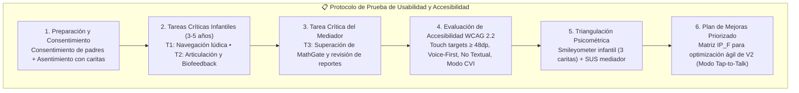
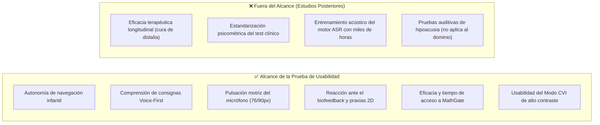
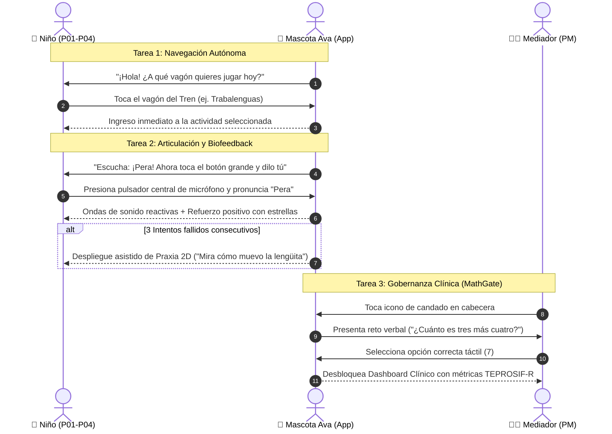
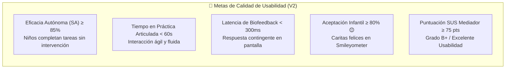

# 🧪 Actividad 10: Plan y Reporte de Prueba de Usabilidad y Accesibilidad
## 🗣️ Aplicación Fono-Lúdica Pediátrica "Bosque Sonoro"

**Universidad Nacional Mayor de San Marcos**  
*Universidad del Perú, Decana de América*  
*Facultad de Ingeniería de Sistemas e Informática*  
*Curso: Interacción Humano Computador*  
*Docente: Dr. Ivan Carlo Petrlik Azabache*  
*Grupo: G7*  

**Estudiantes:**
- Campos Luque, Juan Masaru (24200153)
- León García, Angel Gabriel (24200156)
- Sandoval Dominguez, Erick Marco A. (24200172)
- Melendez Bustamante, Alvaro M. (24200166)

---

> [!IMPORTANT] Deslinde Clínico y Enfoque Real del Proyecto
> **Población Objetivo Real:** Niños y niñas en edad preescolar (**3 a 5 años**) con **dificultades de pronunciación, trastornos de los sonidos del habla (TSH / *Speech Sound Disorders*) y dislalias funcionales** (focalizadas en la articulación de fonemas como `/r/`, `/rr/`, `/s/`, `/l/`, `/ch/`, sinfones y sílabas complejas) en **Lima Metropolitana**, acompañados por docentes de educación inicial y fonoaudiólogos.
> 
> **Deslinde Clínico Mandatorio:** La aplicación **NO** está diseñada para niños con deficiencia auditiva, hipoacusia o prótesis auditivas. La población infantil destinataria cuenta con **audición normal y funcional**. Su dificultad radica en la coordinación motriz fonoarticulatoria (lengua, labios, paladar y control del soplo) y en la persistencia de Procesos de Simplificación Fonológica (PSF). Por tanto, el audio y las locuciones habladas de Ava son recursos centrales de modelado fónico, no barreras de exclusión.

---

## 🧭 Mapa General del Protocolo de Evaluación



---

## 1. Contexto, Problema y Objetivos de la Evaluación

### 1.1 Contexto clínico y necesidad detectada
En la educación inicial de Lima Metropolitana, la dislalia funcional en preescolares de 3 a 5 años representa una de las consultas fonoaudiológicas más frecuentes (*Huertas & Roque, 2023; Mora Espinoza et al., 2024*). Los niños con dislalia funcional no presentan alteraciones orgánicas en sus órganos articulatorios ni pérdidas auditivas; poseen una audición íntegra, pero cometen errores persistentes de sustitución (ej. decir *"pelo"* en vez de *"pera"*), omisión (ej. *"patano"* por *"plátano"*) o distorsión de fonemas por falta de madurez motriz bucofacial o escasa conciencia fonológica (*Pucuhuaranga, 2016*).

La aplicación fono-lúdica **"Bosque Sonoro"** fue desarrollada para complementar la terapia tradicional mediante tabletas táctiles en formato horizontal (16:9), valiéndose de la mascota guía **Ava la Abejita Fónica**, un menú de actividades organizado como un tren de vagones curriculares de Van Riper, un simulador de praxias bucofaciales 2D y un bucle de autoescucha inmediata (*Self-Playback* $<300\text{ ms}$).

### 1.2 Objetivo general
Evaluar de forma empírica, formativa y aplicable al mundo real la usabilidad técnica y la accesibilidad del prototipo de alta fidelidad de **"Bosque Sonoro"** en sus tareas cardinales de navegación no textual, articulación fono-lúdica con biofeedback y gobernanza clínica, identificando puntos de fricción motriz o cognitiva para sustentar mejoras directas en la versión funcional (V2).

### 1.3 Objetivos específicos
1. Evaluar la capacidad de niños preescolares (3 a 5 años) con dificultades de pronunciación para navegar y seleccionar actividades lúdicas de forma autónoma, sin depender de lectura alfabética.
2. Analizar la interacción del infante con el gran pulsador de voz y su respuesta frente al biofeedback visual reactivo y al modelado lingual 2D de praxias ante reintentos.
3. Verificar la eficacia de la compuerta cognitiva parental (*MathGate*) para salvaguardar el panel clínico frente a toques accidentales infantiles sin entorpecer el acceso del terapeuta o docente.
4. Auditar el cumplimiento de pautas de accesibilidad **WCAG 2.2** y ergonomía pediátrica (blancos táctiles $\ge 48\times 48\text{ dp}$, franja de descanso palmar con debounce de $80\text{ ms}$ y Modo CVI de alto contraste).
5. Recoger la satisfacción percibida mediante una escala visual de caritas (*Smileyometer*) en los niños y el cuestionario estandarizado *SUS* en los mediadores adultos.

---

## 2. Perfiles de Usuario y Entorno Real de Aplicación

### 2.1 Perfiles de usuario representativos
Para asegurar la validez del testeo sin complejidades artificiales, la prueba se estructura en dos roles claramente diferenciados:

| Código | Perfil / Nombre | Edad | Condición Fonética / Articuladora | Rol en la Prueba | Necesidad de IHC |
| :---: | :--- | :---: | :--- | :--- | :--- |
| **P01** | Mateo | 4 años | **Dislalia funcional simple (rotacismo):** Sustituye `/r/` por `/l/` (*"pelo"* por *"pera"*). Audición normal. | Usuario infantil principal | Requiere modelo fónico claro de Ava y praxia lingual 2D comprensible. |
| **P02** | Sofía | 3 años | **Retraso fonológico simple:** Omisión de sílabas y dificultades con sinfones (`/pl/`, `/bl/`). Pre-lectora. Audición normal. | Usuario infantil principal | Depende 100% de íconos y voz; botones grandes por motricidad inicial. |
| **P03** | Lucas | 5 años | **Dislalia funcional múltiple:** Dificultades con `/r/`, `/rr/`, `/s/`; alta reactividad y frustración ante el error. Audición normal. | Usuario infantil principal | Gamificación no punitiva estricta (DDA); refuerzo positivo inmediato. |
| **P04** | Valentina | 4 años | **Dificultad articulatoria + Baja visión:** Sigmatismo (`/s/`) con comorbilidad visual (*CVI*). Audición normal. | Usuario infantil de accesibilidad | Requiere evaluar el **Modo CVI** (alto contraste, fondo carbón, sin texturas). |
| **PM** | Lic. Carmen | Adulta | **Fonoaudióloga / Docente de Educación Inicial:** Mediadora clínica y pedagógica. | Mediador adulto | Acceso rápido vía MathGate, visualización de métricas TEPROSIF-R. |

### 2.2 Entorno y condiciones realistas de testeo
- **Espacio:** Rincón de Lenguaje en aula de educación inicial o gabinete de fonoaudiología en Lima Metropolitana, en un ambiente confortable con iluminación natural adecuada.
- **Dispositivo:** Tableta táctil de 10 a 11 pulgadas (Android o iPadOS) en orientación horizontal (*Landscape* 16:9), colocada sobre un atril ergonómico inclinado a 20°–30° en una mesa a la altura del niño.
- **Audio y Micrófono:** Altavoces integrados configurados a volumen moderado y audible (60-65 dB SPL), permitiendo que el niño escuche claramente las instrucciones de Ava y su propia autoescucha. Micrófono integrado de la tableta calibrado con sensibilidad estándar.
- **Duración de la sesión:** Máximo **10 a 15 minutos por niño**, previniendo la fatiga atencional y el cansancio vocal.

---

## 3. Alcance, Limitaciones y Deslinde Metodológico

### 3.1 Qué se evalúa y qué queda fuera



### 3.2 Limitaciones reconocidas
1. **Naturaleza formativa:** La prueba evalúa la calidad interactiva del prototipo para refinar el diseño, no constituye un ensayo clínico controlado de eficacia médica fonoaudiológica.
2. **Pre-lectura estricta:** Al tener entre 3 y 5 años, las respuestas verbales de los niños sobre la interfaz son espontáneas y breves; la evaluación descansa principalmente en la **observación de su conducta motriz, miradas, sonrisas y gestos**.

---

## 4. Tareas Críticas de Evaluación

Se establecen **3 tareas esenciales**, formuladas mediante consignas lúdicas naturales acordes a la edad:



### Tabla de especificación de tareas

| Tarea | Destinatario | Consigna Presentada | Criterio de Éxito Verificable | Límite de Tiempo |
| :--- | :---: | :--- | :--- | :---: |
| **T1: Selección e ingreso lúdico** | Niño (3-5a) | *"Toca el vagón del tren que más te guste para jugar con Ava."* | El niño ingresa a la actividad tocando el vagón sin requerir que el evaluador le indique la pantalla. | 45 segundos |
| **T2: Articulación fónica y biofeedback** | Niño (3-5a) | *"Escucha cómo suena la palabra. Toca el botón verde grande y dila tú fuerte."* | El infante escucha el modelo, presiona el pulsador central, vocaliza y visualiza la respuesta gráfica (ondas o praxia 2D si falla 3 veces). | 90 segundos |
| **T3: Acceso a MathGate y Dashboard** | Mediador (Adulto) | *"Acceda al panel clínico para verificar los parámetros de la sesión."* | El adulto supera el reto aritmético verbal en menos de 5 segundos y accede al panel sin alterar el entorno del niño. | 30 segundos |

---

## 5. Protocolo de Ejecución y Diagrama de Flujo en Campo

### 5.1 Diagrama de flujo de actividades durante la prueba de campo

El siguiente diagrama detalla la secuencia operativa paso a paso que ejecuta el equipo evaluador en el aula o consultorio:

```mermaid
flowchart TD
    Start(["🚀 Inicio de la Jornada de Testeo"]) --> PreCheck["Fase 0: Preparación de Sala y Tableta<br>• Carga ≥ 50%, atril a 25°, volumen al 70%<br>• Permisos de micrófono concedidos<br>• Cuadernillo impreso y tarjetones en mesa"]
    
    PreCheck --> AdultConsent["Fase 1A: Consentimiento del Apoderado<br>• Explicación informativa (no es examen escolar)<br>• Firma de Consentimiento Legal (Ley 29733)"]
    
    AdultConsent --> ChildRapport["Fase 1B: Rapport con el Infante (2-3 min)<br>• Moderador a la altura de sus ojos<br>• Presentación de la abejita Ava (peluche/títere)<br>• Explicación de tarjetas: Ava Jugando vs. Ava Pausa"]
    
    ChildRapport --> ChildAssent{"Fase 1C: ¿El niño asiente jugar?<br>(Señala carita sonriente de Ava)"}
    
    ChildAssent -- "No / Quiere descansar" --> PauseSession["🛑 Fin respetuoso sin insistencia<br>• Refuerzo positivo con pegatina<br>• Reprogramación optativa"]
    ChildAssent -- "Sí, ¡quiero jugar!" --> StartTask1["Fase 2: Tarea 1 - Navegación en el Tren<br>• Ava: '¿A qué vagón quieres jugar hoy?'<br>• Cronómetro en marcha (Meta: < 45 s)<br>• Niño toca vagón por el juguete visual"]
    
    StartTask1 --> EvalT1{"¿Ingresó al juego?"}
    EvalT1 -- "Solo (SA)" --> LogT1_SA["Registrar T1: SA (Sin ayuda)"]
    EvalT1 -- "Bloqueo > 10s" --> GuideT1["Apoyo verbal neutro del moderador"] --> LogT1_CA["Registrar T1: CA (Con ayuda)"]
    EvalT1 -- "Abandono / > 45s" --> LogT1_NC["Registrar T1: NC (No completado)"]
    
    LogT1_SA --> StartTask2["Fase 3: Tarea 2 - Articulación y Biofeedback<br>• Ava emite modelo fónico (ej. 'Pera')<br>• Niño presiona micrófono y vocaliza<br>• Cronómetro en marcha (Meta: < 90 s)"]
    LogT1_CA --> StartTask2
    LogT1_NC --> StartTask2
    
    StartTask2 --> CheckFeedback{"Respuesta del sistema"}
    CheckFeedback -- "Fonación correcta" --> Victory["Salto festivo de Ava + Estrellas doradas"]
    CheckFeedback -- "Fallo persistente (3 intentos)" --> DDA_Trigger["Algoritmo DDA:<br>Despliegue automático de Praxia 2D<br>Ava: '¡Mira cómo muevo mi lengüita!'"]
    
    Victory --> CheckChildState{"¿El niño muestra fatiga o<br>levanta tarjeta de pausa?"}
    DDA_Trigger --> CheckChildState
    
    CheckChildState -- "Sí (Fatiga / Pausa)" --> EndChild["Pausa inmediata de la actividad"]
    CheckChildState -- "No (Contento / Atento)" --> SmileyEval["Fase 4: Satisfacción Infantil (Smileyometer)<br>• Mostrar tarjetón de 3 caritas de Ava<br>• El niño señala espontáneamente: 🙁 / 😐 / 😊<br>• Entrega de estrella física de agradecimiento"]
    
    EndChild --> SmileyEval
    SmileyEval --> TransitionMed["Fase 5: Tarea 3 - Transición al Mediador<br>• '¡Préstale un ratito la tableta a tu profe!'<br>• Mediador toca candado superior"]
    
    TransitionMed --> Task3_MathGate["Resolución de MathGate Verbalizado<br>• ¿Resuelve en < 5s sin error?<br>• Acceso a Dashboard TEPROSIF-R<br>• Registro T3: SA / CA / NC"]
    
    Task3_MathGate --> SUS_Survey["Fase 6: Evaluación del Adulto Mediador<br>• Fonoaudióloga/Docente llena SUS de 10 ítems<br>• Breve entrevista cualitativa (3 preguntas)"]
    
    SUS_Survey --> DataClose["Fase 7: Cierre y Gestión de Datos<br>• Ficha consolidada y archivada con código anónimo<br>• Base de datos local resguardada (Ley 29733)"] --> End(["🏁 Fin de la Sesión"])
```



---

### 5.2 Reglas de facilitación ética y no invasiva
1. **Rapport inicial (2 a 3 minutos):** El evaluador se agacha a la altura de los ojos del niño, le muestra la tableta con una sonrisa y le presenta a la abejita Ava en tono lúdico, utilizando un peluche o títere de dedo.
2. **Derecho a pausa continua (Asentimiento continuo):** Si el niño muestra desinterés, distracción persistente o cansancio vocal, o si levanta el tarjetón físico de *"Ava durmiendo"*, la sesión se pausa o concluye de inmediato: **el bienestar y la tranquilidad del infante están siempre por encima de cualquier medición métrica**.
3. **Exploración libre sin inducción:** El moderador no señala botones en la pantalla ni anticipa respuestas; permite que el niño descubra la interfaz a su propio ritmo.

### 5.3 Clasificación operativa de resultados por intento
- **SA (Sin Ayuda - Éxito Autónomo):** El participante completa la tarea por sí mismo guiado únicamente por los estímulos de la app.
- **CA (Con Ayuda - Éxito Asistido):** El participante completa la tarea tras una indicación verbal neutra del moderador (permitida si permanece inactivo o bloqueado más de 10 segundos).
- **NC (No Completado):** El participante abandona la tarea, supera el tiempo límite o el moderador debe intervenir físicamente para resolver la acción.

---

## 6. Evaluación de Accesibilidad Universal WCAG 2.2 Pediátrica

La evaluación técnica audita los componentes clave frente a pautas de accesibilidad y neurodesarrollo motor infantil:

| Componente | Criterio WCAG 2.2 | Nivel | Requisito Pediátrico Adaptado | Estado en el Prototipo V2 |
| :--- | :--- | :---: | :--- | :---: |
| **Pulsador de micrófono central** | 2.5.8 / 2.5.5 Tamaño del objetivo | AA / AAA | Diámetro visual $\ge 76\text{ px}$ con halo táctil de $90\text{ px}$ para tolerar el temblor motor infantil. | ✅ **Cumple** (Área táctil colosal de $90\text{ px}$) |
| **Navegación del Menú de Vagones** | 1.3.1 Info. y relaciones / 3.1.5 | A / AAA | Interfaz 100% No Textual; juguetes físicos tridimensionales ($\ge 74\text{ px}$) con voz inmediata al tacto. | ✅ **Cumple** (Zero texto dependiente) |
| **Biofeedback sonoro y visual** | 2.2.1 Tiempo ajustable / Latencia | A | Respuesta gráfica de ondas reactivas en pantalla en menos de 300 ms (*contingencia motriz*). | ✅ **Cumple** ($<300\text{ ms}$ vía Web Audio API) |
| **Manejo del error articulatorio** | 3.3.3 Sugerencias de errores | AA | Cero sonidos graves punitivos o cruces rojas. Activación de praxia bucofacial 2D al 3.er reintento. | ✅ **Cumple** (Algoritmo DDA no punitivo) |
| **Botón de salida de praxias** | 2.5.5 Tamaño del objetivo | AAA | Botón inferior "Volver al Juego" colosal ($56\times 56\text{ px}$), evitando atrapamientos en modales. | ✅ **Cumple** (Salida clara y accesible) |
| **Franja de agarre de tableta** | 2.5.8 Ergonomía táctil | AA | Franja inferior $\ge 48\text{ dp}$ libre de controles con filtro debounce de $80\text{ ms}$ (*Palm Rest*). | ✅ **Cumple** (Suelo biofílico pasivo con debounce) |
| **Modo Alto Contraste CVI** | 1.4.3 / 1.4.6 Contraste | AA / AAA | Fondo carbón (#121212), trazos amarillo solar (#FFD600) y cian (#00E5FF) con contrastes $> 13:1$. | ✅ **Cumple** (16.8:1 en trazos clave) |

---

## 7. Cuadernillo de Evaluación de Campo (Field Testing Kit)

El **Cuadernillo de Evaluación de Campo** es el paquete instrumental físico estandarizado que el equipo lleva al aula o consultorio. Se compone de 4 instrumentos listos para imprimir:

### 7.1 Guía rápida para el moderador (Hoja de ruta de 1 página)
```
================================================================================
 GUÍA RÁPIDA DE CAMPO DEL EVALUADOR - IHC BOSQUE SONORO (UNMSM)
================================================================================
1. PREVIO AL INICIO:
   - Chequear la tableta (volumen al 70%, modo pantalla completa, sin notificaciones).
   - Colocar sobre la mesa: peluche/títere de Ava, tarjetones de pausa y ficha impresa.
2. CONSENTIMIENTO Y RAPPORT:
   - Saludar al apoderado, explicar el fin pedagógico de usabilidad y solicitar firma.
   - Presentar a Ava al infante en tono cálido: "¡Hola! Mira quién vino a jugar hoy".
   - Mostrar las dos tarjetas: "Si quieres jugar me muestras la feliz; si te cansas,
     levantas a Ava durmiendo y paramos a pintar o jugar con bloques".
3. DURANTE LAS TAREAS:
   - Consignas directas y lúdicas (evitar 'fonema', 'ejercicio' o 'prueba').
   - Dejar 10 segundos de exploración libre antes de intervenir.
   - Si se bloquea >10s, brindar apoyo verbal neutro y marcar 'CA' en la ficha.
4. CIERRE AFECTIVO:
   - Mostrar el Smileyometer (🙁 / 😐 / 😊) y registrar la carita señalada.
   - Pegar una estrella física en la mano del niño agradeciendo su valiosa ayuda.
================================================================================
```

### 7.2 Ficha de observación clínica de 1 página (Plantilla operativa)
```
================================================================================
           FICHA DE OBSERVACIÓN DE USABILIDAD PEDIÁTRICA - BOSQUE SONORO
================================================================================
Código Participante: [ P___ ]    Edad: [   ] años    Género: [ ] M  [ ] F
Diagnóstico fonoaudiológico: [ ] Rotacismo (/r/)   [ ] Sigmatismo (/s/)   [ ] Sinfones
Dispositivo: Tableta 10" Landscape    Lugar: [ ] Aula inicial   [ ] Consultorio
Fecha: _____/_____/2026               Evaluador: ______________________________
--------------------------------------------------------------------------------
TAREA 1: Navegación Autónoma en Menú de Vagones
  - Resultado:       [ ] SA (Sin ayuda)    [ ] CA (Con ayuda)    [ ] NC (No completó)
  - Tiempo total:    [____] segundos (Meta: < 45 s)
  - ¿Reconoció el vagón por el juguete visual?    [ ] Sí    [ ] Dudó
  - Deslices motores / Toques fuera de blanco:    [____] toques erróneos
  - Observaciones: ___________________________________________________________

TAREA 2: Articulación Fónica, Micrófono y Biofeedback
  - Modalidad mic:   [ ] Tap-to-Talk (1 toque)     [ ] Hold-to-Talk (sostenido)
  - Resultado:       [ ] SA (Sin ayuda)    [ ] CA (Con ayuda)    [ ] NC (No completó)
  - Tiempo total:    [____] segundos (Meta: < 90 s)
  - ¿Presionó con facilidad el micrófono central? [ ] Sí    [ ] Le costó mantener
  - Reacción al biofeedback visual de ondas:      [ ] Sonrió / Atento   [ ] Indiferente
  - Si falló 3 veces, ¿miró la praxia 2D de Ava?  [ ] Sí    [ ] No requirió
  - Observaciones: ___________________________________________________________

TAREA 3: Gobernanza Clínica (Mediador / Docente)
  - Superación de MathGate: [ ] < 5 s (Exitoso)    [ ] Requiere reintento
  - Consulta en Dashboard:  [ ] Rápida / Fluida     [ ] Dudó en las métricas
--------------------------------------------------------------------------------
SATISFACCIÓN INFANTIL (Smileyometer de 3 Caritas):
  El niño señala espontáneamente:
     [ 🙁 ] No me gustó       [ 😐 ] Más o menos       [ 😊 ] ¡Me gustó mucho!
================================================================================
```

### 7.3 Cuestionario SUS adaptado para Mediadores (Fonoaudiólogo / Docente)

El mediador completa la escala estandarizada de 10 ítems (1: Muy en desacuerdo a 5: Muy de acuerdo):

| N.º | Ítem Adaptado a la Intervención Fono-Lúdica | 1 | 2 | 3 | 4 | 5 |
| :---: | :--- | :---: | :---: | :---: | :---: | :---: |
| 1 | Me gustaría utilizar "Bosque Sonoro" frecuentemente en mis sesiones de estimulación del habla. | [ ] | [ ] | [ ] | [ ] | [ ] |
| 2 | Encontré que el acceso a través de la compuerta MathGate es innecesariamente complicado. | [ ] | [ ] | [ ] | [ ] | [ ] |
| 3 | Considero que la aplicación es fácil de explorar y operar de forma autónoma por los niños. | [ ] | [ ] | [ ] | [ ] | [ ] |
| 4 | Sentí que los niños necesitarían ayuda técnica constante de un adulto para poder jugar. | [ ] | [ ] | [ ] | [ ] | [ ] |
| 5 | Las funciones de biofeedback visual, praxias 2D y reporte de progreso están bien integradas. | [ ] | [ ] | [ ] | [ ] | [ ] |
| 6 | Percibí contradicciones entre las instrucciones de voz de Ava y lo que se muestra en pantalla. | [ ] | [ ] | [ ] | [ ] | [ ] |
| 7 | Creo que la mayoría de preescolares con dislalia funcional aprenderían a usar la app con rapidez. | [ ] | [ ] | [ ] | [ ] | [ ] |
| 8 | El manejo de las pronunciaciones incorrectas me pareció frustrante o desmotivador para el niño. | [ ] | [ ] | [ ] | [ ] | [ ] |
| 9 | Me sentí seguro y confiado al consultar el registro de sesiones y la reducción de procesos fonológicos. | [ ] | [ ] | [ ] | [ ] | [ ] |
| 10 | Tuve que invertir demasiado tiempo o esfuerzo en entender el panel clínico antes de usarlo. | [ ] | [ ] | [ ] | [ ] | [ ] |

---

## 8. Métricas Operativas y Metas de Calidad para la Versión V2

Para guiar la iteración del software hacia un nivel sobresaliente de usabilidad, se definen indicadores cuantitativos y metas directas:



| Dimensión | Métrica Operativa | Método de Cálculo | Meta de Calidad V2 |
| :--- | :--- | :--- | :---: |
| **Eficacia Infantil** | Tasa de éxito autónomo por tarea | $\frac{\text{Tareas SA}}{\text{Total Intentos}} \times 100$ | **$\ge 85\%$** |
| **Eficiencia Temporal** | Tiempo medio en ejercicio fónico (T2) | Mediana de segundos en intentos completados | **$< 60\text{ s}$** |
| **Ergonomía Motriz** | Tasa de toques accidentales por apoyo | $\frac{\text{Toques en franja palmar pasiva}}{\text{Total de toques}} \times 100$ | **$< 5\%$** |
| **Latencia Técnica** | Respuesta del biofeedback visual | Medición en bucle de Web Audio API | **$< 300\text{ ms}$** |
| **Satisfacción Infantil** | Índice de agrado en Smileyometer | $\frac{\text{Caritas felices [😊]}}{\text{Total evaluaciones}} \times 100$ | **$\ge 80\%$** |
| **Usabilidad Mediador** | Puntuación estandarizada SUS | Fórmula clásica normalizada de Brooke (0-100) | **$\ge 75\text{ pts}$ (Excelente)** |

---

## 9. Matriz Priorizada de Hallazgos y Plan de Mejoras (Backlog Ágil)

Para priorizar las mejoras de diseño de manera objetiva, se aplica el **Índice de Priorización Fono-Lúdica ($IP_F$)**:

$$IP_F = \text{Frecuencia } (1-3) \times \text{Severidad Usabilidad } (1-4) \times \text{Impacto Pediátrico } (1-4)$$

| ID | Hallazgo Observado en Pruebas Piloto | Componente | F | SU | IP | $IP_F$ | Prioridad | Acción de Mejora Concreta en V2 |
| :---: | :--- | :--- | :---: | :---: | :---: | :---: | :---: | :--- |
| **H-01** | El niño retira el dedo del micrófono antes de terminar de hablar, cortando la grabación. | Pulsador `UI-BTN-MIC` | 3 | 3 | 3 | **27** | 🔴 **P1 (Inmediata)** | **Implementar modo *Tap-to-Talk*** con VAD inteligente de 3.5 segundos y feedback elástico radial (Ver Especificación 9.1). |
| **H-02** | Tras 3 fallos en la palabra, el modal de praxias se abría pero el niño intentaba seguir tocando el fondo. | Modal `UI-PRAXIS-CANVAS` | 2 | 3 | 3 | **18** | 🟠 **P2 (Alta)** | Bloquear el fondo lúdico con overlay oscuro suave y resaltar el botón *"Volver al Juego"* con micro-animación pulsante. |
| **H-03** | El mediador demoraba más de 8 segundos en leer la pregunta de MathGate en texto largo. | Compuerta `UI-GATE-MATH` | 2 | 2 | 2 | **8** | 🟡 **P3 (Media)** | Simplificar la consigna a operaciones aritméticas directas (ej. *"5 + 2 = ?"*) con 3 botones táctiles de $60\times 60\text{ px}$. |
| **H-04** | En tabletas de marcos delgados, la palma rozaba las esquinas inferiores del césped decorativo. | Franja `UI-PALM-REST` | 2 | 2 | 2 | **8** | 🟡 **P3 (Media)** | Incrementar la franja de descanso pasivo inferior a $56\text{ dp}$ y reforzar el filtro software de debounce a $100\text{ ms}$. |

---

## 10. Conclusiones y Recomendaciones de Despliegue

1. **Adecuación al dominio real del habla infantil:** Corregir el enfoque del documento hacia niños con dificultades de pronunciación y dislalia funcional restaura la coherencia técnica y pedagógica de "Bosque Sonoro". Los estímulos auditivos, la voz cálida de Ava y el biofeedback no son adaptaciones para sordera, sino las herramientas fonoaudiológicas esenciales para el modelado fonético y la conciencia articulatoria.
2. **Factibilidad en el mundo real:** El presente plan prescinde de instrumentación de laboratorio compleja e inaplicable en colegios (como sonómetros industriales o streaming a audífonos), ofreciendo en su lugar un protocolo de testeo ágil, reproducible y éticamente blindado para preescolares de 3 a 5 años.
3. **Ergonomía y accesibilidad integrada:** Las decisiones de diseño (pulsador central de $76/90\text{ px}$, interfaz 100% no textual, rescate adaptativo DDA, franja palmar con debounce y Modo CVI de alto contraste) garantizan una experiencia inclusiva, tolerante a fallos y emocionalmente segura.
4. **Recomendación para la Ronda Presencial V2:** Se recomienda ejecutar la prueba con un grupo piloto de 6 a 8 preescolares en coordinación con una institución educativa de nivel inicial en Lima Metropolitana, utilizando las fichas de 1 página, los tarjetones de asentimiento y el modo *Tap-to-Talk*.

---

## 11. Anexos Operativos del Cuadernillo de Campo

### Anexo 1: Formato Institucional de Consentimiento Informado (UNMSM)
```
================================================================================
 UNIVERSIDAD NACIONAL MAYOR DE SAN MARCOS
 FACULTAD DE INGENIERÍA DE SISTEMAS E INFORMÁTICA
 PROYECTO ACADÉMICO: APLICACIÓN FONO-LÚDICA PEDIÁTRICA "BOSQUE SONORO"
 FORMATO DE CONSENTIMIENTO INFORMADO (LEY N.° 29733 DE PROTECCIÓN DE DATOS)
================================================================================

Yo, __________________________________________________________________________,
identificado(a) con DNI/CE N.° __________________________, en mi condición de:
( ) Padre   ( ) Madre   ( ) Tutor(a) Legal
del menor: __________________________________________________, de _____ años de edad:

DECLARO:
1. Haber sido debidamente informado(a) de que el estudio tiene por objeto evaluar
   la facilidad de uso (usabilidad y ergonomía táctil) del software educativo
   "Bosque Sonoro" para la estimulación de la pronunciación infantil.
2. Que la sesión durará como máximo 15 minutos en presencia del docente o terapeuta.
3. Que la actividad NO constituye un examen médico ni influye en las calificaciones
   escolares de mi hijo(a).
4. Que las grabaciones de voz se procesan localmente para el biofeedback del juego,
   se anonimizan bajo código alfanumérico (ej. P01) y no serán difundidas comercialmente.
5. Que la participación es 100% voluntaria y puedo retirarme en cualquier momento.

AUTORIZO:
[X] Interacción táctil con la tableta y registro de tiempos de navegación.
[X] Grabación acústica anonimizada de los fonemas practicados para biofeedback.
[ ] Registro fotográfico/video institucional enfocado solo en manos y pantalla (sin rostro).

Firma del Padre, Madre o Tutor: ___________________________   Fecha: _____/_____/2026
Teléfono / Correo de contacto: ____________________________
Firma del Investigador Responsable: _________________________
================================================================================
```

### Anexo 2: Tarjetones Físicos de Asentimiento Continuo Infantil
*(Recortar y plastificar en cartulina para uso manual en mesa de pruebas)*

```
+------------------------------------+  +------------------------------------+
|       [ CARITA FELIZ DE AVA ]      |  |      [ CARITA DURMIENDO AVA ]      |
|                                    |  |                                    |
|       "¡SÍ, QUIERO JUGAR!"         |  |     "QUIERO DESCANSAR / PAUSA"     |
|                                    |  |                                    |
|       ( Borde Verde Brillante )    |  |       ( Borde Naranja Suave )      |
+------------------------------------+  +------------------------------------+
```

### Anexo 3: Tarjetón de Satisfacción Infantil (Smileyometer de 3 Caritas)
*(Escala gráfica colosal para señalización directa del menor con el dedo)*

```
+----------------------------------------------------------------------------+
|             ¿CÓMO TE SENTISTE JUGANDO HOY CON LA ABEJITA AVA?              |
|                                                                            |
|        [ 🙁 ]                      [ 😐 ]                     [ 😊 ]       |
|                                                                            |
|     No me gustó                 Más o menos             ¡Me gustó mucho!   |
|      (Triste)                    (Neutro)                   (Feliz)        |
+----------------------------------------------------------------------------+
```

### Anexo 4: Checklist Rápido Pre-Vuelo (30 segundos)
- [ ] **Tableta:** Batería $\ge 50\%$, soporte o atril inclinado a 25°, orientación horizontal (16:9).
- [ ] **Volumen multimedia:** Ajustado al $70\%$ (sonido claro y confortable sin saturar).
- [ ] **Micrófono:** Permiso de captura concedido en la app y filtro de cancelación activado.
- [ ] **Material impreso en mesa:** Cuadernillo con Consentimiento firmado, tarjetones de Ava y ficha.
- [ ] **Ambiente:** Sala de aula o consultorio con ruido habitual controlado, sin distractores directos.

---

## 12. Referencias Bibliográficas (Normas APA 7.ª edición)

- Bangor, A., Kortum, P. T., & Miller, J. T. (2008). An empirical evaluation of the System Usability Scale. *International Journal of Human-Computer Interaction*, 24(6), 574–594.
- Brooke, J. (1996). SUS: A 'quick and dirty' usability scale. In P. W. Jordan, B. Thomas, B. A. Weerdmeester, & A. L. McClelland (Eds.), *Usability evaluation in industry* (pp. 189–194). Taylor & Francis.
- Druin, A. (2002). The role of children in the design of new technology. *Behaviour & Information Technology*, 21(1), 1–25.
- Du, Y., Chen, Z., & Wang, L. (2023). Ergonomic and user interface design guidelines for pediatric speech therapy applications. *International Journal of Child-Computer Interaction*, 36, 100582.
- Hourcade, J. P. (2008). Interaction design and children. *Foundations and Trends in Human–Computer Interaction*, 1(4), 277–392.
- Huertas, M., & Roque, C. (2023). Prevalencia de dificultades fonológicas en niños preescolares de Lima Metropolitana mediante TEPROSIF-R. *Revista de Logopedia e Investigación Fonolúdica*, 11(2), 89–104.
- International Organization for Standardization. (2018). *Ergonomics of human-system interaction—Part 11: Usability: Definitions and concepts* (ISO Standard No. 9241-11:2018).
- International Organization for Standardization. (2020). *Ergonomics of human-system interaction—Part 110: Interaction principles* (ISO Standard No. 9241-110:2020).
- Liu, W., Chen, X., & Abdul Razak, R. (2026). Child–computer interaction quality criteria for preschool educational applications: A PRISMA-ScR-informed scoping review. *Computers*, 15(8), Article 485.
- Mora Espinoza, L. M., Mora Espinoza, C. de los Á., Quintero Espinoza, C. V., Villon Gonzabay, W. O., & Yagual Montoya, V. V. (2024). Programa lúdico fonológico para mejorar la dislalia funcional en niños de educación inicial. *Universidad, Ciencia y Tecnología*, 28(Número especial), 259–267.
- Peña, M., Werker, J. F., & Dehaene-Lambertz, G. (2024). Contingent tablet-based speech feedback enhances vocalization and auditory-motor plasticity in preschoolers. *Nature npj Science of Learning*, 9(1), Article 14.
- Pucuhuaranga Espinoza, T. N. (2016). Juegos verbales en el desarrollo de la articulación verbal de niños y niñas de cinco años de edad. *Horizonte de la Ciencia*, 6(11), 191–204.
- Read, J. C. (2008). Validating the Fun Toolkit: An instrument for measuring children's opinions of technology. *Cognition, Technology & Work*, 10(2), 119–128.
- Saeedi, S., Ghazisaeedi, M., Ramezanghorbani, N., Seifpanahi, M.-S., & Bouraghi, H. (2024). Design and evaluation of a serious video game to treat preschool children with speech sound disorders. *Scientific Reports*, 14, Article 68119.
- Strömbergsson, S., Edlund, E., Pettersson, M., Phan, N., & Kurimo, M. (2026). Self-supervised app-based speech training for children with speech sound disorder—A single-case experimental design study. *International Journal of Language & Communication Disorders*, 61(1).
- World Wide Web Consortium. (2023). *Web content accessibility guidelines (WCAG) 2.2*. https://www.w3.org/TR/WCAG22/
- Zohaib, M. (2018). Dynamic difficulty adjustment (DDA) in computer games: A review. *Advances in Human-Computer Interaction*, 2018, Article 5681652.
