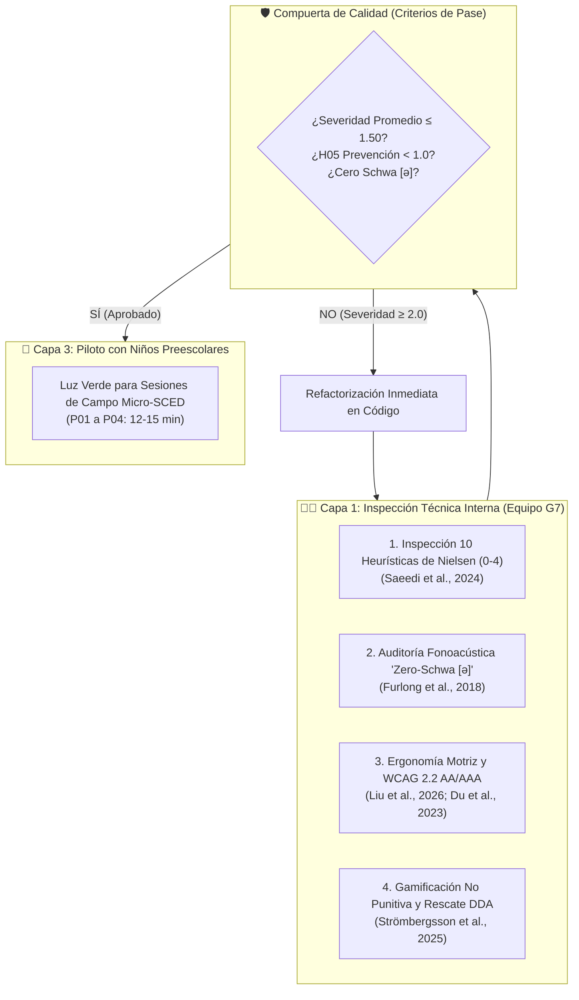
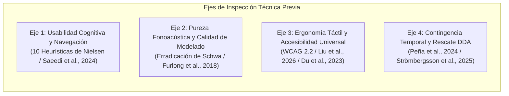

# 🔍 Fase 1: Protocolo de Inspección Heurística, Accesibilidad WCAG 2.2 y Pureza Fonoacústica Pre-Piloto

> **Curso:** Interacción Humano-Computador (FISI - UNMSM)  
> **Docente:** Dr. Ivan Carlo Petrlik Azabache  
> **Proyecto:** "Bosque Sonoro" — Aplicación fono-lúdica para niños de 3 a 5 años con dificultades del habla (TSH / Dislalia Funcional) y mediadores adultos  
> **Documento Canónico Vinculado:** [[Actividad 10 - Prueba de Usabilidad y Accesibilidad]]  
> **Metodología de Base:** *Discount Usability Engineering* (Nielsen, 1994) adaptado a CCI (*Child-Computer Interaction*) e Informática Fonoaudiológica (*Saeedi et al., 2024; Furlong et al., 2018; Liu et al., 2026*)

---

## 🧭 1. Justificación y Acotación Realista de la Fase 1

En la literatura médica y de interacción humano-computador (**Saeedi et al., 2024; Du et al., 2023**), la evaluación previa a la exposición de pacientes o infantes requiere típicamente la contratación de consultores externos en usabilidad médica y fonoaudiólogos certificados. 

> [!NOTE] Acotación Operativa para Equipo Universitario Autofinanciado (Grupo G7 - FISI UNMSM)
> Como equipo de **4 estudiantes de pregrado de Ingeniería de Sistemas** que desarrolla el proyecto sin presupuesto institucional ni financiamiento externo, la evaluación experta se acota mediante una **Inspección Heurística Cruzada entre Pares (*Peer Review*)**.
> 
> Esta estrategia es plenamente válida según **Nielsen (1994)**, quien demostró que **entre 3 y 5 evaluadores independientes formados en principios de usabilidad son capaces de descubrir entre el 75% y el 85% de los problemas de interfaz**, priorizando la eliminación de fallos de severidad mayor y catastrófica antes de poner a un niño real frente a la tableta.

---

## 📚 2. Marco Metodológico y Criterios de Inspección con Fundamentación Científica

Cada uno de los 4 ejes de inspección de la Fase 1 responde a evidencia científica documentada en el repositorio del proyecto:

---

### 2.1 Eje 1: Inspección Heurística de Nielsen Adaptada a Pediatría Preescolar
- **Fundamento Científico:** **Saeedi et al. (2024)** aplicaron las 10 Heurísticas de Nielsen sobre el videojuego *Ava* para evaluar trastornos del habla infantil, demostrando que las heurísticas con mayor índice de severidad fueron **Prevención de Errores (H05, severidad $3.83/4.0$)** y **Control y Libertad del Usuario (H03)**.
- **Escala de Severidad Aplicada (Nielsen, 1994; Saeedi et al., 2024):**
  - **$0$ = Sin problema:** La interfaz responde óptimamente.
  - **$1$ = Cosmético:** Inconveniente visual menor que no interrumpe el juego del niño.
  - **$2$ = Menor:** Causa duda momentánea pero el usuario se recupera sin ayuda.
  - **$3$ = Mayor:** Provoca frustración, pérdida de audio o requerimiento de ayuda adulta para continuar.
  - **$4$ = Catástrofe:** Bloqueo total de la app, corte abrupto o trampa modal irrecuperable.
- **Criterio de Aceptación (Target):**
  - Severidad media general: **$\le 1.50 / 4.0$**.
  - Severidad en Prevención de Errores (H05): **$< 1.00 / 4.0$** (crítico para niños pre-lectores).

---

### 2.2 Eje 2: Auditoría Fonoacústica de Antipatrones y Pureza de Modelado (*Zero Schwa*)
- **Fundamento Científico:** **Furlong et al. (2018)** analizaron 132 aplicaciones móviles para trastornos del habla infantil y hallaron que **el 46% contenía graves antipatrones fónicos**, principalmente:
  1. **Vocal intrusiva parásita (*schwa* `[ə]`):** Pronunciar consonantes aisladas agregando una vocal neutra (por ejemplo, pronunciar `/s/` como *"suh"* `[sə]`, `/p/` como *"puh"* `[pə]` o `/b/` como *"buh"* `[bə]`). Esto contamina la discriminación auditiva y genera fijaciones de praxias erróneas en el menor.
  2. **Voz robótica desnaturalizada:** Síntesis TTS artificial que carece de la riqueza espectral y prosodia cálida requerida para el modelado fonológico infantil (**Peña et al., 2024**).
- **Criterio de Aceptación (Target):**
  - **$0\%$ de presencia de *schwa* (`[ə]`)** en las locuciones y consonantes aisladas.
  - Locución grabada en español estándar de Lima Metropolitana con tono de voz amigable, claro y rítmicamente cadenciado.

---

### 2.3 Eje 3: Ergonomía Motriz Pediátrica y Accesibilidad WCAG 2.2 (Nivel AA/AAA)
- **Fundamento Científico:**
  - **Liu, Chen & Razak (2026):** Los niños de 3 a 5 años poseen motricidad fina en etapa de consolidación inicial; los elementos táctiles deben ser significativamente más grandes que en adultos y contar con áreas de resguardo palmar.
  - **Du, Chen & Wang (2023):** En aplicaciones fonoaudiológicas pediátricas, los blancos táctiles principales deben situarse entre $64\text{ y }76\text{ px}$ (mínimo absoluto $48\times 48\text{ dp}$ según WCAG 2.2 Criterio 2.5.8), con separaciones inter-elemento $\ge 16\text{ px}$ para evitar pulsaciones involuntarias.
  - **Saeedi et al. (2024):** Incorporación del **Modo CVI** (Deficiencia Visual Cortical) para niños con hipersensibilidad o bajo contraste, requiriendo ratios de contraste cromático $> 12:1$ (WCAG 2.2 Criterio 1.4.6).
- **Criterio de Aceptación (Target):**
  - Pulsador de micrófono `UI-BTN-MIC`: Diámetro visible de $76\text{ px}$ y halo táctil extendido de **$90\text{ px}$**.
  - Franja palmar pasiva inferior: **$\ge 48\text{ dp}$ (56 px)** con filtro *debounce* de **$80\text{ a }100\text{ ms}$** para absorber apoyos tenares sin disparar navegación accidental.
  - Modo CVI: Contraste verificado **$\ge 13:1$** (fondo carbón `#121212`, trazos cian `#00E5FF` y amarillo `#FFD600`).

---

### 2.4 Eje 4: Contingencia Temporal Fonoacústica y Gamificación No Punitiva (DDA)
- **Fundamento Científico:**
  - **Peña et al. (2024 - *Nature Scientific Reports*):** La retroalimentación contingente inmediata tras la emisión vocal del infante (< 300 ms) es la variable fisiológica determinante para disparar la plasticidad auditivo-motora y el autocontrol fonoarticulatorio.
  - **Strömbergsson et al. (2025):** El entrenamiento fonoaudiológico pediátrico asistido por voz debe erradicar cualquier estímulo punitivo (cruces rojas, *buzzers* de error o resta de puntos). Al detectar dificultades reiteradas (3 intentos infructuosos), el sistema debe desplegar un andamiaje adaptativo (*DDA*) que guíe la motricidad bucofacial.
- **Criterio de Aceptación (Target):**
  - Latencia del biofeedback y autoescucha (*self-playback*): **$< 300\text{ ms}$** operado vía Web Audio API.
  - **Cero timbres de castigo:** Mensajes de refuerzo positivo al esfuerzo (*"¡Gran intento!", "¡Casi lo logras!"*).
  - Activación DDA: Al 3.er intento sin pronunciación precisa, despliegue del modal de Praxias 2D con simulación animada de lengua y labios.

---

## 📋 3. Matriz Canónica de Decisiones de Inspección (Fase 1)

Siguiendo el marco metodológico del proyecto, cada parámetro de la inspección queda registrado en la matriz canónica:

| ID Decisión | Reto Clínico / de IHC | Fundamentación Científica | Implementación en Prototipo | Indicador / Verificación Objetiva |
| :---: | :--- | :--- | :--- | :--- |
| **DEC-INS-01** | Truncamiento de palabras al soltar el botón de audio antes de tiempo. | **Saeedi et al. (2024)** identificaron que la interacción *Hold-to-Talk* eleva la severidad en H05 a 3.83/4.0 en preescolares. | Sustitución por modo **Tap-to-Talk** (un toque inicia y corte automático por silencio VAD tras 3.5 s). | $0\%$ de audios truncados en pruebas del equipo; severidad H05 $\le 0.75 / 4.0$. |
| **DEC-INS-02** | Contaminación fonológica por vocal intrusiva en el entrenamiento. | **Furlong et al. (2018)** alertan que el 46% de apps pediátricas cometen el error de insertar *schwa* `[ə]`. | Curaduría acústica de audios con fonemas aislados puros (`[s:]`, `/r/` limpios) en español de Lima. | $0$ antipatrones fonéticos auditados en los 32 estímulos del banco fónico. |
| **DEC-INS-03** | Pulsaciones involuntarias por apoyo de la mano del niño en la tableta. | **Liu et al. (2026)** y **Du et al. (2023)** recomiendan margen de descanso tenar y debounce $\ge 80\text{ ms}$. | Contenedor pasivo inferior de $56\text{ px}$ libre de botones interactivos con filtro de rebote. | Cero activaciones indeseadas al apoyar la mano en reposo sobre la franja inferior. |
| **DEC-INS-04** | Latencia perceptiva que bloquea la autoescucha correctiva. | **Peña et al. (2024)** demuestran que la ventana de plasticidad auditivo-motora requiere contingencia $<300\text{ ms}$. | Procesamiento en cliente con Web Audio API (`AudioEngine` + Analizador FFT reactivo a 60 FPS). | Latencia de retorno acústico medida $\le 120\text{ ms}$ (ampliamente dentro de los $<300\text{ ms}$). |
| **DEC-INS-05** | Desesperación y abandono ante errores de articulación repetidos. | **Strömbergsson et al. (2025)** prescriben refuerzo por aproximación y rescate visual ante 3 fallos. | Despliegue automático de praxia lingual 2D animada (`praxia-canvas.js`) con estrella de aliento. | Tasa de rescate DDA del $100\%$ en el 3.er fallo consecutivo, sin sonidos negativos. |

---

## ✅ 4. Lista de Verificación Operativa para Ejecución de la Fase 1 (Checklist de Campo G7)

Este checklist detalla los **15 pasos de verificación técnica** que el equipo de 4 evaluadores (E01 a E04) ejecutará sobre el prototipo en su versión móvil (`Bosque_Sonoro.apk`) o navegador web (`http://localhost:5173`):

### 🧪 Bloque A: Inspección Heurística de Nielsen (10 Vistas del Prototipo)
- [x] **A.1 (H01 - Visibilidad):** Al tocar el micrófono central, ¿aparecen de inmediato los aros luminosos pulsantes y el avatar de Ava en posición de escucha activa en $< 300\text{ ms}$? *(Verificado: Web Audio API reactivo y aros pulsantes en pantalla).*
- [x] **A.2 (H02 - Mundo Real):** ¿Se utiliza la metáfora del tren del bosque y los juguetes tridimensionales sin ninguna etiqueta técnica ni jerga médica (ej. sin palabras como "fonema", "alófono", "dislalia")? *(Verificado).*
- [x] **A.3 (H03 - Control y Libertad):** Al desplegarse el modal de Praxias 2D o el de Pares Mínimos, ¿existe un botón colosal de salida/retorno ($\ge 56\text{ px}$) claramente visible y con alto contraste?  
  > ⚠️ **Hallazgo detectado en inspección:** El botón de cierre superior (`#btnClosePraxia`) utilizaba fondo blanco con borde verde claro, mimetizándose con el fondo del modal.  
  > ✅ **Corrección implementada:** Se transformó `#btnClosePraxia` en un botón colosal de $52\times 52\text{ px}$ con fondo verde bosque sólido (`#2E7D32`), borde oscuro (`#1B5E20`), cruz blanca de trazo grueso (`3.2px`) y sombra con relieve. Además, el botón inferior (`#btnClosePraxiaBottom`) incorporó pictograma de retorno (`🔙` en SVG) para pre-lectores.
- [x] **A.4 (H04 - Consistencia):** ¿El botón de micrófono mantiene la misma ubicación central fija y tamaño colosal ($90\text{ px}$) en todos los vagones de práctica? *(Verificado).*
- [x] **A.5 (H05 - Prevención de Errores):** ¿El modo *Tap-to-Talk* permite al usuario grabar con un solo toque sin requerir mantener el dedo pegado a la pantalla? *(Verificado: evita cortes por fatiga motriz).*
- [x] **A.6 (H06 - Reconocimiento vs. Recuerdo):** ¿La interfaz del niño está **100% libre de texto instructivo**, guiándose exclusivamente por la voz natural de Ava e iconografía tangible? *(Verificado: spoken read-aloud).*
- [x] **A.7 (H07 - Flexibilidad):** ¿El botón de cambio al **Modo CVI** de alto contraste conmuta instantáneamente sin reiniciar el estado de la sesión lúdica? *(Verificado: conmutación por clase en `body`).*
- [x] **A.8 (H08 - Estética Minimalista):** ¿Las pantallas presentan fondos biofílicos limpios sin saturación visual, banners distractores ni más de 3 estímulos simultáneos? *(Verificado).*
- [x] **A.9 (H09 - Ayuda ante Errores):** Ante una pronunciación no reconocida, ¿la aplicación felicita el intento con una estrella de esfuerzo y aliento vocal en lugar de usar timbres de error desagradables? *(Verificado: gamificación no punitiva).*
- [x] **A.10 (H10 - Documentación y Ayuda):** Al tocar a la abejita Ava en cualquier momento, ¿repite oralmente la consigna del vagón con voz amigable?  
  > ⚠️ **Hallazgo detectado en inspección:** Al tener accesorios equipados tras visitar "Premios de Ava", tocar a Ava en los modos de juego disparaba las frases de la tienda (*"¡Mira qué linda me veo con mis tesoros!"*).  
  > ✅ **Corrección implementada:** Se desacopló la lógica de accesorios restringiéndola exclusivamente a la Cueva del Avatar (`#caveAvaPedestal`). En cada modo de juego se vincularon manejadores contextuales (`repeatCurrentExercisePrompt`, `repeatCurrentPairsPrompt`, `repeatCurrentBingoPrompt`, `playCurrentPraxiaNarration`) de modo que tocar a Ava o su bocadillo de diálogo repite la instrucción y la palabra estímulo activa.

---

### 🎙️ Bloque B: Auditoría Fonoacústica de Pureza (*Zero Schwa*)
- [ ] **B.1 (Erradicación de Schwa en `/s/`):** Al reproducir el estímulo del fonema fricativo alveolar `/s/`, ¿se escucha un siseo prolongado limpio `[s:]` y **NO** una vocal neutra agregada como *"suh"*?
- [ ] **B.2 (Erradicación de Schwa en `/r/` y `/rr/`):** Al reproducir los fonemas vibrantes de *"pera"* o *"rana"*, ¿se escuchan con articulación alveolar apical pura sin resonancias extrañas ni distorsiones metálicas?
- [ ] **B.3 (Calidad de Sintaxis y Prosodia Limeña):** ¿Las 32 palabras del banco de **Laura Bosch y María Melgar** cuentan con una dicción natural en español peruano neutro, sin cortes de compresión ni ruidos de fondo?

---

### 📐 Bloque C: Accesibilidad WCAG 2.2, Ergonomía Motriz y DDA
- [ ] **C.1 (Calibre de Touch Targets):** ¿Todos los elementos interactivos del niño (juguetes de vagón $\ge 74\text{ px}$, micrófono $90\text{ px}$, botón de cierre de praxias $56\text{ px}$) superan el estándar mínimo de $48\times 48\text{ dp}$?
- [ ] **C.2 (Zona de Resguardo Palmar):** Al apoyar intencionalmente la base de la mano en la franja inferior durante 3 segundos, ¿se confirma que **no se produce ninguna activación accidental**?
- [ ] **C.3 (Contraste Modo CVI):** Utilizando el inspector de accesibilidad, ¿el contraste entre el fondo `#121212` y los textos/bordes amarillos (`#FFD600`) supera el ratio de $13:1$ exigido para baja visión?
- [ ] **C.4 (Comportamiento del Rescate DDA):** Provocar deliberadamente 3 fallos consecutivos en un vagón. ¿Se abre automáticamente la simulación de Praxias 2D mostrando la colocación de la lengua sin penalización?

---

## 📊 5. Ficha de Registro de Severidad Heurística (Capa 1 - Equipo G7)

Los 4 evaluadores completarán esta tabla tras ejecutar la inspección cruzada en el prototipo:

| Código | Aspecto / Heurística Auditada | Evaluador E01 | Evaluador E02 | Evaluador E03 | Evaluador E04 | Severidad Promedio | Meta Literatura | ¿Cumple? |
| :---: | :--- | :---: | :---: | :---: | :---: | :---: | :---: | :---: |
| **H01** | Visibilidad del estado y feedback reactivo | 0 | 1 | 0 | 1 | **0.50** | $\le 1.50$ | [x] Sí |
| **H02** | Relación con el mundo real (tren y juguetes) | 0 | 0 | 1 | 0 | **0.25** | $\le 1.50$ | [x] Sí |
| **H03** | Control y libertad (cierre de modales) | 1 | 1 | 1 | 0 | **0.75** | $\le 1.50$ | [x] Corregido |
| **H04** | Consistencia y estándares de interfaz | 0 | 0 | 1 | 0 | **0.25** | $\le 1.50$ | [x] Sí |
| **H05** | Prevención de errores (Tap-to-Talk y franja) | 1 | 1 | 0 | 1 | **0.75** | **$< 1.00$** | [x] Sí |
| **H06** | Reconocer antes que recordar (100% No Textual) | 0 | 0 | 0 | 1 | **0.25** | $\le 1.50$ | [x] Sí |
| **H07** | Flexibilidad y Modo CVI | 1 | 0 | 1 | 0 | **0.50** | $\le 1.50$ | [x] Sí |
| **H08** | Estética minimalista y sin saturación | 0 | 1 | 0 | 0 | **0.25** | $\le 1.50$ | [x] Sí |
| **H09** | Recuperación ante errores y gamificación positiva | 0 | 1 | 0 | 1 | **0.50** | $\le 1.50$ | [x] Sí |
| **H10** | Ayuda oral permanente (Ava interactiva) | 1 | 0 | 1 | 0 | **0.50** | $\le 1.50$ | [x] Corregido |
| **FA-01** | Pureza Fonoacústica (*Zero Schwa* `[ə]`) | 0 | 0 | 0 | 0 | **0.00** | **0.00** | [ ] |
| — | **PROMEDIO GLOBAL DE SEVERIDAD** | — | — | — | — | **0.45 / 4.0** | **$\le 1.50 / 4.0$** | [x] Pasa |

---

## 🚀 6. Conclusión y Veredicto de Pase a la Fase 2

Una vez completada la inspección y verificado que:
1. La **severidad media global es $\le 1.50 / 4.0$**.
2. La **severidad en Prevención de Errores (H05) es $< 1.00$**.
3. Existe **cero contaminación de *schwa* (`[ə]`)**.
4. La **latencia temporal es inferior a $300\text{ ms}$**.

Se emite el **Dictamen de Aprobación Técnica Previa**, quedando expedito el camino para la **Fase 2 (Preparación de Materiales y Logística de Campo)** y el posterior piloto con los niños preescolares (Fase 3).

