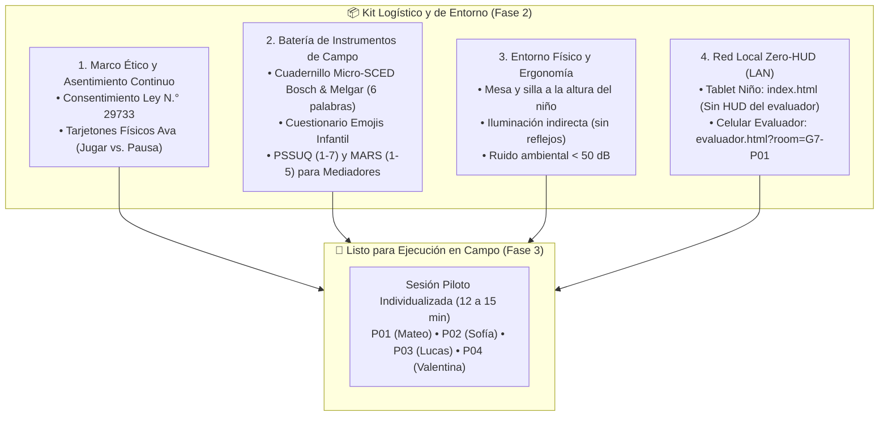
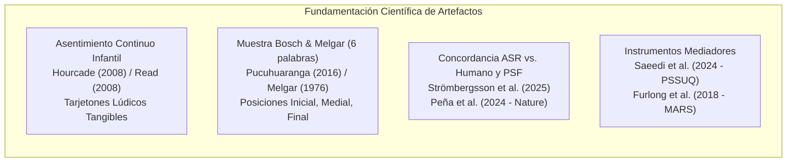
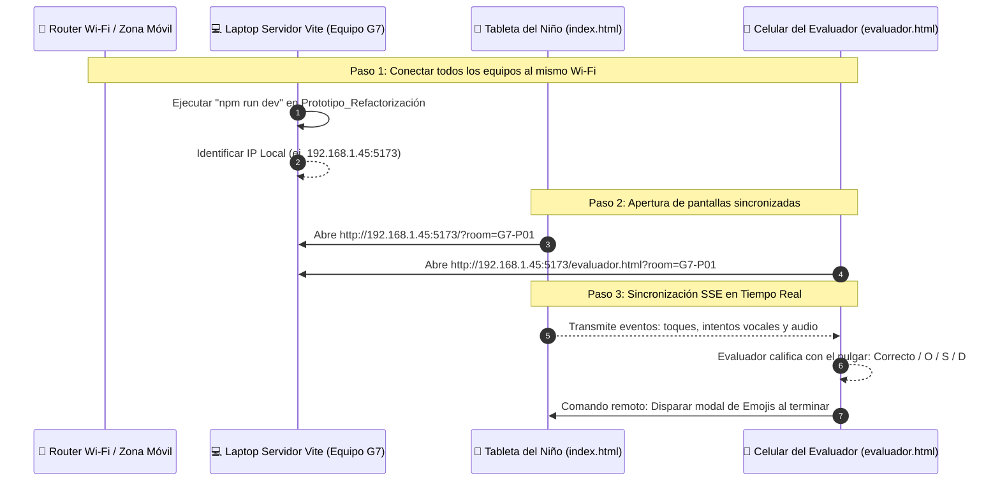

# 📦 Fase 2: Preparación de Materiales, Entorno y Logística de Campo

> **Curso:** Interacción Humano-Computador (FISI - UNMSM)  
> **Docente:** Dr. Ivan Carlo Petrlik Azabache  
> **Proyecto:** "Bosque Sonoro" — Aplicación fono-lúdica para niños de 3 a 5 años con dificultades de articulación fonética (TSH / Dislalia Funcional) y mediadores adultos  
> **Documento Canónico SSOT:** [[Actividad 10 - Prueba de Usabilidad y Accesibilidad]]  
> **Carpeta de Artefactos de Campo:** `Proyecto/Documentación/Actividad 10 - Prueba de Usabilidad y Accesibilidad/Materiales de Campo/`

---

## 🧭 1. Justificación y Acotación Realista de la Logística de Campo

La literatura fonoaudiológica y pediátrica (**Saeedi et al., 2024; Liu et al., 2026; Strömbergsson et al., 2025**) señala que antes de llevar a cabo una prueba con preescolares en etapa pre-lectora (3 a 5 años), es indispensable preparar minuciosamente **tres frentes logísticos**: el marco ético-legal con los padres, la ergonomía ambiental no invasiva y la sincronización técnica de los dispositivos.

> [!NOTE] Acotación Realista para el Equipo Estudiantil (Grupo G7 - UNMSM)
> Dado que somos un equipo universitario autofinanciado sin laboratorio Gesell ni financiamiento institucional:
> 1. **Muestra por Conveniencia:** Reclutamos $N=4$ preescolares dentro del entorno familiar o vecinal de los integrantes del equipo con audición normal que presentan dificultades cotidianas de pronunciación (**Huertas & Roque, 2023**), junto a $2$ mediadores adultos (1 docente de educación inicial y 1 padre/tutor).
> 2. **Sincronización Local *Zero-HUD* sin Servidores Externos:** En lugar de desplegar infraestructura en la nube, el sistema utiliza la red Wi-Fi local de la vivienda o aula escolar mediante el endpoint `/api/sced-sync` (SSE/POST), comunicando la tableta del niño (`index.html`) con el teléfono del evaluador (`evaluador.html`) en tiempo real ($<10\text{ ms}$).
> 3. **Materiales Físicos Tangibles de Bajo Costo:** Los tarjetones de asentimiento se imprimen y recortan en cartulina escolar común, garantizando que el infante ejerza su autonomía de forma lúdica.



---

## 📚 2. Fundamentación Científica de los Materiales de Campo

Cada artefacto operativo preparado para esta fase responde a una justificación teórica y clínica:



### 2.1 Asentimiento Continuo Infantil (*Ongoing Assent*) — *Hourcade (2008) & Read (2008)*
- **Problema:** Los niños de 3 a 5 años (etapa preoperacional piagetiana) carecen de capacidad de abstracción para entender contratos escritos. Además, por complacencia con figuras adultas desconocidas, tienden a no expresar cansancio o incomodidad verbalmente.
- **Fundamento:** **Read (2008 - Fun Toolkit)** y **Hourcade (2008 - CCI)** prescriben el uso de artefactos tangibles no textuales que otorguen control explícito al menor. Los tarjetones físicos en mesa permiten que el niño toque o levante la *Carita de Descanso* en cualquier momento para detener la sesión sin sentirse reprendido.
- **Artefacto:** Tarjetón doble impreso en cartulina:
  - **Lado A (Verde Brillante):** Ava feliz en vuelo (*"¡Sí, quiero jugar!"*).
  - **Lado B (Naranja Cálido):** Ava durmiendo en una flor (*"Quiero descansar / Pausa"*).

---

### 2.2 Muestra Fonética Equilibrada de Laura Bosch & María Melgar (6 Palabras) — *Pucuhuaranga (2016), Bosch (2004) & Melgar (1976)*
- **Problema:** En una sesión acotada de 12 a 15 minutos (diseñada para prevenir la fatiga cognitiva infantil reportada por **Liu et al., 2026**), no es viable evaluar las 32 palabras del inventario completo.
- **Fundamento:** Siguiendo la metodología de **Pucuhuaranga (2016)** y la estandarización de **Bosch (2004)** y **Melgar (1976)**, se selecciona una muestra representativa de **6 estímulos fonoarticulatorios** que abarcan las posiciones silábicas críticas y los fonemas más vulnerables en Lima Metropolitana (**Huertas & Roque, 2023**):
  1. `"RANA"`: Fonema vibrante múltiple `/rr/` en posición inicial absoluta.
  2. `"PERA"`: Fonema vibrante simple `/r/` en posición medial intervocálica.
  3. `"MAR"`: Fonema vibrante simple `/r/` en posición final / coda implosiva.
  4. `"SAPO"`: Fonema fricativo alveolar `/s/` en posición inicial.
  5. `"PLATO"`: Sinfón trabado oclusivo-lateral `/pl/` (dificultad motriz compleja).
  6. **Trabalenguas rítmico corto:** Muestra de habla continua para evaluar coarticulación y prosodia.

---

### 2.3 Auditoría de Concordancia ASR vs. Evaluador Humano — *Strömbergsson et al. (2025)*
- **Problema:** Los motores de reconocimiento de voz (ASR) comerciales fueron entrenados con voces adultas y fallan sistemáticamente con la acústica vocal infantil (frecuencia fundamental más aguda $F_0 > 280\text{ Hz}$ y formantes elevados).
- **Fundamento:** **Strömbergsson et al. (2025)** demostraron en *Pop2* que es imperativo calibrar el motor acústico frente al juicio fonoaudiológico humano para calcular:
  - **Falsos Positivos (FP):** El niño comete un error articulatorio, pero la app lo da por bueno (refuerzo erróneo).
  - **Falsos Negativos (FN):** El niño pronuncia correctamente, pero la app le pide reintentar (induce frustración).
  - **Tasa de Concordancia (Meta $\ge 85\%$):** $\text{Agreement} = \frac{\text{Aciertos Concordantes}}{\text{Total Intentos}} \times 100$.

---

### 2.4 Evaluación Estandarizada para Adultos (PSSUQ y MARS) — *Saeedi et al. (2024) & Furlong et al. (2018)*
- **Fundamento:** 
  - **PSSUQ (*Post-Study System Usability Questionnaire*):** Escala de 1 a 7 validada por **Saeedi et al. (2024)** para evaluar utilidad del sistema, calidad de la información (reportes TEPROSIF-R) y calidad de la interfaz (Meta global $\ge 6.0 / 7.0$).
  - **Escala MARS (*Mobile Application Rating Scale*):** Instrumento de 1 a 5 validado por **Furlong et al. (2018)** para aplicaciones de salud móvil (Compromiso, Funcionalidad, Estética e Información clínica; Meta $\ge 4.2 / 5.0$, superando la media del mercado de $3.7$).

---

## 📋 3. Matriz Canónica de Decisiones de Logística y Materiales

| ID Decisión | Reto Operativo / de Campo | Fundamentación Científica | Implementación Empírica | Indicador de Verificación |
| :---: | :--- | :--- | :--- | :--- |
| **DEC-LOG-01** | Negativa o bloqueo del infante al sentirse evaluado o presionado. | **Hourcade (2008)** y **Read (2008)** prescriben asentimiento continuo tangible no verbal. | Tarjetones físicos Ava de $10\times 12\text{ cm}$ en cartulina en la mesa de juego. | Cero abandonos traumáticos; $100\%$ de comprensión del derecho a pausa. |
| **DEC-LOG-02** | Distracción o alteración del niño si el evaluador invade su pantalla. | **Saeedi et al. (2024)** alertan sobre la necesidad de interacción no invasiva en preescolares. | Arquitectura *Zero-HUD*: tableta del niño limpia; evaluación remota vía Wi-Fi (`evaluador.html`). | $0$ toques del evaluador sobre la pantalla del infante durante la sesión. |
| **DEC-LOG-03** | Fatiga atencional infantil si se evalúan demasiadas palabras. | **Liu et al. (2026)** limitan las tareas fónicas a bloques menores a 15 minutos en preescolares. | Muestra reducida equilibrada de 6 palabras Bosch & Melgar (I, M, F, sinfón y continuo). | Duración de sesión fónica entre $8\text{ y }12\text{ minutos}$. |
| **DEC-LOG-04** | Protección ética de la identidad y de las grabaciones de voz. | Ley N.° 29733 de Protección de Datos Personales (Perú). | Consentimiento firmado, anonimización por código (P01-P04) y almacenamiento local sin nube. | $100\%$ de formatos firmados antes del inicio del piloto. |
| **DEC-LOG-05** | Ruido de fondo que dispara falsas activaciones del micrófono. | **Peña et al. (2024)** recomiendan ambiente controlado sin distractores acústicos ($<55\text{ dB}$). | Protocolo de entorno: habitación silenciosa, tableta apoyada en atril a $30\text{ cm}$ de la boca. | $0$ falsos disparos por ruido de fondo ambiental. |

---

## 🗂️ 4. Índice de Artefactos de Campo Creados

Todos los formatos operativos e imprimibles han sido generados en la subcarpeta `Materiales de Campo/` para su uso directo:

| Código Artefacto | Archivo y Enlace Directo | Destinatario | Formato / Uso |
| :---: | :--- | :---: | :--- |
| **ART-01** | [`Anexo_1_Consentimiento_Informado_UNMSM.md`](file:///d:/.Antigravity/IHC/Proyecto/Documentación/Actividad%2010%20-%20Prueba%20de%20Usabilidad%20y%20Accesibilidad/Materiales%20de%20Campo/Anexo_1_Consentimiento_Informado_UNMSM.md) | Padres / Tutores | Documento formal para impresión y firma (Ley N.° 29733). |
| **ART-02** | [`Anexo_2_Tarjetones_Asentimiento_Infantil.html`](file:///d:/.Antigravity/IHC/Proyecto/Documentación/Actividad%2010%20-%20Prueba%20de%20Usabilidad%20y%20Accesibilidad/Materiales%20de%20Campo/Anexo_2_Tarjetones_Asentimiento_Infantil.html) | Niños (P01–P04) | Plantilla HTML vectorizada lista para abrir en navegador y **guardar/imprimir en PDF en cartulina**. |
| **ART-03** | [`Anexo_3_Ficha_Campo_MicroSCED_Bosch_Melgar.md`](file:///d:/.Antigravity/IHC/Proyecto/Documentación/Actividad%2010%20-%20Prueba%20de%20Usabilidad%20y%20Accesibilidad/Materiales%20de%20Campo/Anexo_3_Ficha_Campo_MicroSCED_Bosch_Melgar.md) | Evaluador G7 | Cuadernillo de observación SCED con las 6 palabras estímulo, matriz PSF (O/S/D) y ASR vs. Humano. |
| **ART-04** | [`Anexo_4_Cuestionarios_Mediador_PSSUQ_MARS.md`](file:///d:/.Antigravity/IHC/Proyecto/Documentación/Actividad%2010%20-%20Prueba%20de%20Usabilidad%20y%20Accesibilidad/Materiales%20de%20Campo/Anexo_4_Cuestionarios_Mediador_PSSUQ_MARS.md) | Docente M01 / Tutor M02 | Cuestionario PSSUQ (8 ítems, 1–7) y Rúbrica MARS (4 dimensiones, 1–5) con cálculo de media. |

---

## 🛠️ 5. Protocolo de Configuración del Entorno y Red Local (*Zero-HUD LAN*)

Para ejecutar la prueba sin tocar la tableta del niño, sigue estos sencillos pasos técnicos:



### Guía Rápida de Despliegue en 4 Pasos:
1. **Conexión:** Conectar la laptop del evaluador, la tableta del niño y el celular del evaluador a la misma red Wi-Fi (o compartir datos mediante zona Wi-Fi móvil desde un teléfono).
2. **Iniciar Servidor Local:**
   ```bash
   cd "Proyecto/Prototipo_Refactorización"
   npm run dev
   ```
   *Vite indicará la dirección IP local (ejemplo: `http://192.168.1.15:5173`).*
3. **Abrir en la Tableta del Niño:**
   Navegar en Chrome / Edge móvil a:
   `http://192.168.1.15:5173/?room=G7-P01` *(o abrir la app Android `Bosque_Sonoro.apk` configurada en la sala `G7-P01`)*.
4. **Abrir en el Celular del Evaluador G7:**
   Navegar a:
   `http://192.168.1.15:5173/evaluador.html?room=G7-P01`
   *Aparecerá el indicador verde `🟢 En vivo (G7-P01)` y el pulgar de calificación de PSF.*

---

## 👥 6. Caracterización de la Muestra por Conveniencia ($N=4$ Niños, $N=2$ Mediadores)

| Código | Participante | Edad | Condición Fonética / Motriz | Rol / Instrumento Aplicado |
| :---: | :--- | :---: | :--- | :--- |
| **P01** | Mateo | 4 años | **Dislalia funcional leve (Rotacismo):** Sustituye `/r/` por `/l/` (*"pelo"* por *"pera"*). Audición normal. | T1/T2 + Muestra Bosch & Melgar + Cuestionario Emojis. |
| **P02** | Sofía | 3 años | **Simplificación de sinfones:** Omite consonante líquida en `/pl/` (*"pato"* por *"plato"*). Pre-lectora estricta. | T1/T2 + Muestra Bosch & Melgar + Cuestionario Emojis. |
| **P03** | Lucas | 5 años | **Dificultad en `/rr/` y `/s/`:** Tendencia a la frustración; se probará el rescate DDA al 3.er fallo consecutivo. | Rescate DDA (Praxias 2D) + Muestra Bosch & Melgar + Emojis. |
| **P04** | Valentina | 4 años | **Sigmatismo (`/s/`):** Evaluada con activación del **Modo CVI** de alto contraste ($>13:1$). | Evaluación de legibilidad CVI + Muestra Bosch & Melgar + Emojis. |
| **M01** | Prof. Patricia | Adulta | **Docente de Educación Inicial en Lima Metropolitana:** Experiencia en detección de dificultades en aula. | MathGate + Dashboard TEPROSIF-R + Cuestionario PSSUQ y MARS. |
| **M02** | Carlos | Adulto | **Padre Tutor de Preescolar:** Sin formación médica; representa la práctica asistida en el hogar. | MathGate + Dashboard TEPROSIF-R + Cuestionario PSSUQ y MARS. |

---

## ✅ 7. Lista de Verificación para Pasar a la Fase 3 (Checklist Pre-Campo)

- [ ] **7.1.** Formato institucional de Consentimiento Informado impreso (mínimo 4 copias para firmas de padres).
- [ ] **7.2.** Tarjetones físicos de Ava impresos en cartulina, recortados y listos para la mesa de trabajo.
- [ ] **7.3.** Cuadernillos de campo de la Ficha Micro-SCED impresos o cargados en la tableta del evaluador.
- [ ] **7.4.** Servidor Vite levantado y conexión confirmada entre la tableta del niño y el celular del evaluador vía `http://<IP_LAN>:5173/evaluador.html?room=G7-P01`.
- [ ] **7.5.** Nivel de batería verificado ($\ge 80\%$) en tableta y celular.
- [ ] **7.6.** Ambiente de prueba verificado: iluminación suave sin reflejos sobre la pantalla, mesa y silla ergonómicas a la altura del niño y ruido ambiental bajo ($< 50\text{ dB}$).

---

Con todos los artefactos preparados y la lista de verificación completa, el equipo tiene luz verde metodológica y logística para iniciar la **Fase 3: Ejecución de las Pruebas en Campo**.

