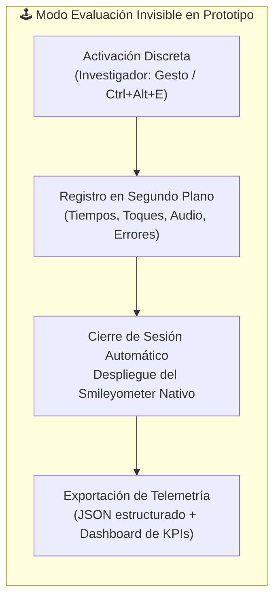
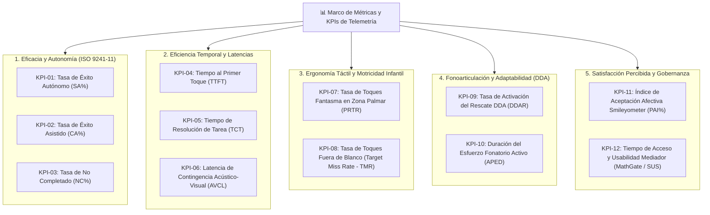
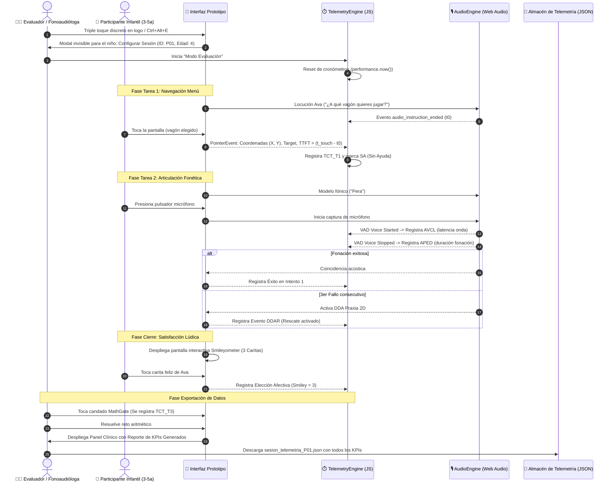
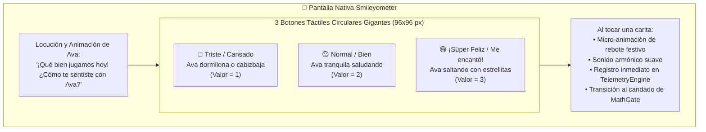
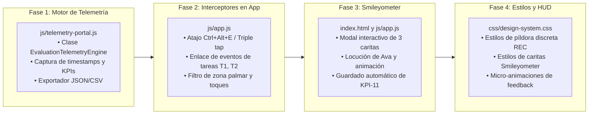

# Plan de Especificación e Implementación: Modo Evaluación con Telemetría Automática y Smileyometer Nativo

> **Curso:** Interacción Humano-Computador (FISI - UNMSM)  
> **Docente:** Dr. Ivan Carlo Petrlik Azabache  
> **Proyecto:** "Bosque Sonoro" — Aplicación fono-lúdica para niños de 3 a 5 años con dificultades de pronunciación (TSH / Dislalia Funcional) y mediadores adultos  
> **Documento:** Especificación Arquitectónica y Hoja de Ruta Técnica (Eje 2)  
> **Estado:** Propuesta Técnica para Aprobación  

---

## 1. Justificación y Propósito del "Modo Evaluación"

En las pruebas de usabilidad y accesibilidad tradicionales con niños de edad preescolar (3 a 5 años), la toma manual de tiempos con cronómetros físicos o la observación visible con cuadernos de notas genera dos sesgos metodológicos críticos:
1. **Efecto observador / Ansiedad de desempeño infantil:** Ver a un adulto con un cronómetro o tomando notas distrae al niño, rompe la metáfora inmersiva del "Bosque Sonoro" e incrementa la inhibición fonoarticulatoria en niños con dislalia funcional.
2. **Imprecisión de registro humano:** Los tiempos de reacción en niños pequeños (latencias de toque entre 200 ms y 800 ms) y los micro-toques accidentales en franjas pasivas son casi imposibles de cuantificar de forma fiable mediante observación humana manual.

El **"Modo Evaluación" con Telemetría Automática** convierte al prototipo interactivo en un **instrumento de medición psicométrica y ergonómica no intrusivo**. El evaluador activa el modo de forma discreta; a partir de ese instante, el software registra en segundo plano cada micro-interacción motriz, acústica y temporal con precisión de milisegundos (`performance.now()`), culminando con un **Smileyometer digital interactivo** que captura la satisfacción infantil sin requerir papel ni inducir respuestas.



---

## 2. Definición Integral de KPIs de Usabilidad, Accesibilidad y Ergonomía

Para evaluar de forma cuantitativa y rigurosa la experiencia de uso conforme al estándar **ISO/IEC 9241-11** (Eficacia, Eficiencia, Satisfacción), las pautas **WCAG 2.2** y la literatura fonoaudiológica pediátrica (*Hourcade, 2008; Du et al., 2023; Read, 2008*), se establecen **12 Indicadores Clave de Desempeño (KPIs)**:



---

### 2.1 Dimensión 1: Eficacia y Autonomía de Uso (ISO 9241-11)

#### KPI-01: Tasa de Éxito Autónomo (*Autonomous Success Rate - SA%*)
- **Definición:** Porcentaje de tareas críticas (T1: Menú Vagones, T2: Articulación Fonética, T3: MathGate) resueltas por el participante por sí mismo, guiado únicamente por las pistas visuales y las locuciones de Ava, sin ninguna intervención verbal o física del moderador.
- **Fórmula Matemática:**
  $$\text{SA\%} = \left( \frac{\sum \text{Tareas resueltas sin ayuda}}{\text{Total de tareas ejecutadas}} \right) \times 100$$
- **Método de Captura Automática:** El sistema marca automáticamente `SA = true` si la tarea culmina con éxito dentro del umbral de tiempo límite sin que el evaluador haya pulsado el botón de asistencia en el HUD de telemetría.
- **Umbrales de Calidad (Semáforo):**
  - 🟢 **Verde (Óptimo):** $\ge 80\%$
  - 🟡 **Ámbar (Aceptable):** $60\% - 79\%$
  - 🔴 **Rojo (Crítico - Requiere Rediseño):** $< 60\%$

#### KPI-02: Tasa de Éxito Asistido (*Assisted Success Rate - CA%*)
- **Definición:** Porcentaje de tareas resueltas con éxito luego de que el moderador proporcionó un *prompt* o pista verbal neutra autorizada (tras detectar más de 10 segundos de inactividad o desorientación del niño).
- **Fórmula Matemática:**
  $$\text{CA\%} = \left( \frac{\sum \text{Tareas resueltas con 1 apoyo verbal}}{\text{Total de tareas ejecutadas}} \right) \times 100$$
- **Método de Captura Automática:** Marcador activado mediante tecla rápida discreta del evaluador o evento asistido en el monitor.
- **Umbrales de Calidad:**
  - 🟢 **Verde:** $\le 15\%$
  - 🟡 **Ámbar:** $16\% - 30\%$
  - 🔴 **Rojo:** $> 30\%$ (Indica que la interfaz no es suficientemente auto-explicativa).

#### KPI-03: Tasa de Tareas No Completadas (*Abandonment / Failure Rate - NC%*)
- **Definición:** Porcentaje de tareas abandonadas voluntariamente por el niño, interrumpidas por sobrepasar el tiempo límite de seguridad, o que requirieron resolución forzada por parte del moderador.
- **Fórmula Matemática:**
  $$\text{NC\%} = \left( \frac{\sum \text{Tareas abandonadas o fallidas}}{\text{Total de tareas ejecutadas}} \right) \times 100$$
- **Umbrales de Calidad:**
  - 🟢 **Verde:** $< 5\%$
  - 🟡 **Ámbar:** $5\% - 15\%$
  - 🔴 **Rojo:** $> 15\%$

---

### 2.2 Dimensión 2: Eficiencia Temporal y Latencias de Interacción

#### KPI-04: Tiempo hasta el Primer Toque (*Time-to-First-Touch - TTFT*)
- **Definición:** Tiempo en segundos transcurrido desde el momento en que termina la locución de instrucción de Ava (ej. *"¿A qué vagón quieres jugar hoy?"*) hasta que la pantalla registra el primer contacto táctil (`pointerdown`) intencional del niño. Mide la **claridad de affordance visual** y la carga cognitiva inicial.
- **Fórmula Matemática:**
  $$\text{TTFT} = t_{\text{primer\_toque}} - t_{\text{fin\_audio\_instruccion}}$$
- **Método de Captura Automática:** Diferencial exacto capturado con `performance.now()` enlazado al evento `ended` de la locución Web Audio y al `pointerdown` del viewport.
- **Umbrales de Calidad (Preescolares 3-5 años):**
  - 🟢 **Verde:** $< 3.5\text{ segundos}$
  - 🟡 **Ámbar:** $3.5\text{ s} - 6.0\text{ s}$
  - 🔴 **Rojo:** $> 6.0\text{ segundos}$ (Indica parálisis atencional o confusión en la metáfora visual).

#### KPI-05: Tiempo de Resolución por Tarea (*Task Completion Time - TCT*)
- **Definición:** Duración total en segundos requerida para cumplir con éxito el objetivo de cada tarea estandarizada.
  - $TCT_{T1}$: Selección y carga del vagón lúdico (Límite: $45\text{ s}$).
  - $TCT_{T2}$: Escucha, pulsación del micrófono y fonación con biofeedback (Límite: $90\text{ s}$).
  - $TCT_{T3}$: Resolución de MathGate por el mediador adulto (Límite: $30\text{ s}$).
- **Fórmula Matemática:**
  $$\text{TCT} = t_{\text{evento\_exito}} - t_{\text{inicio\_tarea}}$$
- **Umbrales de Calidad:**
  - **T1 (Menú):** 🟢 $< 15\text{ s}$ | 🟡 $15\text{ s} - 30\text{ s}$ | 🔴 $> 30\text{ s}$
  - **T2 (Articulación):** 🟢 $< 35\text{ s}$ | 🟡 $35\text{ s} - 60\text{ s}$ | 🔴 $> 60\text{ s}$
  - **T3 (MathGate):** 🟢 $< 5\text{ s}$ | 🟡 $5\text{ s} - 10\text{ s}$ | 🔴 $> 10\text{ s}$

#### KPI-06: Latencia de Contingencia Audiovisual (*Audio-Visual Contingency Latency - AVCL*)
- **Definición:** Intervalo de tiempo en milisegundos entre el inicio de la vocalización del niño (detección acústica en micrófono) y la representación gráfica inmediata de las ondas sonoras en pantalla. Crucial para evitar desconexión en niños pequeños.
- **Fórmula Matemática:**
  $$\text{AVCL} = t_{\text{primer\_frame\_canvas}} - t_{\text{umbral\_rms\_superado}}$$
- **Método de Captura Automática:** Registro de tiempo diferencial entre el callback del `AnalyserNode` de Web Audio API y el primer render del `requestAnimationFrame`.
- **Umbrales de Calidad:**
  - 🟢 **Verde:** $< 150\text{ ms}$ (Sensación de inmediatez física)
  - 🟡 **Ámbar:** $150\text{ ms} - 300\text{ ms}$ (Límite perceptual según WCAG 2.2)
  - 🔴 **Rojo:** $> 300\text{ ms}$ (Ruptura de la contingencia de biofeedback)

---

### 2.3 Dimensión 3: Ergonomía Táctil y Motricidad Pediátrica

#### KPI-07: Tasa de Toques Fantasma en Franja Palmar (*Palm Rest Miss-Tap Rate - PRTR*)
- **Definición:** Frecuencia de eventos de contacto involuntarios registrados en la zona inferior de la tableta ($\le 48\text{ dp}$ de altura) donde el niño apoya la eminencia tenar o los dedos en descanso, los cuales deben ser absorbidos por el filtro debounce de $80\text{ ms}$ sin activar funciones por error.
- **Fórmula Matemática:**
  $$\text{PRTR} = \frac{\sum \text{Toques registrados en franja inferior}}{\text{Duración de la sesión en minutos}}$$
- **Método de Captura Automática:** Escucha activa en el contenedor `#palm-rest-bar` registrando coordenadas $Y \ge (H_{\text{viewport}} - 56\text{ px})$ con estado `filtered = true`.
- **Umbrales de Calidad:**
  - 🟢 **Verde:** $100\%$ de eventos filtrados exitosamente (cero falsos clics provocados).
  - 🔴 **Rojo:** $\ge 1$ activación accidental de elementos de juego debido a apoyo palmar.

#### KPI-08: Tasa de Toques Fuera de Blanco (*Target Miss Rate - TMR*)
- **Definición:** Porcentaje de pulsaciones táctiles que aterrizan fuera del área interactiva objetivo (ej. toques en el espacio vacío que rodea al pulsador central de micrófono o a los vagones del tren). Refleja temblor motor infantil o imprecisión en la puntería fito-motriz.
- **Fórmula Matemática:**
  $$\text{TMR\%} = \left( \frac{\sum \text{Toques en coordenadas sin listener}}{\text{Total de toques en pantalla}} \right) \times 100$$
- **Umbrales de Calidad:**
  - 🟢 **Verde:** $< 20\%$ (Los blancos gigantes de $90\text{ px}$ absorben casi todos los toques).
  - 🟡 **Ámbar:** $20\% - 35\%$
  - 🔴 **Rojo:** $> 35\%$ (Indica que el área sensible es insuficiente para la edad).

---

### 2.4 Dimensión 4: Fonoarticulación y Adaptabilidad Asistida (DDA)

#### KPI-09: Tasa de Activación del Algoritmo DDA (*Dynamic Difficulty Assistance Rate - DDAR*)
- **Definición:** Porcentaje de iteraciones fónicas en que el niño requirió el rescate pedagógico asistido (despliegue automático de la Praxia Bucofacial 2D) tras acumular **3 intentos fallidos consecutivos** en la pronunciación del fonema meta.
- **Fórmula Matemática:**
  $$\text{DDAR\%} = \left( \frac{\sum \text{Activaciones de Praxia 2D DDA}}{\text{Total de palabras ensayadas}} \right) \times 100$$
- **Interpretación Clínica:** Un DDAR alto en fonemas específicos (`/r/`, sinfones) valida la utilidad clínica del soporte visual 2D para dislalia funcional sin frustración.
- **Umbrales de Calidad:**
  - 🟢 **Verde:** Activación en el $100\%$ de los casos de 3er fallo consecutivo (cero fallos de detección).
  - 🟢 **Eficacia posterior:** $\ge 70\%$ de los niños que reciben la praxia 2D logran una aproximación fonética superior o continúan el juego con motivación renovada.

#### KPI-10: Duración del Esfuerzo Fonatorio Activo (*Active Phonatory Effort Duration - APED*)
- **Definición:** Tiempo medio en segundos durante el cual el niño emite sonido vocal continuo mientras interactúa con el botón de micrófono. Permite verificar que el niño no sufre fatiga articulatoria ni sobreesfuerzo laríngeo.
- **Fórmula Matemática:**
  $$\text{APED} = \frac{\sum (t_{\text{silencio\_post\_voz}} - t_{\text{inicio\_voz}})}{\text{Número de fonaciones}}$$
- **Umbrales de Calidad:**
  - 🟢 **Verde:** $1.2\text{ s} - 2.8\text{ s}$ (Articulación sana y natural de palabras bisilábicas/trisilábicas).
  - 🟡 **Ámbar:** $0.5\text{ s} - 1.1\text{ s}$ (Monosílabo cortado o timidez vocal).
  - 🔴 **Rojo:** $> 3.5\text{ s}$ (Sostenimiento excesivo con fatiga o captura involuntaria de ruido).

---

### 2.5 Dimensión 5: Satisfacción Afectiva Infantil y Usabilidad del Mediador

#### KPI-11: Índice de Aceptación Afectiva Smileyometer (*Positive Affect Index - PAI%*)
- **Definición:** Medición digital de satisfacción pediátrica basada en la escala estandarizada *Smileyometer* (*Read, 2008*), desplegada al final de la sesión con 3 caritas animadas de Ava:
  - Carita Feliz / Emocionado ($3\text{ puntos}$)
  - Carita Neutra / Tranquilo ($2\text{ puntos}$)
  - Carita Triste / Cansado o Aburrido ($1\text{ punto}$)
- **Fórmula Matemática:**
  $$\text{PAI\%} = \left( \frac{\sum (\text{Selecciones Carita Feliz})}{\text{Total de niños evaluados}} \right) \times 100$$
  $$\text{Media Smileyometer} = \frac{\sum \text{Puntajes individuales (1 a 3)}}{N}$$
- **Umbrales de Calidad:**
  - 🟢 **Verde:** $\text{PAI\%} \ge 80\%$ y Media $\ge 2.7 / 3.0$
  - 🟡 **Ámbar:** $\text{PAI\%} \ge 60\%$ y Media $\ge 2.3 / 3.0$
  - 🔴 **Rojo:** $\text{PAI\%} < 60\%$ o Media $< 2.3 / 3.0$

#### KPI-12: Usabilidad del Mediador Adulto (*Adult SUS Score & MathGate TCT*)
- **Definición:** Doble métrica para el mediador (Fonoaudióloga o Docente):
  1. **MathGate TCT:** Tiempo en segundos para resolver el reto aritmético verbal y acceder al portal clínico.
  2. **SUS Score:** Puntuación global del cuestionario *System Usability Scale* (Brooke, 1996) de 10 ítems (escala 0-100).
- **Fórmula Matemática SUS:**
  $$\text{SUS} = \left( \sum_{i \in \text{impares}} (R_i - 1) + \sum_{j \in \text{pares}} (5 - R_j) \right) \times 2.5$$
- **Umbrales de Calidad:**
  - 🟢 **Verde:** $\text{SUS} \ge 80\text{ pts}$ (Grado A, Usabilidad Excelente) y MathGate TCT $< 5\text{ s}$.
  - 🟡 **Ámbar:** $68\text{ pts} \le \text{SUS} < 80\text{ pts}$ (Aceptable) y MathGate TCT $5\text{ s} - 8\text{ s}$.
  - 🔴 **Rojo:** $\text{SUS} < 68\text{ pts}$ o MathGate TCT $> 8\text{ s}$.

---

## 3. Matriz Resumen de KPIs y Metas de Aceptación

| Código | Nombre del KPI | Dimensión | Método de Medición | Meta Verde | Meta Ámbar | Meta Roja |
| :---: | :--- | :--- | :--- | :---: | :---: | :---: |
| **KPI-01** | Tasa Éxito Autónomo (SA%) | Eficacia | Telemetría automática | $\ge 80\%$ | $60\% - 79\%$ | $< 60\%$ |
| **KPI-02** | Tasa Éxito Asistido (CA%) | Eficacia | Marcador evaluador HUD | $\le 15\%$ | $16\% - 30\%$ | $> 30\%$ |
| **KPI-03** | Tasa No Completado (NC%) | Eficacia | Timeout automático | $< 5\%$ | $5\% - 15\%$ | $> 15\%$ |
| **KPI-04** | Tiempo al Primer Toque (TTFT) | Eficiencia | `performance.now()` | $< 3.5\text{ s}$ | $3.5\text{ s} - 6.0\text{ s}$ | $> 6.0\text{ s}$ |
| **KPI-05** | Tiempo de Resolución T1 (TCT-T1) | Eficiencia | Timestamps de pantalla | $< 15\text{ s}$ | $15\text{ s} - 30\text{ s}$ | $> 30\text{ s}$ |
| **KPI-06** | Tiempo de Resolución T2 (TCT-T2) | Eficiencia | Timestamps de micrófono | $< 35\text{ s}$ | $35\text{ s} - 60\text{ s}$ | $> 60\text{ s}$ |
| **KPI-07** | Latencia Biofeedback (AVCL) | Accesibilidad | Web Audio Analyser delta | $< 150\text{ ms}$ | $150 - 300\text{ ms}$ | $> 300\text{ ms}$ |
| **KPI-08** | Toques Fantasma Palmares (PRTR) | Ergonomía | Event listener franja pasiva | $100\%$ filtrados | N/A | $\ge 1$ falso clic |
| **KPI-09** | Toques Fuera de Blanco (TMR%) | Ergonomía | Pointer delta vs bounding box | $< 20\%$ | $20\% - 35\%$ | $> 35\%$ |
| **KPI-10** | Activación Rescate DDA (DDAR) | Adaptabilidad | Contador de 3er reintento | $100\%$ asistido | N/A | Fallo de rescate |
| **KPI-11** | Aceptación Smileyometer (PAI%) | Satisfacción | Pantalla final interactiva | $\ge 80\%$ | $60\% - 79\%$ | $< 60\%$ |
| **KPI-12** | Usabilidad Mediador (SUS Score) | Satisfacción | Cuestionario estandarizado | $\ge 80\text{ pts}$ | $68 - 79\text{ pts}$ | $< 68\text{ pts}$ |

---

## 4. Arquitectura del "Modo Evaluación" en el Prototipo

### 4.1 Diagrama de Secuencia de la Telemetría en Segundo Plano



---

### 4.2 Mecanismo de Activación Discreta y HUD de Control

Para no contaminar la interfaz lúdica con elementos ajenos a la fantasía del niño, el Modo Evaluación se controla mediante una **capa invisible de telemetría**:

1. **Mecanismo de Despertar (*Trigger*):**
   - **En teclado (Tableta con teclado o laptop de pruebas):** Combinación de teclas `Ctrl + Alt + E` (*Evaluation Mode*).
   - **En pantalla táctil pura:** Triple toque rápido ($\le 600\text{ ms}$) sobre la insignia de Ava en la esquina superior izquierda.
2. **Modal de Configuración Rápida (10 segundos antes de sentar al niño):**
   - Código anónimo del participante (ej. `P01`, `P02`).
   - Rango de edad: `[3 años] [4 años] [5 años]`.
   - Perfil fonético: `[Rotacismo /r/] [Sigmatismo /s/] [Sinfones /pl/] [Control]`.
   - Modalidad visual: `[Estándar Biofílico] [Modo CVI Alto Contraste]`.
3. **HUD Mínimo del Observador (*Observer Pill*):**
   - Una píldora diminuta y translúcida ($18\text{ px}$ de alto) en el borde superior derecho, de color gris neutro casi imperceptible para el niño:
     - Indicador de estado: `● REC (P01)`.
     - Toque sutil del evaluador en esa píldora abre un menú contextual desplegable con 2 botones de asistencia: `[+ Registrar Asistencia CA]` y `[Finalizar Sesión & Mostrar Smileyometer]`.

---

### 4.3 Componente Nativo: Smileyometer Digital Interactivo

En lugar de que el moderador le muestre un papel impreso al niño, al concluir el recorrido de juegos o al pulsar finalizar sesión, la interfaz realiza una transición suave hacia el **Smileyometer Nativo de Ava**:



**Ventajas metodológicas del Smileyometer interactivo:**
- Cero intermediación del evaluador: el niño presiona directamente la emoción que sintió.
- Elimina el sesgo de complacencia (los niños suelen decirle *"sí, todo bien"* al adulto por educación).
- La selección se registra con timestamp y queda automáticamente tabulada para el cálculo del **KPI-11 (PAI%)**.

---

### 4.4 Esquema de Datos de Telemetría JSON (*SessionTelemetrySchema*)

Al finalizar la sesión, el motor produce un objeto estructurado que puede descargarse en formato `.json` o consultarse directamente en el panel del especialista:

```json
{
  "session_id": "SES-20261031-P01",
  "metadata": {
    "participant_id": "P01",
    "child_pseudonym": "Mateo",
    "age": 4,
    "condition": "Dislalia funcional simple (rotacismo)",
    "visual_mode": "standard_biophilic",
    "start_timestamp": "2026-10-31T11:45:10.120Z",
    "end_timestamp": "2026-10-31T11:58:22.450Z",
    "total_duration_sec": 792.33
  },
  "kpis_summary": {
    "kpi_01_autonomous_success_rate_pct": 100.0,
    "kpi_02_assisted_success_rate_pct": 0.0,
    "kpi_03_non_completed_rate_pct": 0.0,
    "kpi_04_time_to_first_touch_sec": 2.45,
    "kpi_05_task_completion_times_sec": {
      "t1_menu_navigation": 8.20,
      "t2_phonetic_articulation": 24.15,
      "t3_mathgate_adult": 3.80
    },
    "kpi_06_audio_visual_contingency_latency_ms": 112.5,
    "kpi_07_palm_rest_filtered_touches": 6,
    "kpi_07_palm_rest_false_triggers": 0,
    "kpi_08_target_miss_rate_pct": 11.4,
    "kpi_09_dda_rescue_activated": false,
    "kpi_10_avg_phonatory_effort_duration_sec": 1.85,
    "kpi_11_smileyometer_score": 3,
    "kpi_11_smileyometer_label": "Super Feliz",
    "kpi_12_mathgate_tct_sec": 3.80,
    "kpi_12_sus_score_adult": 87.5
  },
  "detailed_events_log": [
    {
      "timestamp_ms": 1240.5,
      "event_type": "TASK_START",
      "task_id": "T1_NAV",
      "target": "screen_vagon_select"
    },
    {
      "timestamp_ms": 3690.5,
      "event_type": "POINTER_DOWN",
      "coordinates": { "x": 512, "y": 384 },
      "target_id": "vagon-trabalenguas",
      "is_valid_target": true,
      "latency_since_task_start_ms": 2450.0
    },
    {
      "timestamp_ms": 14200.0,
      "event_type": "VOICE_RECORD_START",
      "target_word": "Pera",
      "phoneme": "/r/ intervocálica"
    },
    {
      "timestamp_ms": 16050.0,
      "event_type": "VOICE_RECORD_STOP",
      "duration_ms": 1850.0,
      "status": "SUCCESS"
    },
    {
      "timestamp_ms": 780100.0,
      "event_type": "SMILEYOMETER_SELECTION",
      "selected_value": 3,
      "reaction_time_ms": 1890.0
    }
  ]
}
```

---

## 5. Hoja de Ruta de Implementación Técnica en Código

Para ejecutar esta propuesta de forma limpia y modular sobre el prototipo interactivo actual (`Proyecto/Prototipo/`), se estructuran las modificaciones en **4 módulos técnicos**:



### 5.1 Desglose de cambios por archivo

1. **`Proyecto/Prototipo/js/telemetry-portal.js`:**
   - Incorporar la clase `EvaluationTelemetryEngine` complementaria al actual `TelemetryPortalEngine`.
   - Métodos principales:
     - `startSession(participantId, age, condition, visualMode)`
     - `logTaskStart(taskId)`
     - `logPointerEvent(event, targetElement)`
     - `logAudioMetric(type, durationMs, latencyMs)`
     - `logAssistedHelp()`
     - `logSmileyChoice(score)`
     - `computeFinalKPIs()`
     - `exportSessionJSON()`
2. **`Proyecto/Prototipo/js/app.js`:**
   - Escuchar atajo global `Ctrl + Alt + E` y evento de triple pulsación en la barra de Ava.
   - Conectar los eventos de carga de pantallas y reproducción de audio con el `TelemetryEngine`.
   - Modificar la finalización de los juegos para disparar el modal del Smileyometer antes del bloqueo de pantalla.
3. **`Proyecto/Prototipo/index.html`:**
   - Insertar el marcado del modal de configuración inicial (`#eval-config-modal`).
   - Insertar la píldora discreta de telemetría del evaluador (`#eval-observer-hud`).
   - Insertar el modal del Smileyometer con los 3 botones accesibles (`#smileyometer-screen`).
4. **`Proyecto/Prototipo/css/design-system.css`:**
   - Definir variables y clases para los botones del Smileyometer ($\ge 96\text{ px}$ con aros contrastados y foco accesible).
   - Estilo translúcido y no invasivo para la píldora del observador.

---

## 6. Verificación y Criterios de Aceptación (DoD)

Para considerar concluida la implementación del Eje 2 cuando sea autorizada, se validarán los siguientes criterios:

- [ ] **No intrusividad:** La pantalla del juego en modo normal no muestra ningún elemento visible que distraiga o alerte al niño.
- [ ] **Precisión temporal:** Los registros de `TTFT`, `TCT` y `AVCL` se calculan con base en `performance.now()` con error $< 5\text{ ms}$.
- [ ] **Filtrado de zona palmar:** Los toques en la franja inferior se cuantifican con precisión sin disparar eventos de navegación erróneos.
- [ ] **Smileyometer funcional:** Al terminar la interacción o al forzar el cierre, las 3 caritas animadas se despliegan correctamente y la selección del infante se almacena en el registro de la sesión.
- [ ] **Exportación limpia:** El evaluador puede descargar el archivo `.json` formateado con un solo clic desde el panel de mediación.

---

> 📌 **Nota para el Usuario:** Este documento establece la base teórica, las fórmulas de los 12 KPIs y la arquitectura técnica del Modo Evaluación. Una vez revisado y aprobado este plan, se procederá a la implementación técnica en los archivos correspondientes del prototipo interactivo.

