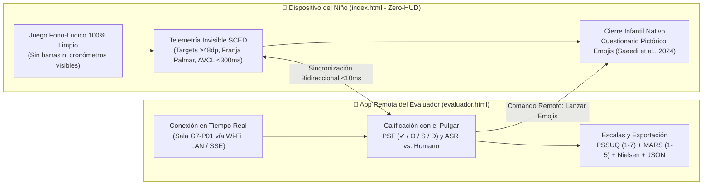
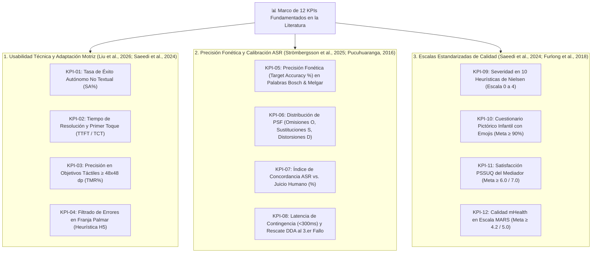

# Plan de Especificación e Implementación: Modo Evaluación Micro-SCED con Telemetría Automática y Cuestionario Pictórico Nativo

> **Curso:** Interacción Humano-Computador (FISI - UNMSM)  
> **Docente:** Dr. Ivan Carlo Petrlik Azabache  
> **Proyecto:** "Bosque Sonoro" — Aplicación fono-lúdica para niños de 3 a 5 años con dificultades de pronunciación (TSH / Dislalia Funcional) y mediadores adultos  
> **Documento:** Especificación Arquitectónica de Telemetría para Diseño de Caso Único (*Micro-SCED*)  
> **Vinculación:** Complemento técnico de [[Actividad 10 - Prueba de Usabilidad y Accesibilidad]]

---

## 1. Justificación Metodológica del "Modo Evaluación" para un Equipo sin Financiamiento

En las pruebas de usabilidad y precisión fonética con niños preescolares (3 a 5/6 años), las fuentes científicas (**Saeedi et al., 2024; Liu et al., 2026; Strömbergsson et al., 2025**) señalan dos retos operativos críticos, los cuales se acentúan cuando el equipo evaluador es un **grupo universitario pequeño sin presupuesto para laboratorios clínicos**:

1. **Sustitución de equipamiento de laboratorio por telemetría embebida (*Micro-SCED*):** Dado que como grupo estudiantil autofinanciado no contamos con cámaras de seguimiento ocular (*eye-tracking*), salas Gessell ni un equipo externo de fonoaudiólogos anotando en tiempo real, el propio software debe actuar como **registrador automático sesión por sesión**, aplicando el **Diseño Experimental de Caso Único (*SCED - Single-Case Experimental Design*)** recomendado por **Strömbergsson et al. (2025)**.
2. **Arquitectura Desacoplada *Zero-HUD* + Consola Remota del Evaluador (`evaluador.html`):** Para evitar el efecto Hawthorne, distracciones visuales y cualquier necesidad de que el evaluador toque el dispositivo del niño mientras este juega, **la pantalla infantil (`index.html`) permanece 100% libre de recuadros o barras del evaluador (*Zero-HUD*)**. La calificación perceptual humana (**Omisión [O], Sustitución [S] o Distorsión [D]**, según **Pucuhuaranga, 2016** y **Peña et al., 2024**), la auditoría de **Concordancia ASR vs. Humano** (**Strömbergsson et al., 2025**), el registro de apoyos verbales (`+1 CA`) y el disparo remoto del cierre se realizan desde una aplicación web ligera e independiente (**`evaluador.html`**) abierta en el propio celular o laptop del integrante del Equipo G7, sincronizada en tiempo real vía Wi-Fi local (`/api/sced-sync` SSE/POST) y `BroadcastChannel`.



---

## 2. Marco de 12 KPIs Fundamentados en las Fuentes del Estado del Arte

Cada indicador automatizado en el motor de telemetría responde directamente a una métrica y autor del repositorio científico del proyecto:



---

### 2.1 Bloque 1: Usabilidad Técnica, Flujo Voice-First y Adaptación Motriz Pediátrica

#### KPI-01: Tasa de Navegación Autónoma No Textual (*SA%*) — *Saeedi et al. (2024) & Liu et al. (2026)*
- **Fundamento:** Mide si la guía hablada (*read-aloud*) de Ava y los juguetes visuales permiten que el preescolar pre-lector navegue sin intervención adulta.
- **Fórmula:** $\text{SA\%} = \left(\frac{\text{Tareas completadas sin ayuda}}{\text{Total de tareas}}\right) \times 100$
- **Meta Objetivo:** **$\ge 85\%$**

#### KPI-02: Eficiencia Temporal y Contingencia Audiovisual (*TCT & AVCL*) — *Peña et al. (2024)*
- **Fundamento:** Verifica que el tiempo en tarea no genere fatiga preescolar y que el retorno de autoescucha (*self-playback*) ocurra dentro de la ventana de plasticidad auditivo-motora.
- **Meta Objetivo:** Tiempo en tarea T1 $< 45\text{ s}$, T2 $< 60\text{ s}$ y latencia de biofeedback **$< 300\text{ ms}$**.

#### KPI-03: Precisión Motriz en Objetivos Táctiles ($\ge 48 \times 48\text{ dp}$) — *Liu et al. (2026) & Saeedi et al. (2024)*
- **Fundamento:** Analiza si el tamaño de los botones (micrófono de $76/90\text{ px}$, vagones de $\ge 74\text{ px}$ y salida de praxias de $56\text{ px}$) compensa el temblor motor infantil.
- **Fórmula (*Target Miss Rate*):** $\text{TMR\%} = \left(\frac{\text{Toques fuera de blanco}}{\text{Total de toques}}\right) \times 100$
- **Meta Objetivo:** **$< 15\%$** de toques errados.

#### KPI-04: Prevención de Errores Motoras y Libertad de Salida (Heurísticas H5 y H3) — *Saeedi et al. (2024)*
- **Fundamento:** **Saeedi et al. (2024)** identificaron a *Prevención de errores* ($3.83/4.0$) como la heurística más severa y a *Control y libertad del usuario* como la más frecuente. El sistema audita cuántos toques palmares fueron absorbidos por el filtro debounce ($80\text{ ms}$) y cuántos cortes de grabación se evitaron gracias al modo *Tap-to-Talk*.
- **Meta Objetivo:** **$0$ activaciones accidentales** por apoyo palmar y severidad H5 **$< 1.0 / 4.0$**.

---

### 2.2 Bloque 2: Precisión Fonética (*Target Accuracy*), PSF y Concordancia del ASR

#### KPI-05: Precisión Fonética (*Target Accuracy %*) en Palabras de Bosch & Melgar — *Strömbergsson et al. (2025) & Pucuhuaranga (2016)*
- **Fundamento:** Registra sesión por sesión (enfoque *SCED*) el porcentaje de fonemas producidos correctamente tanto en palabras aisladas (evaluadas en posición Inicial, Medial y Final según la **Ficha de Laura Bosch y María Melgar**) como en frases o trabalenguas continuos.
- **Fórmula:**
  $$\text{Target Accuracy (\%)} = \left( \frac{\text{Fonemas producidos correctamente (Juicio Humano)}}{\text{Total de estímulos evaluados en la sesión}} \right) \times 100$$

#### KPI-06: Perfil de Procesos de Simplificación Fonológica (PSF: O / S / D) — *Pucuhuaranga (2016) & Peña et al. (2024)*
- **Fundamento:** Clasifica cada error articulatorio registrado en el piloto dentro de las tres categorías clínicas estandarizadas que alimentan el módulo **TEPROSIF-R**:
  - **Omisión (`O`):** Ej. *"pato"* por *"plato"*.
  - **Sustitución (`S`):** Ej. *"pelo"* por *"pera"*.
  - **Distorsión (`D`):** Emisión aproximada distorsionada.

#### KPI-07: Concordancia entre Retroalimentación Automática y Humana (*ASR Agreement %*) — *Strömbergsson et al. (2025)*
- **Fundamento:** Cuantifica el grado de acuerdo entre el puntaje/estrellas otorgado automáticamente por el motor acústico de la app y la validación perceptual del evaluador humano, identificando **Falsos Positivos** (aprobaciones erróneas) y **Falsos Negativos** (rechazos injustificados).
- **Fórmula:**
  $$\text{Concordancia ASR (\%)} = \left( \frac{\text{Intentos donde Veredicto App} = \text{Juicio Humano}}{\text{Total de intentos vocales}} \right) \times 100$$
- **Meta Objetivo:** **$\ge 85\%$** de concordancia perceptual.

#### KPI-08: Eficacia del Rescate DDA y Pureza sin *Schwa* (`[ə]`) — *Strömbergsson et al. (2025) & Furlong et al. (2018)*
- **Fundamento:** Verifica que al 3.er fallo consecutivo se despliegue el modelado lingual 2D sin castigo, y que el 100% de los audios reproducidos carezcan de distorsión robótica o inserción de vocal neutra *schwa* (`[ə]`).
- **Meta Objetivo:** **$100\%$** de activación DDA al 3.er fallo y **$0\%$** de antipatrones fonéticos.

---

### 2.3 Bloque 3: Instrumentos Psicométricos Estandarizados de Calificación

| Código | Instrumento Integrado | Escala | Valor Objetivo (Meta Literatura) | Referencia Científica |
| :---: | :--- | :---: | :---: | :--- |
| **KPI-09** | **10 Heurísticas de Usabilidad de Nielsen** | Severidad $0\text{ a }4$ | Promedio general **$\le 1.5 / 4.0$** y Prevención de Errores **$< 1.0$** | **Saeedi et al. (2024)** |
| **KPI-10** | **Cuestionario Pictórico con Emojis (3–6 años)** | 3 Caritas Pictóricas | **$\ge 90\%$** de agrado estético e intención de jugar | **Saeedi et al. (2024)** |
| **KPI-11** | **Cuestionario PSSUQ (Mediadores Adultos)** | Likert $1\text{ a }7$ | Media global **$\ge 6.0 / 7.0$** y Calidad de Interfaz **$\ge 6.25 / 7.0$** | **Saeedi et al. (2024)** |
| **KPI-12** | **Escala de Calidad mHealth MARS** | Likert $1\text{ a }5$ | Puntuación total **$\ge 4.2 / 5.0$** (superando media comercial de $3.7$) | **Furlong et al. (2018)** |

---

## 3. Esquema de Datos de Telemetría JSON (*SCEDSessionTelemetrySchema*)

El archivo `.json` exportado al concluir cada sesión de 12–15 minutos almacena tanto las métricas de interacción técnica como la matriz fonológica (Bosch & Melgar / TEPROSIF-R), la concordancia ASR vs. Humano y los puntajes PSSUQ/MARS, dejando los datos listos para análisis estadísticos no paramétricos (**Prueba de Kruskal-Wallis / U de Mann-Whitney, $p < 0.05$**, según **Mora Espinoza et al., 2024**):

```json
{
  "session_id": "SCED-20261101-P01-S01",
  "study_scope": "Piloto Acotado Micro-SCED (Grupo G7 UNMSM - Sin Financiamiento Externo)",
  "metadata": {
    "participant_id": "P01",
    "child_pseudonym": "Mateo",
    "age_years": 4,
    "initial_severity_level": "Leve-Moderado (Rotacismo /r/)",
    "mediator_role": "Docente de Educación Inicial (Lima Metropolitana)",
    "visual_mode": "standard_biophilic",
    "session_duration_sec": 745.0
  },
  "technical_usability_metrics": {
    "autonomous_navigation_sa_pct": 100.0,
    "touch_target_compliance_min_dp": 48,
    "mic_button_hit_accuracy_pct": 92.5,
    "palm_rest_filtered_touches": 5,
    "palm_rest_false_activations": 0,
    "biofeedback_contingency_latency_ms": 118.4,
    "schwa_antipattern_detected": false
  },
  "phonetic_sced_evaluation": {
    "instrument_reference": "Ficha Bosch & Melgar (Pucuhuaranga, 2016) + TEPROSIF-R (Peña et al., 2024)",
    "target_accuracy_isolated_words_pct": 60.0,
    "target_accuracy_continuous_phrase_pct": 50.0,
    "psf_error_breakdown": {
      "omissions_O": 0,
      "substitutions_S": 2,
      "distortions_D": 1
    },
    "asr_vs_human_calibration": {
      "total_vocal_attempts": 6,
      "concordant_judgments": 5,
      "false_positives_app_approved_error": 1,
      "false_negatives_app_rejected_correct": 0,
      "agreement_rate_pct": 83.3
    }
  },
  "standardized_scales_scores": {
    "nielsen_heuristics_0_to_4": {
      "overall_mean_severity": 0.45,
      "error_prevention_h5_severity": 0.75,
      "user_control_h3_severity": 0.75
    },
    "child_emoji_pictorial_questionnaire": {
      "visual_appeal_emoji": 3,
      "emotional_comfort_emoji": 3,
      "intention_to_play_again_emoji": 3,
      "positive_acceptance_rate_pct": 100.0
    },
    "mediator_pssuq_1_to_7": {
      "overall_mean": 6.38,
      "system_usefulness": 6.33,
      "information_quality_teprosif": 6.25,
      "interface_quality": 6.50
    },
    "mhealth_mars_scale_1_to_5": {
      "engagement": 4.4,
      "functionality": 4.5,
      "aesthetics": 4.3,
      "clinical_information": 4.2,
      "total_mars_score": 4.35
    }
  }
}
```

---

## 4. Flujo de Interacción Remota del Evaluador y Cuestionarios Nativos

1. **Consola Remota del Evaluador (`evaluador.html` — *Zero-HUD* en el Dispositivo Infantil):**
   - Mientras el niño juega en la tableta (`index.html`), **no aparece ningún recuadro, cronómetro ni barra en su pantalla**. El estudiante evaluador del Equipo G7 abre `evaluador.html?room=G7-P01` en su propio celular o laptop (en la misma red Wi-Fi o segunda ventana) y recibe en tiempo real cada intento vocal, marcando con el pulgar (`[✔ Correcto]`, `[O: Omisión]`, `[S: Sustitución]`, `[D: Distorsión]`) o registrando apoyos verbales (`[🤝 +1 Apoyo CA]`) sin tocar la tableta del niño.
2. **Disparo Remoto del Cuestionario Pictórico Infantil con Emojis (`#emojiQuestionnaireModal`):**
   - Al concluir los 10–12 minutos de práctica lúdica, el evaluador pulsa **`🏁 Cerrar Prueba y Lanzar Emojis al Niño`** desde su celular (`evaluador.html`). Automáticamente, en la tableta del niño aparece el cuestionario de 3 preguntas pictóricas locutado por Ava con tarjetas gigantes ($\ge 148\text{ px}$) y botón circular de repetición oral ($58 \times 58\text{ px}$), transmitiendo en vivo al celular del evaluador si se supera la meta de **$\ge 90\%$** de aceptación (**Saeedi et al., 2024**).
3. **Formulario Digital Rápido PSSUQ, MARS y Heurísticas de Nielsen:**
   - Tanto desde la pestaña 3 y 4 de `evaluador.html` como desde el portal del mediador en `index.html`, el docente de inicial, tutor o evaluador G7 puede completar en tiempo real los 8 ítems del **PSSUQ (1–7)**, las 4 dimensiones **MARS (1–5)** y las **10 Heurísticas de Nielsen (0–4)**, exportando directamente el archivo `.json` (`SCEDSessionTelemetrySchema`) o `.csv`.
