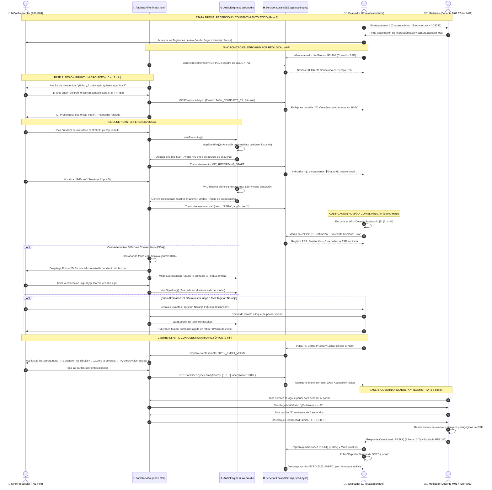

# 🔀 Protocolo de Ejecución de Pruebas: Diagramas de Actividades y Secuencia (Fases 3 y 4)

> **Curso:** Interacción Humano-Computador (FISI - UNMSM)  
> **Docente:** Dr. Ivan Carlo Petrlik Azabache  
> **Proyecto:** "Bosque Sonoro" — Aplicación fono-lúdica para niños de 3 a 5 años con dificultades del habla (TSH / Dislalia Funcional) y mediadores adultos  
> **Documentos Relacionados:**  
> - [[Fase 1 - Inspección Heurística y Verificación Técnica Pre-Piloto]]  
> - [[Fase 2 - Preparación de Materiales, Entorno y Logística de Campo]]  
> - [[Actividad 10 - Prueba de Usabilidad y Accesibilidad]]

---

## 🧭 1. Visión General de las Fases de Campo (Fases 3 y 4)

Las fases con usuarios reales se dividen en dos bloques complementarios bajo el modelo de interacción asimétrica dual (*CCI / Child-Computer Interaction*):

1. **Fase 3: Sesión Infantil Micro-SCED (10 a 15 minutos):** Enfocada exclusivamente en el niño de 3 a 5 años (`P01` a `P04`). Opera bajo la premisa **Voice-First y 100% No Textual**, pantalla limpia sin barras del evaluador (*Zero-HUD*) y arquitectura no punitiva.
2. **Fase 4: Evaluación de Gobernanza y Métricas con Mediadores Adultos (5 a 8 minutos):** Enfocada en la docente de educación inicial (`M01`) o madre/padre tutor (`M02`). Evalúa la compuerta cognitiva parental (*MathGate*), la inteligibilidad del Dashboard clínico TEPROSIF-R y el llenado de los instrumentos psicométricos estandarizados (**PSSUQ** y **MARS**).

---

## 📊 2. Diagrama General de Actividades del Protocolo de Campo (BPMN / Flowchart)

Este diagrama modela el flujo completo de la prueba en campo, contemplando el camino feliz (flujo nominal) y las cuatro ramificaciones condicionales de excepción:

```mermaid
flowchart TD
    Start(["🏁 Inicio de la Prueba en Campo"]) --> PreCheck["Fase 2 Checklist: Wi-Fi LAN verificado, tablet al 80%+ batería, sala silenciosa (<50 dB)"]
    PreCheck --> Ethics["Recepción: Firma de Consentimiento Ley N.° 29733 (Padre/Tutor)<br>Presentación de Tarjetones Físicos de Ava en mesa al niño"]

    Ethics --> InitSession["Evaluador G7 abre consola remota: evaluador.html?room=G7-P01<br>Niño abre juego en tableta: index.html (Zero-HUD)"]

    subgraph FASE_3 ["👶 FASE 3: SESIÓN INFANTIL MICRO-SCED (10 a 15 min)"]
        InitSession --> CheckCVI{"¿Participante con baja visión / CVI?<br>(Ej. Valentina P04)"}
        CheckCVI -- "SÍ" --> EnableCVI["Evaluador activa Modo CVI (>13:1 contraste cromático)"]
        CheckCVI -- "NO" --> T1["Tarea T1: Selección Autónoma de Vagón Voice-First<br>Ava: '¡Hola! ¿A qué vagón quieres jugar hoy?'"]
        EnableCVI --> T1

        T1 --> T1Eval{"¿Toca vagón en < 45 s sin ayuda lectora?"}
        T1Eval -- "SÍ (Autónomo)" --> LogSA["Registrar T1: SA (Éxito Autónomo) en telemetría"]
        T1Eval -- "NO (Duda/Espera)" --> LogCA["Apoyo verbal mínimo ('Mira el tren') y registrar CA"]
        LogSA --> T2
        LogCA --> T2

        T2["Tarea T2: Práctica Fonoarticulatoria Bosch & Melgar<br>(Banco de 6 palabras: RANA, PERA, MAR, SAPO, PLATO, trabalenguas)"]

        T2 --> CheckAssent{"¿El niño muestra fatiga o toca<br>Tarjetón Naranja 'Quiero descansar'?"}
        CheckAssent -- "SÍ (Pausa)" --> PauseBranch["Pausa Serena: Se apaga el micrófono, Ava queda en reposo.<br>¿Desea continuar tras 2 min de agua/descanso?"]
        PauseBranch -- "SÍ" --> T2
        PauseBranch -- "NO" --> ForceClose["Cierre gentil sin penalización y pase a Emojis"]

        CheckAssent -- "NO" --> MicTap["Niño pulsa micrófono central (90 px, Tap-to-Talk) y vocaliza"]
        MicTap --> CutAva["Motor AudioEngine: Cancela al instante cualquier locución previa de Ava"]
        CutAva --> VADCut["Grabación automática con corte VAD por silencio (3.5 s)"]

        VADCut --> HumanCheck["Evaluador califica con el pulgar en evaluador.html:<br>¿Articulación Correcta (✔) o PSF (Omisión O, Sustitución S, Distorsión D)?"]
        HumanCheck --> ASRCheck["Comparación ASR vs. Humano: ¿Coinciden veredictos?"]
        ASRCheck -- "Coinciden" --> Biofeedback["Biofeedback <300 ms: Ondas reactivas + Refuerzo positivo vocal"]
        ASRCheck -- "Discrepan" --> CalibASR["Registrar Falso Positivo (FP) o Falso Negativo (FN) en SCED"]
        CalibASR --> Biofeedback

        Biofeedback --> DDAEval{"¿El niño acumula 3 fallos<br>consecutivos en la misma palabra?"}
        DDAEval -- "SÍ (DDA)" --> PraxiaModal["Rescate DDA: Despliegue automático de Praxia 2D animada<br>Ava modela la posición lingual + Estrella de esfuerzo"]
        PraxiaModal --> ClosePraxiaBtn["Niño practica praxia y pulsa botón colosal 'Volver al Juego'"]
        ClosePraxiaBtn --> CutPraxia["Ava calla de inmediato al cerrar y se reanuda el juego"]
        CutPraxia --> CheckWordBatch{"¿Completó las 6 palabras estímulo?"}

        DDAEval -- "NO" --> CheckWordBatch
        CheckWordBatch -- "Faltan palabras" --> T2
        CheckWordBatch -- "6 palabras listas" --> LaunchEmojiCmd["Evaluador pulsa en celular: '🏁 Cerrar Prueba y Lanzar Emojis'"]
        ForceClose --> LaunchEmojiCmd

        LaunchEmojiCmd --> T3Modal["Tarea T3: Cuestionario Pictórico con Emojis en tableta<br>Ava locuta 3 preguntas gigantes: Atracción, Confort, Re-juego"]
        T3Modal --> ChildSelectEmoji["Niño toca caritas (Meta: ≥ 90% respuestas positivas)"]
    end

    subgraph FASE_4 ["👩‍🏫 FASE 4: GOBERNANZA ADULTA Y TELEMETRÍA (5 a 8 min)"]
        ChildSelectEmoji --> PassAdult["El niño va a jugar/dibujar; el Adulto Mediador toma la tableta"]
        PassAdult --> T4MathGate["Tarea T4: Compuerta Cognitiva Parental (MathGate)<br>Desafío aritmético aleatorio (ej. 3 + 4 = 7)"]
        T4MathGate --> MathCheck{"¿Resuelve en < 5 s?"}
        MathCheck -- "SÍ" --> UnlockPortal["Acceso concedido al Portal Clínico y Dashboard"]
        MathCheck -- "NO" --> RetryMath["Reintento con nuevo reto verbalizado"]
        RetryMath --> UnlockPortal

        UnlockPortal --> ExploreDash["Exploración Dashboard: Gráficas PSF (TEPROSIF-R) y fonemas críticos"]
        ExploreDash --> PSSUQForm["Adulto completa Cuestionario PSSUQ (8 ítems, escala 1 a 7)<br>Metas: Media global ≥ 6.0 | Calidad Interfaz ≥ 6.25"]
        PSSUQForm --> MARSForm["Adulto / Evaluador califica Escala MARS (4 dimensiones, 1 a 5)<br>Meta: Calidad total ≥ 4.2 / 5.0"]
        MARSForm --> ExportJSON["Pulsar 'Exportar Telemetría SCED (.json)' en evaluador.html<br>Descarga directa del esquema SCEDSessionTelemetrySchema"]
    end

    ExportJSON --> EndSession(["🏆 Fin de la Sesión Piloto: Datos Consolidados y Guardados"])
```

---

## 🎬 3. Diagrama de Secuencia Integral Multi-Actor (Ideal End-to-End)

Este diagrama detalla los intercambios temporales, llamadas a la API de sincronización LAN y transiciones de estado entre los 5 actores del sistema:

---

## 🎯 4. Especificación Detallada de los 5 Casos de Prueba en Campo

### Caso 1: Flujo Nominal Ideal (Camino Feliz — Happy Path)
* **Condición de Entrada:** Niño sin fatiga, audición normal, mediador presente y conexión LAN activa.
* **Secuencia de Eventos:**
  1. Firma de consentimiento por el padre y presentación de tarjetones de Ava en la mesa.
  2. Inicio de sesión en `index.html` sincronizada con `evaluador.html?room=G7-P01`.
  3. T1: El niño selecciona el primer vagón en **$< 45\text{ s}$** guiado únicamente por la voz de Ava (*SA% = 100%*).
  4. T2: El infante practica las 6 palabras de Bosch & Melgar con el modo *Tap-to-Talk*. El retorno fonoacústico de autoescucha ocurre en **$< 300\text{ ms}$**.
  5. El evaluador audita en vivo las emisiones; el ASR y el juicio humano concuerdan en $\ge 85\%$ de los casos.
  6. Finalización con el cuestionario de emojis alcanzando **$\ge 90\%$ de satisfacción**.
  7. El adulto mediador supera el *MathGate* en $< 5\text{ s}$, explora el Dashboard y califica con **PSSUQ $\ge 6.0/7.0$** y **MARS $\ge 4.2/5.0$**.
  8. Exportación estructurada del archivo JSON de telemetría.

---

### Caso 2: Manejo de Dificultad Articulatoria y Rescate DDA (Strömbergsson et al., 2025)
* **Condición de Entrada:** El participante (ej. Lucas `P03` o Mateo `P01`) comete errores fonéticos repetidos al articular fonemas de alta demanda motriz (`/rr/` o `/r/`).
* **Secuencia de Eventos:**
  1. En el intento 1 y 2, la pronunciación no alcanza el umbral de claridad fónica.
  2. El sistema **NO reproduce timbres de error desagradables (*buzzers*)**, no resta estrellas ni muestra cruces rojas (**filosofía no punitiva**). En su lugar, emite refuerzos positivos por aproximación: *"¡Casi casi, qué buen intento!"*.
  3. Al producirse el **3.er fallo consecutivo**, el motor activa automáticamente el algoritmo **DDA (*Dynamic Difficulty Adjustment*)**.
  4. Se despliega en pantalla completa el **Modal de Praxias Anatómicas 2D** (`UI-PRAXIS-CANVAS`).
  5. Ava modela pausadamente cómo posicionar los labios y elevar la punta de la lengua detrás de los alvéolos superiores, otorgando una **estrella de esfuerzo**.
  6. El niño imita el movimiento frente al espejo/pantalla y toca el botón colosal **"Volver al Juego"** ($52\text{ px}$, verde bosque con pictograma de retorno).
  7. **Regla de corte inmediato:** Al tocar cerrar, la locución de Ava se detiene al instante y el juego se reanuda sin frustración.

---

### Caso 3: Desacuerdo Acústico y Calibración ASR vs. Juicio Humano (Strömbergsson et al., 2025)
* **Condición de Entrada:** Interferencia de ruido ambiental ($>50\text{ dB}$) o acústica atípica de voz infantil que induce discrepancias en el motor automático.
* **Secuencia de Eventos:**
  - **Sub-caso 3A (Falso Positivo):** El niño dice *"pelo"* en lugar de *"pera"*, pero el ruido de fondo o resonancia engaña al ASR y otorga estrellas de acierto.
    - *Acción del Evaluador:* Desde `evaluador.html`, el integrante G7 marca inmediatamente con el pulgar **`[S: Sustitución]`** y califica **`Juicio Humano = Error`**.
    - *Efecto:* La telemetría registra un **Falso Positivo (FP)**, corrigiendo la precisión fónica (*Target Accuracy*) en el cálculo final sin desmotivar al niño.
  - **Sub-caso 3B (Falso Negativo):** El niño articula correctamente *"sapo"*, pero por volumen bajo o lejanía del micrófono el ASR pide reintentar.
    - *Acción del Evaluador:* El evaluador marca con el pulgar **`[✔ Correcto]`**.
    - *Efecto:* Se contabiliza un **Falso Negativo (FN)** para la calibración del umbral RMS del docente y se anota el punto de acierto en la Ficha de Campo Micro-SCED.

---

### Caso 4: Activación de Pausa por Asentimiento Continuo Infantil (Hourcade, 2008 & Read, 2008)
* **Condición de Entrada:** El menor manifiesta cansancio atencional, timidez, llanto o distracción motriz tras 8–10 minutos de sesión.
* **Secuencia de Eventos:**
  1. El niño señala o levanta el **Tarjetón Naranja de Asentimiento** (*"Quiero descansar / Pausa"*), colocado visiblemente sobre la mesa.
  2. El evaluador G7 y el mediador adulto detienen de inmediato cualquier solicitud verbal.
  3. Se activa la pausa serena en la aplicación (apagando el micrófono y silenciando a Ava).
  4. Se ofrece al menor un vaso de agua, estiramiento o descanso de 2 minutos.
  5. El evaluador pregunta con tono cálido: *"¿Quieres seguir jugando un ratito más con los trenes de Ava o prefieres que lo dejemos por hoy?"*.
  6. Si el niño decide detenerse:
     - Se lanza directamente el **Cuestionario Pictórico de Emojis** para registrar su percepción afectiva.
     - Se guardan los datos registrados hasta ese punto sin penalización alguna, validando el principio ético de retiro voluntario.

---

### Caso 5: Adaptación Visual para Baja Visión / Modo CVI (Saeedi et al., 2024 & WCAG 2.2)
* **Condición de Entrada:** Participante con dificultades de discriminación visual cromática o fatiga ocular (ej. Valentina `P04`).
* **Secuencia de Eventos:**
  1. Antes de iniciar la Tarea T1 o durante la navegación inicial, el mediador adulto o evaluador pulsa el icono de accesibilidad o activa la casilla de **Modo CVI**.
  2. La hoja de estilos conmuta a la paleta de alto contraste:
     - Fondo carbón mate profundo (`#121212`).
     - Trazos vectoriales, botones y bordes en amarillo solar de alta luminancia (`#FFD600`) y cian vibrante (`#00E5FF`).
     - Ratio de contraste cromático superior a **$13:1$** (superando el nivel AAA de WCAG 2.2).
  3. Los elementos mantienen exactamente las mismas coordenadas físicas y áreas de toque ($\ge 48\times 48\text{ dp}$ y micrófono de $90\text{ px}$).
  4. La sesión se desarrolla con normalidad, registrándose en el esquema JSON el campo `"visual_mode": "cvi_high_contrast"`.

---

## 📋 5. Matriz Canónica de Decisiones del Protocolo de Pruebas

| ID Decisión | Reto Metodológico / de Campo | Fundamentación Científica | Solución Modelada en el Protocolo | Métrica / Verificación Objetiva |
| :---: | :--- | :--- | :--- | :--- |
| **DEC-PRU-01** | Sesgo de observación por invasión física del espacio del niño (*Hawthorne Effect*). | **Saeedi et al. (2024)** prescriben evaluación no intrusiva en entornos pediátricos lúdicos. | Arquitectura *Zero-HUD*: tableta del niño 100% limpia; consola remota del evaluador en celular (`evaluador.html`). | $0$ intervenciones físicas del evaluador sobre la pantalla infantil durante el juego. |
| **DEC-PRU-02** | Contaminación fónica por solapamiento entre la voz de Ava y el habla del niño. | **Peña et al. (2024)** exigen aislamiento acústico estricto en la ventana de plasticidad motora. | Regla universal: `AudioEngine.stopSpeaking()` al pulsar cualquier micrófono, cerrar praxias o cambiar de vista. | $0\text{ ms}$ de traslape vocal entre la locución del sistema y el micrófono. |
| **DEC-PRU-03** | Frustración o bloqueo emocional ante errores de articulación reiterados. | **Strömbergsson et al. (2025)** fundamentan el refuerzo por aproximación y rescate visual. | Algoritmo DDA: despliegue de praxia 2D lingual al 3.er fallo consecutivo sin timbres de error. | Tasa de abandono por frustración $= 0\%$; activación DDA en $100\%$ de casos elegibles. |
| **DEC-PRU-04** | Vulnerabilidad ética de niños pre-lectores que no pueden expresar disconformidad escrita. | **Hourcade (2008)** y **Read (2008)** exigen asentimiento continuo tangible (*ongoing assent*). | Tarjetones físicos bicolores de Ava en mesa (Verde = Jugar / Naranja = Pausa). | $100\%$ de comprensión del derecho a pausa verificado antes de iniciar T1. |
| **DEC-PRU-05** | Distorsión métrica por descalibración del reconocimiento de voz comercial en pediatría. | **Strömbergsson et al. (2025)** demuestran necesidad de auditoría de concordancia ASR vs. Humano. | Registro simultáneo de PSF humano (`O/S/D`) frente a veredicto automático en la consola remota. | Tasa de concordancia ASR vs. Juicio Humano documentada con meta $\ge 85\%$. |

---

## 🚀 6. Conclusión y Estado de Madurez Metodológica

Con este protocolo de diagramación de actividades y secuencias, las **Fases 3 y 4** quedan formalmente blindadas metodológicamente:
1. Se cuenta con una **ruta operativa unívoca** para guiar al estudiante evaluador en cada segundo de la prueba.
2. Cada excepción de campo (fatiga, fallos reiterados, fallas de reconocimiento o baja visión) tiene una **respuesta procedimental automatizada** en el software y en el entorno físico.
3. Los datos resultantes alimentan directamente el esquema estructurado `SCEDSessionTelemetrySchema` en formato `.json` para la redacción final del reporte de usabilidad de la **Actividad 10**.

