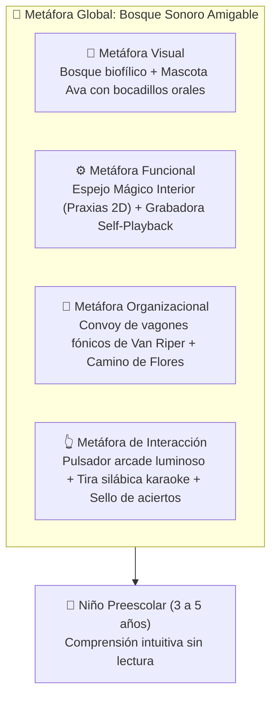
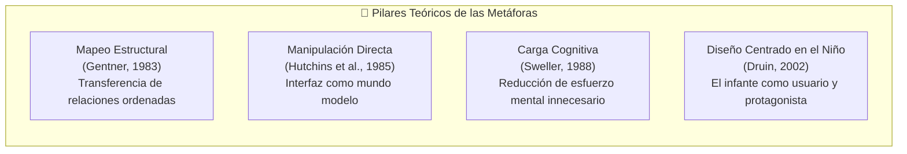
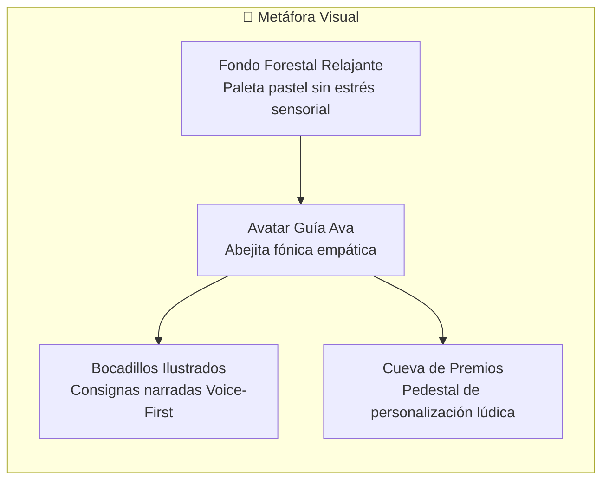
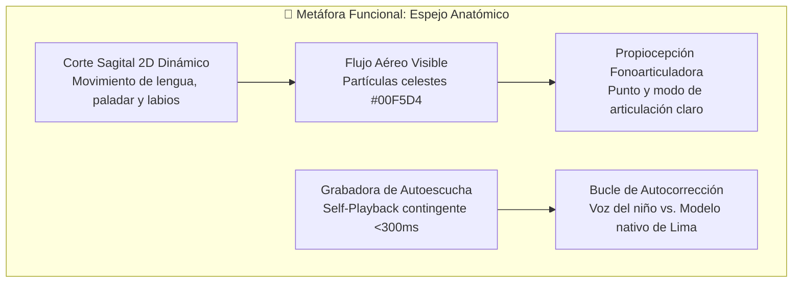
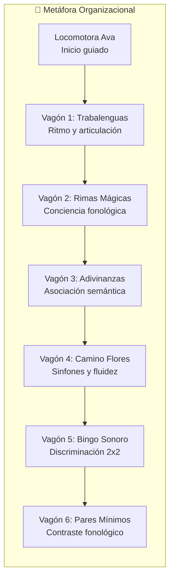
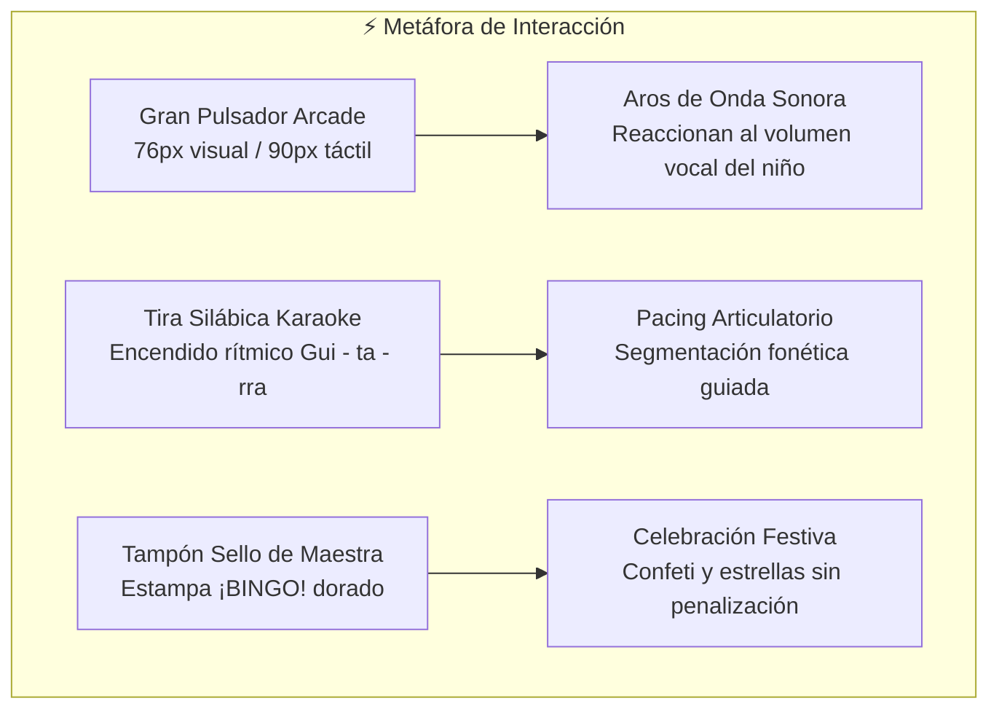

# 🎭 Actividad 6: Aplicación de Metáforas de Interfaz en los Prototipos del Proyecto Final
## 🌳 Aplicación Fono-Lúdica Pediátrica "Bosque Sonoro"

**Universidad Nacional Mayor de San Marcos**  
*Universidad del Perú, Decana de América*  
*Facultad de Ingeniería de Sistemas e Informática*  
*Curso: Interacción Hombre-Computador*  
*Docente: Dr. Ivan Petrlik Azabache*  

**Estudiantes:**
- León García, Ángel Gabriel (24200163)
- Campos Luque, Juan Masaru (24200153)
- Sandoval Dominguez, Erick Marco Alexander (24200172)
- Melendez Bustamante, Alvaro Mathias (24200166)

---

## 1. Introducción

### 1.1 Contexto y objetivos del trabajo
Durante el desarrollo integral del niño, la articulación fonética constituye un aspecto primordial en la etapa preescolar. Al presentarse dificultades persistentes en la pronunciación de determinados sonidos, estas pueden afectar la inteligibilidad del habla, la conciencia fonológica y los posteriores procesos vinculados a la lectoescritura. En el contexto de Lima Metropolitana, el presente proyecto aborda específicamente la estimulación de la pronunciación y el tratamiento de la **dislalia funcional** en niños que cursan la educación inicial (3 a 5 años), considerando las barreras estructurales de acceso frecuente a especialistas fonoaudiólogos, los costos elevados de las terapias privadas y las limitaciones de tiempo de las familias.

Bajo este panorama, las tecnologías táctiles móviles y las estrategias pedagógicas basadas en el juego serio (*serious games*) se presentan como una alternativa de apoyo complementario a las sesiones fonoaudiológicas tradicionales. No obstante, se parte de la premisa de que la mera digitalización de ejercicios fonéticos no garantiza una interacción adecuada ni una ganancia terapéutica espontánea. Por ello, esta propuesta integra contenidos fono-lúdicos fundamentados en principios de Interacción Hombre-Computador (IHC) e Interacción Niño-Computadora (CCI, *Child-Computer Interaction*), asegurando que las actividades sean comprensibles, accesibles y coherentes con las características cognitivas y neuromotoras de los infantes preescolares.

En este marco, se diseñó la aplicación fono-lúdica **"Bosque Sonoro"**, compuesta por juegos verbales tradicionales, ejercicios de producción fonética, biofeedback visual contingente en tiempo real, reconocimiento automático de voz adaptado al habla infantil, animaciones bucofaciales en dos dimensiones y mecanismos de gamificación no punitiva. Sus módulos operativos se organizan alrededor de la gestión fonética de puntos y modos de articulación, la práctica interactiva, el biofeedback propioceptivo y la mediación segura por parte de docentes y padres de familia.

La interfaz debe responder a las particularidades evolutivas de los niños preescolares, eliminando la dependencia de habilidades lectoescritas o estructuras de navegación jerárquicas abstractas. Por consiguiente, se plantea una interfaz predominantemente visual y auditiva (*Voice-First* y 100% no textual para el infante), provista de objetivos táctiles ampliados, navegación horizontal plana y retroalimentación exclusivamente positiva. La interacción descansa en toques simples, arrastre y entrada acústica por micrófono, prescindiendo del teclado alfanumérico.

Dentro de este enfoque, el uso de **metáforas de interfaz** adquiere un rol estructurante: permite representar conceptos y acciones digitales complejas mediante referentes visuales y experienciales provenientes del mundo cotidiano del niño. Para su materialización, el prototipo adopta como metáfora global el **"Bosque Sonoro Amigable"**, un entorno natural que proporciona calidez, calma visual y estimulación sin sobrecarga sensorial. Se incorporan como anclas cognitivas la mascota guía **"Ava la Abejita Fónica"**, un tren de vagones sobre rieles que organiza las actividades curriculares según estadios de complejidad, caminos de flores de progresión y un estampador festivo de aciertos.

### 1.2 Alcance de la aplicación de metáforas en el proyecto final

#### 1.2.1 Objetivo general
Analizar la aplicación de metáforas de interfaz en el diseño de la aplicación fono-lúdica "Bosque Sonoro", considerando su contribución a la comprensión, la facilidad de aprendizaje y la experiencia de interacción de estudiantes de nivel preescolar de Lima Metropolitana con dificultades de articulación fonética.

#### 1.2.2 Objetivos específicos
1. Definir el concepto de metáfora de interfaz y explicar su fundamentación en la Interacción Humano-Computador.
2. Analizar la importancia de las metáforas en el diseño de interfaces dirigidas a usuarios infantiles no lectores.
3. Identificar y clasificar las principales metáforas implementadas en la propuesta fono-lúdica.
4. Relacionar los elementos metafóricos del prototipo con los principios de usabilidad, accesibilidad y el marco de Interacción Niño-Computadora (CCI).

---

## 2. Marco Conceptual sobre las Metáforas Aplicadas a las Interfaces

### 2.1 Definición y evolución del concepto de metáfora de interfaz
Una metáfora de interfaz es un recurso de diseño cognitivo que representa conceptos, acciones o estructuras de un sistema computacional mediante elementos provenientes de un dominio del mundo real que el usuario ya conoce previamente. Su finalidad esencial es transferir conocimientos existentes para facilitar la comprensión de situaciones nuevas, reduciendo drásticamente la curva de aprendizaje inicial que impone cualquier sistema interactivo.

Alty, Knott, Anderson y Smyth (2000) señalan que las metáforas de interfaz promueven el aprendizaje al transformar el conocimiento previo en un andamiaje para interpretar situaciones operativas novedosas. En el contexto de diseño de interacción, Carroll, Mack y Kellogg (1988) demostraron que las metáforas no solo establecen correspondencias estáticas entre objetos, sino que condicionan activamente la construcción de los modelos mentales que los usuarios elaboran sobre el funcionamiento del sistema.

De forma complementaria, Cates (2002) enfatiza la necesidad de seleccionar e implementar las metáforas de interfaz de manera rigurosa y sistemática, cuidando que la metáfora principal mantenga relaciones lógicas y coherentes con los elementos auxiliares o secundarios, a fin de evitar distorsiones perceptivas.

En aplicaciones dirigidas al usuario infantil, la metáfora no es un simple recurso cosmético, sino un vehículo de significación (Druin, 2002; Read & Markopoulos, 2013). Los infantes preescolares disponen de esquemas cognitivos abstractos limitados, pero cuentan con una rica comprensión de su entorno físico inmediato (juguetes, animales, naturaleza, rutinas del aula). En este proyecto, la metáfora adquiere una dimensión narrativa y lúdica: la pantalla deja de ser un panel de control digital y se transforma en un universo reconocible donde cada acción posee sentido vivencial.

### 2.2 Importancia en la Interacción Humano-Computador (IHC)
En IHC, las metáforas de interfaz facilitan la comprensión y reducen la carga cognitiva extrínseca. Al aprovechar conceptos familiares, el usuario no requiere memorizar comandos ni descifrar nomenclaturas técnicas. Sin embargo, la literatura científica advierte que ninguna metáfora constituye una correspondencia perfecta (isomorfismo) entre el mundo real y el sistema digital; por tanto, deben manejarse conociendo sus límites.

Para niños de 3 a 5 años, las metáforas refuerzan cinco aspectos cruciales:

1. **Reconocimiento inmediato de funciones:** Los controles visuales comunican su propósito por analogía física. El botón de captura de voz adopta la forma de un gran pulsador o timbre de juguete que invita a hablar ("si lo presiono, me escucha"), mientras que la bocina o huella parlante de Ava se asocia a la escucha del modelo acústico.
2. **Facilidad de aprendizaje y exploración:** La ambientación forestal y el convoy de vagones eliminan las rutas abstractas de navegación. El infante comprende que explorar la pantalla equivale a recorrer un espacio físico amigable.
3. **Orientación dentro de la interfaz:** En vez de presentar barras de navegación anidadas, la aplicación despliega un escenario continuo de izquierda a derecha sobre rieles de tren o senderos de flores, evitando la desorientación espacial.
4. **Motivación y experiencia lúdica desinhibidora:** El bosque vivo, la abeja empática y la colección de estrellas transforman la terapia articulatoria en una vivencia compartida. El niño no se percibe en un consultorio clínico siendo juzgado, sino colaborando con un personaje amigo.
5. **Reducción de la carga de lectura:** Al ser pre-lectores, los niños dependen de la iconicidad visual y el sonido. La metáfora traduce consignas textuales complejas en retos visuales animados acompañados de voz humana nativa (Liu, Chen & Razak, 2026).

### 2.3 Contribución a la comprensión, usabilidad y experiencia del usuario (UX)
- **Comprensión:** Permite que las operaciones del software sean autodescriptivas. El tren de vagones representa la oferta curricular organizada por dificultad sin recurrir a términos fonoaudiológicos como "fonemas fricativos" o "sílabas trabadas".
- **Usabilidad (ISO 9241-11:2018):** La usabilidad se define como la medida en que usuarios específicos alcanzan metas con efectividad, eficiencia y satisfacción en su contexto de uso. Para preescolares, esto se traduce en controles que absorben la imprecisión motriz (*touch overshoot*), interfaces sin trampas de navegación y confirmaciones perceptibles en menos de 300 ms (Peña et al., 2024).
- **Experiencia de Usuario (UX - ISO 9241-210:2019):** Abarca las emociones, el agrado y la seguridad psicológica generadas durante la interacción. Se erradican respuestas punitivas (sonidos de buzzer o cruces rojas) y se incorpora el Algoritmo de Ajuste Dinámico de Dificultad (DDA) con estrellas por perseverancia (Saeedi et al., 2024; Strömbergsson et al., 2026).

---

## 3. Fundamentos Teóricos Relacionados con las Metáforas de Interfaz

### 3.1 Principales teorías que sustentan el uso de metáforas
El diseño de interfaces metafóricas se apoya en cuatro marcos de la psicología cognitiva y el diseño centrado en el usuario:

1. **Mapeo Estructural (Gentner, 1983):** Plantea que la analogía transfiere la estructura de relaciones de un dominio de origen a un dominio meta, y no las propiedades físicas aisladas. En "Bosque Sonoro", el tren de vagones transfiere la relación relacional de secuencia ("un vagón sigue al anterior y avanza en línea"), mas no las ruedas mecánicas ni el humo de carbón.
2. **Manipulación Directa (Hutchins, Hollan & Norman, 1985):** Propone que el usuario actúe sobre objetos perceptibles con distancia articulatoria mínima, concibiendo la pantalla como un "mundo modelo" y no como un sistema de comandos intermediados.
3. **Teoría de la Carga Cognitiva (Sweller, 1988):** La memoria de trabajo es sumamente limitada en preescolares. Una metáfora cotidiana reduce la carga extrínseca (aprender cómo opera la app) para liberar recursos cognitivos en la tarea intrínseca (discriminar y articular el sonido).
4. **Diseño Centrado en el Niño (Druin, 2002):** Adapta los entornos interactivos a las etapas evolutivas infantiles, reconociendo al niño como usuario principal con derechos de usabilidad específicos.

### 3.2 Enfoques cognitivos y modelos mentales del usuario
Un modelo mental es la representación interna que el usuario construye sobre cómo opera el sistema, permitiéndole anticipar consecuencias de sus acciones. A continuación se presentan las correspondencias metafóricas del prototipo:

| Referente Conocido | Elemento del Prototipo | Metáfora Implicada | Modelo Mental Esperado en el Niño |
| :--- | :--- | :--- | :--- |
| **Tren de juguete** | Menú principal en rieles | Organizacional | *"Me subo al vagón del juego que quiero jugar hoy"* |
| **Animal amigo / Mascota** | Ava, la abejita fónica | Visual | *"Ella es mi amiga, me guía, me habla y no me castiga"* |
| **Timbre o pulsador arcade** | Botón de micrófono colosal ($\ge 76\text{ px}$) | Interacción | *"Si toco el botón grande y redondo, la tableta me escucha"* |
| **Pista de baile o Karaoke** | Tira silábica iluminada | Interacción / Ritmo | *"Las cajitas se encienden al compás de lo que digo"* |
| **Espejo de baño / Radiografía** | Canvas 2D de praxias linguales | Funcional / Biofeedback | *"Puedo ver por dentro cómo se mueve la lengua para hacer la R"* |
| **Sello de la maestra** | Sello festivo ¡BINGO! | Interacción | *"Acerté el sonido y me estamparon mi estrellita"* |
| **Camino de piedras en el prado** | Carrera fónica en curva S | Organizacional | *"Cada vez que hablo, ayudo a Ava a volar a la siguiente flor"* |

> [!NOTE] Límites de la Correspondencia Metafórica
> Las metáforas no deben trasladar conceptos adultos al universo infantil. Elementos como el código PIN, la compuerta de seguridad (*MathGate*), los parámetros acústicos y las métricas TEPROSIF-R pertenecen al mundo clínico adulto y se segregan deliberadamente del entorno del niño.

### 3.3 Revisión de literatura especializada (mínimo 5 artículos científicos)

| Fuente Científica | Aporte Epistemológico Central | Aplicación Concreta en el Proyecto |
| :--- | :--- | :--- |
| **Gentner (1983)** | Teoría del Mapeo Estructural en analogías. | Estructura secuencial del convoy de vagones y progresión en camino de flores. |
| **Hutchins, Hollan & Norman (1985)** | Manipulación directa y reducción de distancia semántica. | Pulsador central táctil, arrastre de tarjetas y activación instantánea por voz. |
| **Sweller (1988)** | Teoría de la Carga Cognitiva y memoria de trabajo. | Interfaz 100% no textual y eliminación de jerga fonética en la vista infantil. |
| **Alty, Knott, Anderson & Smyth (2000)** | Marco de ingeniería para metáforas de interfaz. | Coherencia sistemática entre la metáfora global del bosque y los micromodelos. |
| **Druin (2002)** | El rol del niño en el diseño de tecnología (*CCI*). | Enfoque de usabilidad infantil sin intermediación adulta forzada. |
| **Cates (2002)** | Selección e implementación sistemática de metáforas en GUI. | Separación entre metáforas de primer orden (bosque/tren) y herramientas secundarias. |
| **Peña et al. (2024, Nature)** | Efectividad de biofeedback vocal contingent en tabletas. | Autoescucha inmediata (*Self-Playback* $<300\text{ ms}$) y resonancia visual reactiva. |
| **Saeedi et al. (2024, Sci. Reports)** | Evaluación de serious game para trastornos del habla (*SSD*). | Mascota empática y gamificación sin penalizaciones ni pérdida de vidas. |
| **Liu, Chen & Razak (2026)** | Marco ecológico de calidad CCI para preescolares. | Franja de descanso palmar $\ge 48\text{ dp}$, debounce de 80 ms y control parental. |

---

## 4. Aplicación de los Tipos de Metáforas en los Prototipos del Proyecto Final

### 4.1 Criterios generales de diseño para los prototipos de alta fidelidad
El diseño del prototipo se fundamenta en cinco criterios arquitectónicos de Interacción Niño-Computadora (CCI), alineados con el estándar **ISO/IEC 25010**, las pautas **WCAG 2.2** y las métricas **MARS**:

1. **Interfaz 100% No Textual para el Menor:** Consignas exclusivamente oradas por la voz de Ava y pictogramas de alta iconicidad basados en **TEPROSIF** (*Huertas & Roque, 2023*) y **ARASAAC**.
2. **Ergonometría Táctil Ampliada:** Blancos de toque $\ge 48 \times 48\text{ dp}$ (superando WCAG 2.2 AAA Target Size Enhanced); pulsador de micrófono con diámetro visual de $76\text{ px}$ y halo capacitivo de $90\text{ px}$.
3. **Zona de Descanso Palmar y Debounce:** Franja inferior pasiva $\ge 48\text{ dp}$ libre de controles accionables (*tenar palm rest*) y filtro software de rebote de $80\text{ ms}$.
4. **Gamificación No Punitiva y Algoritmo DDA:** Proscripción de castigos; rescate adaptativo al tercer intento no logrado otorgando 1 estrella dorada y abriendo la praxia 2D.
5. **Separación Estricta de Espacios y Gobernanza:** Compuerta cognitiva aritmética verbalizada (*MathGate*), control de dosis de 15 minutos diarios y almacenamiento local cifrado de audio (Ley 29733 / COPPA).

Adicionalmente, el equipo definió **siete criterios de consistencia interna de las metáforas**:
- **Familiaridad:** Referentes cercanos (bosque, abejita, tren de juguete, sello).
- **Coherencia:** El universo estético se preserva sin quiebres en todas las pantallas.
- **Claridad funcional:** La apariencia del control anticipa su comportamiento exacto.
- **Pertinencia contextual:** Apoya la estimulación fonética sin trivializar el objetivo terapéutico.
- **Simplicidad:** Navegación horizontal panorámica plana sin menús flotantes ocultos.
- **Adaptabilidad:** Optimizado para tabletas de 10 a 11 pulgadas en orientación horizontal (16:9).
- **Vigencia:** Elementos atemporales libres de metáforas tecnológicas obsoletas (como disquetes).

---

### 4.2 Metáfora Visual: El Bosque Sonoro Amigable y Ava la Abejita Fónica

#### 4.2.1 Componente
Entorno escénico de naturaleza diáfana con paleta biofílica (#F1F8E9) y el avatar de **Ava la Abejita Fónica**, provista de bocadillos de habla ilustrados y locución nativa de Lima Metropolitana.

#### 4.2.2 Justificación
- **Fundamento Teórico:** Sustentado en la Teoría del Diseño Metafórico Infantil (*Druin, 2002; Read & Markopoulos, 2013*) y la dimensión *Child-Interface Fit* (*Liu et al., 2026*).
- **Modelo Mental:** Los preescolares personifican el aprendizaje mediante la relación afectiva con animales amigos. El bosque acogedor sustituye la frialdad de un consultorio médico, invitando a la exploración libre.
- **Evidencia Empírica:** *Saeedi et al. (2024)* evidenciaron en niños con trastornos del habla que un avatar animal amigable genera una valoración estética del 100% y satisfacción de 6.25/7 en PSSUQ. *Du et al. (2023)* demostraron que la estética biofílica atenúa la sobreestimulación infantil.

#### 4.2.3 Beneficio
- **Desinhibición fónica:** Desactiva la ansiedad de evaluación clínica; el niño siente que juega con su amiga en lugar de estar siendo examinado.
- **Autonomía plena:** Las consignas habladas permiten que el infante comprenda el objetivo sin requerir que un adulto le lea la pantalla.

#### 4.2.4 Evidencia gráfica
La pantalla principal exhibe a Ava Maquinista dando la bienvenida sobre el fondo diáfano del bosque:

*Figura 1: Menú Principal del Prototipo 'Bosque Sonoro' ([01_menu_principal.png](../Recursos%20Compartidos/capturas/01_menu_principal.png)), destacando la mascota Ava en la cabecera lúdica y la locomotora fónica.*

---

### 4.3 Metáfora Funcional: El Espejo Mágico Interior y Grabadora de Contraste

#### 4.3.1 Componente
Simulador anatómico 2D dinámico de praxias bucofaciales (*"El Espejo Mágico Interior"* en canvas vectorial a 60 FPS) y grabadora de contraste con autoescucha inmediata (*Self-Playback* contingente $<300\text{ ms}$).

#### 4.3.2 Justificación
- **Fundamento Teórico:** Sustentado en la Teoría del Biofeedback Fónico Contingente (*Maas et al., 2008; Peña et al., 2024*), el Protocolo de Praxias de 6 Fases (*Pucuhuaranga, 2016*) y la Pauta 4 de Diseño Fonoaudiológico (*Du et al., 2023*).
- **Modelo Mental:** Opera como un "espejo radiográfico transparente". Frente a un espejo plano común, el niño solo ve sus labios y dientes, permaneciendo oculto el movimiento de la lengua. El simulador 2D expone el interior biomecánico con lenguaje infantil ("sube la puntita de tu lengua arribita"). La grabadora emula un laboratorio fonético interactivo.
- **Evidencia Empírica:** *Du et al. (2023)* señalan que la opacidad del tracto vocal es el mayor obstáculo en la corrección de dislalias. *Peña et al. (2024, Nature)* demostraron que escuchar la propia emisión en latencias $<300\text{ ms}$ genera una mejora estadísticamente significativa en vocalización activa ($p = 0.031$).

#### 4.3.3 Beneficio
- **Conciencia propioceptiva:** El niño comprende de manera tangible qué hacer con su lengua (por ejemplo, apoyarla en las arruguitas del paladar para la `/r/` en vez de sacarla para la `/l/`).
- **Autocorrección sin castigo:** Al presionar "¡Escuchar mi voz!", el niño coteja auditivamente su producción contra el modelo nativo, activando la plasticidad sensorio-motora.

#### 4.3.4 Evidencia gráfica
El modal vectorial muestra la cavidad bucal simplificada y la guía narrada por voz:

*Figura 2: Modal de Praxia Lingual 2D ([06_praxia_bucofacial_2d.png](../Recursos%20Compartidos/capturas/06_praxia_bucofacial_2d.png)), ilustrando el movimiento dinámico de la lengua hacia los alvéolos guiado 100% por voz mediante Ava.*

*Figura 3: Pantalla de Ejercicio Articulatorio ([02_ejercicio_landscape.png](../Recursos%20Compartidos/capturas/02_ejercicio_landscape.png)), con acceso directo a la praxia 2D y la botonera de autoescucha inmediata.*

---

### 4.4 Metáfora Organizacional: El Convoy del Tren de Vagones y el Camino de Flores

#### 4.4.1 Componente
Convoy ferroviario sobre rieles en el menú principal (`.train-track-container`) y el mapa continuo en curva S del **Camino de Flores Fónicas** (`UI-MAP-2D`).

#### 4.4.2 Justificación
- **Fundamento Teórico:** Fundamentado en la Jerarquía Articulatoria Escalar de Van Riper (1978), el paradigma fono-lúdico de juegos verbales tradicionales (*Pucuhuaranga, 2016; Mora Espinoza et al., 2024*) y los principios de navegación horizontal plana para preescolares (*Liu et al., 2026*).
- **Modelo Mental:** Sustituye listas y carpetas abstractas por un convoy físico tangible. Cada vagón representa un estadio de dificultad y un género verbal lúdico. En el Camino de Flores, la progresión equivale a ayudar a la abejita a volar de flor en flor hasta la colmena de miel.
- **Evidencia Empírica:** *Condori & Larico (2022)* demostraron que la articulación se correlaciona fuertemente con juegos verbales estructurados ($r = 0.612, p = 0.008$). *Mora et al. (2024)* comprobaron que organizar la terapia como circuito lúdico de casillas normalizó el habla en el 74% de niños con dislalia funcional.

#### 4.4.3 Beneficio
- **Cero sobrecarga de navegación:** La lectura visual de izquierda a derecha previene el riesgo de "pantallas perdidas" o extravío en menús secundarios.
- **Progresión tangible:** El niño comprende su avance como un recorrido espacial físico sin requerir interpretar barras porcentuales numéricas.

#### 4.4.4 Evidencia gráfica
El menú principal se despliega con vagones temáticos de alta iconicidad:

*Figura 4: Convoy de Vagones en el Menú Principal ([01_menu_principal.png](../Recursos%20Compartidos/capturas/01_menu_principal.png)).*

*Figura 5: Minijuego Camino de Flores ([03_carrera_fonica.png](../Recursos%20Compartidos/capturas/03_carrera_fonica.png)), ilustrando el sendero en perspectiva continua con estaciones de avance.*

---

### 4.5 Metáfora de Interacción: El Gran Pulsador Fónico, Tira Silábica y Sellador de Bingo

#### 4.5.1 Componente
Botón de micrófono colosal estilo arcade con ondas expansivas concéntricas (`UI-BTN-MIC`), tira silábica rítmica iluminada estilo karaoke y tampón gigante de sello con confeti en el Bingo Sonoro.

#### 4.5.2 Justificación
- **Fundamento Teórico:** Sustentado en los estándares de usabilidad pediátrica **ISO/IEC 25010**, las pautas de *Touch Target Size & Feedback* (*Liu et al., 2026; Du et al., 2023*) y el condicionamiento operante no punitivo (*Saeedi et al., 2024*).
- **Modelo Mental:**
  - El micrófono emula un timbre gigante o botón arcade: al presionarse, se deprime elásticamente y proyecta ondas de sonido que reaccionan a la voz infantil en tiempo real.
  - La tira silábica emula las baldosas luminosas de una pista de karaoke, guiando el ritmo fonatorio (*Gui $\rightarrow$ ta $\rightarrow$ rra*).
  - En el Bingo Sonoro, la selección táctil emula el tampón de tinta festiva que usan las maestras de inicial para estampar caritas felices.
- **Evidencia Empírica:** *Du et al. (2023)* demostraron que controles táctiles $<48\text{ dp}$ aumentan en más del 60% los errores motores en preescolares. *Condori & Larico (2022)* confirmaron que la marcación rítmica coordinada estimula la fluidez fonológica.

#### 4.5.3 Beneficio
- **Certeza visual de escucha:** El niño constata de inmediato que la tableta lo está escuchando gracias a los aros reactivos, eliminando la incertidumbre o los silencios incómodos.
- **Segmentación y fluidez:** La iluminación silábica previene la articulación atropellada o acelerada.
- **Refuerzo emocional inolvidable:** El estampado del Bingo celebra la discriminación acústica positiva sin juicios de valor negativos.

#### 4.5.4 Evidencia gráfica
El pulsador de micrófono centralizado y el juego de bingo táctil reflejan estas metáforas:

*Figura 6: Micrófono colosal centralizado con ondas concéntricas de sonido y tira silábica ([02_ejercicio_landscape.png](../Recursos%20Compartidos/capturas/02_ejercicio_landscape.png)).*

*Figura 7: Cartón de Bingo Sonoro ([04_bingo_sonoro.png](../Recursos%20Compartidos/capturas/04_bingo_sonoro.png)), con tarjetas de $180 \times 150\text{ px}$ y sello festivo de acierto.*

---

## 5. Conclusiones y Recomendaciones

### 5.1 Conclusiones derivadas de la aplicación práctica
1. **La metáfora de interfaz organiza y dignifica la experiencia fonoaudiológica:** En "Bosque Sonoro", las metáforas no son elementos decorativos cosméticos. Traducen conceptos informáticos abstractos a un universo que el preescolar domina: un bosque, una abeja amiga, un tren de juguete y sellos festivos.
2. **Las decisiones de diseño descansan en marcos teóricos consolidados:** El mapeo estructural (*Gentner, 1983*) fundamenta el convoy de actividades; la manipulación directa (*Hutchins et al., 1985*) respalda los pulsadores táctiles; y la teoría de carga cognitiva (*Sweller, 1988*) justifica la interfaz 100% no textual.
3. **La metáfora visual atenúa la resistencia a la terapia:** Ava y el bosque eliminan la apariencia clínica punitiva. El niño coopera en una misión lúdica con su mascota en lugar de experimentar la presión evaluativa tradicional.
4. **La metáfora funcional hace visible lo biomecánicamente invisible:** "El Espejo Mágico Interior" permite al menor comprender la postura lingual oculta en la cavidad oral, complementado por la autoescucha inmediata ($<300\text{ ms}$) que detona la autocorrección auditiva (*Peña et al., 2024*).
5. **La metáfora organizacional estructura la progresión fonológica:** El tren de Van Riper organiza las actividades por dificultad fonética creciente, reduciendo a cero el extravío en pantallas secundarias.
6. **Las metáforas de interacción generan certidumbre y control:** Los aros de resonancia reactivos del micrófono y la tira silábica iluminada proporcionan feedback tangible sobre la emisión vocal en curso.
7. **Articulación coherente con los principios de Interacción Niño-Computadora (CCI):** Se garantiza una experiencia adaptada mediante objetivos táctiles $\ge 48\text{ dp}$, franja palmar con debounce de $80\text{ ms}$, gamificación no punitiva con DDA y separación de gobernanza mediante *MathGate*.
8. **Cumplimiento de los objetivos académicos:** Se definieron, analizaron y categorizaron las metáforas de interfaz, demostrando su contribución al diseño centrado en el usuario pediátrico de Lima Metropolitana.
9. **Necesidad de validación empírica en el terreno real:** Los modelos mentales formulados constituyen hipótesis de diseño fundamentadas en la literatura que deben ser contrastadas formalmente mediante pruebas de usabilidad con niños preescolares reales.

### 5.2 Recomendaciones para optimizar la usabilidad, coherencia y UX
1. **Ejecutar pruebas formativas con usuarios reales:** Validar en aulas de educación inicial y gabinetes fonoaudiológicos si los niños reconocen las metáforas y operan la aplicación con autonomía, bajo las directrices de la norma ISO 9241-11:2018.
2. **Deslindar la usabilidad de la eficacia terapéutica clínica:** Comprobar que la interfaz es intuitiva y usable no equivale automáticamente a certificar la corrección del habla; este último aspecto requiere ensayos clínicos longitudinales conducidos por especialistas.
3. **Preservar la consistencia de la metáfora global:** Toda nueva funcionalidad o minijuego que se incorpore a la plataforma debe integrarse de forma natural al universo del Bosque Sonoro, evitando introducir elementos gráficos o mecánicas disonantes.
4. **Mantener la segregación asimétrica entre el mundo infantil y el adulto:** Controles de configuración, calibración acústica, reportes TEPROSIF-R y conmutación de accesibilidad deben permanecer confinados tras la compuerta *MathGate*.
5. **Vigilar el carácter estrictamente no textual del entorno infantil:** Asegurar que ninguna instrucción, botón o retroalimentación dependa de la decodificación de letras por parte del menor, apoyándose siempre en la voz de Ava y en pictogramas de alta iconicidad.
6. **Respetar de forma inflexible las cotas ergonómicas táctiles:** Todo botón interactivo debe conservar un tamaño $\ge 48\times 48\text{ dp}$ y la zona inferior de descanso palmar debe permanecer libre de escuchas de eventos.
7. **Proteger los datos biométricos infantiles:** Mantener el almacenamiento local de audio protegido y sin transmisión a servidores de terceros, respetando rigurosamente la Ley N.° 29733 de Protección de Datos Personales del Perú y la normativa COPPA.
8. **Extender el modelado metafórico a las actividades complementarias:** Desarrollar guías visuales y funcionales detalladas para las actividades de Rimas Mágicas, Adivinanzas y Pares Mínimos, siguiendo el mismo rigor conceptual implementado en el núcleo fonoarticulatorio.

---

## 6. Referencias Bibliográficas (Normas APA 7.ª edición)

- Alty, J. L., Knott, R. P., Anderson, B., & Smyth, M. (2000). A framework for engineering metaphor at the user interface. *Interacting with Computers*, 13(2), 301–322. https://doi.org/10.1016/S0953-5438(00)00047-3
- Bosch, L., & Melgar, M. (1984). *Evaluación fonológica del habla infantil*. Editorial Médica Panamericana.
- Carroll, J. M., Mack, R. L., & Kellogg, W. A. (1988). Interface metaphors and user interface design. In M. Helander (Ed.), *Handbook of human-computer interaction* (pp. 67–85). North-Holland.
- Cates, W. M. (2002). Systematic selection and implementation of graphical user interface metaphors. *Computers & Education*, 38(1–3), 385–397.
- Condori, M., & Larico, E. (2022). Juegos verbales y expresión oral en niños de educación inicial en Puno. *Revista Innova Educación*, 4(2), 45–58.
- Congreso de la República del Perú. (2011). *Ley N.° 29733, Ley de protección de datos personales*. Diario Oficial El Peruano.
- Druin, A. (2002). The role of children in the design of new technology. *Behaviour & Information Technology*, 21(1), 1–25. https://doi.org/10.1080/01449290110108659
- Du, Y., Chen, Z., & Wang, L. (2023). Ergonomic and user interface design guidelines for pediatric speech therapy applications. *International Journal of Child-Computer Interaction*, 36, 100582.
- Furlong, L., Morris, M., Serry, T., & Erickson, S. (2018). Mobile apps for treatment of speech disorders in children: An evidence-based analysis of quality and efficacy. *PLOS ONE*, 13(8), e0201513. https://doi.org/10.1371/journal.pone.0201513
- Gentner, D. (1983). Structure-mapping: A theoretical framework for analogy. *Cognitive Science*, 7(2), 155–170.
- Huertas, M., & Roque, C. (2023). Prevalencia de dificultades fonológicas en niños preescolares de Lima Metropolitana mediante TEPROSIF-R. *Revista de Logopedia e Investigación Fonolúdica*, 11(2), 89–104.
- Hutchins, E. L., Hollan, J. D., & Norman, D. A. (1985). Direct manipulation interfaces. *Human–Computer Interaction*, 1(4), 311–338.
- International Organization for Standardization. (2018). *Ergonomics of human-system interaction—Part 11: Usability: Definitions and concepts* (ISO Standard No. 9241-11:2018).
- International Organization for Standardization. (2019). *Ergonomics of human-system interaction—Part 210: Human-centred design for interactive systems* (ISO Standard No. 9241-210:2019).
- International Organization for Standardization & International Electrotechnical Commission. (2023). *Systems and software engineering—SQuaRE—Product quality model* (ISO/IEC Standard No. 25010:2023).
- Liu, W., Chen, X., & Abdul Razak, R. (2026). Child–computer interaction quality criteria for preschool educational applications: A PRISMA-ScR-informed scoping review. *Computers*, 15(8), Article 485. https://doi.org/10.3390/computers15080485
- Maas, E., Robin, D. A., Austermann Hula, S. N., Freedman, S. E., Wulf, G., Ballard, K. J., & Schmidt, R. A. (2008). Principles of motor learning in treatment of motor speech disorders. *American Journal of Speech-Language Pathology*, 17(3), 277–298.
- Mora Espinoza, L. M., Mora Espinoza, C. de los Á., Quintero Espinoza, C. V., Villon Gonzabay, W. O., & Yagual Montoya, V. V. (2024). Programa lúdico fonológico para mejorar la dislalia funcional en niños de educación inicial. *Universidad, Ciencia y Tecnología*, 28(Número especial), 259–267.
- Peña, M., Werker, J. F., & Dehaene-Lambertz, G. (2024). Contingent tablet-based speech feedback enhances vocalization and auditory-motor plasticity in preschoolers. *Nature npj Science of Learning*, 9(1), Article 14.
- Pucuhuaranga Espinoza, T. N. (2016). Juegos verbales en el desarrollo de la articulación verbal de niños y niñas de cinco años de edad. *Horizonte de la Ciencia*, 6(11), 191–204.
- Read, J. C., & Markopoulos, P. (2013). Child–computer interaction. *International Journal of Child-Computer Interaction*, 1(1), 2–6.
- Saeedi, S., Ghazisaeedi, M., Ramezanghorbani, N., Seifpanahi, M.-S., & Bouraghi, H. (2024). Design and evaluation of a serious video game to treat preschool children with speech sound disorders. *Scientific Reports*, 14, Article 68119. https://doi.org/10.1038/s41598-024-68119-x
- Strömbergsson, S., Edlund, E., Pettersson, M., Phan, N., & Kurimo, M. (2026). Self-supervised app-based speech training for children with speech sound disorder—A single-case experimental design study. *International Journal of Language & Communication Disorders*, 61(1).
- Sweller, J. (1988). Cognitive load during problem solving: Effects on learning. *Cognitive Science*, 12(2), 257–285.
- Van Riper, C. (1978). *Speech correction: Principles and methods* (6th ed.). Prentice-Hall.
- World Wide Web Consortium. (2023). *Web content accessibility guidelines (WCAG) 2.2*. https://www.w3.org/TR/WCAG22/
- Zohaib, M. (2018). Dynamic difficulty adjustment (DDA) in computer games: A review. *Advances in Human-Computer Interaction*, 2018, Article 5681652.

