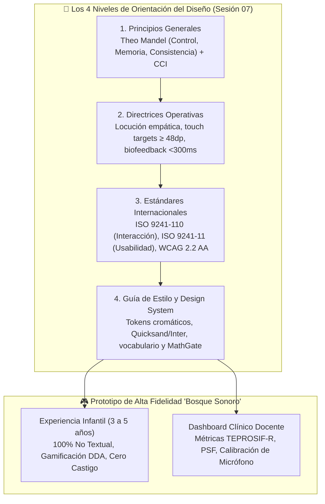
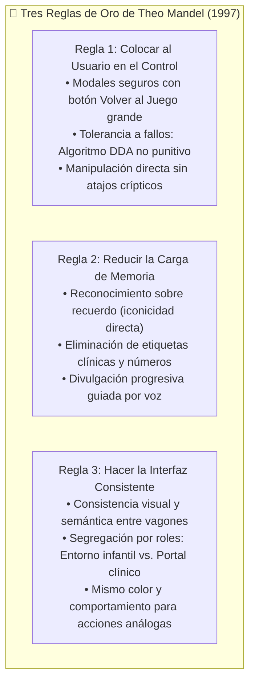
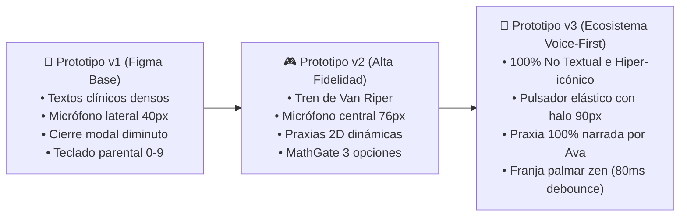
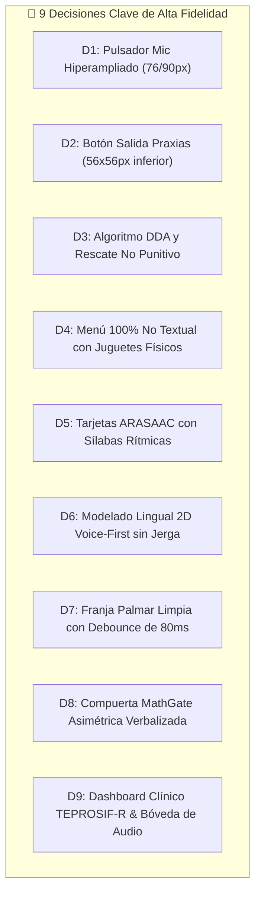

# 📱 Actividad 7: Aplicación de Principios, Directrices, Estándares y Guías de Estilo para el Diseño de Interfaces en los Prototipos del Proyecto Final
## 🗣️ Aplicación Fono-Lúdica Pediátrica "Bosque Sonoro"

**Universidad Nacional Mayor de San Marcos**  
*Universidad del Perú, Decana de América*  
*Facultad de Ingeniería de Sistemas e Informática*  
*Curso: Interacción Humano Computador*  
*Docente: Dr. Ivan Carlo Petrlik Azabache*  
*Grupo: G7*  

**Estudiantes:**
- Campos Luque, Juan Masaru (24200153)
- León García, Angel Gabriel (24200156)
- Sandoval Dominguez, Erick Marco A. (24200172)
- Melendez Bustamante, Alvaro M. (24200166)

*Lima, Perú — 2026*

---

## 🧭 Mapa de Arquitectura y Niveles de Orientación de la Solución

---

## 1. Introducción

### 1.1 Contexto y justificación del proyecto fono-lúdico
El desarrollo de la articulación fonética es un componente central de la comunicación infantil durante la etapa preescolar. Cuando ciertos sonidos del habla se siguen pronunciando de manera inadecuada más allá de lo esperado cronológicamente, el niño puede experimentar dificultades para hacerse entender, afectando su autoestima, su interacción social y su rendimiento escolar temprano (*Mora Espinoza et al., 2024*). Además, las dificultades de pronunciación repercuten en el aprendizaje de la lectoescritura, pues el niño tiende a escribir como pronuncia (*Pucuhuaranga Espinoza, 2016*).

En este marco se ubica la **dislalia funcional**, definida como una alteración en la articulación de los fonemas sin lesión orgánica ni déficit sensorial auditivo (*Mora Espinoza et al., 2024*). Los sonidos que exigen mayor precisión de movimientos linguales y labiales —tales como `/r/`, `/rr/`, `/s/`, `/l/` y `/ch/`— se cuentan entre los más afectados. A nivel internacional, los trastornos de los sonidos del habla (*speech sound disorders, SSD*) se describen como los trastornos de la comunicación más prevalentes en la infancia: *Saeedi et al. (2024)* reportan que entre el 10% y el 15% de los preescolares los presentan, demandando atención oportuna para prevenir secuelas en la vida adulta.

En Lima Metropolitana, el acceso oportuno a la intervención enfrenta obstáculos severos: escasez de profesionales especializados en centros públicos, tarifas prohibitivas en la práctica privada y limitaciones de tiempo de los padres de familia. En este escenario, las tecnologías táctiles móviles y las estrategias basadas en juegos serios fonoaudiológicos (*serious games*) ofrecen una vía accesible de práctica domiciliaria complementaria (*Strömbergsson et al., 2026*).

Sin embargo, antecedentes rigurosos demuestran que digitalizar ejercicios tradicionales no garantiza resultados positivos (*Liu et al., 2026; Strömbergsson et al., 2026*). *Hourcade (2008)* enfatiza que las tecnologías para niños deben diseñarse respetando sus capacidades cognitivas y motoras en desarrollo. En un estudio reciente, *Saeedi et al. (2024)* identificaron 23 problemas de usabilidad únicos en un videojuego foniátrico, evidenciando la imperiosa necesidad de aplicar directrices de IHC sistemáticas.

El proyecto **"Bosque Sonoro"** aborda esta necesidad mediante una solución fono-lúdica centrada en el niño, articulada bajo la metáfora de un bosque amigable, la abeja fónica Ava y un tren de vagones curriculares.

### 1.2 Objetivos del documento
- **Objetivo general:** Aplicar y justificar directrices de Interacción Hombre-Computador (IHC) —las tres reglas de oro de Theo Mandel, los criterios de ISO 9241-11 e ISO 9241-110, las pautas de accesibilidad WCAG 2.2 y las metáforas de diseño— en el prototipo interactivo de alta fidelidad de la aplicación "Bosque Sonoro", dirigida a niños preescolares de 3 a 5 años y a los adultos que median su uso.
- **Objetivos específicos:**
  1. Explicar el rol de la IHC en software clínico-educativo y la tipología de metáforas aplicadas.
  2. Presentar la fundamentación teórica de las Tres Reglas de Mandel, ISO y WCAG adaptadas a preescolares.
  3. Diagnosticar heurísticamente el prototipo inicial (v1 en Figma) y documentar su evolución hacia las versiones v2 y v3 (100% No Textual y Voice-First).
  4. Justificar la matriz de 9 decisiones de diseño y formalizar la guía de estilo y el catálogo de pantallas de alta fidelidad.
  5. Proponer un plan de pruebas de usabilidad con tareas críticas e indicadores observables.
  6. Formular conclusiones y recomendaciones para futuras iteraciones y despliegue.

### 1.3 Alcance y perfil de usuarios
El sistema responde a una arquitectura asimétrica concebida para dos perfiles:
1. **Población Pediátrica Infantil (3 a 5 años):** Infantes en etapa preoperacional (*Piaget & Inhelder, 1969*) y pre-lectores estrictos. Poseen memoria de trabajo limitada (*Gathercole et al., 2004*), motricidad fina inmadura con temblor fisiológico y tendencia a *touch overshoot* (*Du et al., 2023*). La interfaz debe ser 100% visual y auditiva, con botones colosales ($\ge 48\times 48\text{ dp}$), zona de descanso palmar y gamificación sin castigos. Incluye además un Modo CVI de ultra-contraste para niños con Deficiencia Visual Cortical asociada.
2. **Portal Clínico/Parental (Adultos Mediadores):** Padres, docentes y fonoaudiólogos. Acceden mediante la compuerta cognitiva verbalizada (*MathGate*) a un entorno densamente informativo con registro de sesiones, métricas estandarizadas TEPROSIF-R de Procesos de Simplificación Fonológica (PSF), repositorio de grabaciones y configuración de accesibilidad.

---

## 2. Marco Conceptual del Diseño de Interfaces

### 2.1 Definición y rol de la IHC en software educativo-clínico
En IHC, la calidad de un sistema interactivo se mide por su capacidad para permitir que usuarios específicos alcancen sus metas con eficacia, eficiencia y satisfacción en contextos reales (*ISO 9241-11:2018*). Para software pediátrico, el rol cardinal de la IHC es **evitar que la interfaz se convierta en un obstáculo cognitivo o motor adicional**: la atención del niño debe canalizarse en el esfuerzo articulatorio y la discriminación del habla, nunca en descifrar cómo se maneja la aplicación (*Hourcade, 2008; Liu et al., 2026*).

### 2.2 Tipología y aplicación de metáforas de diseño
Conforme al mapeo estructural (*Gentner, 1983*), el sistema traslada relaciones cotidianas a la pantalla mediante cuatro clases de metáforas:
- **Metáforas Visuales:** Bosque biofílico relajante y mascota Ava como ancla afectiva.
- **Metáforas Funcionales:** El "Espejo Mágico Interior" (corte sagital 2D de praxias) y la grabadora con autoescucha inmediata (*Self-Playback* $<300\text{ ms}$).
- **Metáforas Organizacionales:** El convoy de vagones de Van Riper sobre rieles y el sendero de flores fónicas en curva S.
- **Metáforas de Interacción:** El gran pulsador táctil estilo arcade, la tira silábica luminosa y el estampador gigante de Bingo.

### 2.3 Paradigma de interacción para infantes pre-lectores: Enfoque No Textual y Voice-First
Los niños preescolares no procesan el código escrito convencional. Por tanto:
- **Enfoque 100% No Textual:** Se eliminan insignias clínicas y párrafos de lectura obligatoria. Las opciones se representan mediante juguetes físicos tridimensionales y pictogramas de alta iconicidad (ARASAAC / TEPROSIF). Si aparece texto, solo cumple un rol incidental secundario.
- **Enfoque Voice-First:** La mascota Ava narra oralmente todas las consignas con acento neutro limeño, modelando el sonido correcto y brindando retroalimentación empática. El niño puede solicitar la repetición del estímulo acústico tantas veces como requiera (*Callaghan & Reich, 2021*).

---

## 3. Fundamentos Teóricos y Criterios de Calidad

### 3.1 Las Tres Reglas Doradas de Theo Mandel y su adaptación pediátrica

#### 3.1.1 Regla 1: Colocar al usuario en el control
- *Sin modos e interrumpible (1.1, 1.3):* Los modales (como la praxia bucofacial 2D) cuentan con un botón colosal de cierre inferior ("Volver al Juego", $56\times 56\text{ px}$), impidiendo atrapamientos.
- *Tolerante a fallos (1.5):* Los errores de pronunciación no se penalizan. Al tercer fallo consecutivo, el sistema despliega automáticamente la praxia asistida mediante DDA (*Zohaib, 2018*).
- *Navegabilidad y manipulación directa (1.6, 1.10):* El niño interactúa directamente sobre objetos táctiles y el micrófono; botones de inicio y salida siempre visibles.

#### 3.1.2 Regla 2: Reducir la carga de memoria
- *Reconocer en lugar de recordar (2.1, 2.2):* Uso de pictogramas ARASAAC y juguetes tridimensionales en lugar de listas alfabéticas.
- *Ausencia de códigos alfanuméricos:* Se erradican símbolos como `"/pl, tr, gl/"` o contadores fraccionarios de la vista infantil.
- *Metáforas del mundo real (2.7) y claridad visual (2.9):* Elementos reconocibles de la vida diaria del niño.

#### 3.1.3 Regla 3: Hacer la interfaz consistente
- *Consistencia visual, conceptual y semántica (3.1, 3.2, 3.3):* Mismo botón de micrófono central en todas las dinámicas; unificación de tokens de color y tipografía; erradicación del término clínico "fonema" en el juego (reemplazado por "Sonido R, como pera").
- *Consistencia asimétrica de roles:* El entorno del niño es lúdico y desprovisto de texto; el portal del adulto es formal, estructurado y técnico.

### 3.2 Criterios y estándares de calidad de software (ISO 9241-11 e ISO 9241-110)

| Criterio ISO | Adaptación Pediátrica (Niños 3 a 5 años) | Indicador Propuesto |
| :--- | :--- | :--- |
| **Eficacia (ISO 9241-11)** | Completar la secuencia (seleccionar vagón, escuchar modelo, activar micrófono) sin ayuda externa. | Tasa de éxito autónomo (SA). |
| **Eficiencia (ISO 9241-11)** | Esfuerzo motor y cognitivo mínimo: blancos amplios, toques mínimos, sin lectura. | Tiempo de tarea y número de deslices motores. |
| **Tolerancia a errores (ISO 9241-110)** | Los errores fonéticos no imponen penalización; activan asistencia DDA. | Frecuencia de activación correcta del rescate tras 3 fallos. |
| **Satisfacción (ISO 9241-11)** | Escala visual de caritas (Smileyometer) para el infante y SUS para el mediador. | Aceptación infantil ($\ge 80\%$) y SUS adulto ($\ge 75\text{ pts}$). |

### 3.3 Accesibilidad universal y ergonomía táctil (WCAG 2.2 Nivel AA / AAA pediátrico)
- **Tamaño del objetivo táctil (SC 2.5.8 AA / 2.5.5 AAA adaptado):** Controles $\ge 48\times 48\text{ dp}$; pulsador central de $76\text{ px}$ con halo de $90\text{ px}$.
- **Contraste de color (SC 1.4.3 AA / 1.4.6 AAA):** Modo estándar con ratio $>4.5:1$; Modo CVI sobre fondo carbón mate (#121212) con ratios $>12:1$ (amarillo #FFD600 a 16.8:1 y cian #00E5FF a 13.5:1).
- **Franja de descanso palmar (*Palm Rest*):** Margen inferior pasivo $\ge 48\text{ dp}$ con filtro debounce software de $80\text{ ms}$ para absorber el apoyo involuntario de la eminencia tenar al sostener la tableta.

---

## 4. Aplicación en los Prototipos del Proyecto Final

### 4.1 Diagnóstico heurístico del prototipo inicial (Figma v1)
La inspección heurística sobre el concepto preliminar v1 reveló graves fricciones de sesgo adultocéntrico:
1. *Trampas de navegación (Regla 1):* Modal de praxias con botón de cierre "X" periférico de apenas $24\text{ px}$, imposible de accionar para dedos preescolares.
2. *Manejo punitivo del error (Regla 1):* Sonidos disonantes ante errores fonéticos que provocaban inhibición y rechazo del niño.
3. *Sobrecarga textual y cognitiva (Regla 2):* Menús repletos de etiquetas fonoaudiológicas ("Fonemas fricativos", "Sinfones") y párrafos extensos de trabalenguas.
4. *Abstracción médica (Regla 2):* Guía lingual en corte anatómico clínico en blanco y negro con textos incomprensibles ("arrugas alveolares").
5. *Saturación de cabecera e inseguridad (Regla 3):* Agrupación de 6 controles disímiles en la barra superior (cronómetro numérico 8/15 min, selector CVI expuesto al niño y teclado de calculadora para el control parental).

---

### 4.2 Análisis comparativo evolutivo: Prototipo v1 ➔ Prototipo v2 ➔ Prototipo v3

| Dimensión de Interfaz | Prototipo v1 (Figma Base) | Prototipo v2 (Alta Fidelidad) | Prototipo v3 (Voice-First & No Textual) | Justificación e Impacto IHC |
| :--- | :--- | :--- | :--- | :--- |
| **Menú Principal de Actividades** | Grilla de tarjetas con badges clínicos (`"Sinfones /pl, tr/"`) y textos explicativos. | Convoy de locomotora y vagones sobre rieles, conservando subtítulos textuales. | **100% No Textual e Hiper-icónico:** Eliminación total de texto. Juguetes físicos en pedestales ($\ge 74\text{ px}$) con locución al tacto. | Elimina a cero la carga de decodificación lectoescrita (*Mandel 2.1, 2.7*). |
| **Modelado de Praxias 2D** | Corte anatómico médico estático B/N con términos técnicos abstractos. | Animación 2D a color de lengua y paladar con rótulos ("Alvéolo", "Lengua"). | **Modelado Lingual 100% Narrado por Voz:** Erradicación de jerga médica. Ava narra en lenguaje infantil; selector cotidiano ("Sonido R 🍐"). | Estimulación bimodal e imitación motriz directa sin saturación (*Mandel 2.7, 2.8*). |
| **Arquitectura de Pantalla** | 3 tarjetas horizontales fragmentadas; micrófono confinado a la derecha (40 px). | Disposición simétrica: Modelo visual a la izquierda, Micrófono al centro, Praxia a la derecha. | **Consolidación Fono-Lúdica Simétrica:** Foco en el gran pulsador ($76\text{ px}$ con halo de $90\text{ px}$), avatar de Ava y eliminación de etiquetas residuales. | Maximiza la eficiencia motriz situando la acción en la fóvea visual primaria (*Mandel 1.10, 2.9*). |
| **Ergonomía Palmar** | Fondo vegetal al ras del borde; disparos falsos continuos por apoyo de la palma. | Franja de descanso pasivo $\ge 48\text{ dp}$ con filtro de $80\text{ ms}$, con rótulo de texto explicativo. | **Franja Palmar 100% Limpia:** Supresión del rótulo redundante. Franja estética puramente biofílica inmune a toques accidentales. | Cumple WCAG 2.2 SC 2.5.8 adaptado a la sujeción bimanual de tabletas (*Mandel 3.2*). |
| **Gobernanza y Modo CVI** | Conmutador CVI expuesto en cabecera infantil; MathGate con teclado numérico (0-9). | Botón Home unificado; MathGate de 3 opciones; botón CVI mantenido en cabecera superior. | **Seguridad Asimétrica Integral:** MathGate de 3 opciones verbalizadas; conmutador CVI reubicado exclusivamente en el portal clínico adulto. | Previene descalibraciones accidentadas por el menor (*Mandel 1.1, 1.9*). |

---

### 4.3 Matriz de Decisiones de Diseño Justificadas

1. **Decisión 1 - Pulsador Táctil Central Hiperampliado (`UI-BTN-MIC`):** Micrófono central de $76\times 76\text{ px}$ embebido en halo de $90\text{ px}$, con micro-animaciones elásticas y aros reactivos (Web Audio API) que modulan visualmente su tamaño según el volumen vocal infantil (*WCAG 2.2 SC 2.5.8 adaptado; Du et al., 2023*).
2. **Decisión 2 - Cierre Accesible de Praxias (`UI-MODAL-PRAXIS`):** Reemplazo de la cruz diminuta periférica por un botón de acción principal inferior de $56\times 56\text{ px}$ ("Volver al Juego"), anclado en la zona de mayor confort digital (*WCAG 2.2 SC 2.5.5 AAA; Hourcade, 2015*).
3. **Decisión 3 - Algoritmo de Dificultad Dinámica y Rescate No Punitivo (`RN-DDA-001`):** Ante 3 intentos fallidos consecutivos, el sistema otorga una estrella dorada por perseverancia (`GL-005`), emite una locución afectiva de Ava y despliega automáticamente la praxia bucofacial 2D (*Strömbergsson et al., 2026; Saeedi et al., 2024*).
4. **Decisión 4 - Menú Principal 100% No Textual de Juguetes Físicos (`UI-TRAIN-SELECTOR`):** Supresión total de subtítulos; cada actividad se presenta como un juguete tangible colosal ($\ge 74\text{ px}$ sobre base de $98\text{ px}$): Loro Cantor (Trabalenguas), Campanas (Discriminación), Lupa (Pares Mínimos), Flor con abeja (Carrera Fónica), Cartón estelar (Bingo) y Espejo mágico (Premios) (*Piaget & Inhelder, 1969; Hourcade, 2008*).
5. **Decisión 5 - Bimodalidad en Tarjetas de Estímulo ARASAAC (`UI-CARD-PHONETIC`):** Eliminación de trabalenguas escritos en párrafos; priorización del pictograma ARASAAC de alta iconicidad con chips silábicos interactivos iluminados y locución nativa de Lima (*Gathercole et al., 2004*).
6. **Decisión 6 - Modelado Lingual 2D Voice-First sin Jerga Médica (`UI-PRAXIS-CANVAS`):** Animación vectorial limpia sin textos obstructivos. La instrucción es 100% oralizada por Ava con analogías cotidianas ("¡Sube la punta de tu lengua arribita y sopla para que cosquillee: ¡Rrrrrr!"), botón destacado 🔊 Escuchar y selector sin la palabra "fonema" (*Pucuhuaranga, 2016; Maas et al., 2008*).
7. **Decisión 7 - Franja Palmar de Descanso Táctil Limpia (`UI-PALM-REST`):** Franja inferior pasiva $\ge 48\text{ dp}$ desprovista de controles y libre de rótulos redundantes, respaldada por un filtro software de debounce de $80\text{ ms}$ (*Peña et al., 2024; Liu et al., 2026*).
8. **Decisión 8 - Compuerta de Seguridad Cognitiva Asimétrica (`UI-GATE-MATH`):** Reto aritmético verbalizado en texto natural completo ("¿Cuánto es tres más cuatro?") con 3 opciones táctiles de gran tamaño ($60\times 60\text{ px}$), impidiendo el acceso accidental de niños no lectores sin entorpecer al adulto (*Du et al., 2023; Ley 29733*).
9. **Decisión 9 - Dashboard Clínico Basado en Estándares Diagnósticos (`UI-CLINIC-TEPROSIF`):** Módulo profesional estructurado bajo el test TEPROSIF-R, con gráficas comparativas pre/post intervención de Procesos de Simplificación Fonológica (PSF), bóveda auditable de grabaciones infantiles y conmutador centralizado del Modo CVI (*Huertas & Roque, 2023; ISO 9241-11*).

---

### 4.4 Guía de Estilo del Prototipo de Alta Fidelidad

#### 4.4.1 Paleta de color, tokens semánticos y contrastes

| Token / Color | Valor Hex | Aplicación Semántica en la Interfaz | Ratio Contraste WCAG |
| :--- | :--- | :--- | :--- |
| **Verde Bosque** | `#2E7D32` | Acciones principales, confirmaciones y estados activos infantiles | $> 4.5:1$ (AA) |
| **Verde Menta Pastel** | `#F1F8E9` | Fondo general habitual del entorno lúdico del niño | Fondo de bajo estrés |
| **Ámbar / Dorado** | `#FFB300` | Estrellas de perseverancia, recompensas y refuerzo festivo | Identificador visual de logro |
| **Azul Cielo** | `#0288D1` | Reproducción del modelo fónico nativo de Ava y controles de audio | $> 4.5:1$ (AA) |
| **Púrpura Orquídea** | `#7B1FA2` | Indicadores de ayuda adaptativa y rescate DDA | $> 4.5:1$ (AA) |
| **Fondo Carbón CVI** | `#121212` | Fondo de absorción lumínica para Deficiencia Visual Cortical | Modo CVI |
| **Amarillo Solar CVI** | `#FFD600` | Trazos de alto contraste sobre fondo carbón en Modo CVI | **16.8:1** (Supera AAA 7:1) |
| **Cian Eléctrico CVI** | `#00E5FF` | Áreas interactivas activadas en Modo CVI | **13.5:1** (Supera AAA 7:1) |

#### 4.4.2 Tipografía y jerarquías
- **Entorno Lúdico Infantil:** Familia tipográfica **Quicksand** (sans-serif con terminaciones redondeadas cálidas). Títulos de actividades y estímulos en pesos negrita de $28$ a $36\text{ px}$; microcopia de apoyo en $20$ a $24\text{ px}$.
- **Portal Clínico Docente:** Familia tipográfica **Inter** (sans-serif técnica neutral de alta legibilidad en pantallas densas). Tamaños de $14$ a $16\text{ px}$ en tablas, reportes TEPROSIF-R y selectores de calibración.

#### 4.4.3 Componentes atómicos e interactivos
- **Pulsador `UI-BTN-MIC`:** 4 estados visuales claros (Espera: verde bosque estático; Escuchando: pulsación elástica con ondas expansivas; Procesando: rotación sutil; Éxito: salto dorado festivo).
- **Tarjetas `UI-CARD-PHONETIC`:** Ilustraciones ARASAAC vectoriales limpias con chips de segmentación silábica interactiva.
- **Compuerta `UI-GATE-MATH`:** Ventana modal de bloqueo con reto verbalizado y botones de respuesta de $60\times 60\text{ px}$.

#### 4.4.4 Vocabulario y semántica infantil
- Prohibición estricta de jerga fonoaudiológica en la interfaz infantil: se erradican palabras como *"fonema"*, *"sinfón"*, *"fricativo"* u *"oclusivo"*.
- Reemplazo sistemático por referentes cotidianos: *"Sonido R, como pera 🍐"*, *"Sonido S, como el viento 🍃"*, *"Sonido CH, como chocolate 🍫"*, *"¡Escuchar cómo suena!"* y *"¡Volver al juego!"*.

---

### 4.5 Catálogo de Pantallas de Alta Fidelidad y Evidencias Visuales

El prototipo se despliega sobre una resolución panorámica optimizada de **$1366 \times 768\text{ px}$** (proporción 16:9), adaptada a tabletas pediátricas de 10 a 11 pulgadas.

#### Pantalla 1: Menú Principal Lúdico (El Bosque de los Sonidos)
- **Paradigma:** 100% No Textual, Hiper-icónico y Voice-First.
- **Componentes:** Convoy de vagones de Van Riper sobre rieles rústicos, pedestales con juguetes tridimensionales colosales, avatar de Ava Maquinista con saludo oral dinámico y cabecera simplificada con acceso protegido a MathGate.
- **Evidencia visual:**

*Figura 1: Menú Principal ([01_menu_principal.png](../Recursos%20Compartidos/capturas/01_menu_principal.png)).*

#### Pantalla 2: Núcleo de Articulación Fonética y Biofeedback
- **Paradigma:** Arquitectura simétrica de 3 zonas con foco foveal central.
- **Componentes:** Zona izquierda con modelo visual de Ava y botón de audio; Zona central con gran pulsador táctil de micrófono ($76\text{ px}$ con halo de $90\text{ px}$) y aros reactivos en tiempo real; Zona derecha con tarjeta pictográfica ARASAAC, chips silábicos y botón de autoescucha inmediata ($<300\text{ ms}$). Franja palmar pasiva $\ge 48\text{ dp}$.
- **Evidencia visual:**

*Figura 2: Núcleo Articulatorio ([02_ejercicio_landscape.png](../Recursos%20Compartidos/capturas/02_ejercicio_landscape.png)).*

#### Pantalla 3: Minijuego Gamificado «Carrera Fónica»
- **Paradigma:** Control bioacústico por fonación sostenida y mapeo en curva S 2D.
- **Componentes:** Circuito continuo que conecta el prado de inicio con la colmena de miel a través de 5 estaciones florales. Ava vuela al detectar la fonación vocal del niño en el micrófono. Asistencia DDA al 3.er fallo consecutivo.
- **Evidencia visual:**

*Figura 3: Minijuego Carrera Fónica ([03_carrera_fonica.png](../Recursos%20Compartidos/capturas/03_carrera_fonica.png)).*

#### Pantalla 4: Modelado Lingual 2D de Praxias Bucofaciales
- **Paradigma:** Voice-First, espejo kinestésico y lenguaje pediátrico directo.
- **Componentes:** Canvas 2D a 60 FPS con masa lingual deformable y partículas de aire fonatorio. Explicación 100% narrada por Ava sin términos médicos. Selector amigable de sonidos cotidianos y botón de salida colosal ("Volver al Juego", $56\times 56\text{ px}$).
- **Evidencia visual:**

*Figura 4: Simulador de Praxias 2D ([06_praxia_bucofacial_2d.png](../Recursos%20Compartidos/capturas/06_praxia_bucofacial_2d.png)).*

#### Pantalla 5: Compuerta de Seguridad Cognitiva Parental (MathGate)
- **Paradigma:** Autenticación asimétrica cognitiva libre de teclado numérico.
- **Componentes:** Modal de seguridad que bloquea configuraciones críticas. Reto aritmético verbalizado en palabras ("¿Cuánto es tres más cuatro?") con 3 alternativas táctiles ampliadas de $60\times 60\text{ px}$.
- **Evidencia visual:**

*Figura 5: Compuerta MathGate ([08_control_parental_mathgate.png](../Recursos%20Compartidos/capturas/08_control_parental_mathgate.png)).*

#### Pantalla 6: Dashboard Clínico-Docente de Trazabilidad
- **Paradigma:** Interfaz densamente informativa para especialistas y docentes.
- **Componentes:** Curvas de reducción de Procesos de Simplificación Fonológica (PSF) estructuradas bajo el test TEPROSIF-R, bóveda auditable de grabaciones del menor por sesión y conmutador centralizado del Modo CVI.
- **Evidencia visual:**

*Figura 6: Dashboard Clínico ([10_dashboard_clinico_psf_teprosif.png](../Recursos%20Compartidos/capturas/10_dashboard_clinico_psf_teprosif.png)).*

#### Pantalla 7: Modo de Alto Contraste y Accesibilidad CVI
- **Paradigma:** Ultra contraste fotométrico y supresión radical de ruido visual.
- **Componentes:** Fondo carbón mate antirreflejo (#121212), trazos en amarillo solar CVI (#FFD600, contraste 16.8:1) y cian (#00E5FF, 13.5:1), eliminando texturas e ilustraciones complejas para facilitar la fijación foveal.
- **Evidencia visual:**

*Figura 7: Modo CVI ([12_modo_alto_contraste_cvi.png](../Recursos%20Compartidos/capturas/12_modo_alto_contraste_cvi.png)).*

---

### 4.6 Plan de Pruebas de Usabilidad con Usuarios

#### 4.6.1 Definición de tareas críticas
1. **Tarea 1 (Infantil): Navegación autónoma y selección de actividad:** El niño ingresa desde el Menú de Vagones guiado por la voz de Ava, reconoce la actividad de su interés y accede sin mediación adulta.
2. **Tarea 2 (Infantil): Articulación vocal guiada y biofeedback:** El niño escucha el modelo sonoro de Ava, activa el pulsador central de micrófono, articula la palabra meta y observa la reacción gráfica contingente. Ante 3 intentos fallidos, interactúa con la praxia 2D y retorna al juego.
3. **Tarea 3 (Adulto mediador): Superación de MathGate y consulta clínica:** El fonoaudiólogo o docente resuelve el reto aritmético, accede al portal protegido y consulta la curva de PSF en TEPROSIF-R.

#### 4.6.2 Métricas e indicadores observables
- **Tasa de éxito autónomo (SA):** Porcentaje de tareas culminadas sin intervención del moderador.
- **Tiempo de ejecución por tarea:** Segundos transcurridos desde el inicio hasta el desenlace.
- **Errores y deslices motores:** Conteo de pulsaciones perimétricas en zonas pasivas o toques accidentales con la palma.
- **Satisfacción psicométrica dual:** Escala hedónica visual de 3 caritas para los preescolares y cuestionario estandarizado SUS adaptado para los adultos mediadores.

---

## 5. Conclusiones y Recomendaciones

### 5.1 Conclusiones sobre la implementación de principios de Mandel y estándares
1. **Evolución efectiva hacia la autonomía infantil:** La reingeniería desde Figma v1 hasta la v3 demostró que eliminar el texto alfabético y sustituirlo por el paradigma *Voice-First* y juguetes tridimensionales reduce a cero la barrera lectoescrita en preescolares.
2. **Superación del sesgo adultocéntrico:** La incorporación de cotas táctiles $\ge 48\text{ dp}$, el pulsador de micrófono de $76/90\text{ px}$ y la franja palmar con debounce de $80\text{ ms}$ armonizan la interfaz con la motricidad fina real de niños de 3 a 5 años.
3. **Equilibrio asimétrico entre juego y rigor clínico:** El aislamiento del panel administrativo tras la compuerta *MathGate* garantiza la validez diagnóstica (TEPROSIF-R) sin vulnerar el entorno lúdico del infante.

### 5.2 Impacto de las metáforas y la narración Voice-First en la reducción de la carga cognitiva
- El convoy de Van Riper y el bosque sonoro estructuran un modelo mental transparente: el niño sabe de inmediato a dónde ir y qué esperar.
- La locución humana cálida de Ava y el biofeedback contingente ($<300\text{ ms}$) estimulan el bucle sensorio-motor de autocorrección, erradicando la frustración asociada a los errores.

### 5.3 Recomendaciones para futuras iteraciones y despliegue
1. **Validación en aula y consultorio real:** Ejecutar el plan de pruebas de usabilidad con preescolares diagnosticados con dislalia funcional y terapeutas en Lima Metropolitana.
2. **Evaluación acústica del ASR en entornos ruidosos:** Calibrar los umbrales de sensibilidad del micrófono frente al ruido ambiente típico de aulas de inicial.
3. **Auditoría instrumental de contraste:** Comprobar mediante espectrofotometría digital que los ratios de contraste del Modo CVI superen holgadamente las pautas WCAG 2.2 AAA en diferentes modelos de pantallas comerciales.

---

## 6. Referencias Bibliográficas (Normas APA 7.ª edición)

- Bangor, A., Kortum, P. T., & Miller, J. T. (2008). An empirical evaluation of the System Usability Scale. *International Journal of Human-Computer Interaction*, 24(6), 574–594.
- Brooke, J. (1996). SUS: A 'quick and dirty' usability scale. In P. W. Jordan, B. Thomas, B. A. Weerdmeester, & A. L. McClelland (Eds.), *Usability evaluation in industry* (pp. 189–194). Taylor & Francis.
- Callaghan, M. N., & Reich, S. M. (2018). Are educational preschool apps designed to teach? An analysis of the app market. *Learning, Media and Technology*, 43(3), 280–293.
- Callaghan, M. N., & Reich, S. M. (2020). Applying a developmental lens to educational game designs for preschoolers. *International Journal of Mobile and Blended Learning*, 12(2), 1–15.
- Callaghan, M. N., & Reich, S. M. (2021). Mobile app features that scaffold pre-school learning: Verbal feedback and leveling designs. *British Journal of Educational Technology*, 52, 785–806.
- Carroll, J. M., Mack, R. L., & Kellogg, W. A. (1988). Interface metaphors and user interface design. In M. Helander (Ed.), *Handbook of human-computer interaction* (pp. 67–85). North-Holland.
- Cates, W. M. (2002). Systematic selection and implementation of graphical user interface metaphors. *Computers & Education*, 38(1–3), 385–397.
- Centro Aragonés para la Comunicación Aumentativa y Alternativa. (s. f.). *ARASAAC: Portal Aragonés de la Comunicación Aumentativa y Alternativa*. Gobierno de Aragón. https://arasaac.org
- Druin, A. (2002). The role of children in the design of new technology. *Behaviour & Information Technology*, 21(1), 1–25.
- Du, Y., Chen, Z., & Wang, L. (2023). Ergonomic and user interface design guidelines for pediatric speech therapy applications. *International Journal of Child-Computer Interaction*, 36, 100582.
- Gathercole, S. E., Pickering, S. J., Ambridge, B., & Wearing, H. (2004). The structure of working memory from 4 to 15 years of age. *Developmental Psychology*, 40(2), 177–190.
- Gentner, D. (1983). Structure-mapping: A theoretical framework for analogy. *Cognitive Science*, 7(2), 155–170.
- Hourcade, J. P. (2008). Interaction design and children. *Foundations and Trends in Human–Computer Interaction*, 1(4), 277–392.
- Huertas, M., & Roque, C. (2023). Prevalencia de dificultades fonológicas en niños preescolares de Lima Metropolitana mediante TEPROSIF-R. *Revista de Logopedia e Investigación Fonolúdica*, 11(2), 89–104.
- Hutchins, E. L., Hollan, J. D., & Norman, D. A. (1985). Direct manipulation interfaces. *Human–Computer Interaction*, 1(4), 311–338.
- International Organization for Standardization. (2018). *Ergonomics of human-system interaction—Part 11: Usability: Definitions and concepts* (ISO Standard No. 9241-11:2018).
- International Organization for Standardization. (2019). *Ergonomics of human-system interaction—Part 210: Human-centred design for interactive systems* (ISO Standard No. 9241-210:2019).
- International Organization for Standardization. (2020). *Ergonomics of human-system interaction—Part 110: Interaction principles* (ISO Standard No. 9241-110:2020).
- Liu, W., Chen, X., & Abdul Razak, R. (2026). Child–computer interaction quality criteria for preschool educational applications: A PRISMA-ScR-informed scoping review. *Computers*, 15(8), Article 485.
- Maas, E., Robin, D. A., Austermann Hula, S. N., Freedman, S. E., Wulf, G., Ballard, K. J., & Schmidt, R. A. (2008). Principles of motor learning in treatment of motor speech disorders. *American Journal of Speech-Language Pathology*, 17(3), 277–298.
- Mandel, T. (1997). *The elements of user interface design*. John Wiley & Sons.
- Mora Espinoza, L. M., Mora Espinoza, C. de los Á., Quintero Espinoza, C. V., Villon Gonzabay, W. O., & Yagual Montoya, V. V. (2024). Programa lúdico fonológico para mejorar la dislalia funcional en niños de educación inicial. *Universidad, Ciencia y Tecnología*, 28(Número especial), 259–267.
- Peña, M., Werker, J. F., & Dehaene-Lambertz, G. (2024). Contingent tablet-based speech feedback enhances vocalization and auditory-motor plasticity in preschoolers. *Nature npj Science of Learning*, 9(1), Article 14.
- Piaget, J., & Inhelder, B. (1969). *The psychology of the child*. Basic Books.
- Pucuhuaranga Espinoza, T. N. (2016). Juegos verbales en el desarrollo de la articulación verbal de niños y niñas de cinco años de edad. *Horizonte de la Ciencia*, 6(11), 191–204.
- Saeedi, S., Ghazisaeedi, M., Ramezanghorbani, N., Seifpanahi, M.-S., & Bouraghi, H. (2024). Design and evaluation of a serious video game to treat preschool children with speech sound disorders. *Scientific Reports*, 14, Article 68119.
- Strömbergsson, S., Edlund, E., Pettersson, M., Phan, N., & Kurimo, M. (2026). Self-supervised app-based speech training for children with speech sound disorder—A single-case experimental design study. *International Journal of Language & Communication Disorders*, 61(1).
- Sweller, J. (1988). Cognitive load during problem solving: Effects on learning. *Cognitive Science*, 12(2), 257–285.
- Van Riper, C. (1978). *Speech correction: Principles and methods* (6th ed.). Prentice-Hall.
- World Wide Web Consortium. (2023). *Web content accessibility guidelines (WCAG) 2.2*. https://www.w3.org/TR/WCAG22/
- Zohaib, M. (2018). Dynamic difficulty adjustment (DDA) in computer games: A review. *Advances in Human-Computer Interaction*, 2018, Article 5681652.

