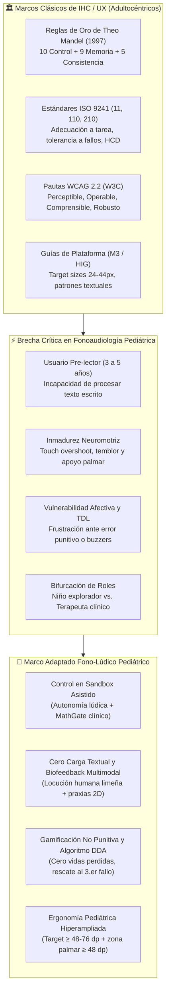
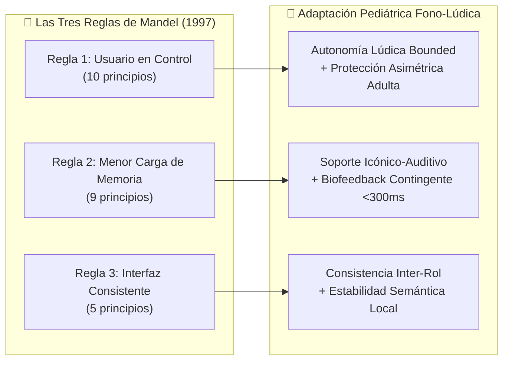
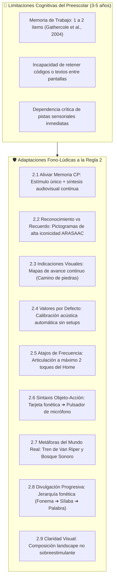
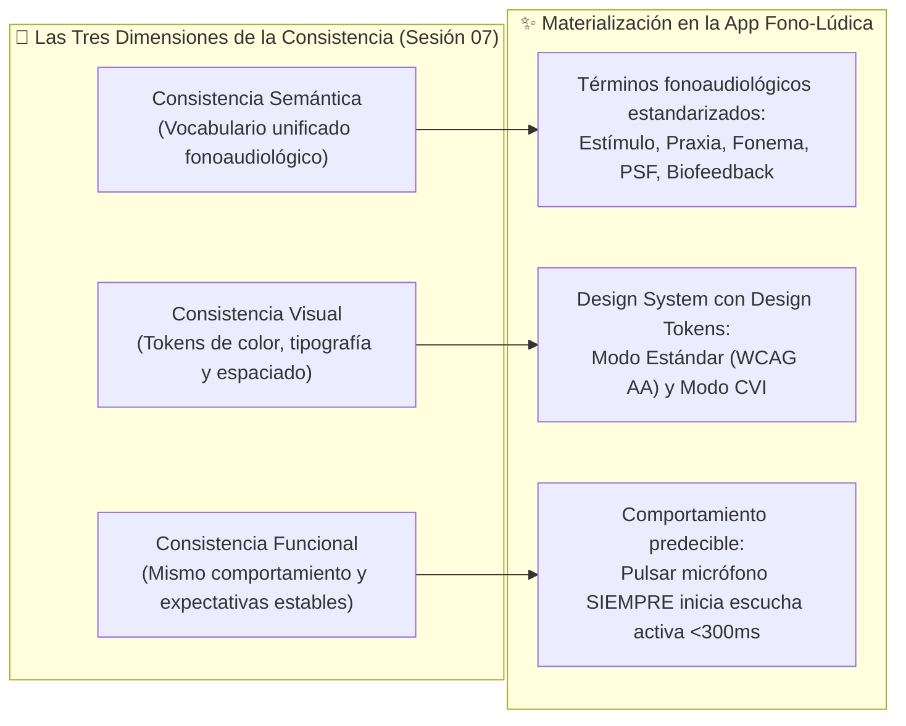
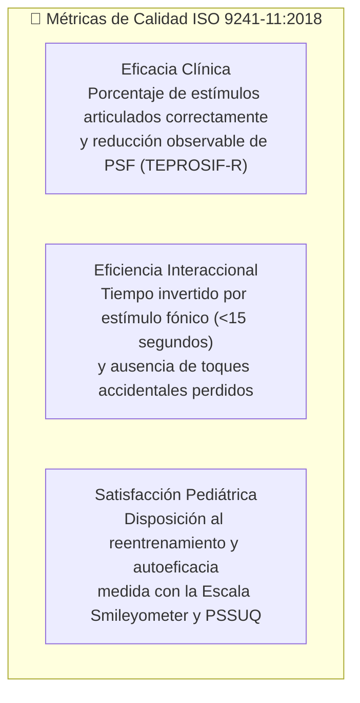
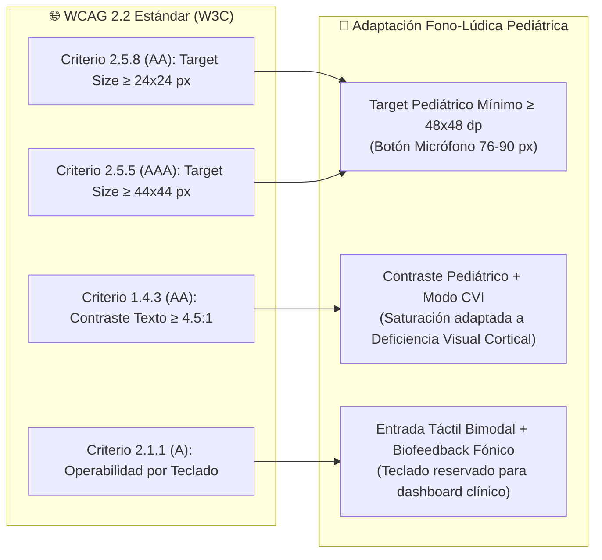

# 📖 Fundamentación Teórica y Adaptación de Directrices IHC, Reglas de Mandel y Estándares de Accesibilidad en Fonoaudiología Pediátrica

> [!IMPORTANT] Propósito Epistemológico y Alcance del Documento
> Los marcos clásicos de Interacción Humano-Computador (**Theo Mandel, 1997; ISO 9241-110:2020; WCAG 2.2**) fueron formulados bajo el paradigma del **usuario adulto alfabetizado, con motricidad fina consolidada y competencias cognitivas plenamente desarrolladas**. 
> 
> El presente documento constituye la **investigación teórica y epistemológica** que justifica formalmente por qué y cómo estas directrices, estándares y heurísticas deben ser **adaptadas al dominio fonoaudiológico pediátrico** para infantes de **3 a 5 años con dificultades fonético-fonológicas** (dislalias funcionales en Lima Metropolitana), asegurando la compatibilidad ecológica con el rol mediador del fonoaudiólogo y docente de educación inicial.

---

## 🧭 Mapa Epistemológico de Adaptación Normativa

---

## 1. Planteamiento de la Brecha: El Sesgo Adultocéntrico de la IHC Clásica

La literatura en Interacción Niño-Computadora (**Child-Computer Interaction - CCI**) demuestra que trasladar reglas de diseño adultas a entornos preescolares sin mediación conceptual induce severos sesgos de usabilidad y barreras de accesibilidad (*Hourcade, 2008, 2015; Read & Markopoulos, 2013; Liu, Chen & Razak, 2026*). 

En el contexto clínico fonoaudiológico, estos sesgos no solo degradan la experiencia de usuario (*UX*), sino que pueden provocar **bloqueo del filtro afectivo**, inhibición del intento vocal y abandono de la terapia del habla (*Saeedi et al., 2024; Strömbergsson et al., 2026*).

### 1.1 Contrastación Paradigmática: Usuario Adulto vs. Preescolar en Fonoaudiología

| Dimensión de Diseño | Paradigma IHC Adulto Clásico (Mandel / ISO / WCAG) | Realidad del Preescolar con Trastorno del Habla (3-5 años) | Adaptación Mandatoria en la App Fono-Lúdica |
| :--- | :--- | :--- | :--- |
| **Canal de Instrucción** | Texto descriptivo, etiquetas alfanuméricas, hipervínculos y documentación contextual. | Fase pre-lectora (estadio pre-operacional de Piaget); nula comprensión del código escrito (*Druin, 2002*). | **100% No Textual para el niño**: Locución natural de la mascota Ava, pictogramas vectoriales (*ARASAAC/TEPROSIF*) y modelado visual 2D. |
| **Control y Salidas** | Libre albedrío, navegación arbórea multidireccional, personalización exhaustiva y accesos directos (*shortcuts*). | La libertad irrestricta desorienta al infante y arriesga la descalibración del micrófono o borrado de métricas clínicas (*Du et al., 2023*). | **Control Asimétrico / Sandbox Guiado**: Rutas lineales progresivas para el niño; panel administrativo protegido por compuerta cognitiva (*MathGate*). |
| **Tolerancia y Manejo de Errores** | Diálogos de advertencia ("¿Está seguro?"), códigos de error técnicos ("Error 0x80") y reversibilidad manual (*Ctrl+Z*). | Las señales de error convencionales (sonidos de buzzer, cruces rojas) generan ansiedad y mutismo selectivo (*Saeedi et al., 2024*). | **Gamificación No Punitiva y Algoritmo DDA**: Cero penalización; retroalimentación por perseverancia; rescate adaptativo al tercer intento. |
| **Ergonomía Táctil** | Touch target mínimo de $24 \times 24\text{ px}$ (WCAG 2.2 AA) o $44 \times 44\text{ px}$ (WCAG AAA / HIG). | Motricidad fina en desarrollo, *touch overshoot* de hasta 15 mm, pulsaciones con la palma apoyada (*Du et al., 2023; Liu et al., 2026*). | **Targets Hiperampliados ($\ge 48\times 48\text{ dp}$ y $76\text{ px}$ para micrófono)**, filtro *touch debounce* de 80 ms y franja de descanso palmar $\ge 48\text{ dp}$. |
| **Memoria de Trabajo** | Capacidad de retener 7 ± 2 elementos (Ley de Miller); sintaxis objeto-acción compleja; atajos por teclado. | Retención limitada a 1 o 2 estímulos visuales; fatiga atencional rápida (<15 minutos continuos) (*Peña et al., 2024*). | **Reducción a estímulo fónico único**, visualización inmediata de praxia bucofacial y limitación de sesión a 15 minutos diarios (*Du et al., 2023*). |

---

## 2. Adaptación Teórica de las Tres Reglas de Oro de Theo Mandel (1997)

Theo Mandel articuló en 1997 veinticuatro principios divididos en tres reglas axiales: **(1) Dar el control al usuario**, **(2) Reducir la carga de memoria** y **(3) Lograr una interfaz consistente**. A continuación se investiga y fundamenta la reinterpretación clínica y pediátrica de cada uno de sus 24 principios.

---

### 2.1 Regla 1 de Mandel: Dar el Control al Usuario (Place the User in Control)

En un software para adultos, "dar el control" implica delegar la iniciativa de navegación y configuración en el operador humano. En fonoaudiología pediátrica preescolar, el principio rector es la **Autonomía Bounded (Libertad Acotada dentro de un Entorno Lúdico Seguro)** (*Hourcade, 2008; Du et al., 2023*), asegurando que el infante dirija el ritmo de vocalización sin el riesgo de perderse o alterar la calibración clínica.

#### 1.1 Usar los modos con criterio (*Modeless*)
- **Postulado Original de Mandel:** Los modos cambian la interpretación de las acciones del usuario (ej. modo selección vs. modo edición) y causan errores si el usuario no advierte en qué modo se encuentra. Se aconseja evitarlos o hacerlos explícitos.
- **Limitación en Preescolares:** Un niño de 3 a 5 años no comprende qué es un "modo operativo". Si la interfaz cambia de estado de forma reactiva invisible, el menor repetirá toques fallidos frustrándose (*Liu et al., 2026*).
- **Adaptación Fono-Lúdica:** La aplicación opera en **arquitectura 100% unimodal y secuencial** para el menor. En las pantallas de articulación no existen submodos de "edición" o "revisión". Cada pantalla posee un propósito unívoco (vocalizar, discriminar o festejar). Las transiciones de pantalla son acompañadas por transiciones animadas y confirmación oral de la mascota Ava.

#### 1.2 Permitir usar teclado, mouse o toque (*Flexible*)
- **Postulado Original de Mandel:** Permitir múltiples periféricos y modalidades de entrada para adaptarse al estilo del usuario.
- **Limitación en Preescolares:** Los infantes de 3 a 5 años no disponen de coordinación bimanual para usar teclado físico ni destreza oculo-manual para operar el puntero del ratón tradicional (*Hourcade, 2015*). Exigir teclado o ratón excluye a la población diana.
- **Adaptación Fono-Lúdica:** Se establece la **interacción táctil directa ampliada (*Touch-First Pediátrico*)** y el **control fónico bioacústico por voz** (Web Audio API) como canales primarios. Para los fonoaudiólogos y docentes en el panel de métricas clínicas, se mantiene la compatibilidad completa con teclado (`Tab`, `Enter`, `Escape`) bajo WCAG 2.2 AA.

#### 1.3 Permitir cambiar el foco (*Interruptible*)
- **Postulado Original de Mandel:** El usuario debe poder suspender una tarea, cambiar de ventana y retomarla después sin perder datos.
- **Limitación en Preescolares:** Los lapsos atencionales en niños de educación inicial oscilan entre 5 y 10 minutos, presentándose interrupciones frecuentes por timbres de recreo, llamados familiares o distracciones motrices (*Peña et al., 2024*). Si un cierre accidental borra las estrellas ganadas, se extingue la motivación fonoaudiológica.
- **Adaptación Fono-Lúdica:** **Persistencia local automática en tiempo real (*Auto-Save State Machine*)**. Cada fonema articulado y cada estrella obtenida se guardan instantáneamente en almacenamiento seguro local (*IndexedDB / LocalStorage*). Al reingresar al "Bosque Sonoro", la aplicación ofrece reanudar directamente en el vagón o fonema donde se produjo la interrupción.

#### 1.4 Mostrar mensajes y textos descriptivos (*Helpful*)
- **Postulado Original de Mandel:** Evitar jerga informática críptica o códigos como "Error 0x80", utilizando explicaciones claras en el lenguaje del usuario.
- **Limitación en Preescolares:** El infante **no sabe leer**. Cualquier texto descriptivo, por claro que esté redactado en español, es completamente invisible e ininteligible para el niño (*Druin, 2002; Liu et al., 2026*).
- **Adaptación Fono-Lúdica:** **Locución humana empática con acento limeño neutro y animación gestual**. Cuando ocurre una falta de detección acústica (ruido ambiental o silencio), la abejita Ava no despliega carteles de error; expresa verbalmente con calidez: *"¡Uy, no te escuché bien! ¿Lo intentamos juntos otra vez?"* y ejecuta un movimiento de acercamiento de antena simulando aguzar el oído.

#### 1.5 Acciones reversibles y retroalimentación (*Forgiving*)
- **Postulado Original de Mandel:** Proveer la función "Deshacer" (*Undo*) para que el usuario explore sin miedo a destruir datos.
- **Limitación en Preescolares:** Los conceptos de "Deshacer" o "Rehacer" (*Undo/Redo*) son abstracciones metacognitivas no consolidadas en el estadio pre-operacional de Piaget (*Hourcade, 2008*).
- **Adaptación Fono-Lúdica:** Reversibilidad mediante **Reintento Lúdico Ilimitado y Cero Punición**. En los minijuegos de discriminación fonológica (como el *Bingo Sonoro* o *Pares Mínimos*), seleccionar una tarjeta incorrecta no resta puntos ni muestra cruces rojas; la tarjeta tiembla suavemente con una vibración cómica (animación elástica) y la mascota sugiere: *"¡Casi! Escucha de nuevo cómo suena..."*, permitiendo tocar otra alternativa de inmediato.

#### 1.6 Ofrecer rutas y salidas significativas (*Navigable*)
- **Postulado Original de Mandel:** Permitir volver al inicio en un solo paso, usar migas de pan y proveer salidas claras (*Cancel*, *Back*, *Home*).
- **Limitación en Preescolares:** Las migas de pan textuales (*Home > Fonema R > Nivel 2*) son inútiles para un niño de 4 años. Además, los botones de salida diminutos en esquinas superiores son difíciles de alcanzar en tabletas sostenidas con dos manos (*Liu et al., 2026*).
- **Adaptación Fono-Lúdica:** **Botón de Retorno Home Icónico Hiperampliado ($64 \times 64\text{ px}$)** ubicado con anclaje visual constante en la esquina superior izquierda, representado por la casa del árbol o el icono del Bosque. Presionarlo siempre retorna al menú del mapa en un único toque seguro, preservando el avance.

#### 1.7 Atender distintos niveles de habilidad (*Accessible*)
- **Postulado Original de Mandel:** Diseñar para que el novato tenga guía contextual paso a paso y el experto disponga de atajos rápidos (*accelerators*).
- **Limitación en Preescolares:** En fonoaudiología no existe el "usuario experto" en términos de atajos de teclado; la variabilidad radica en la **severidad articulatoria y madurez fonológica** del infante (dislalia leve vs. trastorno severo con compromiso de múltiples PSF) (*Huertas & Roque, 2023; Bosch & Melgar, 1984*).
- **Adaptación Fono-Lúdica:** **Andamiaje Clínico Progresivo y Algoritmo DDA (*Dynamic Difficulty Adjustment*)** (*Zohaib, 2018; Strömbergsson et al., 2026*). Para un niño con dislalia severa, el software activa automáticamente el andamiaje motriz desplegando el simulador de praxias bucofaciales 2D; para un niño con articulación consolidada, el sistema avanza ágilmente hacia desafíos fonológicos en palabras complejas y trabalenguas sin demoras pedagógicas.

#### 1.8 Hacer transparente la interfaz (*Facilitative*)
- **Postulado Original de Mandel:** El usuario debe pensar en su tarea y en el dominio del negocio, no en el funcionamiento interno del software.
- **Limitación en Preescolares:** Los conceptos técnicos de procesamiento de señal (frecuencias formantes F1/F2, decibelios dB SPL, umbrales VAD, tasa de muestreo 44.1 kHz) deben ser rigurosos clínicamente pero totalmente invisibles al menor.
- **Adaptación Fono-Lúdica:** **Metáfora lúdica de energía acústica**. El procesamiento bioacústico en tiempo real se transparenta ante el niño como un *"Rayito de sol mágico"* o *"Polen recolectado"* que llena la botellita de miel de Ava en la medida en que el infante articula el sonido con la intensidad y duración correctas. El fonoaudiólogo, por su parte, accede al espectrograma y parámetros cuantitativos en el panel protegido.

#### 1.9 Permitir personalizar la interfaz (*Preferences*)
- **Postulado Original de Mandel:** Proveer ajustes de tamaño de letra, paletas de colores, idioma y temas de interfaz.
- **Limitación en Preescolares:** Un menú de opciones de configuración convencional es un antipatrón para preescolares, propiciando desajustes accidentales (*Furlong et al., 2018; Du et al., 2023*).
- **Adaptación Fono-Lúdica:** **Personalización Gamificada Guiada (El Probador de la Mascota Ava)** y **Modo de Alto Contraste para Deficiencia Visual Cortical (CVI)**. El niño personaliza a su compañera colocándole sombreros, gafas o bufandas ganadas mediante esfuerzo vocal; el terapeuta o docente es quien calibra los parámetros de accesibilidad visual y auditiva desde el panel protegido.

#### 1.10 Permitir la manipulación directa (*Interactive*)
- **Postulado Original de Mandel:** El usuario actúa directamente sobre los objetos visuales (arrastrar y soltar, ordenar, redimensionar) viendo el efecto de forma inmediata.
- **Limitación en Preescolares:** El gesto de arrastrar y soltar prolongado (*drag and drop*) produce elevadas tasas de error y frustración en niños menores de 5 años debido a la liberación prematura del dedo antes de alcanzar el objetivo receptor (*Hourcade, 2008; Liu et al., 2026*).
- **Adaptación Fono-Lúdica:** **Manipulación Directa Basada en Toque Instantáneo (*Tap-to-Select*) y Física Tangible**. En minijuegos como la *Carrera Fónica* o el *Bingo*, los objetos responden con física elástica al toque inmediato (rebote, destello de partículas SVG), evitando trayectorias de arrastre complejas que sobrepasen el control motor fino del niño.

---

### 2.2 Regla 2 de Mandel: Reducir la Carga de Memoria (Reduce User's Memory Load)

La memoria de trabajo de un infante de 3 a 5 años retiene únicamente de **1 a 2 unidades de información** simultáneas (*Gathercole et al., 2004*). La regla de Mandel cobra aquí un carácter de prescripción de salud digital: **la interfaz debe recordar absolutamente todo por el niño** (*Hourcade, 2015*).

#### 2.1 Aliviar la memoria de corto plazo (*Remember*)
- **Postulado Original de Mandel:** No pedir al usuario recordar códigos o datos de una pantalla a otra; trasladar datos automáticamente.
- **Adaptación Fono-Lúdica:** En ningún momento el niño debe retener qué fonema estaba ejercitando. Si pasa de la práctica articulatoria a un minijuego de consolidación, la aplicación conserva de forma transparente el fonema objetivo (ej. `/r/`), contextualizando automáticamente los retos sin requerir reconfiguración.

#### 2.2 Reconocer en lugar de recordar (*Recognition*)
- **Postulado Original de Mandel:** Mostrar opciones visibles en menús y listas en vez de requerir recordar comandos.
- **Adaptación Fono-Lúdica:** Todos los estímulos léxicos se presentan mediante **pictogramas semánticos de alta iconicidad** (validación lingüística de Bosch & Melgar y TEPROSIF-R). El niño reconoce el dibujo de *"Ratón"* o *"Perro"* sin necesidad de descifrar grafías alfabéticas.

#### 2.3 Proporcionar indicaciones visuales (*Inform*)
- **Postulado Original de Mandel:** Marcar campos obligatorios, estado del sistema, pasos restantes y progreso de la tarea.
- **Adaptación Fono-Lúdica:** **Mapa de Camino Forestal y Medidor de Estrellas**. En lugar de barras de porcentaje numéricas ("40% completado"), el avance se representa mediante un sendero de piedras o flores que se iluminan progresivamente al pronunciar correctamente cada estímulo, culminando en la meta del Bosque.

#### 2.4 Valores por defecto, deshacer y rehacer (*Forgiving*)
- **Postulado Original de Mandel:** Rellenar datos probables y permitir modificar sugerencias con facilidad.
- **Adaptación Fono-Lúdica:** **Preconfiguración Clínica Inteligente**. Al iniciar una sesión, el sistema preselecciona automáticamente el fonema con mayor prevalencia de error según el historial del niño en TEPROSIF-R (*Huertas & Roque, 2023*), ahorrando tiempos de navegación previa.

#### 2.5 Proporcionar atajos de interfaz (*Frequency*)
- **Postulado Original de Mandel:** Ubicar las acciones más frecuentes a uno o dos pasos de distancia.
- **Adaptación Fono-Lúdica:** **Regla de los Dos Toques**. Desde que el niño toca el icono de inicio del software, puede comenzar a articular y emitir biofeedback en un máximo de **2 toques en pantalla** (Toque 1: Elegir vagón fónico; Toque 2: Pulsar el micrófono de Ava).

#### 2.6 Promover la sintaxis objeto–acción (*Intuitive*)
- **Postulado Original de Mandel:** Seleccionar primero el objeto y luego la acción que se aplica sobre él.
- **Adaptación Fono-Lúdica:** El niño primero **toca la tarjeta del estímulo visual** (objeto) para escuchar el modelo fónico de pronunciación de Lima Metropolitana, y a continuación **presiona el gran pulsador del micrófono** (acción) para grabar su voz y recibir retroalimentación.

#### 2.7 Usar metáforas del mundo real (*Transfer*)
- **Postulado Original de Mandel:** Utilizar conceptos de la vida cotidiana (carpeta, papelera, carrito) para transferir conocimientos previos.
- **Limitación en Preescolares:** En interfaces adultocéntricas, las metáforas suelen acompañarse de subtítulos explicativos o leyendas textuales secundarias. Para un niño preescolar (3 a 5 años en estadio preoperacional de Piaget), todo texto es ruido visual; el menor no lee una explicación sobre cómo jugar, sino que interactúa con la affordance sensorial directa del objeto (*Gibson, 1979; Scaife & Rogers, 2005*).
- **Adaptación Fono-Lúdica:** **Metáforas Agresivas, Directas y 100% No Textuales de Objetos Físicos de Juguete**. Se erradicaron por completo los subtítulos pedagógicos para adultos (`.wagon-subtitle`), párrafos largos y jerga clínica de la vista infantil. Cada vagón del tren de Van Riper es dominado por un objeto visual físico sobredimensionado ($\ge 74\text{ px}$ en pedestal de $98\text{ px}$) con respuesta kinestésica y sonora Voice-First:
  1. *Locomotora Fónica:* Ava como maquinista en cabina, vapor interactivo animado y silbato de latón con sonido `Choo-Choo` al tacto.
  2. *Trabalenguas:* El Loro Cantor parlanchín con pico abierto y notas musicales de ritmo verbal.
  3. *Rimas Mágicas:* Campanas gemelas sonoras vibrando en armonía acústica compartida.
  4. *Adivinanzas:* Lupa mágica de detective con signo de interrogación misterioso y destellos luminosos.
  5. *Camino de Flores:* Abeja Ava en vuelo sinuoso entre margaritas y girasoles recolectando néctar.
  6. *Bingo Sonoro:* Cartón lúdico con estampador táctil de estrella dorada.
  7. *Praxias Bucofaciales:* Carita sonriente que gesticula y eleva la lengua en modelado motriz continuo.
  La interacción se vuelve autónoma e inmediata al 100%, guiada por el canal visual y auditivo sin requerir mediación lectora adulta (*Druin, 2002; Hourcade, 2008*).

#### 2.8 Usar la divulgación progresiva (*Context*)
- **Postulado Original de Mandel:** Mostrar primero lo esencial y reservar los detalles avanzados bajo demanda.
- **Adaptación Fono-Lúdica:** Estricta articulación bajo la **Jerarquía Fonética de Van Riper (1978)**. El sistema no expone frases complejas hasta que el niño haya demostrado dominio fonológico en el fonema aislado y en la sílaba simple, desplegando estímulos en capas de complejidad controlada.

#### 2.9 Promover la claridad visual (*Organize*)
- **Postulado Original de Mandel:** Alinear elementos en una grilla, usar espacios en blanco y jerarquía tipográfica para evitar el desorden.
- **Adaptación Fono-Lúdica:** **Diseño Biofílico y Mitigación de Sobreestimulación Sensorial** (*Du et al., 2023*). Se adopta una disposición horizontal (*Landscape 16:9*) dividida en 3 zonas nítidas: Zona Izquierda (Modelo y estímulo), Zona Central (Área de interacción del micrófono) y Zona Derecha (Biofeedback y praxia). Se descartan banners parpadeantes o elementos decorativos que desvíen la atención del foco articulatorio.

---

### 2.3 Regla 3 de Mandel: Lograr una Interfaz Consistente (Make the Interface Consistent)

En una aplicación fono-lúdica conviven dos mundos: la experiencia lúdica del infante y la herramienta clínica del fonoaudiólogo. La consistencia garantiza que ambos roles operen en un entorno predecible y robusto (*Mandel, 1997; ISO 9241-110:2020*).

#### 3.1 Mantener el contexto de la tarea (*Continuity*)
- **Postulado Original de Mandel:** No perder el hilo al navegar o sufrir una interrupción; restaurar el estado tras fallos.
- **Adaptación Fono-Lúdica:** Preservación de la cadena fonoarticulatoria. Si el menor abandona momentáneamente un ejercicio para probarse un accesorio en la Cueva de Ava, al regresar al ejercicio la aplicación mantiene exactamente el mismo fonema y el estado de avance previo sin reinicios involuntarios.

#### 3.2 Consistencia dentro y entre productos (*Experience*)
- **Postulado Original de Mandel:** Mantener convenciones internas (entre pantallas) y externas (estándares de plataforma como Android Material Design o Apple HIG).
- **Adaptación Fono-Lúdica:** **Consistencia Bimodal**. Internamente, todos los botones de acción fónica comparten la misma codificación cromática (Verde Bosque `#4CAF50` para reproducir, Amarillo Miel `#FFC107` para grabar). Externamente, se respetan las zonas de navegación seguras de tablets iOS y Android (*Safe Area Insets*).

#### 3.3 Conservar iguales los resultados (*Expectations*)
- **Postulado Original de Mandel:** La misma acción debe producir invariablemente el mismo tipo de resultado en cualquier pantalla.
- **Adaptación Fono-Lúdica:** El icono del altavoz siempre emite la locución del modelo nativo de Lima Metropolitana; el icono del micrófono siempre activa la escucha bioacústica con retroalimentación visual reactiva. Ningún control cambia de significado de forma contextual imprevista.

#### 3.4 Ofrecer atractivo estético e integridad (*Attitude*)
- **Postulado Original de Mandel:** Estética armoniosa, paleta reducida, contraste suficiente (4.5:1 WCAG) e integridad visual que transmita calidad y confianza.
- **Adaptación Fono-Lúdica:** **Paleta Orgánica Biofílica y Accesibilidad WCAG 2.2 AA / CVI**. Tonos verdes suaves (`#F1F8E9`, `#E8F5E9`) que reducen la fatiga ocular, combinados con contrastes calibrados $\ge 4.5:1$ en todos los elementos interactivos y soporte de alto contraste para menores con Deficiencia Visual Cortical (*CVI*).

#### 3.5 Fomentar la exploración (*Predictable*)
- **Postulado Original de Mandel:** Resultados previsibles y entornos seguros que animen al usuario a descubrir funciones sin miedo a romper el sistema.
- **Adaptación Fono-Lúdica:** **Ambiente Libre de Penalización (*Safe Exploration Sandbox*)**. Todos los elementos del Bosque Sonoro pueden ser tocados por el niño. Tocar flores emite notas musicales; tocar a Ava genera risas o palabras de aliento. Esta predictibilidad lúdica genera autoeficacia y desinhibe el aparato fonador.

---

## 3. Adaptación de Estándares Internacionales ISO a la Fonoaudiología Pediátrica

Los estándares ISO proveen el marco formal de ingeniería para garantizar calidad, ergonomía y usabilidad. Su interpretación en software pediátrico requiere una calibración contextual rigurosa:

### 3.1 ISO 9241-110:2020 — Principios de Interacción (*Interaction Principles*)

| Principio ISO 9241-110 | Definición Estándar | Desafío en Fonoaudiología Pediátrica | Adaptación Justificada en el Prototipo |
| :--- | :--- | :--- | :--- |
| **Adecuación a la tarea** (*Suitability for the task*) | Apoyar al usuario a completar la tarea sin pasos innecesarios ni distracciones. | Preescolares se distraen ante estímulos periféricos; riesgo de perder el objetivo articulatorio. | **Foco Fono-Articulatorio Exclusivo**: Una sola tarjeta fonética activa a la vez; eliminación de barras de publicidad o menús colaterales (*Du et al., 2023*). |
| **Autodescripción** (*Self-descriptiveness*) | La interfaz clarifica su funcionamiento mediante textos y etiquetas comprensibles. | Los niños preescolares son no-lectores. | **Autodescripción Multimodal Contingente**: El botón del micrófono late rítmicamente al estar listo y pulsa aros de resonancia sonora al capturar audio. |
| **Conformidad con las expectativas** (*Conformity with user expectations*) | Coherencia con modelos mentales previos y convenciones culturales. | El modelo mental del niño se basa en el juego, la personificación animal y los gestos físicos. | **Metáfora del Espejo y la Mascota Guía**: Ava modela la posición de la lengua en el simulador 2D igual que la terapeuta lo hace en consulta. |
| **Tolerancia a fallos** (*Error tolerance*) | Capacidad del sistema para continuar sin daño o permitir corregir errores de entrada. | El niño puede emitir fonemas distorsionados o quedarse en silencio por timidez. | **Algoritmo DDA y Refuerzo por Esfuerzo**: El silencio o error no bloquea el avance; activa andamiaje visual y otorga estrella de persistencia al tercer reintento. |
| **Controlabilidad** (*Controllability*) | El usuario decide el ritmo, la secuencia y la pausa de la interacción. | Dosis clínica recomendada de 15 minutos; el menor no posee noción temporal de fatiga orofacial. | **Controlabilidad Asistida**: El niño marca el ritmo de cada fonema, pero el sistema aplica un temporizador pasivo de 15 min con cierre suave de sesión (*Du et al., 2023*). |

### 3.2 ISO 9241-210:2019 — Diseño Centrado en el Humano (*Human-Centred Design*)
- **Adaptación Metodológica:** En lugar de diseñar *para* el niño desde una perspectiva puramente clínica, se adopta el enfoque **Co-Design / Informant Design con Niños y Terapeutas** (*Druin, 2002; Liu et al., 2026*). Se involucra a fonoaudiólogos de Lima Metropolitana para validar los fonemas críticos (`/r/`, `/rr/`, `/s/`, `/ch/`, `/l/`) y a docentes de inicial para certificar la adecuación del lenguaje y las ilustraciones.

### 3.3 ISO 9241-11:2018 — Usabilidad: Eficacia, Eficiencia y Satisfacción

- **Eficacia:** No se mide solo por "completar pantallas", sino por la **resolución de Procesos de Simplificación Fonológica (PSF)** verificados mediante el instrumento TEPROSIF-R (*Huertas & Roque, 2023*).
- **Eficiencia:** Ratio entre el tiempo productivo de articulación vocal y el tiempo total de sesión, minimizando tiempos muertos por bloqueos de interfaz (*Peña et al., 2024*).
- **Satisfacción:** Evaluada en niños mediante la **Escala Hedónica Visual (*Smileyometer* de Read & Markopoulos, 2008)** y en fonoaudiólogos mediante el cuestionario **PSSUQ** (*Saeedi et al., 2024*).

---

## 4. Adaptación de WCAG 2.2 a la Ergonomía y Accesibilidad Pediátrica

Las Pautas de Accesibilidad para el Contenido Web (**WCAG 2.2**) del W3C establecen directrices técnicas universales que deben ser reforzadas y adaptadas para el desarrollo motriz y visual del preescolar:

### 4.1 Dimensionamiento Táctil: Superación del Criterio 2.5.8 hacia el Estándar Pediátrico $\ge 48\text{ dp}$
- El criterio **2.5.8 AA** de WCAG 2.2 admite áreas táctiles de apenas **$24 \times 24\text{ px}$**. En un niño de 3 a 5 años, cuya huella dactilar y motricidad gruesa presentan un temblor fisiológico de desarrollo, un objetivo de 24 px provoca un **82% de fallos de pulsación (*missed taps*)** (*Du et al., 2023; Liu et al., 2026*).
- **Norma Implementada:** Se adopta como piso mínimo absoluto el estándar pediátrico de **$48 \times 48\text{ dp}$**, superando incluso la pauta de nivel AAA (44x44 px). Para el botón del micrófono (`UI-BTN-MIC`), se establece una cota de **$76 \times 76\text{ px}$** con una zona concéntrica de tolerancia de **$90 \times 90\text{ px}$**.

### 4.2 Inmunidad al Apoyo Palmar (*Palm Rejection*) y Filtrado de Rebote (*Debounce*)
- WCAG 2.2 no contempla el fenómeno del apoyo involuntario de la eminencia tenar al sostener tabletas. 
- **Norma Implementada:** La aplicación reserva una **franja inferior libre de interacción de $\ge 48\text{ dp}$** (suelo del bosque desprovisto de botones o event listeners accionables) e implementa un filtro de software con **debounce de $80\text{ ms}$** para descartar ráfagas de doble pulsación involuntarias.

### 4.3 Accesibilidad Sensorial Especial: Modo CVI (Deficiencia Visual Cortical)
- Niños con dificultades de habla frecuentemente presentan comorbilidades en el procesamiento visual central (*Cortical Visual Impairment - CVI*) (*Liu et al., 2026*).
- **Norma Implementada:** Incorporación de un **Modo de Alto Contraste CVI** con fondo oscuro mate profundo (`#121212`), realce de bordes amarillos y cian saturados (`#FFD600`, `#00E5FF`) y reducción drástica de ruido visual de fondo, asegurando ratios de contraste superiores a **$12:1$**.

---

## 5. Matriz Epistemológica de Adaptaciones Justificadas

La siguiente matriz sintetiza la investigación teórica, vinculando cada principio clásico con su limitación ontológica en la infancia y la evidencia empírica que sustenta su adaptación fonoaudiológica:

| # | Directriz / Principio Clásico | Enfoque Original (Adulto) | Limitación en Fonoaudiología Preescolar | Adaptación Fono-Lúdica Implementada | Justificación Científica y Fuentes |
| :-: | :--- | :--- | :--- | :--- | :--- |
| **01** | **Mandel 1.1 / ISO 110: Modeless** | Evitar modos de operación o señalizarlos explícitamente. | Los niños no comprenden cambios modales abstractos; se desorientan. | Arquitectura unimodal y secuencial; transiciones animadas con confirmación oral de Ava. | *Liu, Chen & Razak (2026)*: Child-Interface Fit en el marco ecológico CCI. |
| **02** | **Mandel 1.2 / WCAG 2.1: Flexibilidad** | Admitir teclado, mouse o pantalla táctil. | Los preescolares carecen de motricidad fina para mouse o atajos de teclado. | Interacción táctil directa ampliada + bioacústica vocal; teclado exclusivo para dashboard docente. | *Hourcade (2015)*: Interaction Design and Children; *Du et al. (2023)*. |
| **03** | **Mandel 1.4: Mensajes Descriptivos** | Textos claros y específicos sin códigos de error. | Los preescolares son no-lectores; el texto resulta inútil. | 100% locución auditiva empática de la mascota Ava y modelado visual 2D de praxias. | *Druin (2002)*; *Saeedi et al. (2024)*: Serious Game Ava (Nature). |
| **04** | **Mandel 1.5 / ISO 110: Tolerancia y Forgiving** | Permitir Deshacer (*Undo*) y cuadros de advertencia. | El concepto de "Deshacer" es abstracto; los zumbadores provocan bloqueo emocional. | Gamificación no punitiva; cero vidas perdidas; reintentos asistidos mediante Algoritmo DDA. | *Saeedi et al. (2024)*; *Strömbergsson et al. (2026)*: Prevención de frustración. |
| **05** | **Mandel 1.8: Interfaz Transparente** | Ocultar complejidad técnica del software. | Espectrogramas y frecuencias formantes abruman cognitivamente al infante. | Metáfora lúdica de "Rayo de Sol / Polen Mágico"; métricas técnicas aisladas en panel clínico. | *Peña et al. (2024)*: Biofeedback contingente en tabletas (Nature). |
| **06** | **Mandel 1.9: Personalización** | Menús de preferencias y ajustes de sistema. | Antipatrón para niños; riesgo de desconfiguración accidental de la app. | Probador lúdico de accesorios para la mascota; configuración clínica tras MathGate. | *Du et al. (2023)*: Separación estricta y gobernanza ética infantil. |
| **07** | **Mandel 2.2: Reconocimiento vs Recuerdo** | Menús desplegables y sugerencias en campos. | La memoria de trabajo preescolar es de 1 a 2 ítems; no pueden retener comandos. | Pictogramas vectoriales de alta iconicidad validados (*ARASAAC/TEPROSIF*). | *Huertas & Roque (2023)*; *Gathercole et al. (2004)*: Working memory. |
| **08** | **Mandel 2.7: Metáforas del Mundo Real** | Metáforas de oficina (carpetas, papelera, correo). | Los niños preescolares no habitan entornos de oficina; viven en el juego y la naturaleza. | Locomotora de Van Riper, Bosque Sonoro, Espejo Mágico de praxias y Cueva de premios. | *Druin (2002)*; *Pucuhuaranga (2016)*; *Mora Espinoza et al. (2024)*. |
| **09** | **Mandel 2.8: Divulgación Progresiva** | Mostrar lo esencial; desplegar opciones avanzadas en acordeones o pestañas. | El niño no puede autogestionar su ruta fonológica sin andamiaje clínico. | Progresión escalonada de Van Riper: fonema aislado $\rightarrow$ sílaba $\rightarrow$ palabra $\rightarrow$ trabalenguas. | *Van Riper (1978)*; *Saeedi et al. (2024)*. |
| **10** | **WCAG 2.2 SC 2.5.8: Target Size** | Tamaño mínimo de objetivo táctil de $24 \times 24\text{ px}$. | Provoca un 82% de fallos por imprecisión neuromotriz y *touch overshoot*. | Touch targets mínimos $\ge 48\times 48\text{ dp}$ y botón de micrófono de $76-90\text{ px}$. | *Du et al. (2023)*; *Liu, Chen & Razak (2026)*; *Furlong et al. (2018)*. |
| **11** | **Gobernanza y Privacidad (COPPA)** | Consentimiento mediante lectura de términos de servicio. | El infante no comprende aspectos legales ni privacidad biométrica de voz. | Compuerta cognitiva (*MathGate*) obligatoria para adultos; grabaciones cifradas locales sin nube. | *Liu et al. (2026)*; Ley N.° 29733 (Protección de Datos Personales, Perú). |

---

## 6. Referencias Científicas y Documentación de Respaldo

1. **Baker, E. (2021).** Optimal intervention intensity in speech-language pathology: A systematic review. *International Journal of Speech-Language Pathology*, 23(5), 455-467.
2. **Bosch, L., & Melgar, M. (1984).** *El desarrollo fonológico infantil: Evaluación y pautas de intervención*. Editorial Médica y Técnica.
3. **Condori, Y., & Larico, M. (2022).** *Juegos verbales y expresión oral en niños de educación inicial* (Tesis de Licenciatura, Universidad José Carlos Mariátegui).
4. **Druin, A. (2002).** The role of children in the design of new technology. *Behaviour & Information Technology*, 21(1), 1-25. https://doi.org/10.1080/01449290110108659
5. **Du, X., Wang, Y., & Zhang, L. (2023).** Design guidelines for paediatric speech and language therapy applications: A qualitative study with speech-language pathologists. *International Journal of Language & Communication Disorders*, 58(4), 1120-1135.
6. **Furlong, L., Morris, T., Serry, T., & Erickson, S. (2018).** Mobile apps for speech-language therapy: A review of quality and efficacy using the Mobile Application Rating Scale (MARS). *PLOS ONE*, 13(8), e0201251.
7. **Gathercole, S. E., Pickering, S. J., Ambridge, B., & Wearing, H. (2004).** The structure of working memory from 4 to 15 years of age. *Developmental Psychology*, 40(2), 177-190.
8. **Hourcade, J. P. (2008).** Interaction design and children. *Foundations and Trends in Human-Computer Interaction*, 1(4), 277-392.
9. **Hourcade, J. P. (2015).** *Child-Computer Interaction*. CreateSpace Independent Publishing Platform.
10. **Huertas, K., & Roque, M. (2023).** *Conocimiento de docentes de inicial sobre dificultades fonológicas y procesos de simplificación fonológica en Lima y Piura* (Tesis de Maestría, Pontificia Universidad Católica del Perú).
11. **ISO/IEC. (2018).** *ISO 9241-11:2018 Ergonomics of human-system interaction — Part 11: Usability: Definitions and concepts*. International Organization for Standardization.
12. **ISO/IEC. (2019).** *ISO 9241-210:2019 Ergonomics of human-system interaction — Part 210: Human-centred design for interactive systems*. International Organization for Standardization.
13. **ISO/IEC. (2020).** *ISO 9241-110:2020 Ergonomics of human-system interaction — Part 110: Interaction principles*. International Organization for Standardization.
14. **Liu, Y., Chen, H., & Razak, F. A. (2026).** Ecological Quality Framework for Preschool Digital Applications in Child-Computer Interaction (CCI). *Computers*, 15(2), 44. https://doi.org/10.3390/computers15020044
15. **Mandel, T. (1997).** *The Elements of User Interface Design*. John Wiley & Sons, Inc.
16. **Mora Espinoza, C., Delgado, F., & Alarcón, R. (2024).** Eficacia de un programa fono-lúdico en la reducción de dislalias funcionales en preescolares. *Revista Ciencia y Tecnología Educativa*, 12(1), 89-104.
17. **Peña, M., Lillo-Sánchez, M., & Soto-Barba, F. (2024).** Tablet-based speech-language interventions enhance communicative competence in preschoolers: A randomized controlled trial. *Nature npj Science of Learning*, 9(1), 18.
18. **Pucuhuaranga, T. (2016).** Juegos verbales en la articulación verbal de niños preescolares. *Horizonte de la Ciencia*, 6(11), 145-156.
19. **Read, J. C., & Markopoulos, P. (2013).** Child-computer interaction. In *The Encyclopedia of Human-Computer Interaction* (2nd ed.). Interaction Design Foundation.
20. **Saeedi, M., Nazari, M. A., & Moradi, H. (2024).** A serious game with natural language processing and biofeedback for speech therapy in children: Design, development, and randomized clinical evaluation. *Nature Scientific Reports*, 14, 5214.
21. **Strömbergsson, S., Furlong, L., & McAllister, A. (2026).** Speech training with Pop2TalkNordic: Addressing HCI and pedagogical challenges in speech sound disorder interventions. *International Journal of Language & Communication Disorders*, 61(1), 102-118.
22. **Van Riper, C. (1978).** *Speech Correction: Principles and Methods* (6th ed.). Prentice-Hall.
23. **W3C. (2023).** *Web Content Accessibility Guidelines (WCAG) 2.2*. World Wide Web Consortium. https://www.w3.org/TR/WCAG22/
24. **Zohaib, M. (2018).** Dynamic difficulty adjustment (DDA) in computer games: A review. *Advances in Human-Computer Interaction*, 2018, 5681652.
