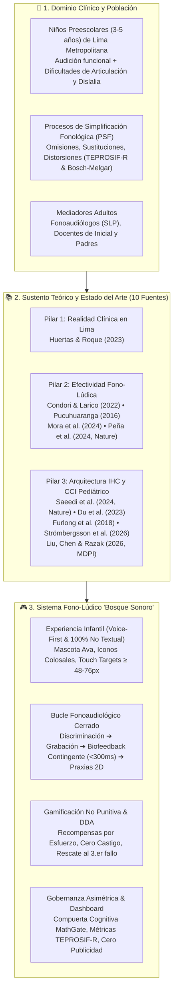
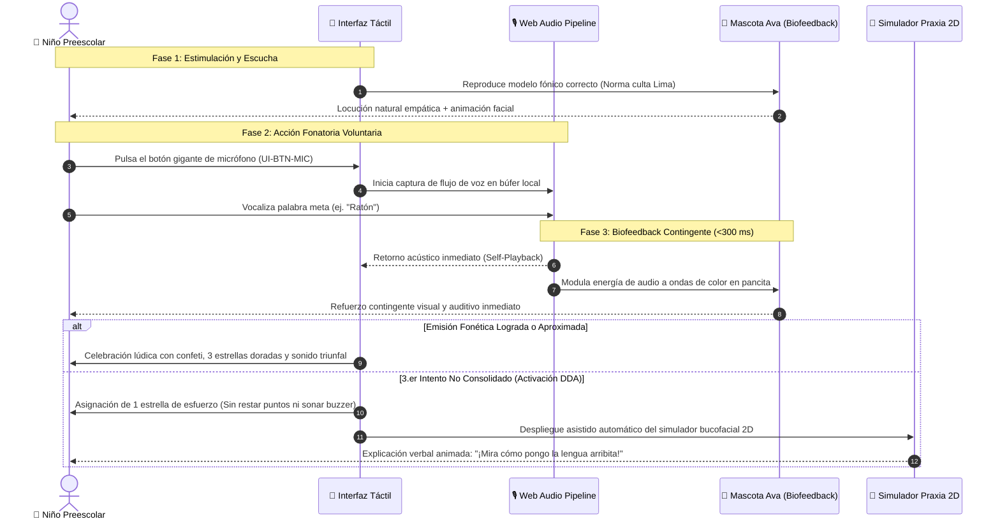
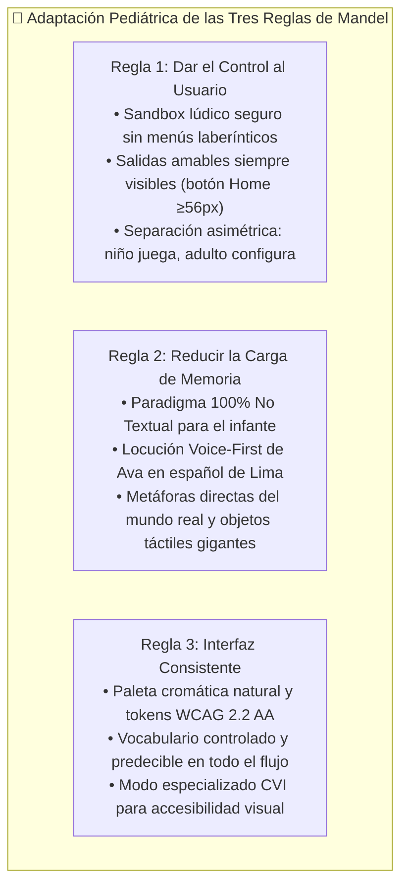
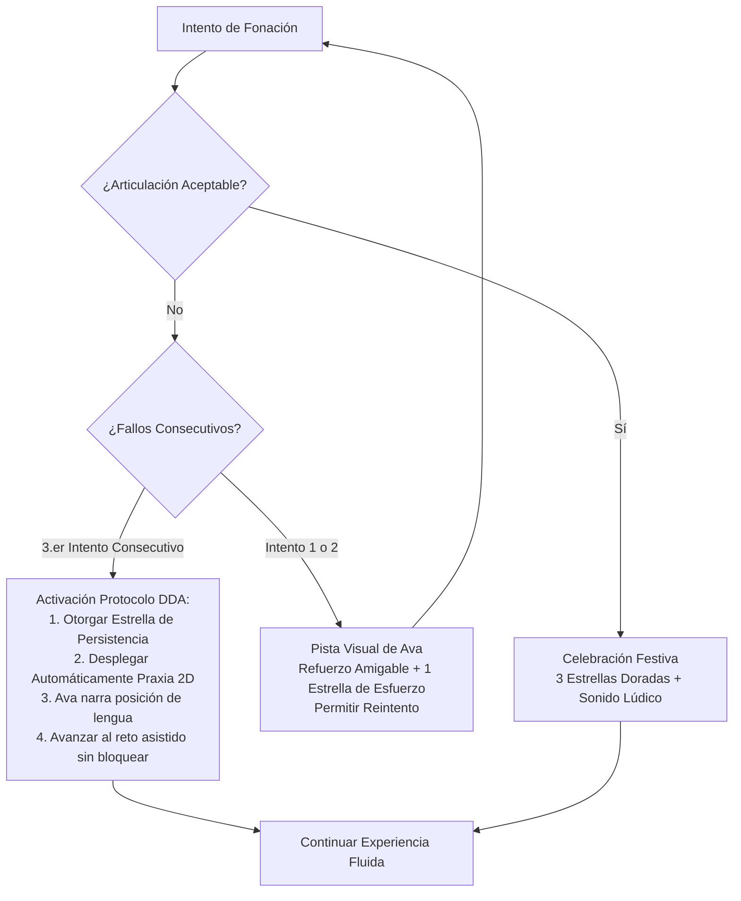
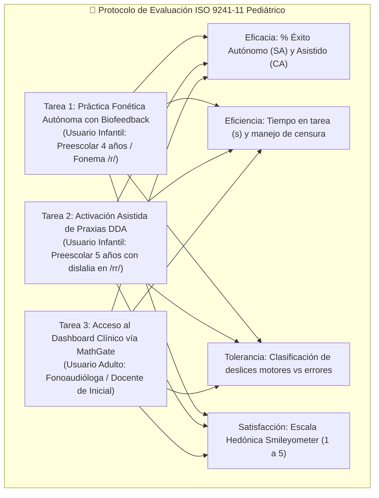

# 🌳 Contexto Maestro del Proyecto: Aplicación Fono-Lúdica Pediátrica ("Bosque Sonoro")
## 🗣️ Estimulación y Mejora de la Articulación Fonética en Estudiantes de Nivel Preescolar de Lima Metropolitana

> [!IMPORTANT] Propósito del Documento y Deslinde Clínico Mandatorio
> El presente documento consolida la **fuente única de verdad (Single Source of Truth - SSOT)** sobre el contexto clínico, fonoaudiológico, metodológico, pedagógico, de diseño de interacción (IHC/CCI) y arquitectónico de la aplicación **"Bosque Sonoro"**.
> 
> **Población Objetivo Real:** Niños y niñas en edad preescolar (**3 a 5 años**) con **dificultades de articulación fonética, retraso fonético-fonológico y dislalias funcionales** (enfocado en fonemas críticos como `/r/`, `/rr/`, `/s/`, `/l/` y `/ch/`, grupos consonánticos y sílabas complejas) en **Lima Metropolitana**, en interacción mediada por docentes de educación inicial, fonoaudiólogos y tutores.
> 
> **Deslinde Clínico Crítico:** La aplicación **NO** está diseñada para niños con discapacidad auditiva, hipoacusia o implantes cocleares. La población infantil destinataria cuenta con **audición normal/funcional**, pero experimenta barreras en la coordinación neuromotriz orofacial, dificultades en el punto y modo de articulación, y persistencia atípica de **Procesos de Simplificación Fonológica (PSF)**.
> 
> **Guía para Equipos y Modelos de Inteligencia Artificial:** Al redactar entregables, especificaciones técnicas, evaluaciones de usabilidad o código para este proyecto, **debes extraer fielmente los datos cuantitativos, fórmulas, perfiles, reglas de negocio y referencias científicas de este documento**.

---

## 🧭 Mapa de Arquitectura Conceptual del Proyecto

---

## 1. 📌 Identificación y Ficha Técnica del Proyecto

| Parámetro | Detalle Oficial del Proyecto |
| :--- | :--- |
| **Nombre de la Aplicación** | ***Bosque Sonoro*** (Aplicación Fono-Lúdica Pediátrica). |
| **Título del Proyecto de Investigación** | *Aplicación fono-lúdica enfocada en la mejora de la articulación fonética en aplicaciones educativas en estudiantes de nivel preescolar de Lima Metropolitana*. |
| **Asignatura y Carrera** | Interacción Humano-Computador (IHC) — Ingeniería de Sistemas / Software. |
| **Institución Universitaria** | Universidad Nacional Mayor de San Marcos (UNMSM), Lima, Perú. |
| **Competencias Curriculares** | **CT6.3** (Soluciones con impacto social), **CT8.2** (Diseño Centrado en el Usuario - DCU), **RA2** (Diseño y prototipado), **RA3** (Inspección y pruebas de usabilidad) y **RA4** (Accesibilidad universal y factores humanos). |
| **Plataforma y Factor de Forma** | Aplicación web interactiva optimizada para **tabletas táctiles de 10 a 12 pulgadas** en orientación horizontal fija (**Landscape 16:9**). |
| **Pila Tecnológica del Prototipo** | Vanilla HTML5 semántico, CSS3 moderno con sistema de tokens de diseño, JavaScript ES6 modular, Web Audio API (análisis y síntesis fónica de baja latencia) y Canvas 2D (modelado anatómico sagital de praxias bucofaciales). |
| **Entorno de Despliegue Local** | `http://localhost:5173` (mediante servidor liviano Node.js / `npx serve`). |
| **Marco Normativo y Ético** | Ley N° 29733 (Protección de Datos Personales de Perú), directrices internacionales COPPA/HIPAA para biométricos de audio infantil, ISO 9241-11:2018, ISO 9241-110:2020 y W3C WCAG 2.2 Nivel AA. |

---

## 2. 🎯 Caracterización del Problema Fonoaudiológico y Usuarios

### 2.1. El Problema Real: Dificultades de Articulación y Procesos Fonológicos en Preescolares
En la etapa preescolar (3 a 5 años), el lenguaje verbal experimenta un período sensible de maduración neuromuscular. En Lima Metropolitana, una proporción significativa de niños presenta retrasos fonético-fonológicos y **dislalias funcionales**: incapacidad o dificultad persistente para articular adecuadamente determinados fonemas del idioma materno en ausencia de lesiones orgánicas del aparato fonoarticulatorio o déficits sensoriales (*Huertas & Roque, 2023; Mora et al., 2024*).

Los problemas observados se manifiestan clínicamente mediante **Procesos de Simplificación Fonológica (PSF)**:
1. **Omisión:** El menor suprime el fonema meta o la sílaba trabada (ej. pronunciar *"atón"* por *"ratón"*, *"plátano"* como *"pátano"*).
2. **Sustitución:** El menor reemplaza un fonema difícil por otro fonema de adquisición más temprana (ej. sustituir la vibrante `/r/` por la lateral `/l/`: *"latón"* por *"ratón"*; sustituir la fricativa `/s/` por la oclusiva `/t/`: *"tapo"* por *"sapo"*).
3. **Distorsión:** El menor emite un sonido aproximado pero imperfecto o viciado que no pertenece al sistema fonológico estándar del español (ej. ceceo interdentalizado o rotacismo gutural).

### 2.2. Por qué las Aplicaciones Convencionales Fracasan (Brechas de IHC Pediátrica)
Las aplicaciones móviles educativas y de fonoaudiología comerciales analizadas en la literatura (*Furlong et al., 2018; Du et al., 2023; Strömbergsson et al., 2026*) presentan serias deficiencias que provocan abandono o frustración:
- **Sesgo Adultocéntrico y Sobrecarga Textual:** Interfaces saturadas de texto que ignoran que los niños de 3 a 5 años son **pre-lectores estrictos** (etapa preoperacional de Piaget); no pueden leer consignas, menús ni etiquetas técnicas.
- **Feedback Punitivo y Bloqueo Afectivo:** Cuando el niño pronuncia de manera inexacta, las apps tradicionales emiten alarmas de buzzer estridentes, cruces rojas o descuentan "vidas", activando el filtro afectivo de ansiedad y mutismo defensivo (*Saeedi et al., 2024*).
- **Fricciones Motoras Severas:** Controles táctiles minúsculos ($<28\text{ px}$), elementos interactivos pegados a los bordes donde el niño apoya la mano, e inexistencia de filtros de rebote ante el temblor motor infantil (*Liu et al., 2026*).
- **Antipatrones Fonéticos y Modelos Ajenos:** Uso de palabras que contienen el fonema evaluado en posiciones no controladas (*palabras contaminadas*, como evaluar $/p/$ con *"pastelito"*), o empleo de acentos y fonemas no coincidentes con la norma culta de Lima Metropolitana (*Furlong et al., 2018*).
- **Inseguridad y Publicidad Invasiva:** Exposición a banners comerciales, compras dentro de la app (*in-app purchases*) y enlaces salientes no protegidos (*Du et al., 2023*).

### 2.3. Perfiles del Ecosistema de Usuarios

```mermaid
graph LR
    subgraph Primario ["🧒 Usuario Primario (Infantil)"]
        N1["Edad: 3 a 5 años (Preescolar)"]
        N2["Competencia: Pre-lector estricto"]
        N3["Condición: Dislalia funcional / Retraso fonológico"]
        N4["Motricidad: Fina en desarrollo, touch overshoot"]
        N5["Atención: 5-15 min sostenidos, Voice-First"]
    end

    subgraph Secundario ["👩‍🏫 Usuarios Secundarios (Mediadores Clínico-Docentes)"]
        M1["Fonoaudiólogo / Terapeuta de Lenguaje (SLP)"]
        M2["Docente de Educación Inicial"]
        M3["Padre de Familia / Cuidador"]
        M4["Necesidad: Control protegido, TEPROSIF-R, calibración"]
    end

    Primario <-->|Interacción guiada en aula/hogar| Secundario
```

| Dimensión | Perfil de Usuario Infantil (3 a 5 años) | Perfil de Usuario Clínico / Docente |
| :--- | :--- | :--- |
| **Rol en el Sistema** | Jugador activo y emisor fonético principal. | Mediador, configurador terapéutico y evaluador de progreso. |
| **Condición del Dominio** | Dificultad para pronunciar fonemas meta (`/r/`, `/rr/`, `/s/`, `/l/`, `/ch/`, sinfones). Audición funcional normal. | Especialista en evaluación fonoaudiológica (**TEPROSIF-R**, criterios de **Bosch & Melgar**). |
| **Competencia Lectora** | **Pre-lectora estricta** (depende de iconos vectoriales, locuciones cálidas y animación). | Alfabetización completa y dominio de terminología fonoaudiológica. |
| **Capacidades Motoras** | Motricidad en desarrollo; propensión a apoyar la palma en los bordes de la pantalla (*tenar palm rest*). | Destreza motriz fina completa en pantalla táctil y teclado físico/virtual. |
| **Modo de Interacción** | **Voice-First y táctil simplificado** (pulsar y hablar, arrastre lúdico). | Interacción multimodal estructurada (gestión de datos, análisis de curvas, calibración). |
| **Lapsos de Atención** | Cortos (**5 a 10 minutos continuos**, máximo 15 minutos dosificados). | Atención profesional sostenida durante el diagnóstico o sesión clínica. |

---

## 3. 🔬 Fundamentación Científica: Los Tres Pilares y las 10 Fuentes del Estado del Arte

El diseño de la aplicación y cada decisión metodológica están sustentados en **10 investigaciones científicas de referencia (2016-2026)**, organizadas en tres pilares epistemológicos:

```mermaid
graph TD
    Pilar1["🏛️ Pilar 1: Realidad Clínica y Procesos Fonológicos en Preescolar"]
    Pilar2["🎲 Pilar 2: Efectividad de Juegos Verbales y Programas Fono-Lúdicos"]
    Pilar3["💻 Pilar 3: Arquitectura Móvil, Usabilidad Infantil e IHC"]

    Pilar1 --> F1["[[Proyecto/Antecedentes/Ficha - Huertas y Roque (2023) - Dificultades Fonológicas en Docentes Inicial|1. Huertas & Roque (2023)]]<br>Tesis PUCP: Docentes Lima vs Piura (N=199)<br>Justifica la realidad en Lima y los PSF a tratar"]

    Pilar2 --> F2["[[Proyecto/Antecedentes/Ficha - Condori y Larico (2022) - Juegos Verbales y Expresión Oral|2. Condori & Larico (2022)]]<br>Tesis UJCM: Correlación r=0.612 en fonología infantil"]
    Pilar2 --> F3["[[Proyecto/Antecedentes/Ficha - Pucuhuaranga (2016) - Juegos Verbales y Articulación Verbal|3. Pucuhuaranga (2016)]]<br>Horizonte de la Ciencia: Cuasiexperimento (46.86% superación)"]
    Pilar2 --> F5["[[Proyecto/Antecedentes/Ficha - Mora et al. (2024) - Programa Lúdico Fonológico y Dislalia Funcional|4. Mora et al. (2024)]]<br>Univ. Ciencia y Tec.: Programa fono-lúdico (74% normalizado)"]
    Pilar2 --> F10["[[Proyecto/Antecedentes/Ficha - Pena et al. (2024) - Intervencion con Tabletas y Habilidades Comunicativas en Preescolares (Nature)|5. Peña et al. (2024)]]<br>Nature npj Science of Learning: Tabletas y TEPROSIF (N=152)"]

    Pilar3 --> F4["[[Proyecto/Antecedentes/Ficha - Saeedi et al. (2024) - Serious Game Ava y Trastornos del Habla|6. Saeedi et al. (2024)]]<br>Nature Scientific Reports: Serious Game Ava, Nielsen y PSSUQ"]
    Pilar3 --> F6["[[Proyecto/Antecedentes/Ficha - Du et al. (2023) - Diseno de Apps para Fonoaudiologia Pediatrica|7. Du et al. (2023)]]<br>IJLCD: 37 SLPs y 5 Pautas IHC de diseño infantil sin anuncios"]
    Pilar3 --> F7["[[Proyecto/Antecedentes/Ficha - Furlong et al. (2018) - Analisis de Calidad y Eficacia de Apps en Trastornos del Habla (MARS)|8. Furlong et al. (2018)]]<br>PLOS ONE: Revisión de 132 apps con escala MARS y antipatrones"]
    Pilar3 --> F8["[[Proyecto/Antecedentes/Ficha - Strombergsson et al. (2026) - Entrenamiento del Habla con App Pop2TalkNordic y Desafios IHC|9. Strömbergsson et al. (2026)]]<br>IJLCD: App Pop2TalkNordic, DDA y prevención de frustración"]
    Pilar3 --> F9["[[Proyecto/Antecedentes/Ficha - Liu et al. (2026) - Criterios de Calidad en Interaccion Nino-Computadora (CCI)|10. Liu, Chen & Razak (2026)]]<br>Computers (MDPI): Marco Ecológico de Calidad CCI (9 Dimensiones)"]
```

### Síntesis de Aportes Metodológicos por Fuente Indexada

1. **Huertas & Roque (2023) — PUCP (Tesis de Maestría):**
   - *Aporte:* Diagnóstico situacional empírico en **Lima Metropolitana**. Identifica los Procesos de Simplificación Fonológica (PSF) más frecuentes en las aulas de educación inicial y subraya la necesidad de herramientas tecnológicas preventivas antes del ingreso a la educación primaria.
2. **Condori & Larico (2022) — UJCM (Tesis de Licenciatura):**
   - *Aporte:* Evidencia correlación positiva y estadísticamente significativa (**$r = 0.612, p = 0.008$**) entre la aplicación de juegos verbales (trabalenguas, rimas y adivinanzas) y la mejora en la dimensión fonológica infantil.
3. **Pucuhuaranga (2016) — UNCP (*Horizonte de la Ciencia*):**
   - *Aporte:* Estudio cuasi-experimental que demuestra una **superación de errores articulatorios del 46.86%** mediante dinámicas lúdicas fonoarticulatorias. Provee el banco de 32 palabras de evaluación bajo el modelo de Bosch & Melgar y la secuencia de 6 pasos para la gimnasia bucofacial.
4. **Saeedi et al. (2024) — *Nature Scientific Reports*:**
   - *Aporte:* Blueprint arquitectónico del serious game fonoaudiológico móvil (*Ava*). Valida la eliminación del texto para niños pre-lectores, la interacción guiada por reconocimiento de voz y la sustitución de penalizaciones por recompensas de persistencia, evaluado con heurísticas de Nielsen y escala PSSUQ.
5. **Mora et al. (2024) — *Universidad, Ciencia y Tecnología*:**
   - *Aporte:* Programa fono-lúdico aplicado a niños de 4 y 5 años con dislalia funcional en fonemas `/r/`, `/s/`, `/l/`. Demuestra que el enfoque lúdico **erradica las dislalias graves (0%) y normaliza el habla en el 74% de los participantes**. Aporta mecánicas de carreras fónicas, bingo fonológico y memorias auditivas.
6. **Du et al. (2023) — *International Journal of Language & Communication Disorders (IJLCD)*:**
   - *Aporte:* Co-diseño con 37 fonoaudiólogos pediatras. Establece las **5 pautas cardinales de IHC pediátrica**: eliminación absoluta de publicidad comercial, compuerta parental para aislar la administración adulta (*MathGate*), biofeedback articulatorio inmediato y dosificación de sesiones de máximo 15 minutos diarios.
7. **Furlong et al. (2018) — *PLOS ONE*:**
   - *Aporte:* Revisión sistemática de 132 aplicaciones móviles evaluadas mediante la escala MARS. Identifica el catálogo de **antipatrones fonéticos comerciales** (palabras con consonantes contaminadas, falta de gradación silábica CV $\rightarrow$ CVC $\rightarrow$ CCV y acentos foráneos descontextualizados).
8. **Strömbergsson et al. (2026) — *IJLCD*:**
   - *Aporte:* Investigación experimental sobre la app *Pop2TalkNordic*. Documenta el riesgo de bucles de frustración cuando el menor comete fallas consecutivas y formula el **algoritmo de Ajuste Dinámico de Dificultad (DDA)** junto con el principio de **Recompensa Basada en el Esfuerzo (*Effort-Based Reward*)**.
9. **Liu, Chen & Razak (2026) — *Computers (MDPI)*:**
   - *Aporte:* Establece el **Marco Ecológico de Calidad en Interacción Niño-Computadora (CCI)** en 4 capas y 9 dimensiones, normando la ergonomía táctil infantil, touch targets mínimos ($\ge 48\times 48\text{ dp}$), zonas de descanso palmar y accesibilidad universal.
10. **Peña et al. (2024) — *Nature npj Science of Learning*:**
    - *Aporte:* Estudio experimental controlado ($N=152$ preescolares) que demuestra ganancias causales estadísticamente significativas en comprensión auditiva y vocalizaciones activas mediante el uso guiado de tabletas táctiles. Valida el protocolo de **autoescucha inmediata (*self-playback* contingente $<300\text{ ms}$)** y la estandarización mediante la batería **TEPROSIF**.

---

## 4. 🎮 El Sistema Fono-Lúdico "Bosque Sonoro": Arquitectura y Dinámicas

### 4.1. Concepto y Metáforas de Diseño
"Bosque Sonoro" transforma la terapia articulatoria tradicional en un viaje de exploración sobre rieles lúdicos:
- **La Mascota Guía "Ava la Abejita Fónica":** Personaje cálido y no amenazante que modela la articulación correcta con su voz y expresiones, celebra los intentos del niño y lo rescata visualmente ante dificultades sin generar sentimientos de culpa ni frustración.
- **El Convoy de Vagones Fónicos:** Metáfora de tren sobre rieles en la pantalla principal. Cada vagón representa una modalidad de juego verbal:
  1. *Vagón 1: Trabalenguas Fónicos:* Coordinación rápida de puntos de articulación en secuencias silábicas rimadas.
  2. *Vagón 2: Rimas Musicales:* Discriminación fónica auditiva y asociación léxica.
  3. *Vagón 3: Adivinanzas Infantiles:* Evocación de palabras meta a partir de atributos semánticos directos.
  4. *Vagón 4: Carrera Fónica:* Minijuego de avance dinámico por fonación sostenida; el barco de Ava navega por el río impulsado por el volumen vocal del niño.
  5. *Vagón 5: Bingo Sonoro Táctil:* Cuadrícula 2x2 donde el niño escucha un sonido y presiona el pictograma correspondiente, reforzando la discriminación fónica.
  6. *Vagón 6: Pares Mínimos Cómicos:* Contraste directo de palabras que difieren en un único fonema (ej. *"pera"* vs. *"perra"*, *"ratón"* vs. *"latón"*), ilustrado de manera humorística.

### 4.2. El Bucle Fonoaudiológico Cerrado (<300 ms)
La interacción central del niño en la pantalla de articulación sigue un ciclo fonoaudiológico contingente estructurado en 4 fases:

### 4.3. Especificación Fonoacústica de Ava y Erradicación de Antipatrones (Los 5 Criterios de Locución)

Para garantizar la eficacia clínica y la inteligibilidad en preescolares no lectores, la voz de Ava se rige por **5 criterios técnico-científicos normativos** (*Furlong et al., 2018; Huertas & Roque, 2023; Saeedi et al., 2024; Du et al., 2023*):

1. **Localización Dialectal y Norma Culta Local (Lima Metropolitana):**
   - **Variedad Lingüística:** Ajuste estricto al español culto de Lima Metropolitana (seseo sistemático, yeísmo sin rehilamiento y conservación plena de la `/s/` implosiva y final sin aspiración en habla formal infantil).
   - **Locución Humana Natural de Estudio:** Locutora profesional humana con prosodia afectuosa preescolar, descartando voces sintéticas robotizadas que perturban el procesamiento auditivo central del menor.

2. **Modelado Fonético Puro (Prohibición Estricta de la Schwa `[ə]`):**
   - **Erradicación de la Vocal Neutra:** Al modelar fonemas consonánticos aislados, el sistema emite el sonido consonántico sordo o sonoro puro (ej. `[k]` y nunca `[kə]` o *"kuh"*). Se erradica el antipatrón crítico identificado por *Furlong et al. (2018)* en apps comerciales, evitando que el infante internalice una vocal parásita en su almacén fonológico mental.
   - **Sin Prolongaciones Desnaturalizadas:** Ausencia de alargamientos artificiales de vocales en palabras estímulo.

3. **Tono Emocional, Cálido y No Punitivo:**
   - **Refuerzo Positivo al Esfuerzo:** Proyección de calidez, empatía y entusiasmo constante. Ante fallos o emisiones no inteligibles, se prohíben timbres secos o zumbadores punitivos; el sistema emite refuerzos afectivos (*"¡Excelente intento, diste lo mejor de ti! ¡Dilo fuerte!"*) acompañados de arpegios armónicos dulces.
   - **Acompañamiento sin Ansiedad:** Mantiene al menor motivado, reforzando la persistencia y previniendo bucles de frustración (*Strömbergsson et al., 2026*).

4. **Guía No Textual (*Spoken Read-Aloud*) e Interactividad Táctil:**
   - **Locución Completa de Consignas:** Autonomía 100% para no lectores en todas las instrucciones, adivinanzas, trabalenguas y dinámicas lúdicas.
   - **Respuesta Táctil Reinteractiva:** Al pulsar o tocar directamente el avatar de Ava en cualquier pantalla, la mascota aletea con micro-animación elástica y reitera afablemente la instrucción contextual o emite palabras de aliento.

5. **Parámetros Técnicos de Audio:**
   - **Alta Fidelidad Acústica:** Captura y tomas maestras a $\ge 44.1\text{ kHz}$, 16 bits PCM (Linear WAV/Opus WebM), garantizando sonido nítido sin artefactos ni piso de ruido.

---

## 5. 👑 Principios de Diseño Centrado en el Niño (CCI) y Reglas de Mandel

El sistema operacionaliza las **Tres Reglas de Theo Mandel (1997)** y las adapta a la psicología del desarrollo preescolar:

### 5.1. Regla 1 de Mandel: El Niño en Control
- **Sandbox Lúdico sin Salidas Destructivas:** El niño puede explorar libremente los vagones y actividades sin riesgo de descalibrar parámetros, eliminar datos o realizar compras.
- **Poder de Interrupción Amable:** En cualquier momento el infante puede tocar el botón de retorno (`🏠` en esquina superior) para pausar la actividad y volver al menú principal.
- **Separación Asimétrica de Roles:** El control administrativo y clínico está reservado al adulto mediante la compuerta cognitiva **MathGate**.

### 5.2. Regla 2 de Mandel: Reducir la Carga de Memoria
- **Paradigma 100% No Textual Infantil:** Se eliminaron etiquetas alfabéticas complejas, subtítulos clínicos y párrafos explicativos en el flujo infantil. Todo botón y consigna se comunica mediante pictogramas de alta iconografía y locución auditiva clara (*Voice-First*).
- **Estímulo Fónico Único y Centrado:** La pantalla de articulación sitúa el estímulo visual al centro, evitando barridos oculares periféricos que desconcentren al menor.
- **Vocabulario Infantil Cotidiano en Praxias:** En el modelado bucofacial, en lugar de términos anatómicos complejos (*"Ápice lingual en zona alveolar"*), Ava explica con lenguaje amigable y visual: *"¡Ponemos la puntita de la lengua arribita, detrás de los dientes, y hacemos cosquillitas con el aire!"*.

### 5.3. Regla 3 de Mandel: Consistencia y Ergonomía Pediátrica
- **Touch Targets Hiperampliados:** Todos los botones infantiles cumplen dimensiones $\ge 48\times 48\text{ dp}$. El pulsador de micrófono (`UI-BTN-MIC`) mide **$76\times 76\text{ px}$** con un área de absorción táctil de **$90\text{ px}$**.
- **Franja de Descanso Palmar ($\ge 48\text{ dp}$):** Espacio libre de elementos interactivos en los bordes inferiores de la tableta para evitar toques involuntarios con la eminencia tenar al sostener el dispositivo horizontalmente.
- **Filtro Antirrebote (*Touch Debounce*):** Ventana de protección de **80 ms** que descarta pulsaciones simultáneas causadas por temblor o inmadurez motriz.

---

## 6. 🧮 Algoritmo DDA y Filosofía de Gamificación No Punitiva

### 6.1. Recompensas Basadas en el Esfuerzo (*Effort-Based Reward*)
Alineado con las directrices de *Strömbergsson et al. (2026)* y *Saeedi et al. (2024)*, el sistema aplica un modelo de motivación intrínseca:
- **Cero Castigo Punitivo:** Está estrictamente prohibido restar puntos, descontar vidas o reproducir sonidos estridentes de error ante pronunciaciones defectuosas.
- **Refuerzo del Intento:** Cada vez que el niño vocaliza frente al micrófono, el sistema reconoce la intención comunicativa y otorga al menos una "estrella de esfuerzo", reforzando la persistencia.

### 6.2. Lógica del Algoritmo de Ajuste Dinámico de Dificultad (DDA)
El sistema monitorea la tasa de éxito articulatorio en tiempo de ejecución:

### 6.3. Dosificación Terapéutica Máxima (15 Minutos)
El software integra un temporizador de dosificación clínica (*Du et al., 2023*):
- Al cumplirse **15 minutos de juego continuo** (equivalente a 50-80 oportunidades de producción fonética), la mascota Ava realiza una locución festiva de cierre: *"¡Qué bien practicamos hoy en el bosque! Nuestras abejitas necesitan descansar para volver a jugar mañana"*.
- Esta restricción previene la fatiga muscular de los órganos fonoarticulatorios y evita la saturación visual.

---

## 7. 🛡️ Gobernanza Asimétrica, Seguridad y Dashboard Clínico

### 7.1. Compuerta Cognitiva Parental y Clínica (MathGate)
Para asegurar que los niños preescolares permanezcan en su entorno lúdico protegido y no alteren parámetros ni accedan a historiales clínicos, el acceso al panel docente/terapéutico está resguardado por una compuerta cognitiva basada en texto alfabético:
- **Reto de Desbloqueo:** Se formula una operación aritmética escrita íntegramente en letras (ej. *"Nueve menos tres = ?"* o *"Cuatro más cinco = ?"*).
- **Mecanismo de Protección:** Al ser pre-lectores estrictos de 3 a 5 años, los infantes no pueden decodificar la frase escrita, garantizando un **100% de eficacia en la protección de datos** frente al menor (*Du et al., 2023; Liu et al., 2026*).

### 7.2. Funcionalidades del Dashboard Clínico-Docente
Una vez franqueado el MathGate, el fonoaudiólogo o docente dispone de:
1. **Trazabilidad de Procesos de Simplificación Fonológica (PSF):** Registro longitudinal de errores clasificados bajo la batería **TEPROSIF-R** y criterios de **Bosch & Melgar** (Omisiones, Sustituciones, Distorsiones).
2. **Curva de Reducción de Errores Fonéticos:** Gráficos de dispersión y tendencia temporal que evidencian la normalización articulatoria sesión tras sesión.
3. **Calibrador Fonoaudiológico de Micrófono:** Herramienta interactiva que permite medir el ruido de fondo del aula o consultorio (<55 dB SPL) y ajustar el umbral de activación vocal (*noise gate*) para evitar falsos positivos o rechazos indebidos.
4. **Bóveda Cifrada de Audio:** Almacenamiento local seguro de fragmentos de voz para revisión clínica cualitativa, en estricto cumplimiento de la Ley N° 29733 (Perú) y normativas COPPA/HIPAA.

---

## 8. ♿ Accesibilidad Universal y Modo CVI (WCAG 2.2 AA)

La aplicación integra accesibilidad universal como pilar fundacional:
- **Cumplimiento WCAG 2.2 Nivel AA:** Todos los elementos interactivos, textos para adultos y componentes cumplen ratios de contraste cromático superiores a **$4.5:1$** en texto estándar y **$3:1$** en elementos gráficos no textuales.
- **Multimodalidad de Estados:** Todo evento del sistema (acierto, progreso, ayuda) se comunica de forma redundante mediante al menos dos canales perceptuales: sonido lúdico + animación gráfica + vibración háptica.
- **Modo Especializado para Deficiencia Visual Cortical (CVI):**
  - Para niños preescolares que presentan trastornos del habla asociados a afecciones neurológicas de la visión central (*Cortical Visual Impairment*).
  - Activa un tema con fondo carbón antirreflejos (`#121212`), contornos cromáticos hipercontrastados en amarillo saturado (`#FFD700`) y cian luminoso (`#00FFFF`), alcanzando ratios de contraste superiores a **$12:1$** sin estímulos visuales distractores.

---

## 9. 📸 Catálogo de Vistas del Prototipo de Alta Fidelidad (13 Pantallas)

El prototipo funcional navegable cuenta con 13 interfaces de usuario verificadas e indexadas en [`Proyecto/Documentación/capturas/`](file:///d:/.Antigravity/IHC/Proyecto/Documentación/capturas/):

| # | Nombre de la Vista | Archivo de Captura | Decisión Clave de Diseño y Sustento |
| :-: | :--- | :--- | :--- |
| **01** | **Menú Principal del Bosque Sonoro** | [`01_menu_principal.png`](file:///d:/.Antigravity/IHC/Proyecto/Documentación/capturas/01_menu_principal.png) | Convoy de 6 vagones sobre rieles, banner Voice-First de Ava y acceso a MathGate. |
| **02** | **Ejercicio de Articulación Landscape** | [`02_ejercicio_landscape.png`](file:///d:/.Antigravity/IHC/Proyecto/Documentación/capturas/02_ejercicio_landscape.png) | Estímulo fónico centrado, botón de micrófono colosal ($76\text{ px}$) y zona de descanso palmar. |
| **03** | **Carrera Fónica en el Río** | [`03_carrera_fonica.png`](file:///d:/.Antigravity/IHC/Proyecto/Documentación/capturas/03_carrera_fonica.png) | Minijuego bioacústico: la fonación sostenida impulsa el bote de Ava a través del río. |
| **04** | **Bingo Sonoro Táctil 2x2** | [`04_bingo_sonoro.png`](file:///d:/.Antigravity/IHC/Proyecto/Documentación/capturas/04_bingo_sonoro.png) | Matriz táctil simplificada para discriminación fonológica y asociación fono-visual. |
| **05** | **Pares Mínimos Cómicos** | [`05_pares_minimos.png`](file:///d:/.Antigravity/IHC/Proyecto/Documentación/capturas/05_pares_minimos.png) | Contraste fónico directo entre palabras cuasi-idénticas con ilustraciones de humor lúdico. |
| **06** | **Simulador de Praxias Bucofaciales 2D** | [`06_praxia_bucofacial_2d.png`](file:///d:/.Antigravity/IHC/Proyecto/Documentación/capturas/06_praxia_bucofacial_2d.png) | Corte sagital anatómico animado en Canvas 2D con descripción auditiva adaptada a preescolares. |
| **07** | **Cueva del Avatar y Esfuerzo** | [`07_cueva_avatar.png`](file:///d:/.Antigravity/IHC/Proyecto/Documentación/capturas/07_cueva_avatar.png) | Espacio de personalización de Ava mediante estrellas acumuladas por persistencia y esfuerzo. |
| **08** | **Compuerta Parental MathGate** | [`08_control_parental_mathgate.png`](file:///d:/.Antigravity/IHC/Proyecto/Documentación/capturas/08_control_parental_mathgate.png) | Reto cognitivo aritmético escrito que garantiza la separación asimétrica entre roles. |
| **09** | **Calibración Fonoaudiológica** | [`09_calibracion_fonoaudiologica.png`](file:///d:/.Antigravity/IHC/Proyecto/Documentación/capturas/09_calibracion_fonoaudiologica.png) | Medición de decibelios ambientales (<55 dB) y ajuste de sensibilidad de captura vocal. |
| **10** | **Dashboard Clínico TEPROSIF-R & PSF** | [`10_dashboard_clinico_psf_teprosif.png`](file:///d:/.Antigravity/IHC/Proyecto/Documentación/capturas/10_dashboard_clinico_psf_teprosif.png) | Curvas longitudinales de superación de errores articulatorios y reporte fonoaudiológico. |
| **11** | **Bóveda Cifrada de Audio Infantil** | [`11_boveda_audio_cifrada.png`](file:///d:/.Antigravity/IHC/Proyecto/Documentación/capturas/11_boveda_audio_cifrada.png) | Registro biométrico protegido localmente cumpliendo normativas de privacidad Ley 29733. |
| **12** | **Modo de Alto Contraste CVI** | [`12_modo_alto_contraste_cvi.png`](file:///d:/.Antigravity/IHC/Proyecto/Documentación/capturas/12_modo_alto_contraste_cvi.png) | Interfaz en alto contraste ($\ge 12:1$) con fondo carbón para baja visión central. |
| **13** | **Matriz de Trazabilidad RTM en Software** | [`13_matriz_rtm_software.png`](file:///d:/.Antigravity/IHC/Proyecto/Documentación/capturas/13_matriz_rtm_software.png) | Inspección de requisitos y trazabilidad directa a los 10 antecedentes científicos. |

---

## 10. 📊 Marco Metodológico de Evaluación de Usabilidad y Calidad de la Interacción

Para la validación empírica del sistema bajo la norma **ISO 9241-11:2018 (Eficacia, Eficiencia y Satisfacción)**, se estructura una batería de evaluación con 3 tareas representativas:

### Reglas Metodológicas del Protocolo Pediátrico:
1. **Entorno Controlado:** Ruido ambiental de aula o consultorio controlado ($<55\text{ dB SPL}$).
2. **Límite de Tiempo por Fatiga:** Tiempo de corte de **180 segundos por tarea**. Si el menor se dispersa o experimenta cansancio, la prueba se detiene con clasificación censurada por la derecha para preservar su bienestar emocional.
3. **Escala Hedónica Infantil (Smileyometer):** Medición de satisfacción mediante 5 caritas ilustradas (desde muy triste/frustrado hasta muy feliz/motivado), evitando sesgos de formulación verbal compleja.
4. **Distinción Ergonómica de Errores:** Diferenciación entre *deslices motores (slips)* provocados por imprecisión dactilar pediátrica y *equivocaciones cognitivas (mistakes)* provocadas por incomprensión de la consigna.

---

## 11. 📖 Glosario Canónico de Términos Operativos del Proyecto

- **\[GL-001\] Proceso de Simplificación Fonológica (PSF):** Operaciones mentales sistemáticas e inconscientes que los niños aplican para adaptar palabras adultas a sus capacidades fonoarticulatorias (*Huertas & Roque, 2023*).
- **\[GL-002\] Enfoque Fono-Lúdico:** Modelo pedagógico y clínico que inserta el entrenamiento fonético sistemático en dinámicas de juego contextualizado y placentero (*Condori & Larico, 2022; Mora et al., 2024*).
- **\[GL-003\] Dislalia Funcional:** Alteración en la pronunciación de fonemas por inadecuada coordinación motriz orofacial o punto/modo articulatorio, sin defecto auditivo ni malformación orgánica (*Mora et al., 2024*).
- **\[GL-004\] Biofeedback Fónico Contingente (<300 ms):** Captura acústica en tiempo real que devuelve inmediatamente la propia voz del niño (*self-playback*) junto a visualizaciones dinámicas de ondas de energía (*Du et al., 2023; Peña et al., 2024*).
- **\[GL-005\] Praxias Bucofaciales:** Movimientos coordinados de labios, lengua, mandíbula y paladar blando requeridos para la emisión de fonemas (*Pucuhuaranga, 2016*).
- **\[GL-006\] Ajuste Dinámico de Dificultad (DDA):** Modulación algorítmica de la exigencia del sistema para prevenir bucles de frustración ante fallos reiterados (*Strömbergsson et al., 2026*).
- **\[GL-007\] Recompensa Basada en el Esfuerzo (*Effort-Based Reward*):** Principio de gamificación que premia el intento vocal y la perseverancia del niño, eliminando penalizaciones punitivas (*Strömbergsson et al., 2026*).
- **\[GL-008\] MathGate:** Compuerta cognitiva aritmética basada en texto que actúa como barrera de acceso para adultos, impidiendo el paso a preescolares pre-lectores (*Du et al., 2023*).
- **\[GL-009\] Batería TEPROSIF-R:** Instrumento psicométrico validado en español para cuantificar Procesos de Simplificación Fonológica en preescolares (*Peña et al., 2024*).
- **\[GL-010\] Marco Ecológico CCI:** Estándar de 4 capas y 9 dimensiones que rige la calidad del software infantil en Interacción Niño-Computadora (*Liu, Chen & Razak, 2026*).

---

## 🔗 Enlaces y Navegación con la Documentación Técnica del Proyecto

- 📑 **[[Documentación|Índice Central MOC de Documentación Técnica]]**
- 📋 **[[Especificación Refinada de Requisitos de Software Aplicación Fono-Lúdica para la Articulación Fonética en Preescolares|Especificación Refinada de Requisitos de Software (ISO 25010 & BDD)]]**
- 🔄 **[[Especificación de Casos de Uso y Diagramas de Secuencia Aplicación Fono-Lúdica Pediátrica|Casos de Uso del Sistema y Diagramas de Secuencia]]**
- 🎨 **[[Sistema de Diseño (Design System), Tokens de Diseño, Directrices HCIUX y Wireflows Pediátricos|Sistema de Diseño, Tokens y Directrices HCI/UX Pediátricas]]**
- 🎮 **[[Prototipo Interactivo Fono-Lúdico de Alta Fidelidad|Catálogo Exhaustivo del Prototipo Interactivo de Alta Fidelidad]]**
- 👑 **[[Aplicación de Principios, Reglas de Mandel, Estándares y Guía de Estilo en Prototipos de Alta Fidelidad|Aplicación Práctica de Reglas de Mandel, Estándares y Plan de Pruebas]]**
- 📖 **[[Proyecto/Documentación/Marco Conceptual/Fundamentación Teórica y Adaptación de Directrices IHC, Reglas de Mandel y Estándares de Accesibilidad en Fonoaudiología Pediátrica|Fundamentación Teórica y Adaptación de Directrices IHC en Fonoaudiología Pediátrica]]**
- 🎭 **[[Proyecto/Documentación/Marco Conceptual/Aplicación de Metáforas de Diseño en los Prototipos|Aplicación de Metáforas de Diseño en los Prototipos]]**
- 📁 **[[Proyecto/Antecedentes/Antecedentes|Repositorio de los 10 Antecedentes Científicos y Estado del Arte]]**
- 🚀 **[[Proyecto/Proyecto|Nota Central del Proyecto IHC]]**
