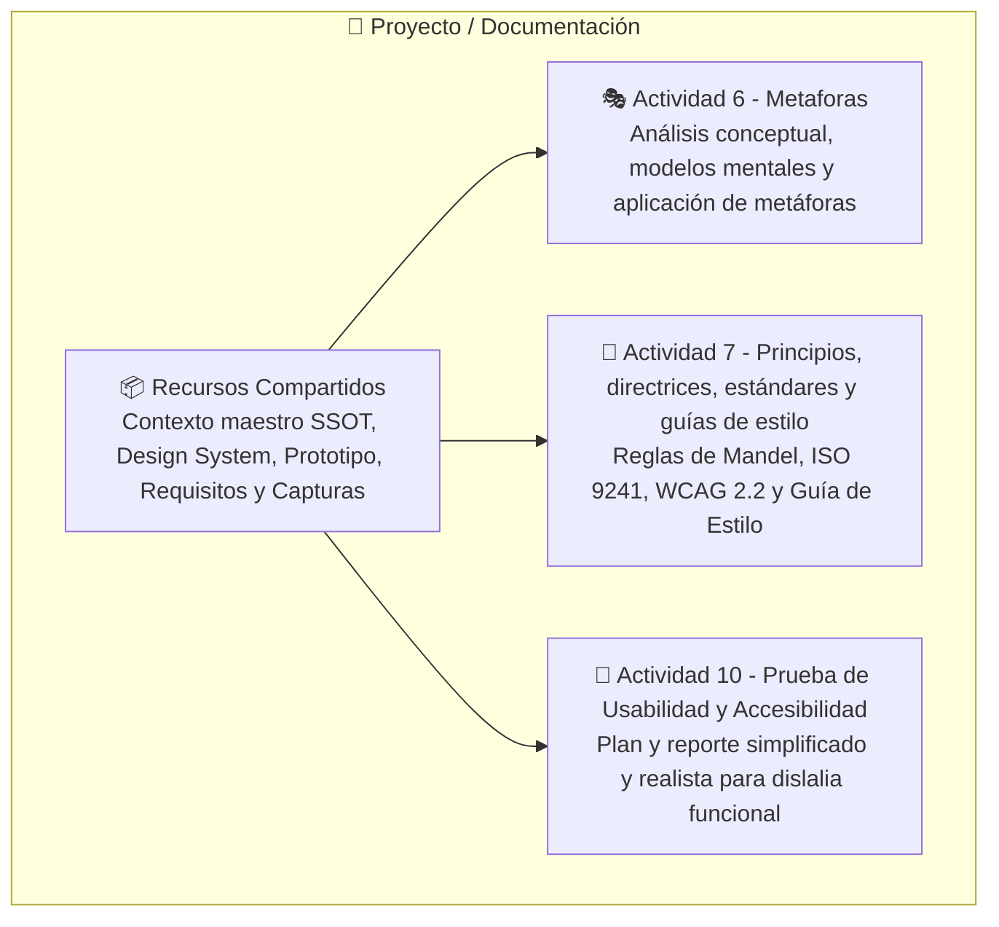

# 📑 Documentación Técnica y Metodológica del Proyecto ("Bosque Sonoro")

Esta sección centraliza los entregables académicos, especificaciones de ingeniería de software, marcos teóricos, guías de diseño y protocolos de prueba para la aplicación fono-lúdica pediátrica **"Bosque Sonoro"**.

La documentación se encuentra estructurada en **cuatro carpetas especializadas**: tres dedicadas a los entregables de las actividades académicas correspondientes y una cuarta carpeta para recursos compartidos y memorias técnicas transversales.

---

## 🗂️ Índice Estructurado por Carpetas

### 1. 🎭 [[Proyecto/Documentación/Actividad 6 - Metaforas/Actividad 6 - Metáforas de Interfaz|Actividad 6: Metáforas de Interfaz]]
*Carpeta dedicada al estudio, justificación y aplicación de las metáforas de interfaz en la interacción infantil.*
- 📄 **[[Proyecto/Documentación/Actividad 6 - Metaforas/Actividad 6 - Metáforas de Interfaz|Actividad 6 - Metáforas de Interfaz.md]]:** Documento académico integral oficial. Cubre marco conceptual con 5+ artículos científicos, fundamentos cognitivos (Gentner, Hutchins, Sweller, Druin), tabla de modelos mentales, y análisis profundo de los 4 tipos de metáforas (Visual, Funcional, Organizacional, Interacción) con justificación, beneficios y capturas.
- 📖 **[[Proyecto/Documentación/Actividad 6 - Metaforas/Teórico de Metáforas de Diseño Fono-lúdico|Teórico de Metáforas de Diseño Fono-lúdico.md]]:** Marco teórico de soporte en los tres ejes: CCI Pediátrico, Aprendizaje Motor Fonoaudiológico y Gamificación No Punitiva.
- 🎨 **[[Proyecto/Documentación/Actividad 6 - Metaforas/Aplicación de Metáforas de Diseño en los Prototipos|Aplicación de Metáforas de Diseño en los Prototipos.md]]:** Notas técnicas de operacionalización de componentes y criterios generales de diseño.

### 2. 📱 [[Proyecto/Documentación/Actividad 7 - Principios, directrices, estándares y guías de estilo/Actividad 7 - Principios, directrices, estándares y guías de estilo|Actividad 7: Principios, Directrices, Estándares y Guías de Estilo]]
*Carpeta enfocada en las reglas doradas de Theo Mandel, estándares internacionales de usabilidad y accesibilidad, y guía de estilo.*
- 📄 **[[Proyecto/Documentación/Actividad 7 - Principios, directrices, estándares y guías de estilo/Actividad 7 - Principios, directrices, estándares y guías de estilo|Actividad 7 - Principios, directrices, estándares y guías de estilo.md]]:** Documento académico integral oficial. Diagnóstico heurístico de Figma v1, trazabilidad evolutiva v1 ➔ v2 ➔ v3, matriz de 9 decisiones justificadas, guía de estilo de alta fidelidad (tokens, tipografía, componentes, semántica infantil sin "fonema") y catálogo de pantallas con evidencia visual.
- 📚 **[[Proyecto/Documentación/Actividad 7 - Principios, directrices, estándares y guías de estilo/Fundamentación Teórica y Adaptación de Directrices IHC, Reglas de Mandel y Estándares de Accesibilidad en Fonoaudiología Pediátrica|Fundamentación Teórica y Adaptación de Directrices IHC Pediátricas.md]]:** Marco conceptual extenso sobre superación del sesgo adultocéntrico, adaptación de los 24 principios de Mandel, ISO 9241-11/110/210 e ISO/IEC 25010.
- 📋 **[[Proyecto/Documentación/Actividad 7 - Principios, directrices, estándares y guías de estilo/Aplicación de Principios, Reglas de Mandel, Estándares y Guía de Estilo en Prototipos de Alta Fidelidad|Aplicación de Principios y Reglas de Mandel (Versión de Trabajo).md]]:** Registro analítico previo de apoyo.

### 3. 🧪 [[Proyecto/Documentación/Actividad 10 - Prueba de Usabilidad y Accesibilidad/Actividad 10 - Prueba de Usabilidad y Accesibilidad|Actividad 10: Prueba de Usabilidad y Accesibilidad]]
*Carpeta destinada al protocolo, ejecución, métricas y plan de mejoras de la evaluación de usabilidad en el mundo real.*
- 📄 **[[Proyecto/Documentación/Actividad 10 - Prueba de Usabilidad y Accesibilidad/Actividad 10 - Prueba de Usabilidad y Accesibilidad|Actividad 10 - Prueba de Usabilidad y Accesibilidad.md]]:** Documento oficial consolidado, corregido y simplificado.
  - **Corrección clínica clave:** Erradicación total del error de hipoacusia/discapacidad auditiva. El software está enfocado estrictamente en **niños preescolares (3 a 5 años) con problemas de pronunciación y dislalia funcional**, con audición normal y funcional.
  - **Simplificación práctica:** Protocolo ágil, realista y aplicable para aulas de inicial y consultorios (sesiones de 10-15 min, 3 tareas observables, fichas de 1 página, escala visual Smileyometer de 3 caritas, cuestionario SUS adaptado a mediadores y matriz priorizada $IP_F$ para la versión V2).
- ⚙️ **[[Proyecto/Documentación/Actividad 10 - Prueba de Usabilidad y Accesibilidad/Plan de Implementación - Modo Evaluación y Telemetría Automática|Plan de Implementación - Modo Evaluación y Telemetría Automática.md]]:** Especificación técnica detallada del Eje 2.
  - **Definición de 12 KPIs:** Eficacia (SA%, CA%, NC%), Eficiencia temporal (TTFT, TCT), Ergonomía táctil (Toques palmares con debounce, Toques fuera de blanco), Fonoarticulación/DDA y Satisfacción lúdica/mediador (PAI% Smileyometer, SUS Adulto).
  - **Arquitectura de telemetría no intrusiva:** Captura con `performance.now()`, activación por gesto/atajo discreto, HUD del observador, componente interactivo de Smileyometer al finalizar y exportación en formato JSON.

### 4. 📦 [[Proyecto/Documentación/Recursos Compartidos/Contexto Maestro del Proyecto - Aplicación Fono-Lúdica Bosque Sonoro|Recursos Compartidos]]
*Carpeta transversal que centraliza los artefactos, especificaciones, tokens y capturas compartidos entre las actividades.*
- 🌳 **[[Proyecto/Documentación/Recursos Compartidos/Contexto Maestro del Proyecto - Aplicación Fono-Lúdica Bosque Sonoro|Contexto Maestro del Proyecto (Bosque Sonoro)]]:** Fuente Única de Verdad (SSOT) del proyecto. Detalla el deslinde clínico (audición normal vs. dislalia funcional), los 10 antecedentes científicos, la arquitectura lúdica de los 6 vagones, el biofeedback contingente (<300 ms), el algoritmo DDA y el panel TEPROSIF-R.
- 🎨 **[[Proyecto/Documentación/Recursos Compartidos/Sistema de Diseño (Design System), Tokens de Diseño, Directrices HCIUX y Wireflows Pediátricos|Sistema de Diseño (Design System) Pediátrico]]:** Tokens de diseño, guía HCI/UX, especificación de componentes atómicos para motricidad infantil y wireflows.
- 🎮 **[[Proyecto/Documentación/Recursos Compartidos/Prototipo Interactivo Fono-Lúdico de Alta Fidelidad|Prototipo Interactivo de Alta Fidelidad]]:** Catálogo descriptivo del prototipo interactivo ejecutable y sustento empírico de las pantallas.
- 📋 **[[Proyecto/Documentación/Recursos Compartidos/Especificación Refinada de Requisitos de Software Aplicación Fono-Lúdica para la Articulación Fonética en Preescolares|Especificación Refinada de Requisitos de Software]]:** Catálogo de requisitos funcionales y no funcionales bajo ISO/IEC 25010 y BDD/PAR.
- 🔄 **[[Proyecto/Documentación/Recursos Compartidos/Especificación de Casos de Uso y Diagramas de Secuencia Aplicación Fono-Lúdica Pediátrica|Casos de Uso y Diagramas de Secuencia]]:** Transición AS-IS ➔ TO-BE, especificación de CUS y diagramas de actividades y secuencia Mermaid.
- 🗣️ **[[Proyecto/Documentación/Recursos Compartidos/Especificación Técnica de Locución Dialectal de Ava, Curaduría Acústica y Erradicación de Schwa|Especificación Técnica de Locución Dialectal de Ava]]:** Parámetros acústicos para síntesis vocal neutra limeña y modelado fonético sin schwa.
- 📸 **`capturas/`:** Carpeta que aloja las 13 capturas de pantalla de alta resolución utilizadas como evidencia visual en los informes.

---

## 🔗 Navegación y Vínculos del Proyecto

- 🚀 **[[Proyecto/Proyecto|Nota Central del Proyecto de IHC]]**
- 📁 **[[Proyecto/Antecedentes/Antecedentes|Repositorio de Antecedentes y Estado del Arte]]**
- 🖥️ **[[Interacción Humano Computador|Curso Principal]]**
