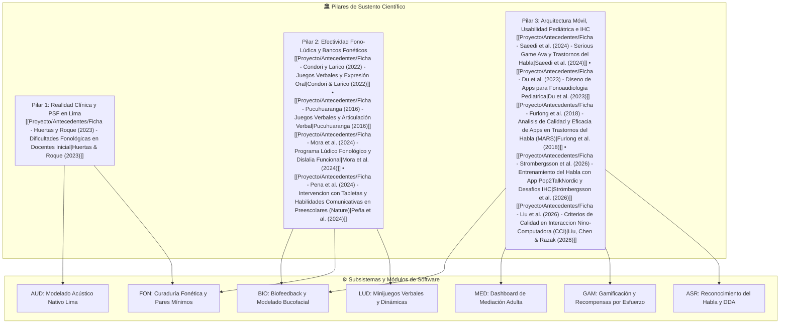
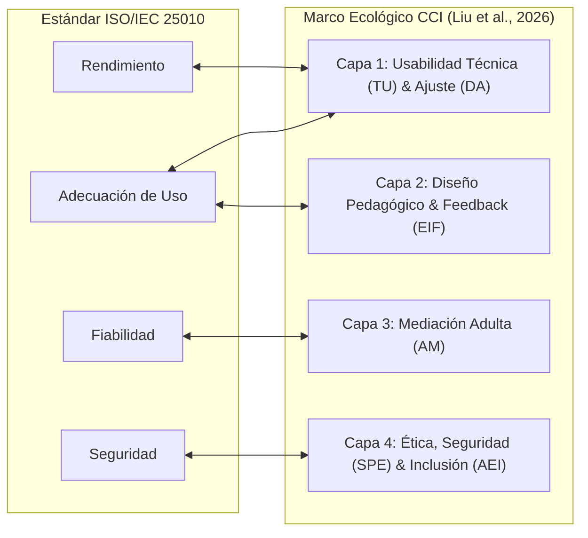

> [!INFO] Propósito y Marco Metodológico
> El presente documento consolida la especificación formal y refinada de los requisitos del sistema para la **aplicación móvil fono-lúdica** orientada a la estimulación y mejora de la articulación fonética en infantes preescolares (3 a 5 años) de Lima Metropolitana. 
> Esta especificación ha sido estructurada aplicando el estándar **Antigravity Requirements Engineering (Edición 2026)**, el estándar internacional de calidad **ISO/IEC 25010**, la formulación de criterios de aceptación bajo patrones **BDD (Behavior-Driven Development / Gherkin)** y **PAR (Precondición-Acción-Resultado)**, y la indexación exhaustiva del **sustento científico empírico proveniente de los 10 antecedentes de investigación** alojados en [[Proyecto/Antecedentes/Antecedentes|📁 Antecedentes del Proyecto]].

---

## 🧭 Árbol de Articulación Científica y Módulos de Requisitos

---

## 📖 1. Glosario de Términos Operativos (GL)

- **\[GL-001\] Proceso de Simplificación Fonológica (PSF):** Mecanismo adaptativo inconsciente mediante el cual los niños preescolares transforman o simplifican las palabras de la norma adulta que sobrepasan sus capacidades de maduración articulatoria o de representación fónica (ej. omisión de codas silábicas, reducción de grupos consonánticos, sustitución de fricativas por oclusivas). Esperados evolutivamente hasta los 4 años y patológicos si persisten a los 5 años *(Fuente: [[Proyecto/Antecedentes/Ficha - Huertas y Roque (2023) - Dificultades Fonológicas en Docentes Inicial|Huertas & Roque, 2023]])*.
- **\[GL-002\] Enfoque Fono-Lúdico:** Paradigma pedagógico y fonoaudiológico que inserta el entrenamiento sistemático de los sonidos del habla dentro de dinámicas de juego lúdicas, placenteras y no amenazantes (trabalenguas, rimas, adivinanzas, bingo y carreras), erradicando la práctica mecánica descontextualizada *(Fuente: [[Proyecto/Antecedentes/Ficha - Condori y Larico (2022) - Juegos Verbales y Expresión Oral|Condori & Larico, 2022]]; [[Proyecto/Antecedentes/Ficha - Mora et al. (2024) - Programa Lúdico Fonológico y Dislalia Funcional|Mora et al., 2024]])*.
- **\[GL-003\] Biofeedback Fónico Contingente:** Técnica de retroalimentación en tiempo real que captura la producción articulatoria del infante y se la reproduce inmediatamente en audio (*self-playback*), acompañada por animaciones de colocación lingual y labial, permitiendo al menor comparar su emisión con el modelo fonético correcto *(Fuente: [[Proyecto/Antecedentes/Ficha - Du et al. (2023) - Diseno de Apps para Fonoaudiologia Pediatrica|Du et al., 2023]]; [[Proyecto/Antecedentes/Ficha - Pena et al. (2024) - Intervencion con Tabletas y Habilidades Comunicativas en Preescolares (Nature)|Peña et al., 2024]])*.
- **\[GL-004\] Ajuste Dinámico de Dificultad (DDA - Dynamic Difficulty Adjustment):** Algoritmo de control adaptativo en tiempo de ejecución que modula la exigencia del sistema (reduciendo el umbral acústico o activando asistencia por pistas) ante fallos repetitivos del niño, previniendo bucles de frustración y abandono *(Fuente: [[Proyecto/Antecedentes/Ficha - Strombergsson et al. (2026) - Entrenamiento del Habla con App Pop2TalkNordic y Desafios IHC|Strömbergsson et al., 2026]])*.
- **\[GL-005\] Recompensa Basada en el Esfuerzo (*Effort-Based Reward*):** Mecanismo de incentivo lúdico que otorga refuerzos positivos (estrellas de intento, animaciones celebratorias) reconociendo la intención y participación del infante al intentar pronunciar, sin penalizarlo si la precisión fonética aún no es perfecta *(Fuente: [[Proyecto/Antecedentes/Ficha - Strombergsson et al. (2026) - Entrenamiento del Habla con App Pop2TalkNordic y Desafios IHC|Strömbergsson et al., 2026]])*.
- **\[GL-006\] Pares Mínimos (*Minimal Pairs*):** Parejas de palabras que se diferencian únicamente por un fonema en la misma posición relativa (ej. *cama* vs. *tama*, *sol* vs. *tol*), utilizadas para ejercitar la discriminación y contraste auditivo previo a la producción motora *(Fuente: [[Proyecto/Antecedentes/Ficha - Mora et al. (2024) - Programa Lúdico Fonológico y Dislalia Funcional|Mora et al., 2024]])*.
- **\[GL-007\] Jerarquía Articulatoria de Van Riper:** Progresión fonoaudiológica clásica estructurada en cuatro estadios de complejidad ascendente: fonema aislado $\rightarrow$ sílaba simple $\rightarrow$ palabra léxica $\rightarrow$ frase contextualizada *(Fuente: [[Proyecto/Antecedentes/Ficha - Saeedi et al. (2024) - Serious Game Ava y Trastornos del Habla|Saeedi et al., 2024]])*.
- **\[GL-008\] Batería TEPROSIF:** Test estandarizado para evaluar Procesos de Simplificación Fonológica en español infantil mediante evocación de palabras dirigidas *(Fuente: [[Proyecto/Antecedentes/Ficha - Pena et al. (2024) - Intervencion con Tabletas y Habilidades Comunicativas en Preescolares (Nature)|Peña et al., 2024]])*.
- **\[GL-009\] Escala MARS (*Mobile Application Rating Scale*):** Instrumento psicométrico validado para la medición multidimensional de la calidad técnica, estética, interactividad y valor clínico de aplicaciones móviles de salud (*mHealth*) *(Fuente: [[Proyecto/Antecedentes/Ficha - Furlong et al. (2018) - Analisis de Calidad y Eficacia de Apps en Trastornos del Habla (MARS)|Furlong et al., 2018]])*.
- **\[GL-010\] Marco Ecológico de Calidad CCI:** Modelo integral de 4 capas y 9 dimensiones que rige el diseño de software para niños preescolares en Interacción Niño-Computadora (*Child-Computer Interaction*) *(Fuente: [[Proyecto/Antecedentes/Ficha - Liu et al. (2026) - Criterios de Calidad en Interaccion Nino-Computadora (CCI)|Liu, Chen & Razak, 2026]])*.

---

## 📜 2. Reglas de Negocio (RN) y Requisitos de Dominio (RDOM)

### Reglas de Negocio Operacionales (RN)
- **\[RN-DDA-001\] Prevención de Frustración por Ajuste Dinámico de Dificultad (DDA):** Si el infante registra **3 intentos consecutivos fallidos** en un mismo estímulo de emisión fonética, el sistema **no bloqueará el avance** ni reiniciará el nivel; en su lugar, debe otorgar una "estrella de esfuerzo", reproducir una pista articulatoria reforzada (animación bucofacial) y avanzar automáticamente al siguiente reto o nivel asistido *(Fuente: [[Proyecto/Antecedentes/Ficha - Strombergsson et al. (2026) - Entrenamiento del Habla con App Pop2TalkNordic y Desafios IHC|Strömbergsson et al., 2026]])*.
- **\[RN-GAM-001\] Condicionamiento Operante Lúdico sin Castigo Punitivo:** El sistema **prohíbe estrictamente** restar puntos, vidas, estrellas o aplicar sonidos estridentes de error (zumbadores, cruces rojas) ante emisiones fonéticas incorrectas. El sistema únicamente aplicará retroalimentación guiada constructiva *(Fuente: [[Proyecto/Antecedentes/Ficha - Saeedi et al. (2024) - Serious Game Ava y Trastornos del Habla|Saeedi et al., 2024]]; [[Proyecto/Antecedentes/Ficha - Strombergsson et al. (2026) - Entrenamiento del Habla con App Pop2TalkNordic y Desafios IHC|Strömbergsson et al., 2026]])*.
- **\[RN-FON-001\] Curaduría de Estímulos sin Contaminación Fonética Colateral:** Toda palabra meta seleccionada para ejercitar un fonema específico debe estar libre de dicho fonema en posiciones no evaluadas (antipatrón de "palabra contaminada", ej. evitar *coca* o *pastelito* para evaluar $/k/$ o $/p/$ inicial). Además, se prohíbe el uso de léxico ajeno a la edad preescolar *(Fuente: [[Proyecto/Antecedentes/Ficha - Furlong et al. (2018) - Analisis de Calidad y Eficacia de Apps en Trastornos del Habla (MARS)|Furlong et al., 2018]])*.
- **\[RN-FON-002\] Filtrado Silábico Progresivo:** Las palabras presentadas al niño de 3 a 5 años deben respetar una progresión silábica controlada: iniciar en estructuras monosilábicas y bisilábicas directas (CV: consonante-vocal), transitar por sílabas trabadas (CVC), y solo tras superar las anteriores habilitar grupos consonánticos / sinfones (CCV) *(Fuente: [[Proyecto/Antecedentes/Ficha - Huertas y Roque (2023) - Dificultades Fonológicas en Docentes Inicial|Huertas & Roque, 2023]]; [[Proyecto/Antecedentes/Ficha - Furlong et al. (2018) - Analisis de Calidad y Eficacia de Apps en Trastornos del Habla (MARS)|Furlong et al., 2018]])*.
- **\[RN-MED-001\] Dosificación Terapéutica Máxima Diaria:** El sistema debe sugerir una dosis de entrenamiento de **15 minutos por sesión** diaria (50 a 100 oportunidades de producción fonética distribuidas), alertando amigablemente al tutor o docente al alcanzar dicho límite para evitar fatiga cognitiva en el preescolar *(Fuente: [[Proyecto/Antecedentes/Ficha - Du et al. (2023) - Diseno de Apps para Fonoaudiologia Pediatrica|Du et al., 2023]]; [[Proyecto/Antecedentes/Ficha - Strombergsson et al. (2026) - Entrenamiento del Habla con App Pop2TalkNordic y Desafios IHC|Strömbergsson et al., 2026]])*.

### Requisitos de Dominio Lingüístico y Clínico (RDOM)
- **\[RDOM-FON-001\] Norma Fonética Culta de Lima Metropolitana:** Todos los modelos acústicos, locuciones y transcripciones fonéticas deben ajustarse con precisión a la variedad lingüística del español de Lima Metropolitana (seseo sistemático, yeísmo sin rehilamiento, ausencia de aspiración de $/s/$ en habla formal infantil), prohibiendo la inserción de vocal neutra (*schwa* $[ə]$) al articular consonantes aisladas (ej. emitir $[k]$ y no $[kə]$) *(Fuente: [[Proyecto/Antecedentes/Ficha - Huertas y Roque (2023) - Dificultades Fonológicas en Docentes Inicial|Huertas & Roque, 2023]]; [[Proyecto/Antecedentes/Ficha - Furlong et al. (2018) - Analisis de Calidad y Eficacia de Apps en Trastornos del Habla (MARS)|Furlong et al., 2018]])*.
- **\[RDOM-EVA-001\] Métrica de Detección de PSF según Criterios TEPROSIF y Bosch & Melgar:** El sistema debe clasificar los errores articulatorios detectados en tres categorías estandarizadas: **Omisión (O)**, **Sustitución (S)** y **Distorsión (D)**, permitiendo mapear el progreso hacia la normalización articulatoria *(Fuente: [[Proyecto/Antecedentes/Ficha - Pucuhuaranga (2016) - Juegos Verbales y Articulación Verbal|Pucuhuaranga, 2016]]; [[Proyecto/Antecedentes/Ficha - Pena et al. (2024) - Intervencion con Tabletas y Habilidades Comunicativas en Preescolares (Nature)|Peña et al., 2024]])*.

---

## 🚫 3. Restricciones Técnicas, Legales y Éticas (RST)

- **\[RST-ETI-001\] Entorno Estricto Cero Publicidad y Cero Monetización Pediátrica:** La aplicación está condicionada a ser **100% libre de anuncios comerciales emergentes (*ads*), compras integradas (*in-app purchases*) o enlaces externos no bloqueados**, debido a que la publicidad destruye la atención del menor y compromete la integridad terapéutica *(Fuente: [[Proyecto/Antecedentes/Ficha - Du et al. (2023) - Diseno de Apps para Fonoaudiologia Pediatrica|Du et al., 2023]]; [[Proyecto/Antecedentes/Ficha - Liu et al. (2026) - Criterios de Calidad en Interaccion Nino-Computadora (CCI)|Liu, Chen & Razak, 2026]])*.
- **\[RST-LEG-001\] Marco Normativo de Privacidad de Datos y Audio Infantil:** El sistema está condicionado a cumplir con la **Ley N° 29733 (Ley de Protección de Datos Personales del Perú)** y las directrices internacionales **COPPA / HIPAA**. Las grabaciones de voz del menor constituyen datos biométricos sensibles y deben encriptarse localmente, prohibiéndose su comercialización o transferencia no autorizada *(Fuente: [[Proyecto/Antecedentes/Ficha - Du et al. (2023) - Diseno de Apps para Fonoaudiologia Pediatrica|Du et al., 2023]]; [[Proyecto/Antecedentes/Ficha - Liu et al. (2026) - Criterios de Calidad en Interaccion Nino-Computadora (CCI)|Liu, Chen & Razak, 2026]])*.
- **\[RST-HW-001\] Modalidad de Interacción Exclusivamente Táctil y por Voz:** La aplicación está condicionada a ejecutarse en dispositivos móviles (*smartphones* y *tablets*) con sistema operativo **Android $\ge 10.0$** e **iOS $\ge 15.0$**, prescindiendo completamente de teclado físico o virtual para el infante, operando únicamente por toque de pantalla simple (*tap*), arrastre (*drag-and-drop*) y entrada de micrófono *(Fuente: [[Proyecto/Antecedentes/Ficha - Liu et al. (2026) - Criterios de Calidad en Interaccion Nino-Computadora (CCI)|Liu, Chen & Razak, 2026]])*.
- **\[RST-DIS-001\] Autonomía Operacional Offline:** El sistema está condicionado a ejecutar todas las dinámicas de juego fono-lúdico, el biofeedback auditivo y el registro de telemetría de forma **comcompletamente local y offline**, sin requerir conectividad continua a Internet en el aula preescolar o el hogar *(Fuente: [[Proyecto/Antecedentes/Ficha - Du et al. (2023) - Diseno de Apps para Fonoaudiologia Pediatrica|Du et al., 2023]]; [[Proyecto/Antecedentes/Ficha - Pena et al. (2024) - Intervencion con Tabletas y Habilidades Comunicativas en Preescolares (Nature)|Peña et al., 2024]])*.

---

## 🎯 4. Requisitos Funcionales Atómicos (RF) con Escenarios BDD

Cada requisito funcional describe una acción única y atómica en voz activa, estableciendo el actor principal y su criterio de aceptación formal en sintaxis BDD (*Given-When-Then* / *Dado-Cuando-Entonces*).

### Módulo LUD: Módulo Fono-Lúdico y Juegos Verbales
*Sustento Científico: Correlación estadísticamente significativa ($r = 0.612, p = 0.008$) entre juegos verbales y la dimensión fonológica ([[Proyecto/Antecedentes/Ficha - Condori y Larico (2022) - Juegos Verbales y Expresión Oral|Condori & Larico, 2022]]), reducción de dislalias al 0% mediante dinámicas de carreras y bingo ([[Proyecto/Antecedentes/Ficha - Mora et al. (2024) - Programa Lúdico Fonológico y Dislalia Funcional|Mora et al., 2024]]) y superación del 46.86% de errores articulatorios ([[Proyecto/Antecedentes/Ficha - Pucuhuaranga (2016) - Juegos Verbales y Articulación Verbal|Pucuhuaranga, 2016]]).*

#### \[RF-LUD-001\] Minijuego de Trabalenguas Fonoarticulatorios
- **Descripción:** El sistema debe presentar minijuegos de trabalenguas interactivos ilustrados y adaptados fonéticamente, que guíen al niño en la repetición rítmica de secuencias bucofaciales complejas.
- **Actor:** Infante Preescolar.
- **Sustento Científico:** [[Proyecto/Antecedentes/Ficha - Condori y Larico (2022) - Juegos Verbales y Expresión Oral|Condori & Larico (2022)]] (p. 14); [[Proyecto/Antecedentes/Ficha - Pucuhuaranga (2016) - Juegos Verbales y Articulación Verbal|Pucuhuaranga (2016)]].
- **Criterio de Aceptación (BDD):**
  - **Dado** que el infante ingresa a la sección de juegos verbales y selecciona el fonema vibrante $[r]$,
  - **Cuando** el sistema reproduce el trabalenguas ilustrado (ej. *"Erre con erre guitarra..."*) con sincronización visual de palabras,
  - **Entonces** el sistema debe habilitar el botón de grabación por micrófono invitando al niño a repetir la secuencia por ritmo.

#### \[RF-LUD-002\] Minijuego de Rimas Interactivas y Discriminación Fonémica
- **Descripción:** El sistema debe proveer dinámicas de rimas interactivas que soliciten al infante emparejar auditivamente palabras con la misma terminación silábica (*onset-rime*).
- **Actor:** Infante Preescolar.
- **Sustento Científico:** [[Proyecto/Antecedentes/Ficha - Condori y Larico (2022) - Juegos Verbales y Expresión Oral|Condori & Larico (2022)]] ($r = 0.612$ en conciencia fonológica).
- **Criterio de Aceptación (BDD):**
  - **Dado** que se presenta la palabra modelo "botón" con locución sonora e imagen,
  - **Cuando** el infante escucha tres opciones sonoras ("ratón", "casa", "mesa"),
  - **Entonces** el sistema debe validar si el niño selecciona la opción rimada ("ratón") emitiendo una animación de festejo y reproduciendo la rima completa.

#### \[RF-LUD-003\] Minijuego de Adivinanzas Guiadas por Voz
- **Descripción:** El sistema debe formular acertijos sonoros narrados en voz alta que requieran que el infante pronuncie el nombre del objeto meta para revelar su ilustración.
- **Actor:** Infante Preescolar.
- **Sustento Científico:** [[Proyecto/Antecedentes/Ficha - Condori y Larico (2022) - Juegos Verbales y Expresión Oral|Condori & Larico (2022)]]; [[Proyecto/Antecedentes/Ficha - Saeedi et al. (2024) - Serious Game Ava y Trastornos del Habla|Saeedi et al. (2024)]].
- **Criterio de Aceptación (BDD):**
  - **Dado** que el avatar guía narra una adivinanza auditiva infantil (ej. *"Tengo una melena y soy muy veloz... ¿quién soy?"*),
  - **Cuando** el infante pronuncia por el micrófono la palabra meta "León",
  - **Entonces** el sistema debe reconocer la palabra y revelar la ilustración animada del león rugiendo con retroalimentación positiva.

#### \[RF-LUD-004\] Dinámica de Carrera de Fonemas con Estaciones
- **Descripción:** El sistema debe ejecutar un tablero gamificado de avance tipo circuito ("Carrera de Fonemas") donde el avance de casillas dependa de la emisión de la palabra estímulo de cada estación.
- **Actor:** Infante Preescolar.
- **Sustento Científico:** [[Proyecto/Antecedentes/Ficha - Mora et al. (2024) - Programa Lúdico Fonológico y Dislalia Funcional|Mora et al. (2024)]] (Juego 4 del programa fono-lúdico, $p = 0.01$).
- **Criterio de Aceptación (BDD):**
  - **Dado** que el infante se encuentra en la casilla 2 del circuito de fonemas,
  - **Cuando** el sistema le solicita articular la palabra de la estación (ej. "Plátano") y el infante efectúa la emisión por voz,
  - **Entonces** el avatar del infante debe avanzar a la casilla siguiente desbloqueando la siguiente prueba lúdica.

#### \[RF-LUD-005\] Dinámica de Bingo Fonológico Visual-Auditivo
- **Descripción:** El sistema debe presentar una cuadrícula de imágenes tipo "Bingo Fonológico" donde el niño deba identificar y tocar la imagen correspondiente al fonema o palabra que escucha.
- **Actor:** Infante Preescolar.
- **Sustento Científico:** [[Proyecto/Antecedentes/Ficha - Mora et al. (2024) - Programa Lúdico Fonológico y Dislalia Funcional|Mora et al. (2024)]] (Juego 2: discriminación auditiva y asociación fónica).
- **Criterio de Aceptación (BDD):**
  - **Dado** que el tablero muestra 4 imágenes (fresa, gato, sol, luna),
  - **Cuando** el sistema emite el estímulo sonoro *"Encuentra la palabra que empieza con /s/ como ¡Sol!"*,
  - **Entonces** el sistema debe registrar la selección táctil del infante y marcar la casilla con una ficha animada de acierto.

---

### Módulo FON: Gestión Fonética, Curaduría y Pares Mínimos
*Sustento Científico: Banco estandarizado de 32 palabras test de Bosch & Melgar ([[Proyecto/Antecedentes/Ficha - Pucuhuaranga (2016) - Juegos Verbales y Articulación Verbal|Pucuhuaranga, 2016]]), progresión de Van Riper ([[Proyecto/Antecedentes/Ficha - Saeedi et al. (2024) - Serious Game Ava y Trastornos del Habla|Saeedi et al., 2024]]), erradicación de antipatrones de contaminación fonética ([[Proyecto/Antecedentes/Ficha - Furlong et al. (2018) - Analisis de Calidad y Eficacia de Apps en Trastornos del Habla (MARS)|Furlong et al., 2018]]) y tipología de PSF en Lima ([[Proyecto/Antecedentes/Ficha - Huertas y Roque (2023) - Dificultades Fonológicas en Docentes Inicial|Huertas & Roque, 2023]]).*

#### \[RF-FON-001\] Filtrado de Estímulos según Etapa Evolutiva y Tipo de PSF
- **Descripción:** El sistema debe filtrar el repertorio de actividades y fonemas disponibles en función de la edad cronológica del menor (3, 4 o 5 años) y el tipo específico de PSF a intervenir (omisión de codas, reducción de sinfones, sustitución de fricativas).
- **Actor:** Docente / Fonoaudiólogo / Sistema.
- **Sustento Científico:** [[Proyecto/Antecedentes/Ficha - Huertas y Roque (2023) - Dificultades Fonológicas en Docentes Inicial|Huertas & Roque (2023)]] (p. 20); [[Proyecto/Antecedentes/Ficha - Du et al. (2023) - Diseno de Apps para Fonoaudiologia Pediatrica|Du et al. (2023)]].
- **Criterio de Aceptación (BDD):**
  - **Dado** que un infante está registrado con 3 años de edad,
  - **Cuando** el sistema carga el menú de actividades fono-lúdicas,
  - **Entonces** el sistema debe habilitar fonemas correspondientes a su nivel madurativo (oclusivos, nasales y vocálicos) y mantener bloqueados los grupos consonánticos complejos ($Tr, Gr, Kr$) hasta etapas posteriores.

#### \[RF-FON-002\] Mapeo de Posiciones Articulatorias con el Banco Fonético de Bosch & Melgar
- **Descripción:** El sistema debe suministrar actividades basadas en el banco estandarizado de **32 palabras test de Bosch & Melgar**, evaluando cada fonema consonántico en sus tres posiciones articulatorias: inicial (I), medial (M) y final (F).
- **Actor:** Sistema / Infante Preescolar.
- **Sustento Científico:** [[Proyecto/Antecedentes/Ficha - Pucuhuaranga (2016) - Juegos Verbales y Articulación Verbal|Pucuhuaranga (2016)]] (Tabla de 32 palabras e impacto cuasiexperimental).
- **Criterio de Aceptación (BDD):**
  - **Dado** que se selecciona el fonema lateral /l/,
  - **Cuando** el sistema genera la sesión de práctica,
  - **Entonces** debe secuenciar tarjetas interactivas correspondientes a posición inicial (*Lápiz*), medial (*Bolsa/Cielo*) y final (*Sol/Cristal*), evaluando omisiones, sustituciones y distorsiones.

#### \[RF-FON-003\] Progresión Jerárquica Articulatoria de Van Riper
- **Descripción:** El sistema debe organizar la dificultad de cada fonema meta en cuatro niveles jerárquicos secuenciales: fonema aislado $\rightarrow$ sílaba simple $\rightarrow$ palabra $\rightarrow$ frase contextualizada.
- **Actor:** Sistema.
- **Sustento Científico:** [[Proyecto/Antecedentes/Ficha - Saeedi et al. (2024) - Serious Game Ava y Trastornos del Habla|Saeedi et al. (2024)]] (GDD de 6 capítulos y arquitectura de *Ava*).
- **Criterio de Aceptación (BDD):**
  - **Dado** que el niño practica el fonema /s/,
  - **Cuando** alcanza una tasa de aciertos de al menos 80% en sílabas simples (/sa/, /se/, /si/),
  - **Entonces** el sistema debe desbloquear automáticamente el nivel de palabras léxicas (*Silla*, *Sapo*) y notificar el logro mediante animación del avatar.

#### \[RF-FON-004\] Ejercicios de Discriminación con Pares Mínimos (*Minimal Pairs*)
- **Descripción:** El sistema debe reproducir pares mínimos acústicos para que el niño diferencie auditivamente el sonido correcto del fonema sustituido antes de solicitarle su producción motriz.
- **Actor:** Infante Preescolar.
- **Sustento Científico:** [[Proyecto/Antecedentes/Ficha - Mora et al. (2024) - Programa Lúdico Fonológico y Dislalia Funcional|Mora et al. (2024)]]; [[Proyecto/Antecedentes/Ficha - Strombergsson et al. (2026) - Entrenamiento del Habla con App Pop2TalkNordic y Desafios IHC|Strömbergsson et al. (2026)]].
- **Criterio de Aceptación (BDD):**
  - **Dado** que el niño presenta un patrón de anteriorización velar ($/k/ \rightarrow [t]$),
  - **Cuando** el sistema presenta el contraste de par mínimo "Cama" vs. "Tama",
  - **Entonces** el sistema debe emitir ambos sonidos con animaciones distintivas y solicitar al niño señalar cuál es el objeto real antes de pasar a la fase de habla.

---

### Módulo BIO: Captura, Praxias y Biofeedback Auditivo
*Sustento Científico: Validación del biofeedback articulatorio y reproducción contingente de la propia voz grabada del niño ([[Proyecto/Antecedentes/Ficha - Pena et al. (2024) - Intervencion con Tabletas y Habilidades Comunicativas en Preescolares (Nature)|Peña et al., 2024]]), guía animada bucofacial ([[Proyecto/Antecedentes/Ficha - Du et al. (2023) - Diseno de Apps para Fonoaudiologia Pediatrica|Du et al., 2023]]) y secuencia de 6 fases bucofaciales ([[Proyecto/Antecedentes/Ficha - Pucuhuaranga (2016) - Juegos Verbales y Articulación Verbal|Pucuhuaranga, 2016]]).*

#### \[RF-BIO-001\] Modelado Visual 2D de Órganos Fonoarticulatorios (Praxias Animadas)
- **Descripción:** El sistema debe exhibir animaciones 2D ilustrativas y amigables del punto y modo de articulación (movimientos labiales, posición lingual y flujo de aire) previas a la emisión de fonemas de alta fricción ($/r, rr, s, l/$).
- **Actor:** Sistema / Infante Preescolar.
- **Sustento Científico:** [[Proyecto/Antecedentes/Ficha - Pucuhuaranga (2016) - Juegos Verbales y Articulación Verbal|Pucuhuaranga (2016)]] (Fases 1 y 2 bucofaciales); [[Proyecto/Antecedentes/Ficha - Du et al. (2023) - Diseno de Apps para Fonoaudiologia Pediatrica|Du et al. (2023)]] (Pauta 2 de diseño IHC).
- **Criterio de Aceptación (BDD):**
  - **Dado** que se inicia la práctica del fonema alveolar /r/,
  - **Cuando** se presenta la pantalla de preparación motora,
  - **Entonces** el sistema debe mostrar un personaje animado que abra la boca y vibre la punta de la lengua en los alvéolos, reproduciendo el sonido de un motor de juguete para su imitación.

#### \[RF-BIO-002\] Captura Contingente de Audio por Micrófono Integrado
- **Descripción:** El sistema debe capturar la señal de voz del infante mediante el micrófono del dispositivo tras una señal visual y auditiva clara (cuenta regresiva sonora de 3 segundos o encendido de icono animado de micrófono).
- **Actor:** Infante Preescolar.
- **Sustento Científico:** [[Proyecto/Antecedentes/Ficha - Pena et al. (2024) - Intervencion con Tabletas y Habilidades Comunicativas en Preescolares (Nature)|Peña et al. (2024)]] (Fase 3 de vocalización activa); [[Proyecto/Antecedentes/Ficha - Saeedi et al. (2024) - Serious Game Ava y Trastornos del Habla|Saeedi et al. (2024)]].
- **Criterio de Aceptación (BDD):**
  - **Dado** que el avatar concluye la enunciación del modelo sonoro y muestra la tarjeta ilustrada,
  - **Cuando** el micrófono se activa y detecta energía acústica por encima del umbral de ruido ambiental,
  - **Entonces** el sistema debe mostrar ondas sonoras de colores que reaccionen visualmente a la voz del niño durante una ventana de captura de 3 a 5 segundos.

#### \[RF-BIO-003\] Biofeedback Inmediato de Autoescucha (*Self-Playback*)
- **Descripción:** El sistema debe reproducir inmediatamente la muestra de voz recién grabada por el niño a través de los altavoces del dispositivo como mecanismo primario de refuerzo y autocorrección auditiva.
- **Actor:** Sistema / Infante Preescolar.
- **Sustento Científico:** [[Proyecto/Antecedentes/Ficha - Pena et al. (2024) - Intervencion con Tabletas y Habilidades Comunicativas en Preescolares (Nature)|Peña et al. (2024)]] (Mecánica de biofeedback en *Nature*, ganancias $p < 0.001$).
- **Criterio de Aceptación (BDD):**
  - **Dado** que finaliza la ventana de captura de la palabra emitida por el infante,
  - **Cuando** el sistema procesa la señal de audio,
  - **Entonces** debe emitir la propia voz del niño con la animación del avatar sosteniendo un megáfono, permitiendo que el niño reconozca su propia pronunciación.

#### \[RF-BIO-004\] Reproducción Comparativa Alternada (Modelo Nativo vs. Voz Propia)
- **Descripción:** El sistema debe permitir alternar en pantalla mediante toques sencillos la reproducción del modelo nativo de locución y la grabación de la voz del niño para facilitar el juicio perceptivo guiado por el adulto.
- **Actor:** Infante Preescolar / Docente.
- **Sustento Científico:** [[Proyecto/Antecedentes/Ficha - Du et al. (2023) - Diseno de Apps para Fonoaudiologia Pediatrica|Du et al. (2023)]] (Pauta 4 de interacción); [[Proyecto/Antecedentes/Ficha - Pena et al. (2024) - Intervencion con Tabletas y Habilidades Comunicativas en Preescolares (Nature)|Peña et al. (2024)]].
- **Criterio de Aceptación (BDD):**
  - **Dado** que una prueba ha sido grabada y el tutor acompaña al menor,
  - **Cuando** se pulsa el botón "Escuchar Pareja",
  - **Entonces** el sistema debe reproducir secuencialmente el modelo adulto de Lima Metropolitana, seguido de un silencio de 500 ms y la grabación del niño.

---

### Módulo ASR: Reconocimiento Automático del Habla y Ajuste Dinámico (DDA)
*Sustento Científico: Lecciones fundamentales sobre limitaciones del ASR infantil y prevención de bucles de frustración con DDA ([[Proyecto/Antecedentes/Ficha - Strombergsson et al. (2026) - Entrenamiento del Habla con App Pop2TalkNordic y Desafios IHC|Strömbergsson et al., 2026]]) e integración de Speech-to-Text adaptado ([[Proyecto/Antecedentes/Ficha - Saeedi et al. (2024) - Serious Game Ava y Trastornos del Habla|Saeedi et al., 2024]]).*

#### \[RF-ASR-001\] Evaluación Automática de Inteligibilidad Fonética Tolerante
- **Descripción:** El sistema debe evaluar la aproximación acústica de la palabra emitida por el niño mediante un motor de reconocimiento de voz con algoritmos calibrados para tolerar la variabilidad fónica propia del habla preescolar.
- **Actor:** Sistema (Motor ASR).
- **Sustento Científico:** [[Proyecto/Antecedentes/Ficha - Saeedi et al. (2024) - Serious Game Ava y Trastornos del Habla|Saeedi et al. (2024)]] (Google STT tolerante); [[Proyecto/Antecedentes/Ficha - Strombergsson et al. (2026) - Entrenamiento del Habla con App Pop2TalkNordic y Desafios IHC|Strömbergsson et al. (2026)]].
- **Criterio de Aceptación (BDD):**
  - **Dado** que el niño de 4 años emite una palabra con distorsión leve de vibrante simple,
  - **Cuando** el algoritmo ASR clasifica el audio,
  - **Entonces** el sistema debe identificar la inteligibilidad general como aprobatoria, evitando clasificarla como fallo destructivo si el núcleo léxico fue reconocido.

#### \[RF-ASR-002\] Activación de Avance Asistido por DDA ante Reintentos
- **Descripción:** El sistema debe detectar cuando el menor acumule 3 intentos no satisfactorios en la misma palabra y activar automáticamente el avance asistido, otorgando estímulo de esfuerzo y pasando al siguiente ejercicio.
- **Actor:** Sistema (Módulo DDA).
- **Sustento Científico:** [[Proyecto/Antecedentes/Ficha - Strombergsson et al. (2026) - Entrenamiento del Habla con App Pop2TalkNordic y Desafios IHC|Strömbergsson et al. (2026)]] (Resolución del problema de los 16 intentos fallidos en *Pop2TalkNordic*).
- **Criterio de Aceptación (BDD):**
  - **Dado** que el infante ha intentado pronunciar la palabra meta "Tres" por 3 veces sin lograr el reconocimiento fonético,
  - **Cuando** se registra el tercer intento no concordante,
  - **Entonces** el sistema debe presentar un mensaje de voz alentador (*“¡Excelente intento, diste lo mejor de ti!”*), otorgar la estrella de esfuerzo y cambiar de palabra o nivel.

---

### Módulo GAM: Gamificación y Recompensas por Esfuerzo
*Sustento Científico: Recompensas basadas en el esfuerzo para mantener el engagement y evitar deserción ([[Proyecto/Antecedentes/Ficha - Strombergsson et al. (2026) - Entrenamiento del Habla con App Pop2TalkNordic y Desafios IHC|Strömbergsson et al., 2026]]), condicionamiento operante lúdico ([[Proyecto/Antecedentes/Ficha - Saeedi et al. (2024) - Serious Game Ava y Trastornos del Habla|Saeedi et al., 2024]]) y personalización de avatares ([[Proyecto/Antecedentes/Ficha - Du et al. (2023) - Diseno de Apps para Fonoaudiologia Pediatrica|Du et al., 2023]]).*

#### \[RF-GAM-001\] Otorgamiento de Estrellas e Insignias por Esfuerzo (*Effort-Based Rewards*)
- **Descripción:** El sistema debe asignar puntos lúdicos (estrellas o miel coleccionable) recompensando tanto la precisión acústica lograda como la cantidad de intentos de vocalización realizados.
- **Actor:** Sistema / Infante Preescolar.
- **Sustento Científico:** [[Proyecto/Antecedentes/Ficha - Strombergsson et al. (2026) - Entrenamiento del Habla con App Pop2TalkNordic y Desafios IHC|Strömbergsson et al. (2026)]]; [[Proyecto/Antecedentes/Ficha - Saeedi et al. (2024) - Serious Game Ava y Trastornos del Habla|Saeedi et al. (2024)]].
- **Criterio de Aceptación (BDD):**
  - **Dado** que el niño finaliza una ronda de 5 palabras habiendo completado todos los ensayos requeridos,
  - **Cuando** se despliega el resumen lúdico de la sesión,
  - **Entonces** el sistema debe entregar estrellas de participación ("Estrellas por intentar"), felicitándolo con confeti visual y fanfarria auditiva moderada.

#### \[RF-GAM-002\] Personalización y Desbloqueo de Avatares Infantiles
- **Descripción:** El sistema debe permitir al infante seleccionar, personalizar y equipar accesorios en su avatar virtual (mascota amigable) utilizando los coleccionables obtenidos durante las sesiones fono-lúdicas.
- **Actor:** Infante Preescolar.
- **Sustento Científico:** [[Proyecto/Antecedentes/Ficha - Du et al. (2023) - Diseno de Apps para Fonoaudiologia Pediatrica|Du et al. (2023)]] (Pauta 5: Personalización); [[Proyecto/Antecedentes/Ficha - Saeedi et al. (2024) - Serious Game Ava y Trastornos del Habla|Saeedi et al. (2024)]].
- **Criterio de Aceptación (BDD):**
  - **Dado** que el infante reúne 10 estrellas acumuladas en sus juegos de trabalenguas y rimas,
  - **Cuando** ingresa a la pantalla de su avatar,
  - **Entonces** el sistema debe habilitar el botón de canje de accesorios lúdicos (sombreros, colores, capas) y reflejar el cambio estético de inmediato.

---

### Módulo MED: Panel de Mediación Docente/Parental y Telemetría Clínica
*Sustento Científico: Enfoque child-centred but clinician-supported con gestión de datos ([[Proyecto/Antecedentes/Ficha - Du et al. (2023) - Diseno de Apps para Fonoaudiologia Pediatrica|Du et al., 2023]]), arquitectura dual con app de tutor ([[Proyecto/Antecedentes/Ficha - Pena et al. (2024) - Intervencion con Tabletas y Habilidades Comunicativas en Preescolares (Nature)|Peña et al., 2024]]), mediación adulta como capa CCI ([[Proyecto/Antecedentes/Ficha - Liu et al. (2026) - Criterios de Calidad en Interaccion Nino-Computadora (CCI)|Liu, Chen & Razak, 2026]]) y diagnóstico de necesidades en docentes de Lima ([[Proyecto/Antecedentes/Ficha - Huertas y Roque (2023) - Dificultades Fonológicas en Docentes Inicial|Huertas & Roque, 2023]]).*

#### \[RF-MED-001\] Control de Acceso Parental y Docente por Desafío Numérico
- **Descripción:** El sistema debe bloquear el acceso a los ajustes de configuración, telemetría y compra mediante un desafío matemático o de lectura orientado exclusivamente a adultos.
- **Actor:** Docente / Tutor / Adulto Mediador.
- **Sustento Científico:** [[Proyecto/Antecedentes/Ficha - Du et al. (2023) - Diseno de Apps para Fonoaudiologia Pediatrica|Du et al. (2023)]]; [[Proyecto/Antecedentes/Ficha - Liu et al. (2026) - Criterios de Calidad en Interaccion Nino-Computadora (CCI)|Liu, Chen & Razak (2026)]].
- **Criterio de Aceptación (BDD):**
  - **Dado** que un usuario presiona el icono de engranaje o panel docente,
  - **Cuando** la aplicación despliega una ventana modal con una multiplicación escrita en texto (ej. *"Resuelve: Tres por cuatro"*),
  - **Entonces** el sistema solo debe desbloquear el panel si se introduce la respuesta numérica correcta (12), bloqueando el intento de niños no lectores.

#### \[RF-MED-002\] Calibración Personalizada de la Sesión Fonoaudiológica
- **Descripción:** El sistema debe permitir al docente o tutor seleccionar manualmente los fonemas específicos a ejercitar, definir el número de repeticiones por sesión y ajustar la sensibilidad del micrófono.
- **Actor:** Docente / Tutor.
- **Sustento Científico:** [[Proyecto/Antecedentes/Ficha - Du et al. (2023) - Diseno de Apps para Fonoaudiologia Pediatrica|Du et al. (2023)]] (Pauta 1: Controles de back-end); [[Proyecto/Antecedentes/Ficha - Strombergsson et al. (2026) - Entrenamiento del Habla con App Pop2TalkNordic y Desafios IHC|Strömbergsson et al. (2026)]].
- **Criterio de Aceptación (BDD):**
  - **Dado** que el docente ingresa al panel de configuración del infante "Juan",
  - **Cuando** desactiva el fonema /s/ y activa prioritariamente los sinfones con /r/ (*Bra, Tra, Fra*),
  - **Entonces** las sesiones de juego fono-lúdico del niño deben cargar únicamente palabras y trabalenguas que ejerciten los fonemas seleccionados.

#### \[RF-MED-003\] Tablero Analítico (*Dashboard*) de Progresión y Reducción de PSF
- **Descripción:** El sistema debe graficar de forma cuantitativa el número de sesiones completadas, minutos de práctica acumulados, porcentaje de aciertos fonéticos y la curva de superación de PSF (omisiones vs. sustituciones).
- **Actor:** Docente / Tutor / Fonoaudiólogo.
- **Sustento Científico:** [[Proyecto/Antecedentes/Ficha - Huertas y Roque (2023) - Dificultades Fonológicas en Docentes Inicial|Huertas & Roque (2023)]]; [[Proyecto/Antecedentes/Ficha - Du et al. (2023) - Diseno de Apps para Fonoaudiologia Pediatrica|Du et al. (2023)]].
- **Criterio de Aceptación (BDD):**
  - **Dado** que el docente consulta el perfil del estudiante tras 2 semanas de uso,
  - **Cuando** abre la pestaña de estadísticas clínicas,
  - **Entonces** el sistema debe renderizar un gráfico de barras comparativo mostrando la reducción de omisiones fonéticas y el incremento de producciones exitosas.

#### \[RF-MED-004\] Repositorio Local de Grabaciones de Audio para Evaluación Especializada
- **Descripción:** El sistema debe indexar las grabaciones de voz generadas por el infante, permitiendo al docente o fonoaudiólogo reproducirlas, etiquetarlas clínicamente o eliminarlas.
- **Actor:** Docente / Fonoaudiólogo.
- **Sustento Científico:** [[Proyecto/Antecedentes/Ficha - Du et al. (2023) - Diseno de Apps para Fonoaudiologia Pediatrica|Du et al. (2023)]]; [[Proyecto/Antecedentes/Ficha - Pena et al. (2024) - Intervencion con Tabletas y Habilidades Comunicativas en Preescolares (Nature)|Peña et al. (2024)]].
- **Criterio de Aceptación (BDD):**
  - **Dado** que el fonoaudiólogo visita el aula y requiere evaluar la articulación real del niño,
  - **Cuando** accede a la lista de muestras de audio almacenadas ordenadas por fecha,
  - **Entonces** el sistema debe reproducir el archivo de audio local con alta fidelidad permitiendo registrar notas clínicas cualitativas.

---

### Módulo AUD: Modelado Acústico Nativo de Lima Metropolitana
*Sustento Científico: Localización fonética a la norma culta de Lima Metropolitana ([[Proyecto/Antecedentes/Ficha - Huertas y Roque (2023) - Dificultades Fonológicas en Docentes Inicial|Huertas & Roque, 2023]]), prohibición de inserción de vocal neutra (schwa) y rechazo a voces sintéticas robotizadas ([[Proyecto/Antecedentes/Ficha - Furlong et al. (2018) - Analisis de Calidad y Eficacia de Apps en Trastornos del Habla (MARS)|Furlong et al., 2018]]) e instrucciones habladas para no lectores ([[Proyecto/Antecedentes/Ficha - Du et al. (2023) - Diseno de Apps para Fonoaudiologia Pediatrica|Du et al., 2023]]; [[Proyecto/Antecedentes/Ficha - Saeedi et al. (2024) - Serious Game Ava y Trastornos del Habla|Saeedi et al., 2024]]).*

#### \[RF-AUD-001\] Emisión de Estímulos Vocales Grabados con Locución Humana Limpia
- **Descripción:** El sistema debe reproducir estímulos fónicos grabados exclusivamente por locutoras profesionales nativas del dialecto de Lima Metropolitana en estudio acústico profesional, sin distorsión robótica ni inserción de *schwa*.
- **Actor:** Sistema / Locución Nativa.
- **Sustento Científico:** [[Proyecto/Antecedentes/Ficha - Huertas y Roque (2023) - Dificultades Fonológicas en Docentes Inicial|Huertas & Roque (2023)]]; [[Proyecto/Antecedentes/Ficha - Furlong et al. (2018) - Analisis de Calidad y Eficacia de Apps en Trastornos del Habla (MARS)|Furlong et al. (2018)]] (Antipatrón 4 y 5).
- **Criterio de Aceptación (BDD):**
  - **Dado** que el niño pulsa la tarjeta interactiva para escuchar el fonema aislado /k/,
  - **Cuando** el sistema reproduce el audio,
  - **Entonces** debe escucharse el sonido consonántico sordo puro $[k]$ sin añadir la vocal neutra $[ə]$ (*"k"* y no *"kuh"*), con una frecuencia de muestreo de al menos 44.1 kHz.

#### \[RF-AUD-002\] Instrucciones de Sistema Narradas en Voz Alta (*Spoken Read-Aloud*)
- **Descripción:** El sistema debe suministrar toda indicación, consigna de juego y mensaje de ayuda en formato sonoro narrado de forma cálida e interactiva, garantizando que el infante no requiera asistencia de lectura.
- **Actor:** Avatar Virtual / Infante Preescolar.
- **Sustento Científico:** [[Proyecto/Antecedentes/Ficha - Saeedi et al. (2024) - Serious Game Ava y Trastornos del Habla|Saeedi et al. (2024)]]; [[Proyecto/Antecedentes/Ficha - Du et al. (2023) - Diseno de Apps para Fonoaudiologia Pediatrica|Du et al. (2023)]].
- **Criterio de Aceptación (BDD):**
  - **Dado** que se abre cualquier minijuego nuevo,
  - **Cuando** carga la pantalla en el dispositivo,
  - **Entonces** el avatar debe narrar en voz audible la consigna (ej. *"¡Hola amigo! Toca el animal que empieza con la letra de la rana"*), con repetición al tocar el avatar.

---

## ⚡ 5. Requisitos No Funcionales Operacionales (RNF) con Criterios PAR

Los RNF representan restricciones directas y cuantificables sobre el rendimiento, latencia y recursos del sistema, formulados bajo el patrón estructurado **PAR (Precondición $\rightarrow$ Acción $\rightarrow$ Resultado Esperado)**:

| Código | Requisito No Funcional | Métrica / Umbral Cuantitativo | Criterio de Aceptación Estructurado (PAR) | Sustento Científico Indexado |
| :--- | :--- | :--- | :--- | :--- |
| **RNF-DES-001** | **Latencia Inmediata de Biofeedback de Autoescucha** | Tiempo de procesamiento y reproducción $\le 300\text{ ms}$. | **Precondición:** El infante culmina la grabación de audio. **Acción:** El sistema comprime el buffer de audio local y dispara el altavoz. **Resultado Esperado:** La propia voz del menor suena por el altavoz en menos de $300\text{ ms}$, garantizando la contingencia perceptivo-auditiva. | [[Proyecto/Antecedentes/Ficha - Pena et al. (2024) - Intervencion con Tabletas y Habilidades Comunicativas en Preescolares (Nature)\|Peña et al. (2024)]]; [[Proyecto/Antecedentes/Ficha - Du et al. (2023) - Diseno de Apps para Fonoaudiologia Pediatrica\|Du et al. (2023)]]. |
| **RNF-DES-002** | **Tiempo de Respuesta del Algoritmo ASR** | Tiempo de inferencia y respuesta $\le 1.2\text{ s}$. | **Precondición:** Muestra de audio capturada (longitud 2 a 4 s). **Acción:** El motor ASR local ejecuta la comparación de patrones acústicos. **Resultado Esperado:** El sistema clasifica el resultado y muestra el refuerzo visual en pantalla en un tiempo estrictamente inferior a $1.2\text{ segundos}$. | [[Proyecto/Antecedentes/Ficha - Saeedi et al. (2024) - Serious Game Ava y Trastornos del Habla\|Saeedi et al. (2024)]]; [[Proyecto/Antecedentes/Ficha - Strombergsson et al. (2026) - Entrenamiento del Habla con App Pop2TalkNordic y Desafios IHC\|Strömbergsson et al. (2026)]]. |
| **RNF-ALM-001** | **Consumo de Almacenamiento Local de Grabaciones** | Tasa de compresión de audio OGG/Opus $\le 24\text{ kbps}$; cuota máxima de $150\text{ MB}$ por perfil. | **Precondición:** Grabación persistente de muestras en memoria interna del dispositivo. **Acción:** El sistema almacena las muestras de voz del niño. **Resultado Esperado:** Un total de 200 muestras de voz comprimidas no debe exceder los $150\text{ MB}$, purgando las muestras más antiguas previa autorización parental. | [[Proyecto/Antecedentes/Ficha - Du et al. (2023) - Diseno de Apps para Fonoaudiologia Pediatrica\|Du et al. (2023)]]. |
| **RNF-DIS-001** | **Disponibilidad Offline de Actividades** | Operatividad funcional del $100\%$ de los minijuegos y biofeedback sin red. | **Precondición:** Dispositivo en modo avión o sin red Wi-Fi/datos móviles. **Acción:** El infante inicia la aplicación y ejecuta cualquier juego verbal. **Resultado Esperado:** El juego corre con fluidez completa, persistiendo estadísticas en base de datos SQLite local sin arrojar advertencias de falta de red. | [[Proyecto/Antecedentes/Ficha - Du et al. (2023) - Diseno de Apps para Fonoaudiologia Pediatrica\|Du et al. (2023)]]; [[Proyecto/Antecedentes/Ficha - Pena et al. (2024) - Intervencion con Tabletas y Habilidades Comunicativas en Preescolares (Nature)\|Peña et al. (2024)]]. |
| **RNF-INT-001** | **Tolerancia a Toques Accidentales Infantiles** | Anulación de eventos multitáctiles accidentales menores a $80\text{ ms}$ o con palma apoyada. | **Precondición:** El niño apoya involuntariamente parte de la mano o realiza pulsaciones múltiples no dirigidas. **Acción:** El controlador de eventos táctiles analiza las coordenadas. **Resultado Esperado:** El sistema descarta los eventos periféricos no intencionales y responde con precisión al punto de toque principal. | [[Proyecto/Antecedentes/Ficha - Liu et al. (2026) - Criterios de Calidad en Interaccion Nino-Computadora (CCI)\|Liu, Chen & Razak (2026)]] (Dimensión Usabilidad Técnica TU). |

---

## 🏆 6. Requisitos de Calidad Sistémicos ISO/IEC 25010 (RC) y Marco Ecológico CCI

Los Requisitos de Calidad (RC) formulan los atributos holísticos del sistema basados en el estándar internacional **ISO/IEC 25010** en sinergia directa con el **Marco Ecológico de Calidad en Interacción Niño-Computadora (CCI)** formulado por [[Proyecto/Antecedentes/Ficha - Liu et al. (2026) - Criterios de Calidad en Interaccion Nino-Computadora (CCI)|Liu, Chen & Razak (2026)]]:

### Matriz de Requisitos de Calidad (RC)

| ID | Característica / Subcaracterística ISO 25010 | Dimensión CCI (Liu et al., 2026) | Métrica Específica | Valor Objetivo | Método de Verificación | Stakeholder | Justificación y Sustento Científico Indexado |
| :--- | :--- | :--- | :--- | :--- | :--- | :--- | :--- |
| **RC-USO-001** | **Usabilidad:** Reconocibilidad y Facilidad de Aprendizaje | Capa 1: Adecuación al Desarrollo (DA) y Usabilidad Técnica (TU) | Tamaño mínimo de elementos interactivos táctiles y tasa de éxito sin asistencia lectora. | Área táctil de botones $\ge 48 \times 48\text{ dp}$; tasa de éxito de navegación del $100\%$ en niños no lectores. | Pruebas de usabilidad con 10 niños preescolares observando tiempo en tarea y deslices motrices. | Infante Preescolar / UX Designer | Los niños de 3 a 5 años poseen destreza motriz fina en desarrollo y nula competencia lectora ([[Proyecto/Antecedentes/Ficha - Liu et al. (2026) - Criterios de Calidad en Interaccion Nino-Computadora (CCI)\|Liu, Chen & Razak, 2026]]; [[Proyecto/Antecedentes/Ficha - Du et al. (2023) - Diseno de Apps para Fonoaudiologia Pediatrica\|Du et al., 2023]]). |
| **RC-USO-002** | **Usabilidad:** Satisfacción del Usuario y Calidad de Interfaz | Capa 2: Compromiso, Interacción y Feedback (EIF) | Cuestionario estandarizado **PSSUQ** (*Post-Study System Usability Questionnaire*). | Puntuación media global $\ge 6.0 / 7.0$; subescala de Calidad de Interfaz (INTERQUAL) $\ge 6.25 / 7.0$. | Administración del instrumento PSSUQ a 15 fonoaudiólogos y educadores tras sesiones guiadas. | Docente Inicial / Fonoaudiólogo | El serious game *Ava* demostró que puntuaciones PSSUQ superiores a 6.0 correlacionan directamente con la adherencia terapéutica doméstica ([[Proyecto/Antecedentes/Ficha - Saeedi et al. (2024) - Serious Game Ava y Trastornos del Habla\|Saeedi et al., 2024]]). |
| **RC-USO-003** | **Usabilidad:** Prevención de Errores de Interfaz | Capa 1: Usabilidad Técnica (TU) | Inspección heurística formal con las **10 Heurísticas de Nielsen**; índice de severidad (0 a 4). | Severidad promedio general $\le 1.5$; severidad en la heurística *Prevención de Errores* $< 1.0$. | Panel de 4 evaluadores independientes expertos en IHC aplicando la escala de severidad de Nielsen. | UX Evaluator / Analista de Tareas | La heurística más crítica detectada en serious games infantiles fue la prevención de errores (severidad 3.83 en *Ava*), donde la falta de pistas visuales generaba frustración reiterada ([[Proyecto/Antecedentes/Ficha - Saeedi et al. (2024) - Serious Game Ava y Trastornos del Habla\|Saeedi et al., 2024]]). |
| **RC-CAL-001** | **Calidad de Software Móvil mHealth:** Integralidad Técnica y Pedagógica | Capa 2 y 4: Relevancia de Contenido (CCR) y Evidencia (EET) | Escala estandarizada **MARS** (*Mobile Application Rating Scale*, 1 a 5 estrellas). | Puntuación total MARS $\ge 4.2 / 5.0$; dimensión *Engagement* $\ge 4.5 / 5.0$. | Evaluación independiente por fonoaudiólogas investigadoras mediante rúbrica MARS. | Fonoaudiólogo Investigador / QA | El 86% de las apps comerciales actuales carece de sustento clínico (promedio MARS 3.7). Superar 4.2 sitúa a la app en el percentil superior del estado del arte ([[Proyecto/Antecedentes/Ficha - Furlong et al. (2018) - Analisis de Calidad y Eficacia de Apps en Trastornos del Habla (MARS)\|Furlong et al., 2018]]). |
| **RC-SEG-001** | **Seguridad:** Confidencialidad y Protección de Datos Biométricos | Capa 4: Seguridad, Privacidad y Ética (SPE) | Estándar de cifrado de base de datos local y almacenamiento de archivos de audio. | Algoritmo **AES-256** para muestras de audio almacenadas; anonimización criptográfica de identificadores de menores. | Auditoría técnica de seguridad informática e inspección de almacenamiento SQLite. | Oficial de Privacidad / Desarrollador Backend | Los datos de voz infantil son biométricos sensibles según la Ley 29733 y normativas COPPA/HIPAA ([[Proyecto/Antecedentes/Ficha - Du et al. (2023) - Diseno de Apps para Fonoaudiologia Pediatrica\|Du et al., 2023]]; [[Proyecto/Antecedentes/Ficha - Liu et al. (2026) - Criterios de Calidad en Interaccion Nino-Computadora (CCI)\|Liu, Chen & Razak, 2026]]). |
| **RC-ACC-001** | **Accesibilidad:** Inclusión Sensorial y Sobriedad Visual | Capa 4: Accesibilidad, Equidad e Inclusión (AEI) | Directrices **WCAG 2.2 Nivel AA**; ratio de contraste cromático; tasa de destellos por segundo. | Ratio de contraste tipográfico e iconográfico $\ge 4.5:1$; destellos visuales $\le 3\text{ Hz}$; opción de alto contraste. | Análisis automático con herramientas *Colour Contrast Analyser* (CCA) y revisión por checklist WCAG. | Diseñador UI / Especialista en Accesibilidad | Evita la sobrecarga sensorial y fatiga cognitiva en niños neurodivergentes o con dificultades atencionales ([[Proyecto/Antecedentes/Ficha - Du et al. (2023) - Diseno de Apps para Fonoaudiologia Pediatrica\|Du et al., 2023]]; [[Proyecto/Antecedentes/Ficha - Liu et al. (2026) - Criterios de Calidad en Interaccion Nino-Computadora (CCI)\|Liu, Chen & Razak, 2026]]). |
| **RC-CON-001** | **Fiabilidad:** Tolerancia a Fallos y Persistencia | Capa 1 y 3: Usabilidad Técnica y Mediación Adulta | Tasa de cierres forzados (*crash rate*) y tasa de persistencia de datos ante interrupciones. | Crash rate $< 0.1\%$ de sesiones; $100\%$ de recuperación automática de estado ante llamadas entrantes o salida a home. | Pruebas de estrés y pruebas de interrupción de ciclo de vida de la aplicación en dispositivos físicos. | QA Engineer / Desarrollador Móvil | Furlong et al. identificaron fallos frecuentes de cierre abrupto en apps de Google Play, lo que interrumpe la sesión y confunde al niño ([[Proyecto/Antecedentes/Ficha - Furlong et al. (2018) - Analisis de Calidad y Eficacia de Apps en Trastornos del Habla (MARS)\|Furlong et al., 2018]]). |

---

## 📊 7. Matriz de Trazabilidad Integral de Requisitos (RTM) con Indexación a Antecedentes

La siguiente Matriz de Trazabilidad bidireccional garantiza que cada necesidad pedagógica, clínica y de interacción cuente con respaldo explícito en los antecedentes científicos y se traduzca en especificaciones operativas verificables:

| Pilar y Necesidad del Proyecto | Antecedente Científico Indexado | Requisitos Funcionales Asociados | Requisitos No Funcionales / Calidad | Reglas y Restricciones Vinculadas | Criterio de Verificación / Validación |
| :--- | :--- | :--- | :--- | :--- | :--- |
| **Contexto Regional Lima Metropolitana y Diagnóstico de PSF** | [[Proyecto/Antecedentes/Ficha - Huertas y Roque (2023) - Dificultades Fonológicas en Docentes Inicial\|Huertas & Roque (2023)]] (Tesis PUCP, $N=199$ docentes) | `RF-FON-001` `RF-AUD-001` `RF-MED-003` | `RC-CAL-001` `RNF-DIS-001` | `RDOM-FON-001` `RN-FON-002` | Mapeo de repertorio fonético contra currículo de educación inicial de Lima Metropolitana. |
| **Eficacia Fono-Lúdica de Juegos Verbales Tradicionales** | [[Proyecto/Antecedentes/Ficha - Condori y Larico (2022) - Juegos Verbales y Expresión Oral\|Condori & Larico (2022)]] (Tesis UJCM, $r=0.612, p=0.008$) | `RF-LUD-001` `RF-LUD-002` `RF-LUD-003` | `RC-USO-001` `RC-USO-002` | `RN-GAM-001` | Pruebas piloto observando adherencia y comprensión lúdica en preescolares. |
| **Superación Causal de Errores y Banco de 32 Palabras** | [[Proyecto/Antecedentes/Ficha - Pucuhuaranga (2016) - Juegos Verbales y Articulación Verbal\|Pucuhuaranga (2016)]] (*Horizonte de la Ciencia*, 46.86% superación) | `RF-FON-002` `RF-BIO-001` | `RC-CAL-001` | `RDOM-EVA-001` `RN-FON-001` | Auditoría de las 32 palabras de Bosch & Melgar en posiciones I, M y F. |
| **Blueprint de Serious Game Móvil, Nielsen y PSSUQ** | [[Proyecto/Antecedentes/Ficha - Saeedi et al. (2024) - Serious Game Ava y Trastornos del Habla\|Saeedi et al. (2024)]] (*Nature Sci. Rep.*, PSSUQ=6.14, 6 expertos) | `RF-FON-003` `RF-ASR-001` `RF-GAM-001` `RF-AUD-002` | `RC-USO-001` `RC-USO-002` `RC-USO-003` | `RN-GAM-001` | Inspección heurística de Nielsen con 4 evaluadores y cálculo de métricas PSSUQ. |
| **Mecánicas de Juego Fono-Lúdicas y Pares Mínimos** | [[Proyecto/Antecedentes/Ficha - Mora et al. (2024) - Programa Lúdico Fonológico y Dislalia Funcional\|Mora et al. (2024)]] (*Univ. Ciencia y Tec.*, 74% normalizado) | `RF-LUD-004` `RF-LUD-005` `RF-FON-004` | `RC-CAL-001` | `RN-FON-001` `RN-FON-002` | Verificación de mecánicas de Carrera de Fonemas y Bingo Fónico interactivo. |
| **Pautas IHC Pediátricas y Panel de Mediación Adulta** | [[Proyecto/Antecedentes/Ficha - Du et al. (2023) - Diseno de Apps para Fonoaudiologia Pediatrica\|Du et al. (2023)]] (*IJLCD*, 37 SLPs usuarios y diseñadores) | `RF-MED-001` `RF-MED-002` `RF-MED-004` `RF-BIO-004` | `RNF-ALM-001` `RC-ACC-001` `RC-SEG-001` | `RST-ETI-001` `RST-LEG-001` `RN-MED-001` | Prueba de desafío parental y calibración de dosis terapéutica máxima de 15 min. |
| **Benchmark de Calidad MARS y Curaduría Fonética** | [[Proyecto/Antecedentes/Ficha - Furlong et al. (2018) - Analisis de Calidad y Eficacia de Apps en Trastornos del Habla (MARS)\|Furlong et al. (2018)]] (*PLOS ONE*, 132 apps evaluadas) | `RF-AUD-001` `RF-FON-001` | `RC-CAL-001` `RC-CON-001` | `RN-FON-001` `RN-FON-002` `RDOM-FON-001` | Evaluación estandarizada con escala MARS y revisión de ausencia de *schwa*. |
| **Ajuste Dinámico de Dificultad (DDA) y Recompensas por Esfuerzo** | [[Proyecto/Antecedentes/Ficha - Strombergsson et al. (2026) - Entrenamiento del Habla con App Pop2TalkNordic y Desafios IHC\|Strömbergsson et al. (2026)]] (*IJLCD*, ensayo SCED, frustración UX) | `RF-ASR-002` `RF-GAM-001` | `RNF-DES-002` | `RN-DDA-001` `RN-GAM-001` | Pruebas de estrés de 3 fallos consecutivos verificando avance asistido automático. |
| **Marco Ecológico CCI (4 Capas, 9 Dimensiones)** | [[Proyecto/Antecedentes/Ficha - Liu et al. (2026) - Criterios de Calidad en Interaccion Nino-Computadora (CCI)\|Liu, Chen & Razak (2026)]] (*Computers*, MDPI, 103 reportes) | `RF-GAM-002` `RF-AUD-002` | `RC-USO-001` `RC-SEG-001` `RC-ACC-001` `RNF-INT-001` | `RST-ETI-001` `RST-HW-001` | Checklist de conformidad con las 9 dimensiones del marco ecológico CCI. |
| **Biofeedback de Autoescucha Inmediata y Batería TEPROSIF** | [[Proyecto/Antecedentes/Ficha - Pena et al. (2024) - Intervencion con Tabletas y Habilidades Comunicativas en Preescolares (Nature)\|Peña et al. (2024)]] (*Nature npj Sci. Learn.*, $N=152$, $p<0.001$) | `RF-BIO-002` `RF-BIO-003` `RF-BIO-004` | `RNF-DES-001` `RNF-DIS-001` | `RDOM-EVA-001` `RST-DIS-001` | Medición instrumental de latencia de playback ($< 300\text{ ms}$) y modo offline. |

---

## 🛠️ 8. Plan de Validación y Cierre de Requisitos

1. **Inspección de Atomicidad:** Se certifica que los 21 Requisitos Funcionales desglosados poseen un único verbo operativo y un actor explícito, habiendo eliminado los requisitos compuestos no atómicos del borrador preliminar.
2. **Conformidad Estándar BDD:** Cada RF cuenta con su escenario `Dado-Cuando-Entonces` directamente ejecutable para las fases de prototipado e inspección heurística.
3. **Indexación y Conectividad en Obsidian:** Cada uno de los 10 antecedentes dispone de hipervínculos bidireccionales funcionales hacia sus notas de lectura individuales en la bóveda, consolidando la trazabilidad científica requerida para el manuscrito formal y la defensa del proyecto.

---
[[Proyecto/Documentación/Documentación|⬅️ Volver a Documentación del Proyecto]] | [[Proyecto/Antecedentes/Antecedentes|Ver Antecedentes Indexados 📁]] | [[Proyecto/Proyecto|Proyecto Principal 🚀]]
