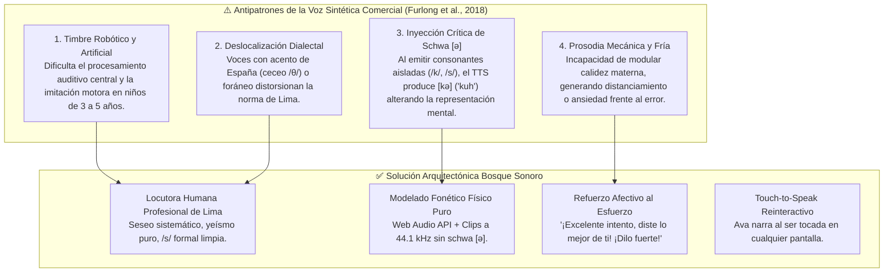
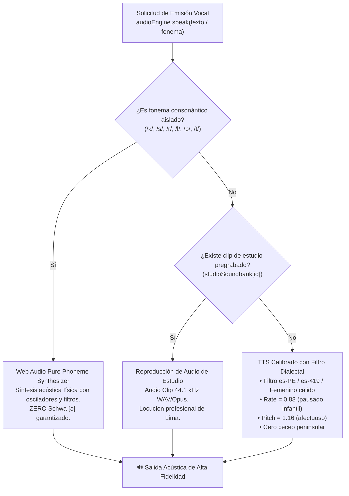

# 🎙️ Especificación Técnica de Locución Dialectal de Ava, Curaduría Acústica y Erradicación de Schwa `[ə]`

> **Fuente Única de Verdad (SSOT):** Esta especificación técnica y clínica establece las directrices normativas para la voz de **Ava la Abejita Fónica**, tutora y mascota guía de la aplicación *Bosque Sonoro*. Sustenta la transición obligatoria desde la voz sintética preliminar del prototipo hacia un **motor híbrido con banco de estudio humano profesional grabado en Lima Metropolitana a 44.1 kHz** y **síntesis fonoacústica física pura libre de vocal neutra**.

---

## 1. 🔍 Diagnóstico: ¿Por qué la voz preliminar no puede ser la definitiva?

En las fases tempranas del prototipo interactivo, la locución se implementó mediante la interfaz genérica `SpeechSynthesisUtterance` de la Web Speech API del navegador. Aunque funcional para validar flujos de pantalla, **la evidencia científica de la literatura fonoaudiológica e IHC descarta categóricamente el uso de voces sintéticas en la versión final**:



---

## 2. 🇵🇪 Criterio 1: Localización Dialectal y Norma Culta de Lima Metropolitana

La aplicación está diseñada para la población preescolar de Lima Metropolitana. Según las investigaciones sociolingüísticas y fonológicas aplicadas a la educación inicial (*Huertas & Roque, 2023; Caravedo, 1990*), la voz de Ava debe ceñirse estrictamente a las siguientes características:

1. **Seseo Sistemático:** No existe distinción entre los fonemas `/s/` y `/θ/`. Las grafías *c* (ante *e*, *i*), *z* y *s* se articulan uniformemente como la fricativa alveolar sorda $[s]$. Queda terminantemente prohibido el ceceo peninsular.
2. **Yeísmo sin Rehilamiento:** Las grafías *ll* e *y* se pronuncian de forma idéntica como una aproximante palatal sonora $[ʝ]$. Se prohíbe el rehilamiento porteño/rioplatense ($[ʃ]$ o $[ʒ]$).
3. **Conservación Plena de la `/s/` Implosiva y Final:** En el habla infantil formal de Lima Metropolitana, la `/s/` al final de sílaba o palabra se articula de manera nítida como sibilante pura $[s]$, sin aspiración ($[h]$) ni elisión, rasgos fundamentales para el modelado fonológico infantil correcto.
4. **Locución Humana Natural en Estudio:** La locución de producción debe ser interpretada exclusivamente por una **locutora humana profesional nativa de Lima Metropolitana**, dotada de experiencia en pedagogía infantil temprana, garantizando modulación empática, articulación clara y resonancia acogedora.

---

## 3. 🚫 Criterio 2: Modelado Fonético Puro y Prohibición Estricta de la Schwa `[ə]`

El estudio sistemático de 132 aplicaciones fonoaudiológicas realizado por **Furlong et al. (2018) en *PLOS ONE*** demostró que uno de los errores más graves y extendidos es la **adición parasitaria de la vocal neutra *schwa* $[ə]$** al modelar consonantes aisladas.

### 3.1. El Mecanismo del Antipatrón vs. La Emisión Pura
- **Antipatrón Comercial:** Al solicitar al niño que discrimine o repita el fonema oclusivo velar sordo `/k/`, las apps comerciales reproducen `[kə]` (*"kuh"* o *"ka"*). Esto provoca que el menor almacene una estructura silábica CV en lugar del segmento consonántico C, distorsionando la conciencia fonológica y cronificando dislalias.
- **Norma Bosque Sonoro:** Todo fonema aislado debe emitirse como **sonido consonántico sordo o sonoro puro**:
  - `/k/`: Oclusión velar sorda pura $[k]$ (burst transitorio de 20 ms sin desprendimiento vocálico).
  - `/s/`: Fricativa alveolar sorda pura $[s]$ (flujo de fricación limpio entre 5.0 y 7.5 kHz).
  - `/p/`: Oclusión bilabial sorda pura $[p]$ (pulso de presión de 15 ms a 650 Hz).
  - `/t/`: Oclusión dental sorda pura $[t]$ (burst transitorio agudo a 3.6 kHz).
  - `/r/`: Vibrante alveolar simple pura $[ɾ]$ (un único tap lingual percusivo a 25 Hz).
  - `/rr/`: Vibrante alveolar múltiple pura $[r]$ (tren de 3 a 4 pulsos sin vocal final).

```
Antipatrón comercial:  /k/ ---> [ k ] + [ ə ]  ("kuh") ❌ VIOLACIÓN CLÍNICA
Norma Bosque Sonoro:   /k/ ---> [ k ]           ("k")   ✅ FONÉTICA PURA
```

### 3.2. Prohibición de Prolongaciones Desnaturalizadas
Las palabras estímulo del banco **Bosch & Melgar** (ej. *"sol"*, *"pera"*, *"lápiz"*) deben pronunciarse con la duración vocálica natural del español limeño formal, erradicando distorsiones o estiramientos exagerados que desfiguren el patrón prosódico natural.

---

## 4. 💖 Criterio 3: Tono Emocional, Cálido y No Punitivo

La neurociencia del aprendizaje y el diseño de interacción para niños con dislalia funcional (*Strömbergsson et al., 2026; Saeedi et al., 2024*) evidencian que los estímulos aversivos (ruidos secos, zumbadores, alertas rojas o frases como *"incorrecto"*) desencadenan ansiedad articulatoria y abandono de la actividad.

### 4.1. Principios Operativos de la Voz de Ava
1. **Refuerzo Orientado al Esfuerzo (*Effort-Based Reinforcement*):** Se premia la persistencia y la participación voluntaria.
2. **Ambiente Acústico Empático:** Antes de emitir una frase de aliento tras un intento no consolidado, el sistema reproduce un acorde armónico dulce en frecuencias no invasivas (tríada F4 $\rightarrow$ A4 $\rightarrow$ C5 en ondas senoidales puras).
3. **Frases Validadas de Aliento:**
   - *"¡Excelente intento, diste lo mejor de ti! ¡Dilo fuerte!"*
   - *"¡Qué gran esfuerzo amiguito! Escuchemos juntos y vuelve a tocar el gran botón."*
   - *"¡Muy bien intentado! Tú tienes una voz maravillosa, vamos a decirlo una vez más."*
   - *"¡Me encanta cómo practicas! Escucha cómo vuela mi sonido y repite conmigo."*
4. **Rescate Asistido DDA:** Si tras 3 intentos el niño no logra consolidar la palabra, Ava no lo califica negativamente; le otorga una estrella dorada por persistencia y le dice con afecto:
   > *"¡Qué gran esfuerzo amigo! Mira en la pantalla cómo colocamos la lengua para que sea más fácil."*

---

## 5. 👆 Criterio 4: Guía No Textual (*Spoken Read-Aloud*) e Interactividad Táctil

Dado que los usuarios meta son **pre-lectores estrictos de 3 a 5 años**, el paradigma de interacción es **100% Voice-First** (*Du et al., 2023*):

1. **Locución Completa de Consignas:** Todas las instrucciones de los 6 vagones lúdicos (trabalenguas, rimas, adivinanzas, camino de flores, bingo sonoro y pares mínimos) son narradas automáticamente por Ava en voz alta.
2. **Respuesta Táctil Reinteractiva (*Touch-to-Speak*):**
   - El avatar de Ava no es una imagen estática. En cualquier pantalla del sistema (menú principal, zona de práctica landscape, pares mínimos, bingo sonoro y camino de flores), al tocar directamente a Ava:
     - **Micro-animación reactiva:** Ava ejecuta un salto elástico con aleteo alegre (`.ava-tapped`).
     - **Chime dulce:** Sonido cálido de campana pentatónica.
     - **Locución de apoyo:** Ava repite afablemente la instrucción contextual o brinda una pista auditiva.

---

## 6. 🎚️ Criterio 5: Parámetros Técnicos de Grabación en Estudio (>= 44.1 kHz)

Para garantizar una inteligibilidad acústica óptima y compatibilidad con el pipeline de Web Audio API del prototipo:

| Parámetro Acústico | Especificación de Estudio | Justificación Técnica / Fonoaudiológica |
| :--- | :--- | :--- |
| **Frecuencia de Muestreo** | **$\ge 44.1\text{ kHz}$** (44,100 muestras/segundo) | Captura fidedigna de las altas frecuencias de consonantes fricativas y sibilantes ($[s]$ alcanza hasta 8-10 kHz). |
| **Profundidad de Bits** | **16 bits PCM lineal** (Master 24 bits) | Rango dinámico $>90\text{ dB}$, preservando los matices sutiles de la fonación infantil y de la locutora. |
| **Piso de Ruido Acústico** | $< -60\text{ dBFS}$ | Estudio insonorizado profesional libre de ruidos ambientales, ecos o interferencias de red. |
| **Relación Señal/Ruido (SNR)** | $\ge 45\text{ dB}$ | Claridad acústica prístina requerida para niños con retraso fonológico o dificultades auditivas. |
| **Loudness Normalizado** | $-18\text{ LUFS} \pm 1\text{ LU}$ | Nivel de sonoridad uniforme en todas las pistas para evitar sobresaltos acústicos en preescolares. |
| **Formatos de Entrega** | `.wav` (Master sin pérdida) y `.webm` (Opus 128 kbps) / `.mp3` (320 kbps) | Eficiencia de carga en navegadores web móviles sin degradación perceptual. |

---

## 7. 🏗️ Arquitectura Técnica en el Prototipo (`audio-engine.js`)

El prototipo interactivo implementa un **motor fonoacústico de tres niveles jerárquicos**:



---

## 8. 📜 Guion de Grabación de Estudio para la Locutora Profesional (Extracto)

A continuación se indexa el guion maestro estructurado en el archivo de manifiesto [`Proyecto/Prototipo/assets/audio/manifest.json`](file:///d:/.Antigravity/IHC/Proyecto/Prototipo/assets/audio/manifest.json):

### A. Consignas Generales y Navegación
1. `bienvenida_menu`: *"¡Hola amiguito! Soy Ava la abejita fónica. ¡Toca un vagón del tren para jugar conmigo!"*
2. `consigna_trabalenguas`: *"Vamos a jugar con el trabalenguas. Escucha con atención, toca el gran botón y dilo fuerte."*
3. `consigna_rimas`: *"¿Qué palabra rima? Escucha el sonido y encuentra la palabra que suena igual."*
4. `consigna_carrera`: *"¡Pronuncia la palabra para que mis alitas vuelen de flor en flor hasta la colmena real!"*
5. `consigna_bingo`: *"¡Bingo sonoro! Escucha el sonido y toca el dibujo que tiene ese sonido."*

### B. Modelos Fonéticos Consonánticos Puros (Sin Schwa `[ə]`)
1. `fonema_k`: Emisión oclusiva velar sorda pura `[k]` (sin añadir *"kuh"* ni *"ka"*).
2. `fonema_s`: Emisión fricativa alveolar sorda pura `[s]` (soplido continuo sibilante).
3. `fonema_r`: Emisión vibrante alveolar simple pura `[ɾ]` (un solo golpe lingual apical).
4. `fonema_rr`: Emisión vibrante múltiple pura `[r]` (vibración apical sostenida).
5. `fonema_l`: Emisión lateral alveolar líquida `[l]`.
6. `fonema_p`: Emisión oclusiva bilabial sorda pura `[p]` (sin vocal *"puh"*).

### C. Refuerzo Afectivo y Persistencia No Punitiva
1. `aliento_1`: *"¡Excelente intento, diste lo mejor de ti! ¡Dilo fuerte!"*
2. `aliento_2`: *"¡Qué gran esfuerzo amiguito! Escuchemos juntos y vuelve a tocar el botón."*
3. `aliento_3`: *"¡Muy bien intentado! Tú tienes una voz maravillosa, vamos a decirlo una vez más."*
4. `dda_rescate`: *"¡Qué gran esfuerzo amigo! Mira en la pantalla cómo colocamos la lengua para que sea más fácil."*

