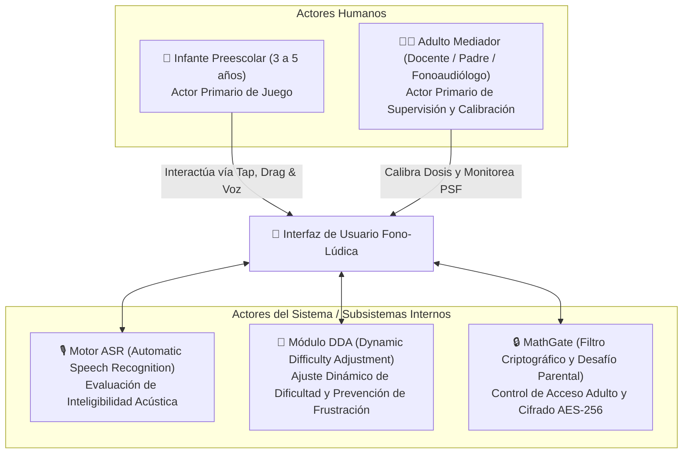
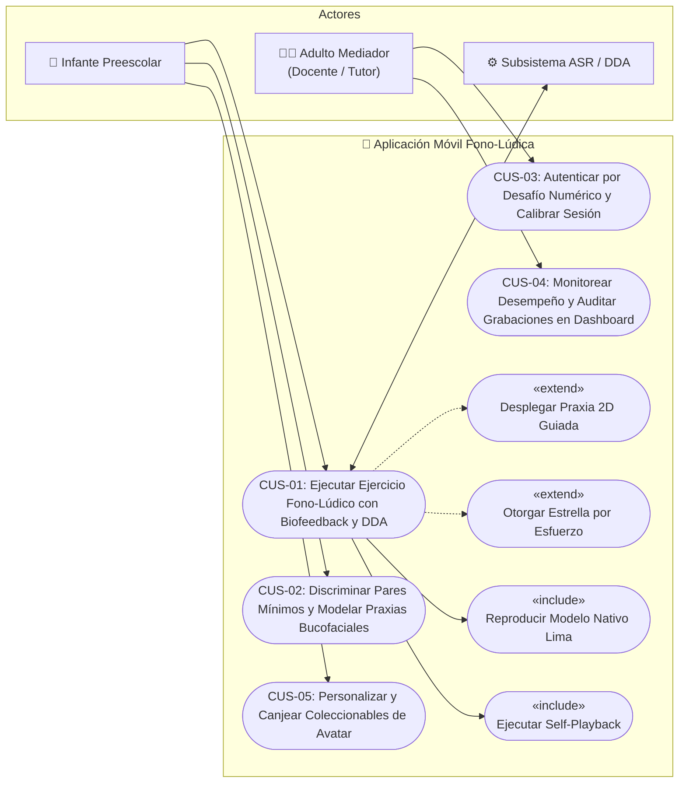
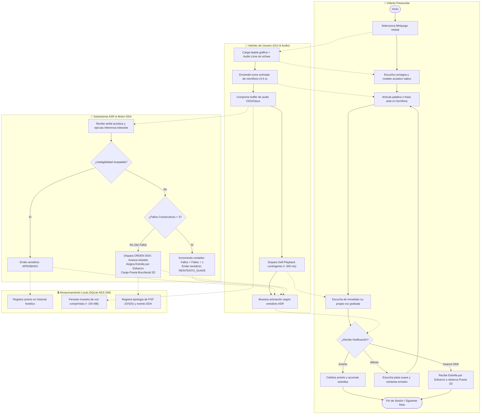
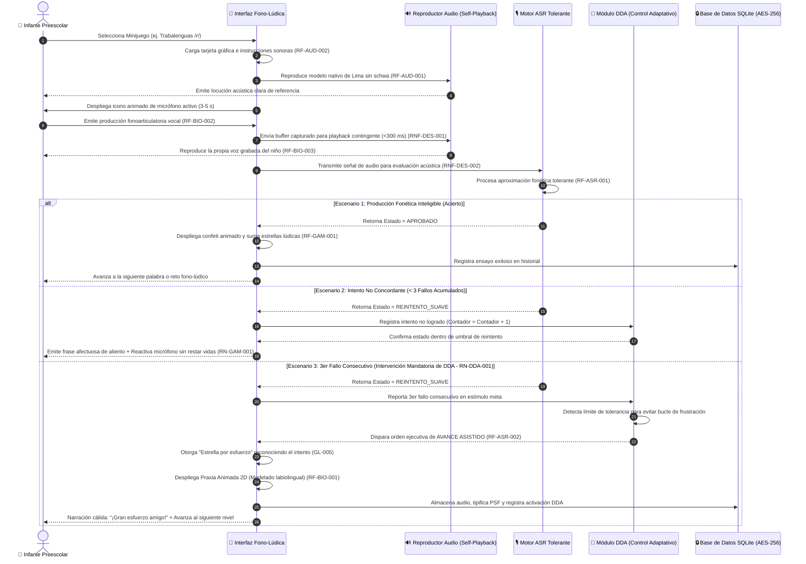
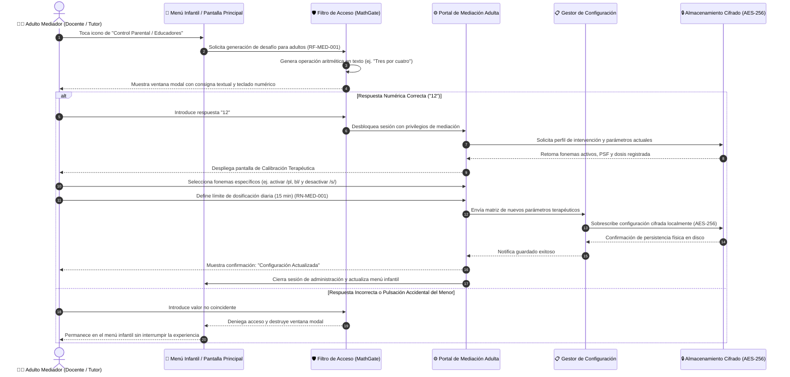
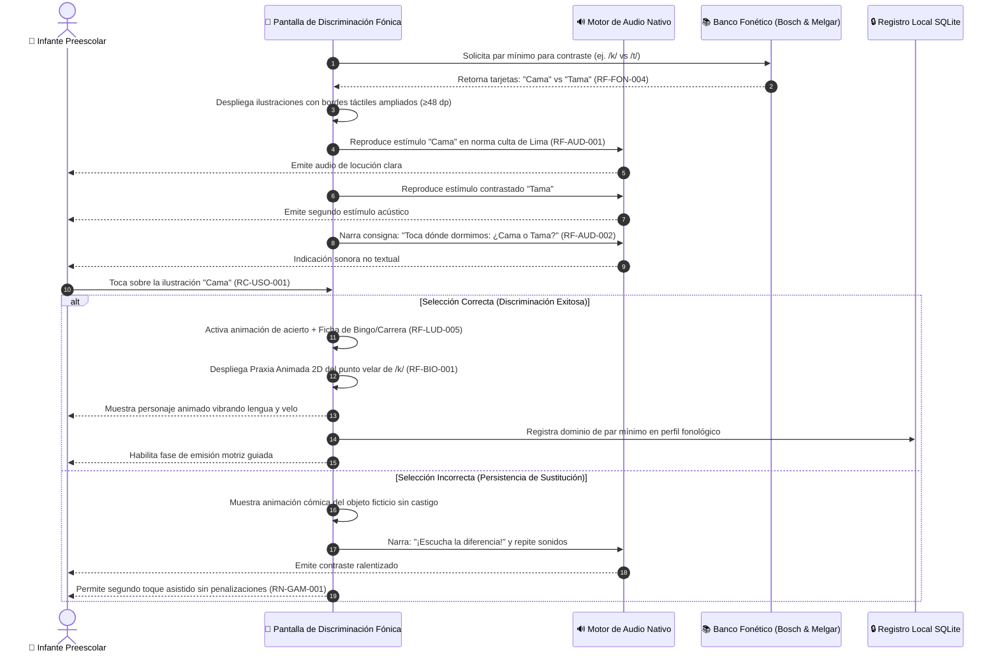
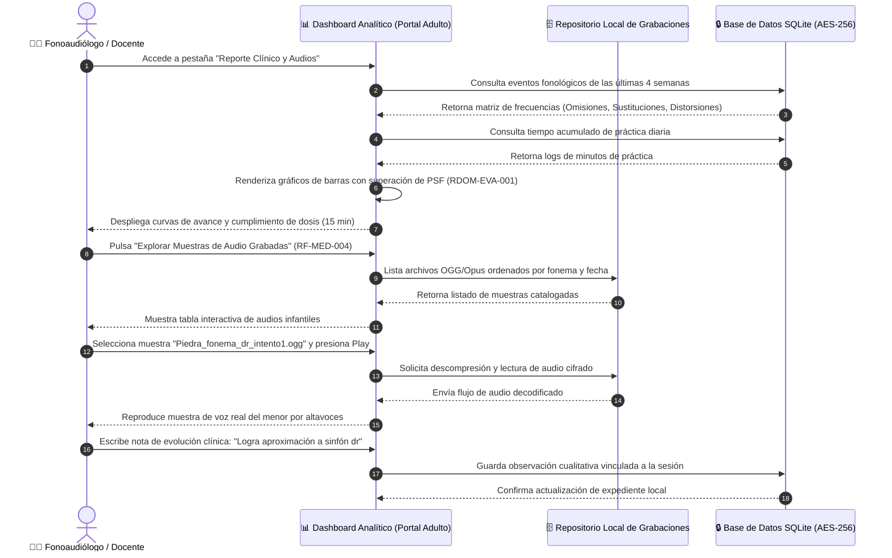

> [!INFO] Marco de Modelado y Trazabilidad
> El presente documento detalla la arquitectura de interacción y los procesos operacionales de la **aplicación móvil fono-lúdica** para niños preescolares (3 a 5 años) de Lima Metropolitana. 
> Ha sido elaborado aplicando la **Skill de Modelado de Procesos de Negocio (BPMN/UML)**, estableciendo la transición del **Espacio del Problema (AS-IS / CUN)** hacia el **Espacio de la Solución (TO-BE / CUS)**, la especificación textual rigurosa bajo la **Plantilla de Ceremonia Estándar (9 campos esenciales)**, diagramas de actividades estructurados con **particiones (*swimlanes*)**, diagramas de secuencia en notación nativa **Mermaid (`sequenceDiagram` con `autonumber`)** y la indexación exhaustiva del **sustento científico de las 10 fichas de antecedentes** en [[Proyecto/Antecedentes/Antecedentes|📁 Repositorio de Antecedentes]].

---

## 👥 1. Identificación y Caracterización de Actores del Sistema



1. **Infante Preescolar (3 a 5 años) [Actor Primario]:** Usuario final no lector. Presenta destrezas motrices finas en desarrollo y un sistema fonológico en consolidación. Interactúa con el sistema mediante toques directos de gran tamaño ($\ge 48\text{ dp}$), arrastre simple (*drag-and-drop*) y emisiones fonéticas captadas por el micrófono *(Fuente: [[Proyecto/Antecedentes/Ficha - Liu et al. (2026) - Criterios de Calidad en Interaccion Nino-Computadora (CCI)|Liu, Chen & Razak, 2026]]; [[Proyecto/Antecedentes/Ficha - Du et al. (2023) - Diseno de Apps para Fonoaudiologia Pediatrica|Du et al., 2023]])*.
2. **Adulto Mediador (Docente de Inicial / Padre de Familia / Fonoaudiólogo) [Actor Primario]:** Responsable de la mediación relacional y la gobernanza terapéutica. Accede a través de un desafío de control parental para calibrar los fonemas meta, monitorear la dosis de práctica (máximo 15 minutos diarios) y evaluar la curva de superación de Procesos de Simplificación Fonológica (PSF) *(Fuente: [[Proyecto/Antecedentes/Ficha - Huertas y Roque (2023) - Dificultades Fonológicas en Docentes Inicial|Huertas & Roque, 2023]]; [[Proyecto/Antecedentes/Ficha - Du et al. (2023) - Diseno de Apps para Fonoaudiologia Pediatrica|Du et al., 2023]])*.
3. **Motor ASR (Automatic Speech Recognition) [Actor Secundario / Subsistema]:** Servicio de procesamiento acústico calibrado para tolerar la variabilidad fónica propia del habla infantil. Analiza la señal de voz capturada por el micrófono y clasifica la inteligibilidad sin aplicar penalizaciones destructivas *(Fuente: [[Proyecto/Antecedentes/Ficha - Saeedi et al. (2024) - Serious Game Ava y Trastornos del Habla|Saeedi et al., 2024]]; [[Proyecto/Antecedentes/Ficha - Strombergsson et al. (2026) - Entrenamiento del Habla con App Pop2TalkNordic y Desafios IHC|Strömbergsson et al., 2026]])*.
4. **Módulo DDA (Dynamic Difficulty Adjustment) [Actor Secundario / Subsistema]:** Componente inteligente que monitoriza el historial de reintentos en tiempo de ejecución. Al detectar 3 intentos fallidos consecutivos en un mismo estímulo, neutraliza el bucle de frustración activando el avance asistido, otorgando estrellas de esfuerzo y reforzando mediante praxias animadas *(Fuente: [[Proyecto/Antecedentes/Ficha - Strombergsson et al. (2026) - Entrenamiento del Habla con App Pop2TalkNordic y Desafios IHC|Strömbergsson et al., 2026]])*.
5. **MathGate & Gestor de Persistencia Local [Actor Secundario / Subsistema]:** Módulo de seguridad que genera desafíos dinámicos para restringir el acceso a adultos y gestiona la base de datos local SQLite con cifrado biométrico AES-256 para muestras de audio *(Fuente: [[Proyecto/Antecedentes/Ficha - Du et al. (2023) - Diseno de Apps para Fonoaudiologia Pediatrica|Du et al., 2023]]; [[Proyecto/Antecedentes/Ficha - Liu et al. (2026) - Criterios de Calidad en Interaccion Nino-Computadora (CCI)|Liu, Chen & Razak, 2026]])*.

---

## 🔀 2. Transición Metodológica: Espacio del Problema (AS-IS) ➔ Espacio de la Solución (TO-BE)

Bajo el marco de ingeniería de procesos, la solución de software transforma radicalmente la práctica fonoarticulatoria tradicional en preescolares:

```mermaid
flowchart TD
    subgraph AS_IS["📉 Espacio del Problema (AS-IS / CUN: Práctica Tradicional en Aula y Hogar)"]
        A1["Docente/Madre presenta tarjeta de cartón"] --> A2["Solicita repetición mecánica del fonema"]
        A2 --> A3{"¿Pronunciación Correcta?"}
        A3 -- No --> A4["Corrección verbal insistente<br>(Riesgo de frustración y bloqueo emocional)"]
        A4 --> A2
        A3 -- Sí --> A5["Aprobación subjetiva sin registro métrico"]
        A5 --> A6["Registro manual en libreta o informe<br>(Carga administrativa y datos discontinuos)"]
    end

    subgraph TO_BE["📈 Espacio de la Solución (TO-BE / CUS: Sistema Fono-Lúdico Digital Asistido)"]
        B1["Avatar narra consigna lúdica (Rima/Trabalenguas/Adivinanza)"] --> B2["Modelado visual 2D de praxias + Audio nativo de Lima"]
        B2 --> B3["Captura de voz por micrófono integrado"]
        B3 --> B4["Biofeedback inmediato de autoescucha (<300 ms)"]
        B4 --> B5["Inferencia acústica tolerante por Motor ASR (<1.2 s)"]
        B5 --> B6{"Evaluación Acústica"}
        B6 -- Aprobado --> B7["Recompensa lúdica inmediata + Avance de nivel"]
        B6 -- Intento Fallido < 3 --> B8["Sonido suave de aliento + Reactivación de micrófono"]
        B6 -- 3er Fallo Consecutivo --> B9["Intervención DDA: Estrella de esfuerzo + Praxia 2D + Avance asistido"]
        B7 --> B10["Telemetría fonoaudiológica cifrada en SQLite (AES-256)"]
        B9 --> B10
        B10 --> B11["Dashboard analítico para docente/padre con control de dosis (15 min)"]
    end
```



### Análisis de Brecha (Gap Analysis)
- **Eliminación del Bucle de Bloqueo:** En el modelo AS-IS, el niño que no logra emitir un fonema difícil (ej. $/r/$) es sometido a repetición insistente, generando rechazo y ansiedad. En el modelo TO-BE, el algoritmo DDA (`RN-DDA-001`) garantiza que tras 3 ensayos se otorgue una recompensa por esfuerzo (`RF-GAM-001`) y se avance sin castigo (`RN-GAM-001`), preservando la motivación intrínseca *(Fuente: [[Proyecto/Antecedentes/Ficha - Strombergsson et al. (2026) - Entrenamiento del Habla con App Pop2TalkNordic y Desafios IHC|Strömbergsson et al., 2026]])*.
- **Inclusión de Biofeedback de Autoescucha:** El modelo AS-IS carece de retroalimentación acústica objetiva para el niño. El modelo TO-BE incorpora la reproducción contingente de la propia voz grabada (*self-playback*, $\le 300\text{ ms}$), mecanismo neurocognitivo que dispara la autoconciencia fonológica y las vocalizaciones activas *(Fuente: [[Proyecto/Antecedentes/Ficha - Pena et al. (2024) - Intervencion con Tabletas y Habilidades Comunicativas en Preescolares (Nature)|Peña et al., 2024]])*.
- **Automatización de Telemetría Clínica:** La docente de inicial no necesita registrar manualmente tablas de errores; el sistema tabula automáticamente las omisiones, sustituciones y distorsiones contra el banco de palabras de Bosch & Melgar *(Fuente: [[Proyecto/Antecedentes/Ficha - Huertas y Roque (2023) - Dificultades Fonológicas en Docentes Inicial|Huertas & Roque, 2023]]; [[Proyecto/Antecedentes/Ficha - Pucuhuaranga (2016) - Juegos Verbales y Articulación Verbal|Pucuhuaranga, 2016]])*.

---

## 🗺️ 3. Diagrama General de Casos de Uso del Sistema (CUS)



---

## 📝 4. Especificación Textual Detallada de Casos de Uso del Sistema (CUS)

### CUS-01: Ejecución de Ejercicio Fono-Lúdico con Biofeedback de Autoescucha y Ajuste Dinámico (DDA)

1. **ID y Nombre:** `CUS-01` - Ejecución de Ejercicio Fono-Lúdico con Biofeedback Inmediato de Autoescucha y Ajuste Dinámico de Dificultad (DDA).
2. **Actores:** 
   - *Primario:* Infante Preescolar (3 a 5 años).
   - *Secundarios:* Motor ASR, Módulo DDA, Base de Datos Local SQLite.
3. **Propósito / Objetivo:** Permitir al infante practicar la pronunciación de un fonema o palabra meta mediante un minijuego verbal (trabalenguas, rima o adivinanza), recibiendo autoescucha inmediata de su propia voz grabada y progresión asistida sin penalizaciones ante fallos reiterados.
4. **Precondiciones:** 
   - El dispositivo móvil tiene el micrófono operativo y los permisos concedidos.
   - El sistema tiene habilitado al menos un fonema meta según la edad del infante (`RF-FON-001`).
   - La aplicación opera en modo local offline (`RNF-DIS-001`, `RST-DIS-001`).
5. **Disparador (Trigger):** El infante pulsa sobre una tarjeta de minijuego verbal en la pantalla principal.
6. **Flujo Principal de Eventos:**
   1. El infante selecciona un minijuego verbal (Trabalenguas `RF-LUD-001`, Rimas `RF-LUD-002` o Adivinanzas `RF-LUD-003`).
   2. El sistema carga la tarjeta gráfica ilustrada y reproduce la consigna hablada (*spoken read-aloud*) (`RF-AUD-002`).
   3. El sistema reproduce el estímulo acústico modelo en norma culta del español de Lima Metropolitana, sin inserción de vocal neutra (*schwa*) (`RF-AUD-001`, `RDOM-FON-001`).
   4. El sistema despliega el icono animado de micrófono y emite una señal sonora amigable de inicio de captura (`RF-BIO-002`).
   5. El infante pronuncia la palabra o frase meta ante el micrófono del dispositivo.
   6. Al concluir la emisión (o expirar la ventana de captura de 3 a 5 s), el sistema comprime el buffer de audio localmente.
   7. El sistema ejecuta el **biofeedback de autoescucha inmediata (*self-playback*)**, reproduciendo la voz grabada del menor por el altavoz con una latencia inferior a $300\text{ ms}$ (`RF-BIO-003`, `RNF-DES-001`).
   8. Simultáneamente, el sistema remite la muestra de audio al Motor ASR local para su inferencia fonética (`RNF-DES-002`).
   9. El Motor ASR evalúa la inteligibilidad de forma tolerante (`RF-ASR-001`).
   10. Si la emisión es inteligible, el sistema activa una animación celebratoria festiva, suma estrellas de recompensa lúdica al perfil (`RF-GAM-001`) y registra el evento de éxito en la base de datos local SQLite.
   11. El sistema avanza automáticamente a la siguiente estación o tarjeta lúdica.
7. **Flujos Alternativos y Excepciones:**
   - **FA-1: Intento No Concordante con $< 3$ Fallos Acumulados (`RN-GAM-001`):**
     1. Si el Motor ASR clasifica la emisión con omisión o sustitución severa, el sistema evita emitir zumbadores, cruces rojas o restar puntos (`RN-GAM-001`).
     2. El sistema reproduce un sonido suave de aliento narrado por el avatar (*"¡Casi lo tienes! Escucha otra vez e inténtalo de nuevo"*).
     3. El sistema incrementa en $+1$ el contador de fallos del estímulo en el Módulo DDA y reabre el micrófono para un nuevo ensayo.
   - **FA-2: Tercer Fallo Consecutivo e Intervención Mandatoria del Módulo DDA (`RN-DDA-001`):**
     1. Al registrarse el 3.er intento no concordante consecutivo, el Módulo DDA intercepta el flujo (`RF-ASR-002`).
     2. El sistema otorga de inmediato una **"Estrella por esfuerzo"** reconociendo la perseverancia del niño (`RF-GAM-001`, `GL-005`).
     3. El sistema despliega en pantalla una **praxia animada 2D** que modela en cámara lenta la posición de labios y lengua para dicho fonema (`RF-BIO-001`).
     4. El sistema registra el evento DDA y clasifica el error fonológico en la base de datos local (`RDOM-EVA-001`).
     5. El sistema avanza automáticamente al siguiente ejercicio asistido para prevenir bucles de frustración y rechazo al juego.
   - **FA-3: Ruido Ambiental o Ausencia de Entrada Vocal:**
     1. Si el micrófono no detecta energía vocal infantil tras 5 segundos, el sistema cancela la captura sin penalizar, reproduce una vibración suave y el avatar reitera la invitación: *"¿Estás listo? ¡Dilo fuerte!"*.
8. **Postcondiciones:**
   - Se actualiza el balance de estrellas y coleccionables del infante.
   - La muestra de audio queda comprimida en formato OGG/Opus y almacenada localmente con cifrado AES-256 (`RC-SEG-001`, `RNF-ALM-001`).
   - El contador de intentos del estímulo se reinicia para el siguiente nivel.
9. **Requisitos Asociados y Sustento Científico Indexado:**
   - *Requisitos:* `RF-LUD-001` a `RF-LUD-003`, `RF-FON-002`, `RF-BIO-002`, `RF-BIO-003`, `RF-ASR-001`, `RF-ASR-002`, `RF-GAM-001`, `RF-AUD-001`, `RF-AUD-002`, `RN-DDA-001`, `RN-GAM-001`, `RNF-DES-001`, `RNF-DES-002`, `RC-USO-001`.
   - *Sustento Científico:* 
     - [[Proyecto/Antecedentes/Ficha - Pena et al. (2024) - Intervencion con Tabletas y Habilidades Comunicativas en Preescolares (Nature)|Peña et al. (2024)]]: Valida el patrón de biofeedback de autoescucha inmediata y ganancias en vocalizaciones activas ($p < 0.001$).
     - [[Proyecto/Antecedentes/Ficha - Strombergsson et al. (2026) - Entrenamiento del Habla con App Pop2TalkNordic y Desafios IHC|Strömbergsson et al. (2026)]]: Fundamenta la necesidad del DDA tras detectar que 16 intentos fallidos destruyen la experiencia de usuario y causan frustración.
     - [[Proyecto/Antecedentes/Ficha - Saeedi et al. (2024) - Serious Game Ava y Trastornos del Habla|Saeedi et al. (2024)]]: Demuestra la eficacia del refuerzo operante positivo sin castigos en serious games móviles.

---

### CUS-02: Discriminación Auditiva con Pares Mínimos y Modelado Bucofacial (Praxias 2D)

1. **ID y Nombre:** `CUS-02` - Discriminación Auditiva con Pares Mínimos y Modelado Bucofacial de Praxias Animadas.
2. **Actores:** 
   - *Primario:* Infante Preescolar (3 a 5 años).
   - *Secundario:* Sistema (Módulo de Contenido Fonético y Animaciones).
3. **Propósito / Objetivo:** Desarrollar la agudeza perceptiva y la conciencia fonológica del menor permitiéndole contrastar parejas de palabras que difieren en un único fonema antes de exigirle la producción motriz.
4. **Precondiciones:** El infante ha seleccionado un fonema de contraste o el sistema ha identificado un patrón recurrente de sustitución en sesiones previas (ej. oclusivización de fricativas o anteriorización velar).
5. **Disparador (Trigger):** El sistema inicia un ejercicio preparatorio de discriminación fonémica dentro de la progresión de Van Riper (`RF-FON-003`).
6. **Flujo Principal de Eventos:**
   1. El sistema presenta en pantalla dos ilustraciones correspondientes a un par mínimo fonético (ej. *Cama* vs. *Tama*, o *Sol* vs. *Tol*) (`RF-FON-004`).
   2. El avatar virtual reproduce de forma alternada la locución de ambos términos, resaltando visualmente la ilustración activa mediante un contorno pulsante (`RF-AUD-001`).
   3. El sistema formula una consigna hablada interactiva solicitando al menor tocar el objeto real (ej. *"Toca dónde dormimos por las noches: ¿Cama o Tama?"*).
   4. El infante realiza un toque simple sobre la imagen correcta (`RC-USO-001`).
   5. El sistema reproduce una animación de acierto y despliega al personaje animado mostrando la **praxia bucofacial 2D** del fonema contrastado (posición lingual y escape de aire) (`RF-BIO-001`).
   6. El infante observa el modelado bucofacial y el sistema le solicita imitar el movimiento labiolingual frente a la pantalla.
   7. El sistema registra el acierto de discriminación auditiva y avanza al módulo de producción vocal.
7. **Flujos Alternativos y Excepciones:**
   - **FA-1: Selección del Estímulo Sustituido / Incorrecto:**
     1. Si el menor selecciona la palabra incorrecta (*Tama*), el sistema reproduce la animación correspondiente al término ficticio con humor amigable (un dibujo divertido sin sentido).
     2. El avatar interviene narrando: *"¡Oh! Ese objeto suena raro... Escucha la diferencia"*.
     3. El sistema reproduce nuevamente el contraste auditivo en cámara lenta y permite un segundo intento guiado sin penalización.
8. **Postcondiciones:** El sistema registra en el perfil del menor el nivel de dominio en discriminación fónica del par mínimo evaluado.
9. **Requisitos Asociados y Sustento Científico Indexado:**
   - *Requisitos:* `RF-FON-004`, `RF-BIO-001`, `RF-FON-003`, `RF-AUD-001`, `RN-FON-001`, `RC-ACC-001`.
   - *Sustento Científico:*
     - [[Proyecto/Antecedentes/Ficha - Mora et al. (2024) - Programa Lúdico Fonológico y Dislalia Funcional|Mora et al. (2024)]]: Demuestra que el entrenamiento fono-lúdico de contraste elimina el 100% de dislalias graves y normaliza el habla en el 74% de preescolares.
     - [[Proyecto/Antecedentes/Ficha - Pucuhuaranga (2016) - Juegos Verbales y Articulación Verbal|Pucuhuaranga (2016)]]: Justifica las praxias labiales y linguales (Fases 1 y 2 de la metodología bucofacial) como precondición fisiológica para la emisión correcta.
     - [[Proyecto/Antecedentes/Ficha - Furlong et al. (2018) - Analisis de Calidad y Eficacia de Apps en Trastornos del Habla (MARS)|Furlong et al. (2018)]]: Exige la erradicación de modelos con vocal neutra (*schwa*) o palabras contaminadas en pares mínimos.

---

### CUS-03: Autenticación por Desafío Numérico y Calibración Terapéutica en Portal de Mediación Adulta

1. **ID y Nombre:** `CUS-03` - Autenticación por Desafío Numérico y Calibración Terapéutica en Portal de Mediación Adulta.
2. **Actores:** 
   - *Primario:* Adulto Mediador (Docente de Inicial / Tutor / Fonoaudiólogo).
   - *Secundarios:* Módulo de Seguridad (MathGate), Gestor de Configuración Local.
3. **Propósito / Objetivo:** Proporcionar un canal protegido y exclusivo para adultos que permita calibrar los fonemas objetivo, regular la dosificación diaria de práctica y ajustar los parámetros de asistencia sin interferencia de los menores.
4. **Precondiciones:** La aplicación móvil se encuentra activa en el menú principal o durante una pausa de actividad.
5. **Disparador (Trigger):** El adulto mediador presiona el botón de acceso con icono de candado / engranaje ("Zona de Educadores y Padres").
6. **Flujo Principal de Eventos:**
   1. El adulto presiona el acceso al área protegida.
   2. El subsistema MathGate intercepta la petición y genera un desafío aritmético o de comprensión textual aleatorio en texto (ej. *"Resuelve: Tres por cuatro"* o *"¿Cuánto es 8 menos 3?"*) (`RF-MED-001`).
   3. El adulto introduce la respuesta correcta en el teclado numérico de la ventana modal.
   4. MathGate valida la respuesta y desbloquea el **Portal de Mediación Adulta**.
   5. El sistema carga los parámetros fonoaudiológicos actuales del niño desde la base de datos local SQLite cifrada con AES-256 (`RC-SEG-001`).
   6. El adulto personaliza la sesión:
      - Activa o desactiva fonemas específicos a intervenir (ej. priorizar sinfones laterales $/pl, bl/$ o vibrantes $/r, rr/$) (`RF-MED-002`).
      - Ajusta el límite de tiempo de exposición diaria recomendada (fijado por defecto en 15 minutos) (`RN-MED-001`).
      - Modifica la sensibilidad del micrófono y el umbral de pistas articulatorias.
   7. El adulto presiona "Guardar y Aplicar Cambios".
   8. El Gestor de Configuración persiste los nuevos parámetros en almacenamiento local y emite un mensaje de confirmación.
   9. El sistema retorna a la interfaz infantil aplicando la nueva configuración en las sesiones subsecuentes.
7. **Flujos Alternativos y Excepciones:**
   - **FA-1: Respuesta Errónea (Intento de Manipulación por el Infante):**
     1. Si se ingresa una respuesta incorrecta, MathGate bloquea el acceso, cierra inmediatamente la ventana modal y regresa a la pantalla infantil sin alterar ningún parámetro.
   - **FA-2: Alerta de Tiempo de Sesión Excedido:**
     1. Si el menor ha alcanzado los 15 minutos continuos de práctica sugeridos, el portal genera una recomendación amigable al adulto para hacer una pausa motriz fuera de pantalla.
8. **Postcondiciones:**
   - Los parámetros de personalización quedan almacenados de forma segura en local.
   - El repertorio de estímulos fono-lúdicos del menor queda reconfigurado según el criterio del fonoaudiólogo o docente.
9. **Requisitos Asociados y Sustento Científico Indexado:**
   - *Requisitos:* `RF-MED-001`, `RF-MED-002`, `RN-MED-001`, `RST-ETI-001`, `RST-LEG-001`, `RC-SEG-001`, `RNF-DIS-001`.
   - *Sustento Científico:*
     - [[Proyecto/Antecedentes/Ficha - Du et al. (2023) - Diseno de Apps para Fonoaudiologia Pediatrica|Du et al. (2023)]]: Destaca la Pauta 1 de diseño IHC: controles de *back-end* para que el clínico regule la dosis terapéutica (15 min/sesión) y personalice los ensayos.
     - [[Proyecto/Antecedentes/Ficha - Liu et al. (2026) - Criterios de Calidad en Interaccion Nino-Computadora (CCI)|Liu, Chen & Razak (2026)]]: Fundamenta la Capa 3 (Mediación Adulta) y la Capa 4 (Gobernanza y Ética) del Marco Ecológico CCI.

---

### CUS-04: Monitoreo de Desempeño, Dosis Diaria y Auditoría de Audios en Dashboard Fonoaudiológico

1. **ID y Nombre:** `CUS-04` - Monitoreo de Desempeño, Dosis Diaria y Auditoría de Muestras de Audio en Dashboard Clínico.
2. **Actores:** 
   - *Primario:* Fonoaudiólogo / Docente de Inicial / Adulto Mediador.
   - *Secundario:* Repositorio Local de Audio, Base de Datos SQLite.
3. **Propósito / Objetivo:** Proveer al docente o fonoaudiólogo una herramienta analítica visual para auditar las grabaciones de voz del infante, revisar el cumplimiento de la dosis terapéutica y medir la reducción sistemática de Procesos de Simplificación Fonológica (PSF).
4. **Precondiciones:** El adulto ha superado la autenticación de control parental (`CUS-03`) y el menor ha completado al menos una sesión de juego fono-lúdico.
5. **Disparador (Trigger):** El adulto selecciona la pestaña "Dashboard de Desempeño y Muestras de Audio".
6. **Flujo Principal de Eventos:**
   1. El sistema consulta la base de datos local SQLite y recopila las métricas agregadas de sesiones de las últimas 4 semanas.
   2. El sistema renderiza un panel visual con gráficos de barras y líneas que ilustran:
      - Tasa global de inteligibilidad fonética.
      - Gráfica comparativa de errores por tipología: Omisiones, Sustituciones y Distorsiones (`RDOM-EVA-001`).
      - Registro de minutos de práctica semanales frente a la dosis recomendada (`RN-MED-001`).
      - Desglose por fonema del banco de 32 palabras de Bosch & Melgar en posiciones inicial, medial y final (`RF-FON-002`).
   3. El fonoaudiólogo accede a la sección "Repositorio de Muestras de Voz" (`RF-MED-004`).
   4. El sistema despliega el listado cronológico de grabaciones ordenadas por fecha, fonema meta y resultado del ASR.
   5. El especialista pulsa el botón de reproducción de una muestra específica; el sistema decodifica el audio local OGG/Opus y lo reproduce con alta fidelidad.
   6. El especialista añade una anotación cualitativa clínica en el perfil del menor (ej. *"Se observa correcta colocación lingual en /r/ inicial"*).
   7. El sistema guarda la anotación y actualiza el reporte clínico local.
7. **Flujos Alternativos y Excepciones:**
   - **FA-1: Exportación Segura de Informe en PDF:**
     1. El docente selecciona "Exportar Informe de Progreso".
     2. El sistema compila las gráficas y estadísticas en un documento PDF local cifrado, sin transferir datos a servidores externos, garantizando el cumplimiento de la Ley 29733 (`RC-SEG-001`, `RST-LEG-001`).
   - **FA-2: Almacenamiento Saturado de Muestras de Voz (`RNF-ALM-001`):**
     1. Si el espacio ocupado por grabaciones supera los $150\text{ MB}$, el sistema sugiere al adulto purgar las grabaciones de sesiones superadas preservando las métricas cuantitativas.
8. **Postcondiciones:** El fonoaudiólogo o docente obtiene evidencia objetiva y trazable de la evolución articulatoria del infante para su intervención multidisciplinaria.
9. **Requisitos Asociados y Sustento Científico Indexado:**
   - *Requisitos:* `RF-MED-003`, `RF-MED-004`, `RF-FON-002`, `RDOM-EVA-001`, `RN-MED-001`, `RNF-ALM-001`, `RC-SEG-001`, `RC-CAL-001`.
   - *Sustento Científico:*
     - [[Proyecto/Antecedentes/Ficha - Huertas y Roque (2023) - Dificultades Fonológicas en Docentes Inicial|Huertas & Roque (2023)]]: Resuelve la brecha diagnóstica de las docentes de Lima Metropolitana proporcionando métricas automatizadas de PSF.
     - [[Proyecto/Antecedentes/Ficha - Pucuhuaranga (2016) - Juegos Verbales y Articulación Verbal|Pucuhuaranga (2016)]]: Proporciona el instrumento y el banco de 32 palabras de prueba de Bosch & Melgar para la medición cuantitativa de errores articulatorios.
     - [[Proyecto/Antecedentes/Ficha - Pena et al. (2024) - Intervencion con Tabletas y Habilidades Comunicativas en Preescolares (Nature)|Peña et al. (2024)]]: Valida la batería estandarizada TEPROSIF para documentar el progreso fonoaudiológico.

---

### CUS-05: Personalización y Canje de Coleccionables por Esfuerzo en el Avatar Infantil

1. **ID y Nombre:** `CUS-05` - Personalización y Canje de Coleccionables por Esfuerzo en el Avatar Infantil.
2. **Actores:** 
   - *Primario:* Infante Preescolar (3 a 5 años).
   - *Secundario:* Subsistema de Gamificación y Personalización.
3. **Propósito / Objetivo:** Mantener un alto compromiso (*engagement*) y motivación intrínseca a largo plazo permitiendo al niño utilizar las estrellas ganadas por esfuerzo para personalizar su personaje virtual guía.
4. **Precondiciones:** El infante cuenta con estrellas lúdicas o coleccionables acumulados tras completar ejercicios fono-lúdicos (`CUS-01`).
5. **Disparador (Trigger):** El infante pulsa sobre el avatar en la pantalla principal o selecciona el icono de la "Cueva del Avatar".
6. **Flujo Principal de Eventos:**
   1. El sistema carga la pantalla del avatar interactivo, mostrando la mascota elegida y el contador visual de estrellas acumuladas (`RF-GAM-001`).
   2. El sistema despliega un carrusel iconográfico táctil de accesorios estéticos (sombreros divertidos, gafas, capas, colores de pelaje) (`RF-GAM-002`).
   3. Cada elemento muestra su costo en estrellas mediante un icono visual comprensible para no lectores.
   4. El menor toca un accesorio deseado; el sistema lo equipa temporalmente en el avatar con una animación simpática de prueba.
   5. El menor pulsa el botón de confirmación ("¡Me gusta!"); el sistema descuenta las estrellas del balance local y guarda la apariencia personalizada del personaje.
   6. El avatar verbaliza una felicitación afectuosa (*"¡Mira qué bien me veo! ¡Gracias amigo!"*) (`RF-AUD-002`).
   7. El nuevo aspecto del avatar acompaña al niño en todas las dinámicas y praxias bucofaciales posteriores.
7. **Flujos Alternativos y Excepciones:**
   - **FA-1: Estrellas Insuficientes:**
     1. Si el menor selecciona un accesorio cuyo costo excede sus estrellas acumuladas, el sistema no emite sonidos negativos.
     2. El avatar narra con entusiasmo: *"¡Pronto lo conseguiremos! Sigamos jugando trabalenguas para juntar más estrellas"*.
8. **Postcondiciones:** La configuración estética del avatar queda guardada en las preferencias locales del perfil del niño.
9. **Requisitos Asociados y Sustento Científico Indexado:**
   - *Requisitos:* `RF-GAM-001`, `RF-GAM-002`, `RF-AUD-002`, `RC-USO-001`, `RST-ETI-001`.
   - *Sustento Científico:*
     - [[Proyecto/Antecedentes/Ficha - Du et al. (2023) - Diseno de Apps para Fonoaudiologia Pediatrica|Du et al. (2023)]]: Destaca la Pauta 5 (Personalización) demostrando que los avatares seleccionados por el niño sostienen la adherencia a la terapia.
     - [[Proyecto/Antecedentes/Ficha - Saeedi et al. (2024) - Serious Game Ava y Trastornos del Habla|Saeedi et al. (2024)]]: Demuestra una valoración estética positiva del 100% en niños preescolares al usar personajes amigables y recompensas visuales.

---

## 📊 5. Diagrama de Actividades con Particiones (Swimlanes)

El siguiente diagrama detalla la lógica de bifurcaciones, bucles de reintento, activación del algoritmo DDA y persistencia local distribuyendo las responsabilidades en cuatro particiones funcionales:



---

## ⏱️ 6. Diagramas de Secuencia Mermaid (Mensajería Cronológica Detallada)

### Diagrama 1: Ciclo de Ejecución Fono-Lúdica, Autoescucha ($<300\text{ ms}$), ASR Tolerante y DDA
*Detalla la interacción precisa entre el niño, la GUI, el hardware de audio, el motor ASR y la intervención de DDA al tercer intento fallido.*



---

### Diagrama 2: Autenticación por Desafío Numérico (MathGate) y Calibración en Control Parental
*Representa la protección del portal adulto y la configuración de dosificación clínica de 15 minutos.*



---

### Diagrama 3: Discriminación con Pares Mínimos, Modelado 2D de Praxias y Locución Nativa
*Ilustra la dinámica de contraste fonológico previo a la emisión motriz.*



---

### Diagrama 4: Monitoreo de Dosis Diaria, Auditoría de Muestras y Reporte en Dashboard
*Representa la consulta analítica y reproducción clínica de grabaciones por el fonoaudiólogo o docente.*



---

## 📊 7. Matriz de Trazabilidad Integral (RTM) con Indexación a Antecedentes

La siguiente matriz conecta cada Caso de Uso del Sistema (CUS) con sus Requisitos Funcionales, Reglas de Negocio, Atributos de Calidad y las fuentes científicas empíricas que sustentan su diseño:

| Caso de Uso del Sistema (CUS) | Requisitos Funcionales Asociados | Reglas de Negocio y Restricciones | Requisitos No Funcionales y Calidad | Antecedente Científico Indexado | Aporte Empírico y Cita Metodológica |
| :--- | :--- | :--- | :--- | :--- | :--- |
| **`CUS-01`: Ejecución Fono-Lúdica con Biofeedback y DDA** | `RF-LUD-001`<br>`RF-LUD-002`<br>`RF-LUD-003`<br>`RF-BIO-002`<br>`RF-BIO-003`<br>`RF-ASR-001`<br>`RF-ASR-002`<br>`RF-GAM-001` | `RN-DDA-001`<br>`RN-GAM-001`<br>`RST-HW-001`<br>`RST-DIS-001` | `RNF-DES-001` ($\le 300\text{ ms}$)<br>`RNF-DES-002` ($\le 1.2\text{ s}$)<br>`RC-USO-001` (Botones $\ge 48\text{ dp}$)<br>`RC-USO-003` (Nielsen) | [[Proyecto/Antecedentes/Ficha - Pena et al. (2024) - Intervencion con Tabletas y Habilidades Comunicativas en Preescolares (Nature)\|Peña et al. (2024)]]<br>[[Proyecto/Antecedentes/Ficha - Strombergsson et al. (2026) - Entrenamiento del Habla con App Pop2TalkNordic y Desafios IHC\|Strömbergsson et al. (2026)]]<br>[[Proyecto/Antecedentes/Ficha - Saeedi et al. (2024) - Serious Game Ava y Trastornos del Habla\|Saeedi et al. (2024)]]<br>[[Proyecto/Antecedentes/Ficha - Condori y Larico (2022) - Juegos Verbales y Expresión Oral\|Condori & Larico (2022)]] | • Biofeedback auditivo contingente con aumento causal de vocalizaciones ($p < 0.001$).<br>• DDA tras 3 ensayos para evitar el colapso de UX por bucles de ASR.<br>• Correlación positiva ($r = 0.612$) entre juegos verbales y fonología.<br>• Refuerzo positivo sin castigo punitivo. |
| **`CUS-02`: Discriminación con Pares Mínimos y Praxias 2D** | `RF-FON-004`<br>`RF-BIO-001`<br>`RF-FON-003`<br>`RF-AUD-001`<br>`RF-LUD-005` | `RN-FON-001`<br>`RN-FON-002`<br>`RDOM-FON-001` | `RC-ACC-001` (WCAG AA)<br>`RC-USO-001` (No lectores)<br>`RC-CAL-001` (MARS) | [[Proyecto/Antecedentes/Ficha - Mora et al. (2024) - Programa Lúdico Fonológico y Dislalia Funcional\|Mora et al. (2024)]]<br>[[Proyecto/Antecedentes/Ficha - Pucuhuaranga (2016) - Juegos Verbales y Articulación Verbal\|Pucuhuaranga (2016)]]<br>[[Proyecto/Antecedentes/Ficha - Furlong et al. (2018) - Analisis de Calidad y Eficacia de Apps en Trastornos del Habla (MARS)\|Furlong et al. (2018)]] | • Eliminación de dislalias graves (del 21% al 0%) y habla normalizada en el 74%.<br>• Secuencia bucofacial de 6 pasos con modelado lingual y labial previo.<br>• Erradicación de palabras contaminadas y prohibición de vocal neutra (*schwa*). |
| **`CUS-03`: Autenticación por Desafío y Calibración Adulta** | `RF-MED-001`<br>`RF-MED-002` | `RN-MED-001`<br>`RST-ETI-001`<br>`RST-LEG-001` | `RC-SEG-001` (AES-256)<br>`RNF-DIS-001` (Offline)<br>`RC-CON-001` (Tolerancia) | [[Proyecto/Antecedentes/Ficha - Du et al. (2023) - Diseno de Apps para Fonoaudiologia Pediatrica\|Du et al. (2023)]]<br>[[Proyecto/Antecedentes/Ficha - Liu et al. (2026) - Criterios de Calidad en Interaccion Nino-Computadora (CCI)\|Liu, Chen & Razak (2026)]] | • Pauta 1 de diseño IHC: Controles de back-end para dosificación clínica (15 min/día).<br>• Capa de Mediación Adulta (AM) y Gobernanza Ética/Seguridad (SPE) del marco CCI. |
| **`CUS-04`: Monitoreo en Dashboard y Auditoría de Audios** | `RF-MED-003`<br>`RF-MED-004`<br>`RF-FON-002` | `RDOM-EVA-001`<br>`RN-MED-001`<br>`RST-LEG-001` | `RC-CAL-001` (MARS $\ge 4.2$)<br>`RNF-ALM-001` ($\le 150\text{ MB}$)<br>`RC-SEG-001` (Cifrado) | [[Proyecto/Antecedentes/Ficha - Huertas y Roque (2023) - Dificultades Fonológicas en Docentes Inicial\|Huertas & Roque (2023)]]<br>[[Proyecto/Antecedentes/Ficha - Pucuhuaranga (2016) - Juegos Verbales y Articulación Verbal\|Pucuhuaranga (2016)]]<br>[[Proyecto/Antecedentes/Ficha - Pena et al. (2024) - Intervencion con Tabletas y Habilidades Comunicativas en Preescolares (Nature)\|Peña et al. (2024)]] | • Cierre de la brecha diagnóstica docente en Lima Metropolitana ($N=199$).<br>• Banco fonético de 32 palabras de Bosch & Melgar en posiciones I, M y F.<br>• Batería estandarizada TEPROSIF para documentar ganancias fónicas a largo plazo. |
| **`CUS-05`: Personalización y Coleccionables de Avatar** | `RF-GAM-001`<br>`RF-GAM-002`<br>`RF-AUD-002` | `RN-GAM-001`<br>`RST-ETI-001` | `RC-USO-001`<br>`RC-USO-002` (PSSUQ $\ge 6.0$) | [[Proyecto/Antecedentes/Ficha - Du et al. (2023) - Diseno de Apps para Fonoaudiologia Pediatrica\|Du et al. (2023)]]<br>[[Proyecto/Antecedentes/Ficha - Saeedi et al. (2024) - Serious Game Ava y Trastornos del Habla\|Saeedi et al. (2024)]]<br>[[Proyecto/Antecedentes/Ficha - Strombergsson et al. (2026) - Entrenamiento del Habla con App Pop2TalkNordic y Desafios IHC\|Strömbergsson et al. (2026)]] | • Pauta 5 de diseño IHC: Personalización de personajes elegidos por el infante.<br>• Puntuación PSSUQ de calidad de interfaz (6.25/7) y satisfacción infantil.<br>• Desbloqueo estético por esfuerzo (*effort-based reward*). |

---

## 🛠️ 8. Verificación y Conformidad Metodológica

1. **Cumplimiento de Estándar BPMN/UML:** Se respeta la separación metodológica entre el proceso manual original (AS-IS / CUN) y los Casos de Uso del Sistema de software (TO-BE / CUS), modelando las responsabilidades operacionales mediante particiones funcionales (*swimlanes*).
2. **Especificación Textual Rigurosa:** Cada caso de uso cumple con los 9 campos estandarizados de la plantilla formal (Precondiciones, Disparadores, Flujo Principal, Flujos Alternativos, Postcondiciones y Requisitos Asociados).
3. **Sintaxis Mermaid Validada:** Todos los diagramas de secuencia están etiquetados como ```` ```mermaid ```` con la directiva `sequenceDiagram` y `autonumber`, garantizando su visualización interactiva sin errores en Obsidian y herramientas compatibles.
4. **Indexación y Trazabilidad Científica:** Las 10 fuentes científicas están vinculadas mediante enlaces bidireccionales funcionales (`[[...]]`), fundamentando la ingeniería de interacción con evidencia empírica cuantitativa y cualitativa.

---
[[Proyecto/Documentación/Documentación|⬅️ Volver a Documentación del Proyecto]] | [[Especificación Refinada de Requisitos de Software Aplicación Fono-Lúdica para la Articulación Fonética en Preescolares|Ver Especificación de Requisitos 📋]] | [[Proyecto/Antecedentes/Antecedentes|Ver Antecedentes Indexados 📁]] | [[Proyecto/Proyecto|Proyecto Principal 🚀]]
