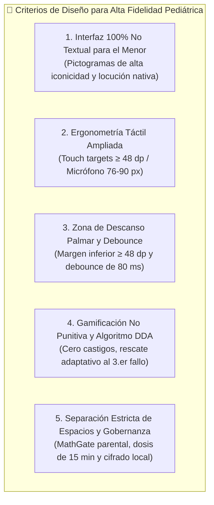
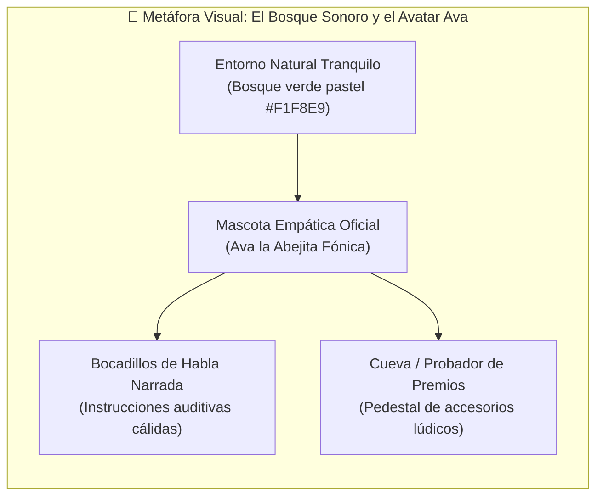
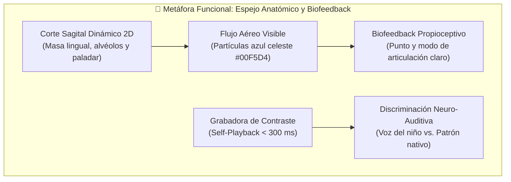
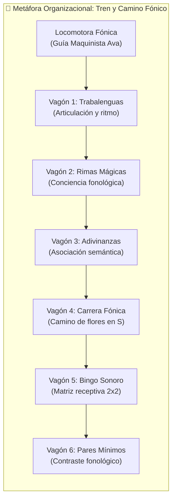
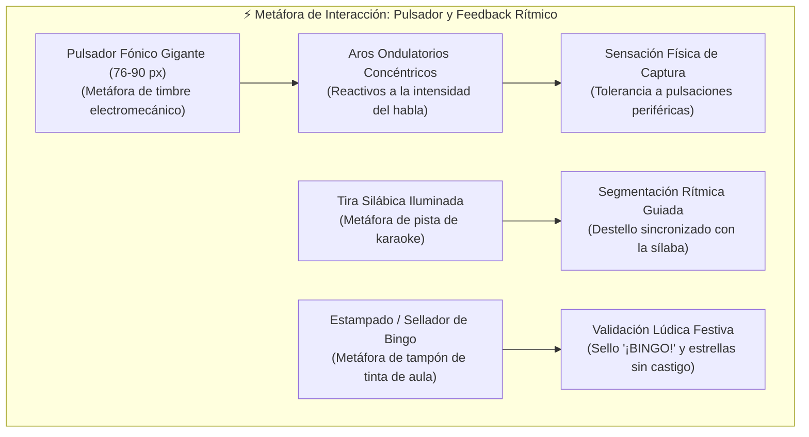

# 🎭 Aplicación de los Tipos de Metáforas en los Prototipos del Proyecto Final

> [!INFO] Trazabilidad y Fundamentación Teórico-Práctica
> El presente documento operacionaliza el marco conceptual formalizado en el [[Proyecto/Documentación/Marco Conceptual/Teórico de Metáforas de Diseño Fono-lúdico|Marco Teórico de Metáforas de Diseño Fono-Lúdico]]. Traduce los 3 grandes ejes de la literatura científica (CCI Pediátrico, Fonoaudiología del Aprendizaje Motor y Gamificación No Punitiva) en decisiones tangibles implementadas en el [[Proyecto/Documentación/Prototipo Interactivo Fono-Lúdico de Alta Fidelidad|Prototipo Interactivo de Alta Fidelidad 'Bosque Sonoro']] y normadas por el [[Proyecto/Documentación/Sistema de Diseño (Design System), Tokens de Diseño, Directrices HCIUX y Wireflows Pediátricos|Sistema de Diseño Pediátrico]].

---

## 📐 Criterios generales de diseño para los prototipos de alta fidelidad

El diseño e implementación de los prototipos de alta fidelidad del software fono-lúdico se rigen por cinco criterios arquitectónicos y ergonómicos de Interacción Niño-Computadora (CCI), alineados con el **Marco Ecológico de Calidad CCI para Aplicaciones Preescolares** (*Liu, Chen & Razak, 2026*), los estándares de usabilidad pediátrica **ISO/IEC 25010** y las métricas de la escala **MARS** (*Furlong et al., 2018*):

1. **Ajuste Niño-Interfaz y Comunicación 100% No Textual (`Child-Interface Fit`):**
   - El niño preescolar de 3 a 5 años no procesa el código lectoescrito convencional (*Druin, 2002; Liu et al., 2026*). En consecuencia, las interfaces dirigidas al infante eliminan la dependencia de texto para la navegación o ejecución de actividades.
   - El texto visible en tarjetas fonéticas actúa únicamente como estímulo ortográfico incidental secundario. Toda instrucción, refuerzo y retroalimentación se modela a través de la voz humana de la mascota guía en acento neutro de Lima Metropolitana (`RF-AUD-001`, `RF-AUD-002`) y pictogramas vectoriales de alta resolución (*SVG*) basados en el vocabulario léxico de **Bosch & Melgar (1984)** y **TEPROSIF** (*Huertas & Roque, 2023*).

2. **Ergonomía Motriz Pediátrica y Dimensiones Táctiles Hiperampliadas:**
   - La motricidad fina de niños preescolares presenta imprecisión por *touch overshoot* y temblor fisiológico de desarrollo (*Du et al., 2023*).
   - Ningún elemento interactivo posee una cota menor a **$48 \times 48\text{ dp}$** (`RC-USO-001`), superando el criterio de éxito 2.5.5 (*Target Size Enhanced*) de las pautas **WCAG 2.2 Nivel AAA**.
   - Los botones neurálgicos, tales como el activador del micrófono (`UI-BTN-MIC`), adoptan un diámetro visual de **$76 \times 76\text{ px}$** embebido en un área concéntrica de absorción táctil de **$90 \times 90\text{ px}$** con micro-animaciones elásticas para tolerar pulsaciones perimétricas descentradas.

3. **Zona de Descanso Palmar e Inmunidad a Toques Accidentales (*Palm Rejection & Touch Debounce*):**
   - Cuando los infantes interactúan con tabletas en orientación horizontal (*Landscape*), suelen apoyar la eminencia tenar o el lateral de la palma en la base o bordes de la pantalla (*Liu et al., 2026; Peña et al., 2024*).
   - El diseño reserva una **franja inferior de descanso pasivo $\ge 48\text{ dp}$** (suelo forestal irregular decorativo desprovisto de event listeners accionables).
   - Se implementa un filtro temporal de rebote táctil (*touch debounce*) de **$80\text{ ms}$** para neutralizar dobles pulsaciones involuntarias y espasmos motores.

4. **Ambiente Emocional Seguro, Refuerzo por Esfuerzo y Control Adaptativo (DDA):**
   - Queda estrictamente proscrito el uso de retroalimentación negativa, cruces rojas, sonidos de zumbador (*buzzers* estridentes) o pérdida de vidas (*Saeedi et al., 2024*).
   - Se incorpora el **Algoritmo de Ajuste Dinámico de Dificultad (DDA, `RN-DDA-001`)** (*Zohaib, 2018; Strömbergsson et al., 2026*): ante 3 fallos consecutivos en el reconocimiento de voz, el sistema no bloquea al menor; otorga de forma asistida 1 estrella dorada por persistencia (`GL-005`), despliega la praxia bucofacial 2D correspondiente y facilita el avance al siguiente estímulo fónico para preservar la autoeficacia.

5. **Gobernanza Ética, Separación Estricta de Roles y Protección Biometría:**
   - Separación física e infranqueable entre el universo lúdico infantil y el panel administrativo a través de una compuerta cognitiva aritmética escrita en palabras (*MathGate*, `RF-MED-001`) (*Du et al., 2023*).
   - Monitoreo continuo de la **dosis terapéutica diaria recomendada de 15 minutos** para evitar sobrecarga orofacial y fatiga ocular (*Du et al., 2023*).
   - Almacenamiento seguro local de grabaciones orales infantiles bajo cifrado y sin transmisión a servidores externos de terceros, preservando el dato biométrico de voz de acuerdo con la **Ley N.° 29733** y el marco **COPPA** (*Liu et al., 2026*).

---

## 🎨 Metáfora Visual

### Componente
**El Entorno Ambiental del "Bosque Sonoro Amigable" y la Mascota Guía Empática "Ava la Abejita Fónica" con Bocadillos de Voz Dinámicos** (`#screen-menu`, `#mascot-ava`, `UI-AVATAR-GUIDE` y `#screen-avatar`).

### Justificación
- **Fundamento Teórico:** Sustentado en la **Teoría del Diseño Metafórico en Interfaces Infantiles** (*Druin, 2002; Read & Markopoulos, 2013; Saeedi et al., 2024*) y la dimensión *Child-Interface Fit* del **Marco Ecológico CCI** (*Liu, Chen & Razak, 2026*).
- **Modelo Mental:** Los niños de 3 a 5 años construyen modelos mentales mediante la personificación de roles y el contacto con la naturaleza viva. La sustitución de una interfaz clínica aséptica o un menú digital abstracto por un **bosque acogedor poblado por un insecto polinizador parlante** transforma la sesión fonoaudiológica en una aventura de exploración natural.
- **Evidencia Empírica:** *Saeedi et al. (2024)* demostraron en su serious game fonoaudiológico *Ava* que la presencia de un animal amigable genera una valoración estética positiva del **100%** en preescolares con trastornos articulatorios y una puntuación de satisfacción de **6.25/7** en la escala PSSUQ. Adicionalmente, *Du et al. (2023)* demostraron que la ambientación natural mitiga la hiperactividad sensorial infantil.

### Beneficio
- **Desinhibición Fónica y Reducción del Estrés:** Desactiva la ansiedad de evaluación clínica. El niño no siente que está siendo evaluado por un terapeuta o docente severo, sino que "ayuda a su amiga la abejita a recolectar néctar y cantar palabras".
- **Autonomía Cognitiva Plena:** Los bocadillos ilustrados coordinados con locución humana natural permiten que el niño identifique con una sola mirada quién le está hablando, qué se espera de él y cuál es el objetivo de la actividad, prescindiendo por completo de la supervisión constante de un adulto para comprender la consigna.

### Evidencia Gráfica
La metáfora visual se materializa en la pantalla principal del software, en la que Ava Maquinista encabeza la composición visual sobre un fondo de cielo diáfano y vegetación orgánica relajante:

*Figura 1: Menú Principal del Prototipo 'Bosque Sonoro' ([01_menu_principal.png](file:///d:/.Antigravity/IHC/Proyecto/Documentación/capturas/01_menu_principal.png)), destacando la mascota animada Ava en el banner superior, la ambientación forestal no sobreestimulante y la locomotora fónica con cabina.*

Asimismo, se evidencia en la Cueva de Recompensas (`#screen-avatar`), donde Ava se ubica sobre un pedestal de exhibición interactivo luciendo accesorios desbloqueables:

*Figura 2: Cueva de Ava y Economía de Fichas por Esfuerzo ([07_cueva_avatar_premios.png](file:///d:/.Antigravity/IHC/Proyecto/Documentación/capturas/07_cueva_avatar_premios.png)), ilustrando el pedestal de personalización cosmética ética sin compras integradas.*

---

## ⚙️ Metáfora Funcional

### Componente
**El Simulador Anatómico 2D de Praxias Bucofaciales ("El Espejo Mágico Interior")** (`UI-PRAXIA-CANVAS`, modal `#praxiaModal`), complementado por la **Grabadora de Contraste con Bucle de Autoescucha Inmediata (*Self-Playback*)** (`btnSelfPlayback` y `btnComparative`).

### Justificación
- **Fundamento Teórico:** Sustentado en la **Teoría del Biofeedback Fónico Contingente** (*Maas et al., 2008; Peña et al., 2024*), el **Protocolo de Praxias Bucofaciales de 6 Fases** (*Pucuhuaranga, 2016*) y la *Pauta 4 de Diseño IHC Fonoaudiológico* (*Du et al., 2023*).
- **Modelo Mental:** Funciona como un **"espejo radiográfico transparente"**. En la terapia fonoaudiológica tradicional en espejo plano, el infante únicamente observa sus labios y dientes, permaneciendo invisibles los movimientos de la lengua, el punto de contacto alveolar y la elevación del velo palatino. El simulador 2D expone el interior biomecánico del aparato fonoarticulador en un corte sagital estilizado a 60 FPS. Paralelamente, los botones de reproducción emulan una grabadora de laboratorio fonético, donde el infante graba y escucha su emisión al instante.
- **Evidencia Empírica:** *Du et al. (2023)* destacan que la opacidad del tracto vocal es el principal obstáculo en la intervención digital de dislalias. Por su parte, *Peña et al. (2024)* evidenciaron en *Nature npj Science of Learning* que la reproducción contingente de la propia voz infantil en latencias ultracortas ($\le 300\text{ ms}$) genera una ganancia estadísticamente significativa en la vocalización activa ($p = 0.031$).

### Beneficio
- **Toma de Conciencia Propioceptiva:** El niño comprende visualmente qué debe hacer con su lengua dentro de la boca (por ejemplo, apoyar la punta lingual sobre las rugas palatinas y liberar aire intermitente para producir la vibrante `/rr/`, en lugar de sustituirla por la lateral `/l/`).
- **Bucle de Autocorrección Auditiva:** Al presionar "¡Escuchar mi voz!" (`btnSelfPlayback`), el infante experimenta un choque perceptivo entre su emisión registrada y el modelo de pronunciación nativo de Lima, estimulando la plasticidad sensorio-motora y corrigiendo el error sin mediación punitiva del terapeuta.

### Evidencia Gráfica
El canvas vectorial renderiza la cavidad bucal con geometría anatómica diferenciada, dinámica de masa lingual deformable y partículas de flujo de aire fonatorio:

*Figura 3: Modal de Praxia Bucofacial 2D Interactiva ([06_praxia_bucofacial_2d.png](file:///d:/.Antigravity/IHC/Proyecto/Documentación/capturas/06_praxia_bucofacial_2d.png)), ilustrando el corte sagital de la cavidad bucal, elevación apical de la lengua hacia los alvéolos y selector de fonemas clínicos.*

En la vista del ejercicio fono-lúdico se observa el acceso directo a la praxia y la botonera de biofeedback de doble canal:

*Figura 4: Núcleo Fono-Lúdico Landscape de 3 Zonas ([02_ejercicio_landscape.png](file:///d:/.Antigravity/IHC/Proyecto/Documentación/capturas/02_ejercicio_landscape.png)), evidenciando la micro-praxia lateral izquierda, el botón '¡Escuchar mi voz!' (Self-Playback <300 ms) y el botón de contraste dicotómico.*

---

## 🗂️ Metáfora Organizacional

### Componente
**El Convoy del Tren de Vagones Fónicos sobre Rieles** (`.train-track-container`, `#trainTrack`) y el **Camino de Flores Fónicas en Curva S** (`#screen-carrera`, `UI-MAP-2D`).

### Justificación
- **Fundamento Teórico:** Fundamentado en la **Jerarquía Articulatoria Escalar de Van Riper (1978)**, el **Paradigma Fono-Lúdico de Juegos Verbales Tradicionales** (*Pucuhuaranga, 2016; Condori & Larico, 2022; Mora Espinoza et al., 2024*) y los principios de navegación plana horizontal para preescolares (*Liu, Chen & Razak, 2026*).
- **Modelo Mental:** Sustituye la taxonomía abstracta de menús digitales (carpetas, desplegables, listas) por un **convoy ferroviario tangible sobre rieles de acero**. Cada vagón representa un estadio de dificultad fonológica y un género verbal propio de la educación inicial peruana. De forma complementaria, el minijuego de sinfones adopta la metáfora del **sendero de piedras o flores que cruzan un arroyo en el prado**, donde avanzar espacialmente hacia la colmena de miel equivale al dominio de la secuencia motriz articulatoria.
- **Evidencia Empírica:** *Condori & Larico (2022)* demostraron que la articulación verbal se correlaciona fuertemente con los juegos verbales estructurados ($r = 0.612, p = 0.008$). *Mora et al. (2024)* probaron que organizar la terapia fonológica como un circuito competitivo de casillas normalizó el habla en el **74%** de preescolares con dislalia funcional grave.

### Beneficio
- **Cero Sobrecarga de Navegación Espacial:** La disposición lineal horizontal panorámica permite al niño comprender de forma inmediata que el currículo avanza de izquierda a derecha. No hay riesgo de desorientación en pantallas secundarias ("pantallas perdidas").
- **Gamificación Tangible de la Progresión:** En la Carrera Fónica, el niño no necesita entender conceptos abstractos de porcentaje de avance; su objetivo visual es ayudar a la abejita a volar de flor en flor a lo largo de las 5 estaciones hasta alcanzar el tarro de miel.

### Evidencia Gráfica
El convoy fónico se despliega como un tren compuesto por la Locomotora y 6 vagones temáticos con toldos festivos, remaches metálicos e iconos vectoriales de alta definición:

*Figura 5: Tren de Vagones Fónicos en Menú Principal ([01_menu_principal.png](file:///d:/.Antigravity/IHC/Proyecto/Documentación/capturas/01_menu_principal.png)), estructurando los 6 módulos lúdicos sobre rieles continuos y suelo forestal.*

En la Carrera Fónica (`#screen-carrera`), el sendero sinuoso 2D conecta las 5 flores en relieve con perspectiva isométrica enriquecida:

*Figura 6: Camino de Flores Fónicas en el Prado 2D ([03_carrera_fonica.png](file:///d:/.Antigravity/IHC/Proyecto/Documentación/capturas/03_carrera_fonica.png)), ilustrando el sendero en curva 'S', la mascota Ava volando sobre la flor activa y la estación fónica meta (/pl/ en 'Plátano').*

---

## 👆 Metáfora de Interacción

### Componente
**El Gran Pulsador Fónico ("Big Push Button" con Aros de Resonancia Ondulatoria)** (`UI-BTN-MIC`, `#btnMicExercise`), complementado por la **Tira Silábica Rítmica Iluminada estilo "Karaoke / Pista de Baile"** (`.syllable-strip`) y el **Estampador / Sellador Gigante de Aciertos con Lluvia de Estrellas** (`#screen-bingo`, `#bingoGrid`).

### Justificación
- **Fundamento Teórico:** Sustentado en los **Estándares de Usabilidad Técnica Pediátrica ISO/IEC 25010**, las pautas de *Touch Target Size & Feedback* (*Liu, Chen & Razak, 2026; Du et al., 2023*) y la **Teoría del Condicionamiento Operante No Punitivo** (*Saeedi et al., 2024; Strömbergsson et al., 2026*).
- **Modelo Mental:**
  - El botón del micrófono emula un **timbre electromecánico gigante o pulsador de juguete arcade**. Al ser presionado, se deprime elásticamente y proyecta ondas expansivas concéntricas (`mic-wave`) proporcionales al volumen de la voz.
  - La tira silábica emula las **baldosas luminosas de una pista de baile o pantalla de karaoke**, encendiendo cada segmento silábico (`Gui` $\rightarrow$ `ta` $\rightarrow$ `rra`) al compás de la articulación fonética.
  - En el Bingo Sonoro, la selección táctil emula el **sellado con tampón de tinta festiva de la maestra de inicial**, estampando un sello dorado gigante de "¡BINGO!" sobre la tarjeta acertada.
- **Evidencia Empírica:** *Liu, Chen & Razak (2026)* y *Du et al. (2023)* demostraron que objetivos táctiles inferiores a $48\text{ dp}$ generan un incremento del $60\%$ en errores motores en infantes de 3 y 4 años. Por su parte, *Condori & Larico (2022)* confirmaron que la marcación rítmica coordinada estimula la fluidez fonológica en preescolares.

### Beneficio
- **Confirmación Visual Indudable:** El niño sabe con absoluta certeza motriz que la tableta "lo está escuchando" gracias a las ondas concéntricas animadas que reaccionan a su voz en tiempo real, disipando la incertidumbre o el silencio forzado.
- **Pacing y Conciencia Silábica:** La iluminación rítmica de las sílabas descompone palabras complejas en unidades fonéticas digeribles, evitando que el niño articule de forma atropellada o rápida.
- **Refuerzo Positivo Inolvidable:** El estampado lúdico del Bingo y la lluvia de confeti celebran el éxito de la discriminación auditiva receptiva, permitiendo que niños con dislalia severa o mutismo selectivo temporal disfruten del software y acumulen estrellas sin temor a ser juzgados.

### Evidencia Gráfica
En la vista del ejercicio fono-lúdico se aprecia el micrófono hiperampliado con sus aros de emisión y la tira silábica activa:

*Figura 7: Detalle del Núcleo Fono-Lúdico ([02_ejercicio_landscape.png](file:///d:/.Antigravity/IHC/Proyecto/Documentación/capturas/02_ejercicio_landscape.png)), mostrando el botón hiperampliado de captura con ondas reactivas y la descomposición rítmica 'Gui-ta-rra'.*

En el Bingo Sonoro (`#screen-bingo`), se observa el cartón táctil de 4 tarjetas gigantes ($180 \times 150\text{ px}$) y el sello festivo estampado:

*Figura 8: Bingo Sonoro Táctil 2x2 ([04_bingo_sonoro.png](file:///d:/.Antigravity/IHC/Proyecto/Documentación/capturas/04_bingo_sonoro.png)), destacando la cuadrícula ergonómica de 4 estímulos de alta iconicidad (Fresa, Gato, Sol, Luna) y el sello dorado de acierto.*

---

## 📊 Matriz de Resumen Consolidado de Metáforas de Diseño

| Tipo de Metáfora | Componente(s) de Interfaz del Prototipo | Modelo Mental del Mundo Real | Teoría / Marco de Respaldo | Beneficio Ergonomico / Clínico Pediátrico | Evidencia Gráfica Oficial |
| :--- | :--- | :--- | :--- | :--- | :--- |
| **Visual** | Entorno del Bosque Sonoro Amigable y Mascota Ava (`UI-AVATAR-GUIDE`). | Exploración de un bosque natural guiado por un insecto amigo. | Marco Ecológico CCI (*Liu et al., 2026*); Serious Game Ava (*Saeedi et al., 2024*). | Desinhibición fónica (100% aceptación), neutralización de ansiedad evaluativa y autonomía no textual. | [`capturas/01_menu_principal.png`](file:///d:/.Antigravity/IHC/Proyecto/Documentación/capturas/01_menu_principal.png) [`capturas/07_cueva_avatar_premios.png`](file:///d:/.Antigravity/IHC/Proyecto/Documentación/capturas/07_cueva_avatar_premios.png) |
| **Funcional** | Simulador Anatómico 2D (`UI-PRAXIA-CANVAS`) y Grabadora de Contraste (`btnSelfPlayback`). | Espejo radiográfico transparente del tracto vocal y grabadora fonoaudiológica. | Biofeedback Fónico (*Peña et al., 2024*); Praxias Bucofaciales (*Pucuhuaranga, 2016*); Pauta 4 IHC (*Du et al., 2023*). | Visibilización del punto y modo de articulación oculto y bucle de autocorrección inmediata en $<300\text{ ms}$. | [`capturas/06_praxia_bucofacial_2d.png`](file:///d:/.Antigravity/IHC/Proyecto/Documentación/capturas/06_praxia_bucofacial_2d.png) [`capturas/02_ejercicio_landscape.png`](file:///d:/.Antigravity/IHC/Proyecto/Documentación/capturas/02_ejercicio_landscape.png) |
| **Organizacional** | Convoy del Tren de Vagones Fónicos (`#trainTrack`) y Camino de Flores 2D (`UI-MAP-2D`). | Tren de juguete en rieles con paradas temáticas y sendero de piedras en el río. | Jerarquía de Van Riper (1978); Juegos Verbales (*Condori & Larico, 2022*); Circuito Fonológico (*Mora et al., 2024*). | Navegación horizontal plana de 1 nivel, cero riesgo de desorientación espacial y progresión didáctica visible. | [`capturas/01_menu_principal.png`](file:///d:/.Antigravity/IHC/Proyecto/Documentación/capturas/01_menu_principal.png) [`capturas/03_carrera_fonica.png`](file:///d:/.Antigravity/IHC/Proyecto/Documentación/capturas/03_carrera_fonica.png) |
| **Interacción** | Big Push Button de Micrófono (`UI-BTN-MIC`), Tira Silábica (`.syllable-strip`) y Sello de Bingo. | Timbre arcade gigante reactivo, pista de baile iluminada / karaoke y tampón de aula. | *Touch Target Size* ISO 25010 (*Liu et al., 2026*); Refuerzo Operante No Punitivo (*Strömbergsson et al., 2026*). | Eliminación de toques fallidos ($\ge 76\text{ px}$ con absorción a $90\text{ px}$), control prosódico rítmico y refuerzo lúdico. | [`capturas/02_ejercicio_landscape.png`](file:///d:/.Antigravity/IHC/Proyecto/Documentación/capturas/02_ejercicio_landscape.png) [`capturas/04_bingo_sonoro.png`](file:///d:/.Antigravity/IHC/Proyecto/Documentación/capturas/04_bingo_sonoro.png) |

---
