# 🎮 Prototipo Interactivo Fono-Lúdico de Alta Fidelidad: "Bosque Sonoro"
## 🔬 Catálogo Exhaustivo de Justificación en Fuentes Científicas y Evidencia Visual del Software

> [!INFO] Propósito Epistemológico y Trazabilidad Metodológica del Documento
> El presente documento constituye la **memoria técnica y científica de justificación del prototipo interactivo de alta fidelidad**. A diferencia de una descripción puramente cosmética, cada elemento gráfico, componente de interacción, algoritmo adaptativo, parámetro ergonómico y protocolo clínico implementado en el software ha sido diseñado con estricto apego a las **10 fuentes científicas del estado del arte** y formalizado en:
> - 📋 [[Especificación Refinada de Requisitos de Software Aplicación Fono-Lúdica para la Articulación Fonética en Preescolares|Especificación Refinada de Requisitos de Software]]
> - 🔄 [[Especificación de Casos de Uso y Diagramas de Secuencia Aplicación Fono-Lúdica Pediátrica|Casos de Uso y Diagramas de Secuencia (CUS-01 a CUS-05)]]
> - 🎨 [[Sistema de Diseño (Design System), Tokens de Diseño, Directrices HCIUX y Wireflows Pediátricos|Sistema de Diseño, Tokens de Diseño y Directrices HCI/UX]]
> - 📑 [[Antecedentes|Repositorio Consolidado de los 10 Antecedentes Científicos]]

---

## 🗺️ Mapa de Trazabilidad Científica Global del Prototipo

El siguiente diagrama detalla cómo los 3 pilares del marco teórico se materializan en las 13 pantallas, vistas y subsistemas del prototipo funcional:

```mermaid
graph TD
    subgraph Fuentes ["📚 10 Fuentes Científicas del Estado del Arte"]
        F1["Huertas & Roque (2023)<br>PUCP: Realidad Lima y PSF (TEPROSIF)"]
        F2["Condori & Larico (2022)<br>UJCM: Juegos Verbales (r=0.612)"]
        F3["Pucuhuaranga (2016)<br>UNCP: Praxias y Bosch-Melgar (46.8%)"]
        F4["Saeedi et al. (2024)<br>Nature: Serious Game Ava y Cero Castigo"]
        F5["Mora et al. (2024)<br>UCT: Carrera Fónica y Bingo (74% éxito)"]
        F6["Du et al. (2023)<br>IJLCD: 5 Pautas IHC, MathGate y 15 min"]
        F7["Furlong et al. (2018)<br>PLOS ONE: Escala MARS y Antipatrones"]
        F8["Strömbergsson et al. (2026)<br>IJLCD: Pop2TalkNordic, DDA y Frustración"]
        F9["Liu, Chen & Razak (2026)<br>MDPI: Marco Ecológico CCI y WCAG"]
        F10["Peña et al. (2024)<br>Nature: Self-Playback <300ms y Tableta"]
    end

    subgraph Prototipo ["🎮 Prototipo 'Bosque Sonoro' (13 Vistas Clave)"]
        V1["01. Menú Principal de Vagones"]
        V2["02. Ejercicio Landscape 3 Zonas"]
        V3["03. Carrera Fónica en el Río"]
        V4["04. Bingo Sonoro Táctil 2x2"]
        V5["05. Pares Mínimos Cómicos"]
        V6["06. Praxia Lingual 2D Sagital"]
        V7["07. Cueva del Avatar y Esfuerzo"]
        V8["08. MathGate Control Parental"]
        V9["09. Calibración Fonoaudiológica"]
        V10["10. Curva de Reducción de PSF"]
        V11["11. Bóveda Cifrada de Audio"]
        V12["12. Modo Alto Contraste CVI"]
        V13["13. Matriz RTM en Software"]
    end

    F1 --> V9 & V10
    F2 --> V1 & V2
    F3 --> V2 & V6 & V10
    F4 --> V1 & V2 & V7
    F5 --> V3 & V4 & V5
    F6 --> V7 & V8 & V9
    F7 --> V2 & V5
    F8 --> V2 & V4 & V7
    F9 --> V1 & V8 & V11 & V12
    F10 --> V2 & V10 & V11
```



---

## 📸 Catálogo Analítico de Vistas: Evidencia Visual y Justificación en Fuentes

---

### 1. Menú Principal: El "Bosque Sonoro" y el Tren de Vagones Fónicos

> [!IMPORTANT] 🖼️ **ESPACIO RESERVADO PARA CAPTURA VISUAL: MENÚ PRINCIPAL: BOSQUE SONORO, LOCOMOTORA Y CONVOY DE 6 VAGONES FÓNICOS**
> - **Archivo de Imagen Asignado:** [`capturas/01_menu_principal.png`](file:///d:/.Antigravity/IHC/Proyecto/Documentación/capturas/01_menu_principal.png)
> - **Ruta / Disparador en Prototipo:** `http://localhost:5173/ (#screen-menu)`
> - **Resolución Estándar Recomendada:** `1366 × 768 px` (Ratio 16:9 Panorámico Landscape)
> - **Composición Visual y Elementos que Deben Figurar:**
>   Vista panorámica del menú principal en ratio 16:9 (1366×768). Debe ilustrar: (1) Banner superior con Ava la abejita fónica y bocadillo narrado; (2) Tren de 7 piezas sobre rieles de acero: la Locomotora Fónica Principal a la cabeza (con chimenea emitiendo vapor, silbato de latón, cabina con Ava Maquinista y farol frontal luminoso), seguida de los 6 vagones temáticos enriquecidos con toldos festivos, remaches táctiles, enganches metálicos pesados e iconos vectoriales de alta definición (Trabalenguas, Rimas, Adivinanzas, Camino de Flores, Bingo Sonoro y Pares Mínimos); (3) Base inferior con el suelo forestal irregular de 120+ briznas de césped orgánico y flores silvestres a diferentes alturas; (4) Header con pill de dosificación clínica de 15 min y botón MathGate.

> [!TIP] 📸 Guía de Inspección y Obtención de la Captura
> - **Ruta / URL en Servidor Local:** `http://localhost:5173/` (pantalla de inicio predeterminada `#screen-menu`).
> - **Pasos de Navegación:** Cargar la raíz del prototipo o pulsar el botón `btnBackMenu` (icono 🏠) desde cualquier pantalla interna.
> - **Elementos Críticos a Inspeccionar:** Banner superior con la Abejita Ava animada, convoy del tren fónico: Locomotora Principal de Ava y 6 vagones interactivos enriquecidos, widget de estrellas de esfuerzo (`#btnWidgetStars`), pill de dosificación clínica de 15 minutos (`clinical-dosing-pill`) y el botón con candado MathGate (`btnParentalGate`).
> - **Archivo de Imagen:** [`01_menu_principal.png`](file:///d:/.Antigravity/IHC/Proyecto/Documentación/capturas/01_menu_principal.png)

#### A. Elementos Visibles y Dinámica de Interacción
1. **Avatar Guía Empático:** La mascota oficial, la abejita fónica *Ava*, saluda al niño mediante un bocadillo ilustrado con locución auditiva sintetizada: *"¡Hola amiguito! Soy Ava, tu abejita fónica 🐝 ¿Qué juego de palabras quieres jugar hoy en nuestro Bosque Sonoro?"*.
2. **Convoy Fónico de Locomotora Maestra y 6 Juegos Verbales:** Cada vagón representa una mecánica lúdica diferenciada:
   - *Vagón 1 (Trabalenguas):* Ritmo y articulación rápida para fonemas vibrantes y fricativos (`RF-LUD-001`).
   - *Vagón 2 (Rimas Mágicas):* Discriminación auditiva rimada y conciencia fonológica (`RF-LUD-002`).
   - *Vagón 3 (Adivinanzas):* Asociación semántica y respuesta fonética activa (`RF-LUD-003`).
   - *Vagón 4 (Carrera Fónica):* Circuito en río gamificado para sinfones (`RF-LUD-004`).
   - *Vagón 5 (Bingo Sonoro):* Cartón de discriminación táctil directa sin habla obligatoria (`RF-LUD-005`).
3. **Pill de Dosificación Fonoaudiológica (`8/15 min`):** Barra de progreso visual que monitorea el tiempo de uso en sesión.

#### B. Justificación en Fuentes Científicas (¿Por qué está diseñado así?)
- **Saeedi et al. (2024) [*Nature Scientific Reports*]:** Demuestran que la incorporación de un personaje animal empático y animado como agente pedagógico central incrementa la satisfacción percibida al 100% y neutraliza la ansiedad de rendimiento en infantes con dificultades fonoarticulatorias. La abejita *Ava* replica este principio eliminando la figura del terapeuta evaluador frío.
- **Condori & Larico (2022) [*Tesis UJCM*]:** Evidencian una correlación lineal positiva y estadísticamente significativa ($r = 0.612, p = 0.008$) entre la práctica estructurada de juegos verbales (trabalenguas, rimas y adivinanzas) y la mejora en la dimensión fonológica infantil. Por ello, el menú principal organiza el currículo en estos géneros verbales tradicionales.
- **Du et al. (2023) [*IJLCD*]:** En su *Pauta 1 de Diseño IHC Fonoaudiológico*, establecen que el software infantil no debe ser un pozo sin fondo de estimulación pasiva, sino restringirse a una **dosis fonoaudiológica diaria recomendada de 15 minutos** para evitar sobrecarga atencional y fatiga muscular orofacial. La `clinical-dosing-pill` visible en el header aplica este principio preventivo.
- **Liu, Chen & Razak (2026) [*Computers MDPI*]:** En la dimensión de *Adecuación al Desarrollo*, prohíben la navegación jerárquica profunda para niños de 3 a 5 años. El diseño de vagones en riel horizontal unidimensional permite selección directa sin menús desplegables complejos.

---

### 2. Núcleo Fono-Lúdico: Interfaz Landscape de 3 Zonas con Biofeedback y DDA (CUS-01)

> [!IMPORTANT] 🖼️ **ESPACIO RESERVADO PARA CAPTURA VISUAL: NÚCLEO FONO-LÚDICO: INTERFAZ LANDSCAPE TRIPARTITA CON BIOFEEDBACK Y DDA (CUS-01)**
> - **Archivo de Imagen Asignado:** [`capturas/02_ejercicio_landscape.png`](file:///d:/.Antigravity/IHC/Proyecto/Documentación/capturas/02_ejercicio_landscape.png)
> - **Ruta / Disparador en Prototipo:** `Pulsar Vagón 1 'Trabalenguas' (#screen-exercise)`
> - **Resolución Estándar Recomendada:** `1366 × 768 px` (Ratio 16:9 Panorámico Landscape)
> - **Composición Visual y Elementos que Deben Figurar:**
>   Composición panorámica horizontal tripartita (26% - 48% - 26%) a 1380 px de amplitud máxima. Debe ilustrar: (1) Zona Izquierda con Ava modelando consigna verbal y tarjeta de micro-praxia lingual; (2) Zona Central con tarjeta fonética extendida (660 px), pictograma vectorial ilustrado (Guitarra), badge fonético (/rr/ medial) y tira silábica rítmica interactiva ('Gui-ta-rra'); (3) Zona Derecha con botón hiperampliado de micrófono táctil (UI-BTN-MIC) con anillos concéntricos reactivos, botón '¡Escuchar mi voz!' (Self-Playback <300 ms) y botón dicotómico comparativo.

> [!TIP] 📸 Guía de Inspección y Obtención de la Captura
> - **Ruta / URL en Servidor Local:** Pulsar sobre el vagón **"Trabalenguas"** (`#wagon-trabalenguas`) desde el menú principal.
> - **Pasos de Navegación:** Activa la vista `#screen-exercise`.
> - **Elementos Críticos a Inspeccionar:** Disposición horizontal tripartita (26% - 48% - 26%), tarjeta central `UI-CARD-FON` con desglose de sílabas rítmicas (`Gui-ta-rra`), botón de micrófono hiperampliado con ondas concéntricas (`UI-BTN-MIC`), botón de *Self-Playback* inmediato (`btnSelfPlayback`) y botón de comparación dicotómica (`btnComparative`).
> - **Archivo de Imagen:** [`02_ejercicio_landscape.png`](file:///d:/.Antigravity/IHC/Proyecto/Documentación/capturas/02_ejercicio_landscape.png)

#### A. Elementos Visibles y Dinámica de Interacción
1. **Zona Izquierda (26% - Avatar y Praxia de Bolsillo):** Muestra a Ava modelando la consigna en habla natural y un acceso directo a la praxia de la lengua (`mini-praxia-card`).
2. **Zona Central (48% - Tarjeta Fonética Ilustrada `UI-CARD-FON`):** Pictograma vectorial de alta resolución (`🎸`), fonema objetivo resaltado en badge (`Fonema /rr/`), estímulo contextualizado (*"Erre con erre guitarra..."*) y tira silábica rítmica interactiva (`Gui` - `ta` - `rra`) que titila coordinada con el audio.
3. **Zona Derecha (26% - Motor de Biofeedback y Microfonía Pediátrica):**
   - **Botón `UI-BTN-MIC`:** Objetivo táctil de $76\times 76\text{ px}$ ($90\text{ px}$ con anillo de dispersión de impacto). Al pulsarlo, despliega ondas sonoras animadas en CSS reflectantes de la captura.
   - **Botón "¡Escuchar mi voz!" (`btnSelfPlayback`):** Habilita la reproducción de la propia emisión del infante en $<300\text{ ms}$.
   - **Botón "Escuchar Pareja" (`btnComparative`):** Reproduce en alternancia el patrón modelo nativo limeño y el audio grabado del niño con una pausa inter-estímulo de $500\text{ ms}$.

#### B. Justificación en Fuentes Científicas (¿Por qué está diseñado así?)
- **Peña et al. (2024) [*Nature npj Science of Learning*]:** Demuestran que la intervención con tabletas táctiles genera ganancias significativas en la comprensión y vocalización activa en infantes ($p = 0.031$), siempre y cuando exista un **bucle de autoescucha inmediata (*Self-Playback*) contingente**. Los preescolares son incapaces de monitorear su propio tracto vocal en tiempo real sin una referencia acústica externa; escuchar su propia voz reproducida al instante consolida el mapa neuro-auditivo articulatorio.
- **Strömbergsson et al. (2026) [*IJLCD*]:** En su estudio experimental con la app *Pop2TalkNordic*, alertan sobre la gravísima frustración que experimentan los niños preescolares con trastornos articulatorios cuando los motores comerciales de reconocimiento de voz (ASR) rechazan repetidamente sus intentos. Para solucionar esto, el prototipo implementa el **Algoritmo Adaptativo DDA (RN-DDA-001)**:
  - Intento fallido 1 y 2: Se emite un sonido cálido de aliento con halo púrpura `#8E24AA` y Ava dice *"¡Casi casi, inténtalo una vez más!"*, sin restar puntos, vidas ni mostrar cruces rojas.
  - 3.er fallo consecutivo: **Avance asistido forzoso**. Se otorga 1 estrella dorada por esfuerzo (`GL-005`), se abre automáticamente el modal de praxia bucofacial para guiar la postura y se avanza al siguiente desafío. El niño jamás queda estancado en un bucle de fracaso.
- **Furlong et al. (2018) [*PLOS ONE*]:** En su análisis de 132 aplicaciones móviles para el habla mediante la escala MARS, denuncian que la mayoría de apps comerciales utilizan palabras con fonemas complejos mezclados sin control. En nuestro prototipo, la palabra *Guitarra* fue rigurosamente seleccionada del banco estandarizado de **Bosch & Melgar** (aislando el fonema vibrante múltiple `/rr/` en posición medial con vocal abierta).
- **Liu, Chen & Razak (2026) [*Computers MDPI*]:** Demuestran que la atención de un infante de 4 años decae drásticamente si los elementos de interacción se dispersan en múltiples vistas. La disposición en paisaje (*landscape*) de 3 zonas consolida en una sola pantalla visual: modelo auditivo (izquierda), estímulo cognitivo (centro) y acción motora (derecha).

---

### 3. Dinámica Gamificada: Camino de Flores Fónicas en el Prado 2D (RF-LUD-004)

> [!IMPORTANT] 🖼️ **ESPACIO RESERVADO PARA CAPTURA VISUAL: DINÁMICA GAMIFICADA: CAMINO DE FLORES FÓNICAS EN EL PRADO 2D (RF-LUD-004)**
> - **Archivo de Imagen Asignado:** [`capturas/03_carrera_fonica.png`](file:///d:/.Antigravity/IHC/Proyecto/Documentación/capturas/03_carrera_fonica.png)
> - **Ruta / Disparador en Prototipo:** `Pulsar Vagón 4 'Camino de Flores' (#screen-carrera)`
> - **Resolución Estándar Recomendada:** `1366 × 768 px` (Ratio 16:9 Panorámico Landscape)
> - **Composición Visual y Elementos que Deben Figurar:**
>   Mapa interactivo 2D del prado con perspectiva e ilusión de profundidad (lienzo de 530 px de altura). Debe ilustrar: (1) Gran roble del bosque cortado por la mitad en el borde derecho para maximizar el espacio útil, con rama horizontal de la que cuelga la Colmena de Miel y tarro de néctar; (2) Sendero sinuoso en curva 'S' con línea discontinua dorada brillante que conecta con precisión matemática el centro de las 5 flores hasta la colmena; (3) 5 flores de pétalos radiantes en escala ergonómica enriquecida: flores de primer plano (~130 px) con sombras profundas y flores de colina lejana (~85 px) fácilmente legibles y pulsables; (4) La mascota Ava volando sobre la flor activa con aleteo rápido de alas translúcidas y halo de polen dorado; (5) Panel derecho con la estación activa (sinfón /pl/ en 'Plátano'), botón de microfonía táctil y botón de modelo sonoro.

> [!TIP] 📸 Guía de Inspección y Obtención de la Captura
> - **Ruta / URL en Servidor Local:** En el menú principal, pulsar el vagón **"Carrera Fónica"** (`#wagon-carrera`).
> - **Pasos de Navegación:** Despliega la pantalla `#screen-carrera`.
> - **Elementos Críticos a Inspeccionar:** Mapa 2D del prado con perspectiva, sendero sinuoso de néctar, 5 flores ilustradas y Ava volando, marcador de estación activa (`Estación 1 de 5`), la mascota Ava posada sobre la piedra actual, panel de pronunciación lateral con el sinfón `/pl/` (*Plátano*) y botón de modelo fonético.
> - **Archivo de Imagen:** [`03_carrera_fonica.png`](file:///d:/.Antigravity/IHC/Proyecto/Documentación/capturas/03_carrera_fonica.png)

#### A. Elementos Visibles y Dinámica de Interacción
1. **Mapa 2D con Perspectiva e Ilusión de Profundidad:** Un prado verde con colinas en relieve alberga un sendero sinuoso en curva "S" con línea discontinua dorada brillante y resplandor de polen. Las 5 flores se distribuyen en coordenadas 2D (primer plano y plano medio con sombras de suelo). Ava vuela activamente sobre la flor actual batiendo sus alas en bucle.
2. **Estación Fonética Meta:** Panel dedicado al sinfón consonántico complejo `/pl/`, con la ilustración de una banana (`🍌`), la palabra *Plátano* y la consigna: *"¡Di la palabra para saltar a la siguiente piedra hasta llegar al árbol de miel!"*.
3. **Micrófono y Salto:** Al pulsar el micrófono y articular el sinfón (o al intervenir el algoritmo DDA al 3.er intento), Ava emprende un vuelo suave con partículas de néctar y fanfarria alegre hacia la siguiente flor del mapa.

#### B. Justificación en Fuentes Científicas (¿Por qué está diseñado así?)
- **Mora et al. (2024) [*Univ. Ciencia y Tecnología*]:** Demuestran que la implementación de un **programa lúdico fonológico con circuitos de casillas competitivas y dinámicas motrices eliminó el 100% de las dislalias funcionales graves y normalizó el habla en el 74% de los preescolares evaluados** (prueba de Wilcoxon $p = 0.01$). La "Carrera Fónica" digitaliza directamente la mecánica de aula documentada por Mora et al., transformando la repetición mecánica de sinfones difíciles (`/pl, tr, gl/`) en un avance espacial visible hacia una meta lúdica tangible.
- **Pucuhuaranga (2016) [*Horizonte de la Ciencia*]:** Constata que los grupos consonánticos licuantes y sinfones son las últimas estructuras adquiridas en la ontogenia fonoarticulatoria infantil y las que sufren mayor índice de omisión (ej. pronunciar *"pátano"* en lugar de *"plátano"*). La segmentación de 5 estaciones consecutivas permite graduar el esfuerzo fonológico sin fatiga orofacial.

---

### 4. Discriminación Auditiva Receptiva: Bingo Sonoro 2x2 Táctil (RF-LUD-005)

> [!IMPORTANT] 🖼️ **ESPACIO RESERVADO PARA CAPTURA VISUAL: DISCRIMINACIÓN AUDITIVA RECEPTIVA: BINGO SONORO 2X2 TÁCTIL (RF-LUD-005)**
> - **Archivo de Imagen Asignado:** [`capturas/04_bingo_sonoro.png`](file:///d:/.Antigravity/IHC/Proyecto/Documentación/capturas/04_bingo_sonoro.png)
> - **Ruta / Disparador en Prototipo:** `Pulsar Vagón 5 'Bingo Sonoro' (#screen-bingo)`
> - **Resolución Estándar Recomendada:** `1366 × 768 px` (Ratio 16:9 Panorámico Landscape)
> - **Composición Visual y Elementos que Deben Figurar:**
>   Tablero ergonómico pediátrico ampliado a 1180 px con cuadrícula de 820 px. Debe ilustrar: (1) 4 tarjetas gigantes táctiles de alto contraste (Fresa /f/, Gato /g/, Sol /s/ y Luna /l/); (2) Banner superior narrado con botón de repetición del sonido meta; (3) Tarjeta seleccionada con borde esmeralda pulsante y sello gigante de acierto dorado '¡BINGO!' con lluvia de estrellas; (4) Base de pantalla perfectamente despejada sin interferencia del césped.

> [!TIP] 📸 Guía de Inspección y Obtención de la Captura
> - **Ruta / URL en Servidor Local:** En el menú principal, pulsar el vagón **"Bingo Sonoro"** (`#wagon-bingo`).
> - **Pasos de Navegación:** Despliega la pantalla `#screen-bingo`.
> - **Elementos Críticos a Inspeccionar:** Cartón táctil en cuadrícula 2x2 (`bingo-grid`) compuesto por 4 tarjetas gigantes: *Fresa*, *Gato*, *Sol* y *Luna*; banner de locución superior con el botón de repetición de sonido (`btnBingoRepeatCaller`); interacción puramente táctil (*touch*) sin requerir micrófono.
> - **Archivo de Imagen:** [`04_bingo_sonoro.png`](file:///d:/.Antigravity/IHC/Proyecto/Documentación/capturas/04_bingo_sonoro.png)

#### A. Elementos Visibles y Dinámica de Interacción
1. **Consigna Auditiva Narrada:** Ava canta el sonido fonético a buscar: *"¡Encuentra y toca la palabra que empieza con /s/ como ¡Sol! 🐝"*.
2. **Matriz 2x2 Ergonómica Pediátrica:** 4 tarjetas ilustradas de gran formato táctil ($180\times 150\text{ px}$ cada una):
   - Fresa (sonido inicial `/f/`)
   - Gato (sonido inicial `/g/`)
   - Sol (sonido inicial meta `/s/`)
   - Luna (sonido inicial `/l/`)
3. **Estampado de Victoria:** Al tocar la tarjeta correcta (*Sol*), la tarjeta se ilumina en verde esmeralda y se estampa un sello dorado gigante de "¡BINGO!" acompañado de partículas festivas.

#### B. Justificación en Fuentes Científicas (¿Por qué está diseñado así?)
- **Mora et al. (2024) [*Univ. Ciencia y Tecnología*]:** Identifican el **Bingo Fonológico** como la dinámica de aula más efectiva para afianzar la **discriminación auditiva del sonido inicial**. Muchos errores articulatorios no son de base motora periférica, sino de falta de categorización perceptual fonológica.
- **Strömbergsson et al. (2026) [*IJLCD*]:** Enfatizan que los sistemas interactivos de terapia del habla no deben depender exclusivamente del reconocimiento de voz por micrófono. Exigir habla en el 100% de las tareas satura al preescolar y genera ansiedad en niños con dislalia severa o mutismo selectivo temporal. El "Bingo Sonoro" actúa como una **zona de descanso articulatorio**, donde el infante refuerza su competencia fonológica de forma puramente receptiva y táctil motriz, acumulando estrellas sin riesgo de fallo vocal.
- **Liu, Chen & Razak (2026) [*Computers MDPI*]:** Recomiendan matrices cognitivas reducidas (máximo 4 opciones en $2\times 2$) para preescolares de 3 y 4 años, evitando cartones complejos de $3\times 3$ o $5\times 5$ que sobrecargan la memoria de trabajo visual.

---

### 5. Terapia de Contrastes: Pares Mínimos y Feedback Cómico sin Castigo (CUS-02)

> [!IMPORTANT] 🖼️ **ESPACIO RESERVADO PARA CAPTURA VISUAL: TERAPIA DE CONTRASTES FONOLÓGICOS: PARES MÍNIMOS Y PRAXIAS (CUS-02)**
> - **Archivo de Imagen Asignado:** [`capturas/05_pares_minimos.png`](file:///d:/.Antigravity/IHC/Proyecto/Documentación/capturas/05_pares_minimos.png)
> - **Ruta / Disparador en Prototipo:** `Pulsar Vagón 6 'Pares Mínimos' (#screen-pairs)`
> - **Resolución Estándar Recomendada:** `1366 × 768 px` (Ratio 16:9 Panorámico Landscape)
> - **Composición Visual y Elementos que Deben Figurar:**
>   Zona de discriminación auditiva y modelado articulatorio a 1260 px de ancho. Debe ilustrar: (1) Banner superior de consigna encabezado por el avatar oficial ilustrado de Ava (sin emojis genéricos); (2) Díada de contraste fonológico con tarjetas de 260 px de altura: Tarjeta meta real ('Cama' con sonido velar /k/) vs. Tarjeta de sustitución cómica ('Tama' con sonido alveolar [t]); (3) Ausencia total de símbolos de castigo o tachas rojas punitivas.

> [!TIP] 📸 Guía de Inspección y Obtención de la Captura
> - **Ruta / URL en Servidor Local:** En el menú principal, pulsar el botón dorado **"🔀 Pares Mínimos & Praxias 2D"** (`#btnOpenPairs`).
> - **Pasos de Navegación:** Activa la pantalla `#screen-pairs`.
> - **Elementos Críticos a Inspeccionar:** Pregunta semántica contextualizada (*"¿Dónde dormimos por la noche para soñar lindo?"*), tarjeta meta correcta (*Cama* con `/k/`) vs. tarjeta distractora fonológica (*Tama* con `[t]`), ausencia total de iconos punitivos de error (sin cruces rojas ni bocinas de falla).
> - **Archivo de Imagen:** [`05_pares_minimos.png`](file:///d:/.Antigravity/IHC/Proyecto/Documentación/capturas/05_pares_minimos.png)

#### A. Elementos Visibles y Dinámica de Interacción
1. **Pregunta Contextualizada Semánticamente:** Se formula un acertijo comprensible que otorga significado a la palabra meta.
2. **Díada de Contraste Fonológico:**
   - **Opción Meta (*Cama*):** Oclusiva velar sorda `/k/`.
   - **Opción Distractora (*Tama*):** Sustitución por oclusiva alveolar `[t]`. Simula el proceso de anteriorización velar típico en niños de 3 y 4 años.
3. **Respuesta Cómica Empática:** Si el niño pulsa *Tama*, la tarjeta se balancea amigablemente y Ava dice con voz risueña: *"¡Uy, tama no existe! ¿Te imaginas dormir en una tama? ¡Qué gracioso! Toca la cama real"*. Al pulsar *Cama*, se valida con fanfarria y se abre la praxia del fonema `/k/`.

#### B. Justificación en Fuentes Científicas (¿Por qué está diseñado así?)
- **Huertas & Roque (2023) [*PUCP - Tesis de Maestría*]:** En su diagnóstico en Lima Metropolitana, determinan que la **Sustitución fonológica** (especialmente la anteriorización de velares $/k/ \rightarrow [t]$ y el sigmatismo $/s/ \rightarrow [\theta]$ o $[t]$) representa el **44% de las dificultades articulatorias** detectadas por docentes de nivel inicial. El uso de pares mínimos (*Cama/Tama*, *Sol/Tol*, *Pera/Pela*) ataca directamente la raíz de esta confusión fonológica.
- **Saeedi et al. (2024) [*Nature Scientific Reports*]:** Su principio cardinal de diseño IHC para serious games fonoaudiológicos prohíbe explícitamente los mensajes de fracaso estándar (como tachas rojas, sonidos de campana estridente o game overs), ya que estos inducen al abandono del software en preescolares. El feedback cómico y lúdico convierte el error en una oportunidad divertida de aprendizaje.
- **Furlong et al. (2018) [*PLOS ONE*]:** Destacan que los mejores resultados clínicos en fonoaudiología se logran cuando los pares mínimos oponen una palabra del léxico real infantil frente a una **pseudopalabra no existente** (*pseudo-word contrast*), forzando al sistema cognitivo infantil a notar que alterar un solo rasgo fonológico destruye el significado de la palabra.

---

### 6. Biofeedback Físico: Praxia Bucofacial Anatómica 2D en Tiempo Real

> [!IMPORTANT] 🖼️ **ESPACIO RESERVADO PARA CAPTURA VISUAL: BIOFEEDBACK FÍSICO: MODELADO LINGUAL 2D TOTALMENTE NARRADO**
> - **Archivo de Imagen Asignado:** [`capturas/06_praxia_bucofacial_2d.png`](file:///d:/.Antigravity/IHC/Proyecto/Documentación/capturas/06_praxia_bucofacial_2d.png)
> - **Ruta / Disparador en Prototipo:** `Modal emergente de Praxias (#praxiaModal)`
> - **Resolución Estándar Recomendada:** `1366 × 768 px` (Ratio 16:9 Panorámico Landscape)
> - **Composición Visual y Elementos que Deben Figurar:**
>   Modal interactivo de modelado lingual para preescolares. Debe ilustrar: (1) Canvas 2D renderizado a 60 FPS con movimiento lingual vectorial limpio (sin rótulos anatómicos médicos estáticos que saturen la vista); (2) Partículas de aire fónico azul mostrando el flujo de soplo; (3) Tarjeta de narración oral de Ava con avatar, bocadillo y botón `🔊 Escuchar` para reproducir la locución sintetizada; (4) Selector adaptado con nombres cotidianos (*"Sonido R (como Pera 🍐)"*, *"Sonido RR (como Carro 🚗)"*, etc., sin la palabra "fonema") y botón accesible de retorno `Volver al Juego`.

> [!TIP] 📸 Guía de Inspección y Obtención de la Captura
> - **Ruta / URL en Servidor Local:** Dentro de la pantalla de ejercicio fónico, pulsar el botón **"👅"** (`#btnOpenMiniPraxia`), o acceder desde la intervención asistida DDA.
> - **Pasos de Navegación:** Despliega el modal emergente `#praxiaModal`.
> - **Elementos Críticos a Inspeccionar:** Canvas animado en 2D sin etiquetas de texto clínico (`#praxiaCanvas`), avatar de Ava narrando por voz, botón `🔊 Escuchar`, selector de sonidos cotidianos sin la palabra "fonema" y botón de retorno al juego.
> - **Archivo de Imagen:** [`06_praxia_bucofacial_2d.png`](file:///d:/.Antigravity/IHC/Proyecto/Documentación/capturas/06_praxia_bucofacial_2d.png)

#### A. Elementos Visibles y Dinámica de Interacción
1. **Modelado Lingual 2D Limpio y Dinámico:** El canvas 2D renderiza a 60 FPS la cavidad oral sin rótulos anatómicos confusos:
   - Paladar superior y marcador de posición alveolar (foco verde suave).
   - Dientes incisivos superiores e inferiores y labios suaves.
   - Masa lingual en rosa cálido que se deforma en bucle continuo mostrando la posición articulatoria exacta.
   - Partículas de aire fónico azul celeste que ilustran el flujo espiratorio.
2. **Selector de Sonidos Cotidianos (Sin la palabra "Fonema"):** Permite alternar la animación entre 6 sonidos familiares para el niño: *"Sonido R (como Pera 🍐)"*, *"Sonido RR (como Carro 🚗)"*, *"Sonido S (como Sol ☀️)"*, *"Sonido L (como Luna 🌙)"*, *"Sonido K (como Casa 🏠)"* y *"Sonido P (como Papá 🎈)"*.
3. **Instrucción 100% Narrada por Voz (Voice-First):** Ava la Abejita habla automáticamente al abrir el modal narrando paso a paso cómo colocar la lengua y soplar (*"¡Sube la punta de tu lengua arribita, detrás de tus dientes de arriba, y sopla para que cosquillee: ¡Rrrrrr!"*). El niño o su cuidador pueden tocar en cualquier momento el botón `🔊 Escuchar` o la tarjeta de Ava para volver a oír la narración.

#### B. Justificación en Fuentes Científicas (¿Por qué está diseñado así?)
- **Pucuhuaranga (2016) [*Horizonte de la Ciencia*]:** En su programa cuasiexperimental de articulación verbal, concluye que el entrenamiento fonoarticulatorio no puede limitarse a la repetición auditiva ciega; requiere obligatoriamente una **fase previa de gimnasia y modelado bucofacial** (movilidad lingual, labial y de velo de paladar) para que el niño tome conciencia propioceptiva de sus órganos fonoarticuladores. Su protocolo de 6 pasos fundamenta la representación visual de la elevación apical lingual.
- **Du et al. (2023) [*IJLCD*]:** En su *Pauta 4*, los 37 fonoaudiólogos pediatras consultados coinciden en que el mayor vacío de las apps móviles convencionales es la invisibilidad del tracto vocal. Los niños no pueden ver el fondo de su boca; un esquema animado 2D de perfil clarifica el **punto y modo de articulación** mucho mejor que un espejo plano o un video humano confuso.
- **Saeedi et al. (2024) [*Nature Scientific Reports*]:** Validan el uso de avatares con bocas biomecánicas dinámicas para reducir la ambigüedad en niños con dislalia funcional.

---

### 7. Refuerzo Ético y Economía de Fichas: La Cueva de Ava (CUS-05)

> [!IMPORTANT] 🖼️ **ESPACIO RESERVADO PARA CAPTURA VISUAL: REFUERZO ÉTICO Y ECONOMÍA DE FICHAS: LA CUEVA DE AVA (CUS-05)**
> - **Archivo de Imagen Asignado:** [`capturas/07_cueva_avatar_premios.png`](file:///d:/.Antigravity/IHC/Proyecto/Documentación/capturas/07_cueva_avatar_premios.png)
> - **Ruta / Disparador en Prototipo:** `Pulsar 'Cueva de Ava & Premios' (#screen-avatar)`
> - **Resolución Estándar Recomendada:** `1366 × 768 px` (Ratio 16:9 Panorámico Landscape)
> - **Composición Visual y Elementos que Deben Figurar:**
>   Catálogo de recompensas y personalización ética. Debe ilustrar: (1) Pedestal central con la abejita Ava luciendo accesorios cosméticos dinámicos en CSS; (2) Cuadrícula de 6 ítems desbloqueables exclusivamente mediante estrellas ganadas por esfuerzo articulatorio; (3) Banner explícito de gobernanza: 'Cero Publicidad (Zero Ads) • Cero Compras Integradas (No In-App Purchases)'.

> [!TIP] 📸 Guía de Inspección y Obtención de la Captura
> - **Ruta / URL en Servidor Local:** En el menú principal, pulsar el botón **"🐝 Cueva de Ava & Premios"** (`#btnOpenAvatar`) o pulsar sobre el widget de estrellas del header (`#btnWidgetStars`).
> - **Pasos de Navegación:** Activa la pantalla `#screen-avatar`.
> - **Elementos Críticos a Inspeccionar:** Pedestal central con Ava luciendo accesorios cosméticos dinámicos en CSS (`pedestal-avatar-img`), catálogo de coleccionables del bosque (`storeItemsGrid`), banner de gobernanza ética (*"Cero Anuncios • Recompensas por Esfuerzo"*), saldo de estrellas acumuladas.
> - **Archivo de Imagen:** [`07_cueva_avatar_premios.png`](file:///d:/.Antigravity/IHC/Proyecto/Documentación/capturas/07_cueva_avatar_premios.png)

#### A. Elementos Visibles y Dinámica de Interacción
1. **Pedestal de Vista Previa Dinámica:** Muestra a la mascota Ava con el accesorio equipado actualmente mediante una capa de overlay gráfico (`#avatarAccessoryOverlay`).
2. **Tienda Lúdica Coleccionable:** Grilla de 6 accesorios temáticos (Sombrero Pirata, Corona Floral, Gafas de Sol, Capa de Vuelo, Miel Fónica Real).
3. **Mecánica de Canje por Estrellas:** Cada accesorio requiere entre 10 y 35 estrellas doradas. Al pulsar "Canjear", si el niño tiene suficientes estrellas ganadas por esfuerzo articulatorio, se desbloquea inmediatamente y se equipa sobre Ava.

#### B. Justificación en Fuentes Científicas (¿Por qué está diseñado así?)
- **Du et al. (2023) [*IJLCD*]:** En su *Pauta 1 (Gobernanza Ética y Entornos Seguros)*, estipulan que el software infantil en fonoaudiología debe mantener una **política estricta de Cero Publicidad (Zero Ads) y Ausencia Total de Compras Integradas (No In-App Purchases)**. Los niños preescolares son altamente vulnerables a toques accidentales en banners comerciales, lo que desvía la sesión clínica. En el prototipo, absolutamente todo el contenido cosmético se desbloquea con el progreso lúdico del propio infante.
- **Strömbergsson et al. (2026) [*IJLCD*]:** Recomiendan que las recompensas en apps del habla estén vinculadas a **economías de fichas basadas en el esfuerzo sostenido (`effort-based token economy`)** y no en la perfección acústica algorítmica. Si un niño con dislalia grave sólo ganara estrellas cuando el software reconoce una pronunciación perfecta, se generaría indefensión aprendida. Nuestro sistema otorga estrellas tanto por aciertos como por persistencia tras 3 intentos en el bucle DDA.

---

### 8. Seguridad Infantil y Mediación: Control Parental y Docente MathGate (CUS-03)

> [!IMPORTANT] 🖼️ **ESPACIO RESERVADO PARA CAPTURA VISUAL: SEGURIDAD INFANTIL Y MEDIACIÓN: CONTROL PARENTAL Y DOCENTE MATHGATE (CUS-03)**
> - **Archivo de Imagen Asignado:** [`capturas/08_control_parental_mathgate.png`](file:///d:/.Antigravity/IHC/Proyecto/Documentación/capturas/08_control_parental_mathgate.png)
> - **Ruta / Disparador en Prototipo:** `Pulsar botón de candado en header (#mathgateModal)`
> - **Resolución Estándar Recomendada:** `1366 × 768 px` (Ratio 16:9 Panorámico Landscape)
> - **Composición Visual y Elementos que Deben Figurar:**
>   Compuerta de seguridad cognitiva para mediación adulta. Debe ilustrar: (1) Desafío aritmético escrito en palabras en español ('Tres por cuatro = ?'); (2) Pantalla de visualización numérica y teclado táctil virtual con botones grandes; (3) Bloqueo eficaz que impide el acceso accidental de niños preescolares al panel clínico docente.

> [!TIP] 📸 Guía de Inspección y Obtención de la Captura
> - **Ruta / URL en Servidor Local:** En cualquier pantalla, pulsar el botón de candado en el header superior derecho (`#btnParentalGate`).
> - **Pasos de Navegación:** Despliega el modal de seguridad `#mathgateModal`.
> - **Elementos Críticos a Inspeccionar:** Desafío aritmético escrito en palabras en idioma español (*"Tres por cuatro = ?"*), pantalla de entrada numérica (`mathgateDisplay`), teclado numérico táctil virtual con botones grandes (`keypad-grid`), botón de cancelación inmediata.
> - **Archivo de Imagen:** [`08_control_parental_mathgate.png`](file:///d:/.Antigravity/IHC/Proyecto/Documentación/capturas/08_control_parental_mathgate.png)

#### A. Elementos Visibles y Dinámica de Interacción
1. **Desafío Aritmético Expresado en Palabras:** Genera dinámicamente retos aleatorios (ej. *"Tres por cuatro"*, *"Cinco más siete"*, *"Cuatro por dos"*).
2. **Teclado Numérico Virtual en Pantalla:** Botones del 0 al 9, tecla "Borrar" en rojo y tecla "OK" en verde.
3. **Filtro Cognitivo Eficaz:** Al ingresar la respuesta correcta (`12`) y pulsar OK, se abre el Portal Clínico Docente. Si el niño ingresa números al azar o pulsa "Cancelar", el sistema lo regresa al bosque de juegos sin mensajes agresivos ni bloqueos de tiempo punitivos.

#### B. Justificación en Fuentes Científicas (¿Por qué está diseñado así?)
- **Du et al. (2023) [*IJLCD*]:** Identifican la **falta de separación entre el espacio infantil y la configuración terapéutica** como un grave problema de usabilidad en apps de salud. Los niños tocan botones administrativos, desconfiguran las sesiones o borran registros de voz. Proponen una compuerta matemática textual (*MathGate*) para garantizar que solo un adulto alfabetizado con razonamiento lógico-formal (docente o padre) pueda acceder al panel de calibración.
- **Liu, Chen & Razak (2026) [*Computers MDPI*]:** En su *Capa de Mediación Adulta*, destacan que los niños preescolares (3 a 5 años) no dominan la lectura comprensiva de números escritos en palabras ortográficas ni la multiplicación básica. Expresar *"Tres por cuatro"* en lugar de *"3 x 4"* asegura que el niño no resuelva el acceso por simple emparejamiento visual de dígitos en el teclado.

---

### 9. Portal Fonoaudiológico: Tab 1 - Calibración Clínica y Dosificación Diaria (CUS-04)

> [!IMPORTANT] 🖼️ **ESPACIO RESERVADO PARA CAPTURA VISUAL: PORTAL CLÍNICO DOCENTE: TAB 1 - CALIBRACIÓN FONÉTICA Y DOSIFICACIÓN (CUS-04)**
> - **Archivo de Imagen Asignado:** [`capturas/09_dashboard_clinico_calibracion.png`](file:///d:/.Antigravity/IHC/Proyecto/Documentación/capturas/09_dashboard_clinico_calibracion.png)
> - **Ruta / Disparador en Prototipo:** `Portal Clínico Docente -> Pestaña 1 (#screen-adult)`
> - **Resolución Estándar Recomendada:** `1366 × 768 px` (Ratio 16:9 Panorámico Landscape)
> - **Composición Visual y Elementos que Deben Figurar:**
>   Panel de administración fonoaudiológica. Debe ilustrar: (1) Cuadrícula de checkboxes de habilitación selectiva de fonemas; (2) Selector de edad madurativa (3, 4 y 5 años); (3) Slider de sensibilidad y tolerancia de reconocimiento ASR infantil; (4) Indicador de dosificación máxima diaria recomendada de 15 minutos (Du et al., 2023).

> [!TIP] 📸 Guía de Inspección y Obtención de la Captura
> - **Ruta / URL en Servidor Local:** Acceder tras superar el MathGate (`#screen-adult`) y verificar la pestaña activa **"⚙️ Calibración Fonoaudiológica"** (`tab-calibration`).
> - **Pasos de Navegación:** Permite ajustar la sesión antes de entregar el dispositivo al niño.
> - **Elementos Críticos a Inspeccionar:** Cuadrícula de checkboxes de selección fonética (`/r/, /rr/, /s/, /l/, /k/` y sinfones), selector de edad madurativa (3, 4 y 5 años), slider de tolerancia del motor ASR y recordatorio de la dosis clínica de 15 minutos.
> - **Archivo de Imagen:** [`09_dashboard_clinico_calibracion.png`](file:///d:/.Antigravity/IHC/Proyecto/Documentación/capturas/09_dashboard_clinico_calibracion.png)

#### A. Elementos Visibles y Dinámica de Interacción
1. **Banco Modular de Fonemas Habilitados:** El fonoaudiólogo o docente activa o desactiva con un solo clic los fonemas que desea trabajar en la sesión del día, personalizando el contenido del Tren de Vagones.
2. **Selector de Edad Madurativa (3, 4 y 5 años):** Modifica el umbral de aceptación del motor acústico.
3. **Sensibilidad y Tolerancia de ASR Infantil:** Slider con 3 niveles (Alta para 3 años, Media para 4 años, Estricta para 5 años), adaptándose a la inmadurez biológica del tracto vocal en la primera infancia.
4. **Parámetro de Dosificación Máxima Diaria:** Recordatorio formal de 15 minutos para preservar la salud postural y visual del preescolar.

#### B. Justificación en Fuentes Científicas (¿Por qué está diseñado así?)
- **Huertas & Roque (2023) [*PUCP - Tesis de Maestría*]:** Enfatizan que los objetivos fonológicos deben respetar estrictamente la **escala de adquisición evolutiva cronológica** en el contexto hispanohablante de Lima Metropolitana. Forzar a un niño de 3 años a articular el fonema vibrante múltiple `/rr/` genera frustración inútil, ya que su punto de maduración normativa se alcanza entre los 4 años y medio y los 5 años. La pestaña de calibración permite al educador desactivar fonemas avanzados y enfocarse en fricativas (`/s/`) o laterales (`/l/`).
- **Strömbergsson et al. (2026) [*IJLCD*]:** Demuestran empíricamente que los sistemas de reconocimiento automático del habla (ASR) diseñados para adultos fallan estrepitosamente con niños debido a formantes acústicos más agudos y duraciones silábicas impredecibles. Ajustar la tolerancia acústica por edad previene que el motor rechace vocalizaciones válidas en pleno proceso de adquisición.
- **Du et al. (2023) [*IJLCD*]:** Respaldan que los docentes y terapeutas exigen herramientas de *back-end* fáciles de operar en menos de 30 segundos entre turnos de clase.

---

### 10. Portal Fonoaudiológico: Tab 2 - Curva de Reducción de PSF según TEPROSIF (CUS-04)

> [!IMPORTANT] 🖼️ **ESPACIO RESERVADO PARA CAPTURA VISUAL: PORTAL CLÍNICO DOCENTE: TAB 2 - CURVA DE REDUCCIÓN DE PSF SEGÚN TEPROSIF (CUS-04)**
> - **Archivo de Imagen Asignado:** [`capturas/10_dashboard_clinico_psf_teprosif.png`](file:///d:/.Antigravity/IHC/Proyecto/Documentación/capturas/10_dashboard_clinico_psf_teprosif.png)
> - **Ruta / Disparador en Prototipo:** `Portal Clínico Docente -> Pestaña 2 (tab-psf-charts)`
> - **Resolución Estándar Recomendada:** `1366 × 768 px` (Ratio 16:9 Panorámico Landscape)
> - **Composición Visual y Elementos que Deben Figurar:**
>   Visualización analítica de evolución clínica. Debe ilustrar: (1) Gráficos comparativos de barras para Omisión (52% -> 12%), Sustitución (44% -> 8%) y Distorsión (38% -> 5%); (2) Barras rojas para línea base pre-test y verdes para post-intervención; (3) Tarjetas de adherencia con métrica de +46.8% de superación global (Pucuhuaranga, 2016) y 4 rescates DDA registrados.

> [!TIP] 📸 Guía de Inspección y Obtención de la Captura
> - **Ruta / URL en Servidor Local:** En el Portal Clínico Docente, pulsar sobre la segunda pestaña **"📊 Reducción de PSF (TEPROSIF)"** (`data-target="tab-psf-charts"`).
> - **Pasos de Navegación:** Muestra el panel `#tab-psf-charts`.
> - **Elementos Críticos a Inspeccionar:** Gráficos de barras comparativos de prevalencia de errores articulatorios pre/post-intervención en Omisión, Sustitución y Distorsión; tarjetas resumen de adherencia clínica (+46.8% de superación y registro de 4 intervenciones DDA asistidas).
> - **Archivo de Imagen:** [`10_dashboard_clinico_psf_teprosif.png`](file:///d:/.Antigravity/IHC/Proyecto/Documentación/capturas/10_dashboard_clinico_psf_teprosif.png)

#### A. Elementos Visibles y Dinámica de Interacción
1. **Visualización de los Tres Grandes Procesos Fonológicos:**
   - **Omisiones (O):** Reducción de la línea base pre-test de $52\%$ a un $12\%$ en post-test.
   - **Sustituciones (S):** Reducción de la línea base pre-test de $44\%$ a un $8\%$ en post-test.
   - **Distorsiones (D):** Reducción de la línea base pre-test de $38\%$ a un $5\%$ en post-test.
2. **Leyenda Cromática Estandarizada:** Barras rojas (`#EF4444`) para línea base pre-test y barras verdes esmeralda (`#10B981`) para el progreso post-intervención fono-lúdica.
3. **Métricas de Adherencia y Gobernanza:** Indicador de 14 de 20 sesiones completadas y 4 activaciones de rescate por DDA.

#### B. Justificación en Fuentes Científicas (¿Por qué está diseñado así?)
- **Huertas & Roque (2023) [*PUCP - Tesis de Maestría*]:** Fundamentan la utilización de la taxonomía del **Test para Evaluar Procesos de Simplificación Fonológica (TEPROSIF)** para categorizar los errores de habla en preescolares peruanos. La investigación demuestra que la falta de herramientas docentes cuantitativas dificulta el diagnóstico oportuno. La visualización de barras provee a los colegios iniciales de Lima una métrica clínica transparente y objetiva.
- **Pucuhuaranga (2016) [*Horizonte de la Ciencia*]:** En su cuasiexperimento con 50 niños en educación inicial, reporta una **disminución global de errores articulatorios del 46.86%** tras aplicar sesiones basadas en juegos verbales. La métrica global reportada en nuestro dashboard (`+46.8% Superación`) replica con exactitud los datos empíricos de Pucuhuaranga.
- **Peña et al. (2024) [*Nature npj Science of Learning*]:** Validan la batería TEPROSIF en conjunto con intervenciones guiadas por software en tableta táctil, demostrando su alta sensibilidad para capturar progresos fonéticos en periodos de 4 a 8 semanas de intervención.

---

### 11. Portal Fonoaudiológico: Tab 3 - Bóveda Cifrada de Muestras Biométricas de Audio (CUS-04)

> [!IMPORTANT] 🖼️ **ESPACIO RESERVADO PARA CAPTURA VISUAL: PORTAL CLÍNICO DOCENTE: TAB 3 - BÓVEDA CIFRADA DE MUESTRAS BIOMÉTRICAS DE AUDIO (CUS-04)**
> - **Archivo de Imagen Asignado:** [`capturas/11_dashboard_clinico_boveda_audio.png`](file:///d:/.Antigravity/IHC/Proyecto/Documentación/capturas/11_dashboard_clinico_boveda_audio.png)
> - **Ruta / Disparador en Prototipo:** `Portal Clínico Docente -> Pestaña 3 (tab-audio-vault)`
> - **Resolución Estándar Recomendada:** `1366 × 768 px` (Ratio 16:9 Panorámico Landscape)
> - **Composición Visual y Elementos que Deben Figurar:**
>   Tabla de auditoría fonoaudiológica de grabaciones orales. Debe ilustrar: (1) Identificadores anonimizados (SMPL-001, SMPL-002, SMPL-003); (2) Registro de palabras test (Guitarra, Sol, Plátano); (3) Badges de diagnóstico clínico (APROBADO, SUSTITUCIÓN [t], DDA ASISTIDO); (4) Botones de reproducción local de audio para contraste pericial con el oído del terapeuta.

> [!TIP] 📸 Guía de Inspección y Obtención de la Captura
> - **Ruta / URL en Servidor Local:** En el Portal Clínico Docente, pulsar la tercera pestaña **"🔒 Bóveda de Muestras (AES-256)"** (`data-target="tab-audio-vault"`).
> - **Pasos de Navegación:** Despliega el panel `#tab-audio-vault`.
> - **Elementos Críticos a Inspeccionar:** Tabla de auditoría cualitativa de grabaciones vocales pediátricas, identificadores disociados (`SMPL-001`, `SMPL-002`, `SMPL-003`), fecha/hora de captura, palabra test evaluada, badge de diagnóstico clínico, reproductor de audio integrado y notas fonoaudiológicas cualitativas.
> - **Archivo de Imagen:** [`11_dashboard_clinico_boveda_audio.png`](file:///d:/.Antigravity/IHC/Proyecto/Documentación/capturas/11_dashboard_clinico_boveda_audio.png)

#### A. Elementos Visibles y Dinámica de Interacción
1. **Registro Clínico Longitudinal de Ensayos:** Lista en tiempo real de las muestras orales capturadas en el aula durante el uso del micrófono.
2. **Columnas de Trazabilidad Especializada:**
   - *Código de Muestra:* Formato anonimizado sin nombres de menores.
   - *Palabra Test y Fonema:* Ej. *Guitarra* (`/rr/ medial`), *Sol* (`/s/ final`), *Plátano* (`/pl/ sinfón`).
   - *Estado Clínico:* Badges cromáticos (`APROBADO` en verde, `SUSTITUCIÓN [t]` en amarillo, `DDA ASISTIDO` en púrpura).
   - *Reproducir:* Botón de playback local para que el fonoaudiólogo escuche el timbre fonético y verifique si hubo falsos positivos del ASR.
   - *Observaciones Fonoaudiológicas:* Notas cualitativas (ej. *"Articulación nítida con vibración alveolar adecuada (Bosch & Melgar)"*).

#### B. Justificación en Fuentes Científicas (¿Por qué está diseñado así?)
- **Liu, Chen & Razak (2026) [*Computers MDPI*]:** En su dimensión de *Gobernanza Ética y Privacidad en CCI*, dictaminan que la voz infantil constituye un **dato biométrico sensible** de máxima protección. Las grabaciones vocales jamás deben transmitirse a servidores en la nube de terceros sin consentimiento explícito. La bóveda del prototipo almacena los datos estrictamente en el almacenamiento seguro local del dispositivo bajo estándares compatibles con la **Ley Peruana de Protección de Datos Personales (Ley 29733)** y la normativa internacional **COPPA**.
- **Du et al. (2023) [*IJLCD*]:** En su *Pauta 2 de Fonoaudiología*, recalcan que los especialistas necesitan poder auditar los audios grabados por los niños para contrastar el juicio algorítmico de la máquina frente a su oído clínico experto, garantizando una intervención de calidad no automatizada a ciegas.
- **Peña et al. (2024) [*Nature npj Science of Learning*]:** Demuestran que el análisis acústico longitudinal de grabaciones pre y post-intervención es el método de referencia (*gold standard*) para constatar la maduración fonética en la infancia temprana.

---

### 12. Accesibilidad Universal: Modo Alto Contraste CVI para Deterioro Visual Cortical

> [!IMPORTANT] 🖼️ **ESPACIO RESERVADO PARA CAPTURA VISUAL: ACCESIBILIDAD UNIVERSAL: MODO ALTO CONTRASTE CVI PARA DETERIORO VISUAL CORTICAL**
> - **Archivo de Imagen Asignado:** [`capturas/12_modo_alto_contraste_cvi.png`](file:///d:/.Antigravity/IHC/Proyecto/Documentación/capturas/12_modo_alto_contraste_cvi.png)
> - **Ruta / Disparador en Prototipo:** `Pulsar botón 'Modo CVI' en header ([data-theme='cvi'])`
> - **Resolución Estándar Recomendada:** `1366 × 768 px` (Ratio 16:9 Panorámico Landscape)
> - **Composición Visual y Elementos que Deben Figurar:**
>   Transformación accesible de alto contraste. Debe ilustrar: (1) Sustitución de todos los fondos por negro puro (#121212); (2) Tipografías y textos en amarillo de máxima luminancia (#FFEE58) con ratio de contraste 16.8:1; (3) Contornos interactivos en cian saturado (#00E5FF) con ratio 14.2:1; (4) Eliminación completa de gradientes complejos para niños con baja visión o CVI.

> [!TIP] 📸 Guía de Inspección y Obtención de la Captura
> - **Ruta / URL en Servidor Local:** En el header superior derecho del menú principal (o en cualquier vista), pulsar el botón **"🕶️ Modo CVI"** (`#btnCviToggle`).
> - **Pasos de Navegación:** Aplica el atributo global `data-theme="cvi"` al elemento `<body>`.
> - **Elementos Críticos a Inspeccionar:** Reemplazo inmediato de fondos pasteles por negro puro (`#121212`), realce de bordes y tipografías en amarillo de alta luminancia (`#FFEE58`), marcos de tarjeta en cian luminoso (`#00E5FF`), ratio de contraste visual superior a $14.5:1$.
> - **Archivo de Imagen:** [`12_modo_alto_contraste_cvi.png`](file:///d:/.Antigravity/IHC/Proyecto/Documentación/capturas/12_modo_alto_contraste_cvi.png)

#### A. Elementos Visibles y Dinámica de Interacción
1. **Transformación Instantánea de Paleta:** Con un solo clic accesible, todo el sistema de diseño se transforma eliminando distracciones visuales complejas (gradientes, texturas arbóreas, sombras suaves) y adoptando formas hipercontrastadas.
2. **Cumplimiento y Ratios Medidos:**
   - Texto amarillo sobre fondo negro: Ratio **$16.8:1$** (supera con holgura el umbral de $7.0:1$ de WCAG 2.2 Nivel AAA).
   - Elementos interactivos cian sobre negro: Ratio **$14.2:1$**.
3. **Retorno Sencillo:** El botón se actualiza dinámicamente a *"☀️ Normal"* para alternar de regreso con cero fricción cognitiva.

#### B. Justificación en Fuentes Científicas (¿Por qué está diseñado así?)
- **Liu, Chen & Razak (2026) [*Computers MDPI*]:** Su marco ecológico exige accesibilidad universal para niños en situación de neurodiversidad o discapacidad sensorial. El **Deterioro Visual Cortical (CVI - Cortical Visual Impairment)** es la principal causa de déficit visual en edad pediátrica moderna; los niños con CVI no procesan bien fondos complejos con gradientes o elementos pastel dispersos. Requieren contrastes saturados extremos en amarillo sobre negro y reducción de complejidad visual periférica.
- **Du et al. (2023) [*IJLCD*]:** Enfatizan que los fonoaudiólogos infantiles atienden a menudo poblaciones con comorbilidades (trastornos del espectro autista, parálisis cerebral o CVI). Un software que solo ofrezca estética pastel tradicional excluye a estos menores del entrenamiento fono-lúdico.
- **Pautas WCAG 2.2 AA / AAA del W3C:** Cumple plenamente con el criterio de éxito 1.4.6 (*Contraste Mejorado*), garantizando legibilidad ante cualquier condición de iluminación ambiental en aulas escolares públicas o de bajos recursos de Lima Metropolitana.

---

### 13. Portal Fonoaudiológico: Tab 4 - Matriz de Trazabilidad RTM de Literatura (CUS-04)

> [!IMPORTANT] 🖼️ **ESPACIO RESERVADO PARA CAPTURA VISUAL: PORTAL CLÍNICO DOCENTE: TAB 4 - MATRIZ DE TRAZABILIDAD RTM DE LITERATURA (CUS-04)**
> - **Archivo de Imagen Asignado:** [`capturas/13_dashboard_clinico_trazabilidad.png`](file:///d:/.Antigravity/IHC/Proyecto/Documentación/capturas/13_dashboard_clinico_trazabilidad.png)
> - **Ruta / Disparador en Prototipo:** `Portal Clínico Docente -> Pestaña 4 (tab-literature)`
> - **Resolución Estándar Recomendada:** `1366 × 768 px` (Ratio 16:9 Panorámico Landscape)
> - **Composición Visual y Elementos que Deben Figurar:**
>   Matriz integrada de sustentación empírica. Debe ilustrar: (1) Tarjetas modulares de mapeo donde cada requerimiento y decisión de diseño cita explícitamente a su autor del estado del arte (Liu et al. 2026, Saeedi et al. 2024, Peña et al. 2024, Strömbergsson et al. 2026, Mora et al. 2024, etc.); (2) Transparencia científica total eliminando el antipatrón de caja negra en software de salud.

> [!TIP] 📸 Guía de Inspección y Obtención de la Captura
> - **Ruta / URL en Servidor Local:** En el Portal Clínico Docente, pulsar la cuarta pestaña **"📚 Trazabilidad Científica (10 Antecedentes)"** (`data-target="tab-literature"`).
> - **Pasos de Navegación:** Activa el panel `#tab-literature`.
> - **Elementos Críticos a Inspeccionar:** Cuadrícula de tarjetas de mapeo científico donde cada componente del software cita explícitamente el autor, revista indexada, año y directriz aplicada (Liu et al. 2026, Saeedi et al. 2024, Peña et al. 2024, Strömbergsson et al. 2026, etc.).
> - **Archivo de Imagen:** [`13_dashboard_clinico_trazabilidad.png`](file:///d:/.Antigravity/IHC/Proyecto/Documentación/capturas/13_dashboard_clinico_trazabilidad.png)

#### A. Elementos Visibles y Dinámica de Interacción
1. **Evidencia Científica Integrada en el Mismo Software:** A diferencia de proyectos donde la documentación queda aislada en un archivo de texto, el prototipo integra su propia **Matriz de Trazabilidad de Requisitos (RTM)** dentro de la interfaz administrativa docente.
2. **Verificación Inmediata para Evaluadores:** El jurado, docente o investigador puede inspeccionar directamente dentro del ejecutable cómo cada decisión de ingeniería de software responde a un artículo científico revisado por pares.

#### B. Justificación en Fuentes Científicas (¿Por qué está diseñado así?)
- **Furlong et al. (2018) [*PLOS ONE*]:** La crítica más severa que su revisión sistemática de 132 aplicaciones móviles formula contra la industria es el fenómeno de la **"caja negra pseudocientífica"**: el 86% de las apps comerciales afirman mejorar el habla pero no citan ni un solo autor, prueba de efectividad clínica o marco teórico que respalde su metodología. La pestaña de trazabilidad rompe este antipatrón garantizando total transparencia científica y reproducibilidad académica.
- **Liu, Chen & Razak (2026) [*Computers MDPI*]:** Señalan que para que una tecnología educativa sea adoptada de forma sostenible en escuelas y clínicas fonoaudiológicas, debe proveer credenciales pedagógicas verificables a los educadores y comités éticos.

---

## 📐 Justificación de la Ergonomía Pediátrica y Arquitectura Técnica

### 1. Ergonomía Motora Infantil y Dimensiones Táctiles (CCI)
| Parámetro de Diseño | Valor Implementado | Fundamento en Fuentes Científicas |
| :--- | :--- | :--- |
| **Objetivo táctil general mínimo** | $\ge 48\times 48\text{ dp}$ | **Liu et al. (2026):** Los niños de 3 a 5 años poseen menor destreza motora fina; botones $<44\text{ dp}$ generan un 38% de toques fallidos. |
| **Botón de Micrófono `UI-BTN-MIC`** | $76\times 76\text{ dp}$ ($90\text{ dp}$ captura) | **Saeedi et al. (2024):** El elemento central de captura de voz debe dominar visual y físicamente el cuadrante de acción para evitar titubeos. |
| **Césped Inferior Amortiguador (*Palm Rejection*)** | $12\%$ de altura inferior (`app-footer-cushion`) | **Liu et al. (2026):** Los infantes apoyan la eminencia tenar o muñeca en la base de la tableta; un colchón libre de controles previene toques no deseados. |
| **Filtro de Rebote Táctil (*Debounce*)** | $80\text{ ms}$ (`canTouch()`) | **Strömbergsson et al. (2026):** Los niños suelen realizar pulsaciones múltiples o temblorosas involuntarias que saturan el ruteador de eventos. |
| **Tipografía Amigable Redondeada** | *Fredoka* (Títulos) / *Nunito* (Textos) | **Saeedi et al. (2024):** Tipografías redondeadas sin serifa incrementan la legibilidad y proyectan calidez emocional no punitiva. |

### 2. Pila Tecnológica y Modularidad de Código
El prototipo funcional se encuentra implementado en `d:\.Antigravity\IHC\Proyecto\Prototipo\` con la siguiente arquitectura modular de alto rendimiento:

- **HTML5 Semántico y Accesible:** Vistas estructuradas con roles ARIA, tabindexes y jerarquía de encabezados (`h1` a `h3`).
- **CSS3 Vanilla con Design Tokens:** Archivo [`design-system.css`](file:///d:/.Antigravity/IHC/Proyecto/Prototipo/css/design-system.css) que centraliza tokens de color, tipografía, espaciado, transiciones físicas y el tema dinámico CVI.
- **JavaScript Moderno ES6+ Modular:**
  - [`app.js`](file:///d:/.Antigravity/IHC/Proyecto/Prototipo/js/app.js): Orquestador global, bucle DDA (3 fallos), ruteador de vistas y gestor de eventos táctiles.
  - [`audio-engine.js`](file:///d:/.Antigravity/IHC/Proyecto/Prototipo/js/audio-engine.js): Motor de síntesis Web Audio, captura por `MediaRecorder`, bucle de *Self-Playback* contingente en latencia $<300\text{ ms}$ y reconocimiento fonético `SpeechRecognition`.
  - [`praxia-canvas.js`](file:///d:/.Antigravity/IHC/Proyecto/Prototipo/js/praxia-canvas.js): Modelado cinemático 2D bucofacial en Canvas HTML5 con simulación de flujo espiratorio.
  - [`speech-games.js`](file:///d:/.Antigravity/IHC/Proyecto/Prototipo/js/speech-games.js): Banco fonético estandarizado de 32 palabras test de Bosch & Melgar y orquestación de los 5 juegos verbales.
  - [`minimal-pairs.js`](file:///d:/.Antigravity/IHC/Proyecto/Prototipo/js/minimal-pairs.js): Lógica de contrastes fonológicos y feedback cómico sin castigo.
  - [`avatar-cave.js`](file:///d:/.Antigravity/IHC/Proyecto/Prototipo/js/avatar-cave.js): Economía de fichas y canje de coleccionables éticos libres de anuncios.
  - [`telemetry-portal.js`](file:///d:/.Antigravity/IHC/Proyecto/Prototipo/js/telemetry-portal.js): Desafíos aritméticos MathGate, métricas de reducción de PSF y bóveda de audio local cifrada.
  - [`confetti.js`](file:///d:/.Antigravity/IHC/Proyecto/Prototipo/js/confetti.js): Partículas celebratorias suaves (frecuencia $<3\text{ Hz}$ para evitar riesgos de fotosensibilidad pediátrica).

---

## 🚀 Guía de Reproducción, Demostración y Generación de Capturas en Vivo

Cualquier evaluador, docente o jurado puede levantar el prototipo y verificar cada pantalla siguiendo estos sencillos pasos:

```bash
# 1. Navegar a la carpeta del prototipo
cd d:\.Antigravity\IHC\Proyecto\Prototipo

# 2. Iniciar el servidor local en el puerto 5173
npx serve -l 5173 .
```

- **Acceso en Navegador:** `http://localhost:5173` (Se recomienda Google Chrome o Microsoft Edge para soporte completo de Web Speech API y Web Audio).
- **Regeneración Automatizada de Todas las Capturas de Pantalla:**
  Se ha provisto un script headless automatizado con Chromium que recorre todas las vistas y genera las 13 capturas de alta resolución en la carpeta de documentación:
  ```bash
  node d:\.Antigravity\IHC\Proyecto\Prototipo\capture_screenshots.cjs
  ```

---

## 📚 Matriz Resumen: Las 10 Fuentes Científicas y su Aporte Concreto

| # | Fuente Científica | Tipo y Revista / Universidad | Aporte Concreto al Prototipo "Bosque Sonoro" |
| :-: | :--- | :--- | :--- |
| **1** | **[[Proyecto/Antecedentes/Ficha - Huertas y Roque (2023) - Dificultades Fonológicas en Docentes Inicial\|Huertas & Roque (2023)]]** | Tesis Maestría (PUCP, Lima) | Diagnóstico en Lima Metropolitana, tipología de Procesos de Simplificación Fonológica (PSF: Omisión, Sustitución, Distorsión) y validación de la batería TEPROSIF reflejada en la Curva del Dashboard. |
| **2** | **[[Proyecto/Antecedentes/Ficha - Condori y Larico (2022) - Juegos Verbales y Expresión Oral\|Condori & Larico (2022)]]** | Tesis Licenciatura (UJCM) | Correlación estadística positiva y significativa ($r=0.612, p=0.008$) que fundamenta la estructura del Menú en 5 géneros de juegos verbales infantiles (Trabalenguas, Rimas, Adivinanzas). |
| **3** | **[[Proyecto/Antecedentes/Ficha - Pucuhuaranga (2016) - Juegos Verbales y Articulación Verbal\|Pucuhuaranga (2016)]]** | Artículo Científico (*Horizonte de la Ciencia*) | Cuasiexperimento con superación del 46.86% de errores articulatorios; aporta la secuencia de gimnasia bucofacial modelada en el Canvas 2D y el banco estandarizado de 32 palabras test de Bosch & Melgar. |
| **4** | **[[Proyecto/Antecedentes/Ficha - Saeedi et al. (2024) - Serious Game Ava y Trastornos del Habla\|Saeedi et al. (2024)]]** | Artículo Científico (*Nature Sci. Reports*) | Blueprint de diseño del serious game infantil: mascota fónica animada empática (*Ava*), interfaz 100% audio-guiada no textual, microfonía STT y eliminación de mensajes punitivos de error. |
| **5** | **[[Proyecto/Antecedentes/Ficha - Mora et al. (2024) - Programa Lúdico Fonológico y Dislalia Funcional\|Mora et al. (2024)]]** | Artículo Científico (*Univ. Ciencia y Tecnol.*) | Evidencia de eliminación de dislalias graves (0%) y 74% de normalización articulatoria en inicial; fundamenta directamente las mecánicas de la Carrera Fónica y el Bingo Sonoro 2x2. |
| **6** | **[[Proyecto/Antecedentes/Ficha - Du et al. (2023) - Diseno de Apps para Fonoaudiologia Pediatrica\|Du et al. (2023)]]** | Artículo Científico (*IJLCD*) | Establece las 5 pautas cardinales de fonoaudiología pediátrica: Cero Anuncios (Zero Ads), Control Parental MathGate, dosificación clínica a 15 minutos, biofeedback visual y economía de fichas ética. |
| **7** | **[[Proyecto/Antecedentes/Ficha - Furlong et al. (2018) - Analisis de Calidad y Eficacia de Apps en Trastornos del Habla (MARS)\|Furlong et al. (2018)]]** | Artículo Científico (*PLOS ONE*) | Análisis de 132 apps comerciales con escala MARS; identificación y erradicación de antipatrones (palabras contaminadas fonéticamente y cajas negras sin evidencia científica). |
| **8** | **[[Proyecto/Antecedentes/Ficha - Strombergsson et al. (2026) - Entrenamiento del Habla con App Pop2TalkNordic y Desafios IHC\|Strömbergsson et al. (2026)]]** | Artículo Científico (*IJLCD*) | Estudio experimental en habla preescolar con ASR; fundamenta el algoritmo adaptativo DDA (rescate y avance asistido obligatorio al 3.er fallo consecutivo) y recompensas por esfuerzo. |
| **9** | **[[Proyecto/Antecedentes/Ficha - Liu et al. (2026) - Criterios de Calidad en Interaccion Nino-Computadora (CCI)\|Liu, Chen & Razak (2026)]]** | Artículo de Revisión (*Computers MDPI*) | Marco Ecológico de Calidad CCI (9 dimensiones en 4 capas); fundamenta targets táctiles $\ge 48\text{ dp}$, palm rejection, filtro debounce $<80\text{ ms}$, privacidad biométrica y Modo CVI. |
| **10** | **[[Proyecto/Antecedentes/Ficha - Pena et al. (2024) - Intervencion con Tabletas y Habilidades Comunicativas en Preescolares (Nature)\|Peña et al. (2024)]]** | Artículo Científico (*Nature npj Science of Learning*) | Intervención en tableta táctil con preescolares; demuestra ganancias significativas ($p=0.031$) en comprensión y vocalizaciones activas mediante biofeedback de autoescucha inmediata ($<300\text{ ms}$). |

---
[[Proyecto/Documentación/Documentación|⬅️ Volver a Documentación General]] | [[Proyecto/Documentación/Sistema de Diseño (Design System), Tokens de Diseño, Directrices HCIUX y Wireflows Pediátricos|Ver Sistema de Diseño 🎨]] | [[Proyecto/Antecedentes/Antecedentes|Ver Fichas de Antecedentes 📑]] | [[Proyecto/Proyecto|Proyecto Principal 🚀]]
