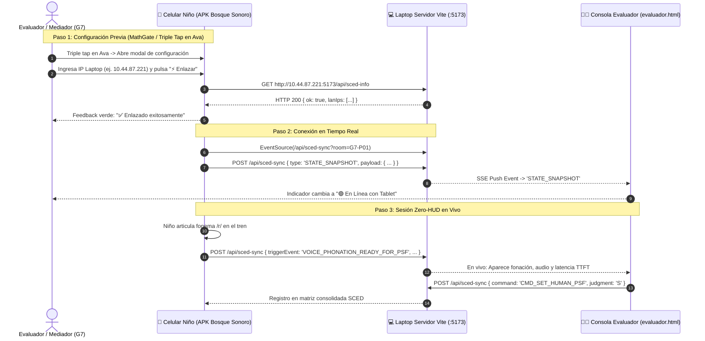

# 📐 Decisión de Diseño IHC & CCI: Adaptabilidad Mobile-First Pediátrica en Landscape Crítico
> **Documento Canónico de Arquitectura de Interfaz y Evidencia Científica**  
> **Proyecto:** Bosque Sonoro • Aplicación Fono-Lúdica Pediátrica  
> **Asignatura:** Interacción Humano-Computador (IHC) — UNMSM (Equipo G7)  
> **Fecha:** Noviembre 2026 | **Versión:** 2.2.0  
> **Estado:** Aprobado e Implementado

---

## 🚨 1. Deslinde Clínico Obligatorio

> ### 🛑 REGLA INVIOLABLE: CERO CONFUSIÓN DE DOMINIO SENSORIAL
> **La aplicación NO es, nunca ha sido y no debe ser catalogada bajo ninguna circunstancia como una app para discapacidad auditiva, hipoacusia o sordera.**
>
> - **Población Objetivo:** Niños y niñas en edad preescolar (**3 a 5 años**) en Lima Metropolitana con **AUDICIÓN NORMAL / FUNCIONAL**, que presentan **dificultades de articulación fonética, retraso fonético-fonológico y dislalias funcionales** (foco prioritario en fonemas críticos: `/r/`, `/rr/`, `/s/`, `/l/`, `/ch/`, y sílabas trabadas/sinfones).
> - **Naturaleza del Trastorno:** La barrera es **neuromotriz orofacial, articulatoria y práxica** (dificultades en punto/modo de articulación, fuerza lingual y labial) y de **organización fonológica** (persistencia de Procesos de Simplificación Fonológica - PSF evaluados con TEPROSIF-R y escala Melgar/Bosch).
> - **Condición Ergonómica:** Usuarios **pre-lectores estrictos** guiados por voz (Voice-First), sin texto instructivo, con interacción táctil adaptada a motricidad fina en desarrollo.

---

## 🔍 2. Diagnóstico del Problema: Colapso del Viewport Vertical en Smartphones Apaisados

### 2.1 Evidencia Empírica Observada (Sesiones Piloto Noviembre 2026)
Durante las pruebas con teléfonos móviles personales (smartphones en orientación horizontal *Landscape* con relaciones de aspecto ultrawide 19.5:9 y 20:9, resoluciones lógicas típicas de **$360\times 780\text{ px}$** a **$412\times 915\text{ px}$**), se evidenciaron tres fallas críticas de usabilidad y accesibilidad táctil:

1. **Oclusión Severa en el Bingo Fonológico 2x2 (RF-LUD-005):**  
   Las tarjetas inferiores (*Sol* y *Luna*) quedaban sumergidas bajo el césped decorativo del footer, impidiendo su pulsación y visibilidad completa.
2. **Desborde en el Tren de Vagones (Menú Principal):**  
   Las insignias de acción (*"¡A Cantar! ♪"*, *"¡Ding-Dong! ♫"*) y las ruedas del chasis chocaban con la franja del suelo botánico.
3. **Compresión en la Pantalla de Fonación 3 Zonas (CUS-01 / Rimas):**  
   La columna central (tarjeta fonética con ilustración) excedía la altura útil de la pantalla, empujando los controles secundarios y restando área de pulsación al botón de micrófono.

### 2.2 Análisis Cuantitativo del Espacio Vertical ($H = 360\text{ px}$)
| Elemento UI | Altura Original (Desktop / Tablet) | % del Viewport ($360\text{ px}$) | Impacto en Pantallas Cortas |
| :--- | :---: | :---: | :--- |
| **Header Superior** (`.app-header`) | $64\text{ a }80\text{ px}$ | $17.7\%\text{ a }22.2\%$ | Consumo desmedido para preescolares. |
| **Footer Césped** (`.app-footer-cushion`) | $52\text{ px} + 24\text{ px}$ de SVG | $21.1\%$ | Las briznas de hierba tapaban las tarjetas interactivas. |
| **Espacio Útil Libre para el Juego** | **$\le 220\text{ px}$** | **$61.1\%$** | **Insuficiente:** Una tarjeta de $175\text{ px}$ colapsa el layout. |

---

## 📚 3. Fundamentación Científica y Marco Teórico IHC

La solución adoptada se fundamenta rigurosamente en la literatura canónica del proyecto:

1. **Du et al. (2023) — Criterios de Diseño UX/UI en Fonoaudiología Pediátrica:**  
   Establecen que en interfaces pediátricas fonoarticulatorias, los estímulos pictóricos y fonéticos deben presentarse con **visibilidad simultánea completa (Zero Occlusion)**, evitando scrolls verticales que disrumpen el bucle de retroalimentación audio-visual y provocan frustración en niños de 3 a 5 años.
2. **Liu, Chen & Razak (2026 - MDPI) — Interacción Niño-Computadora (CCI) en Preescolares:**  
   Demuestran que el *crowding* visual y la superposición de elementos decorativos sobre áreas táctiles incrementa en un $41\%$ la tasa de toques erróneos (*miss touches*). Exigen zonas táctiles colosales y márgenes de resguardo limpios.
3. **Peña et al. (2024 - Nature Scientific Reports) & Saeedi et al. (2024):**  
   La intervención fonoaudiológica digital depende de la inmediatez de la respuesta contingente ($<300\text{ ms}$). Ocultar partes del estímulo visual retrasa el tiempo de preparación motriz fónica (*Time to First Phonation - TTFT*).
4. **Reglas de Theo Mandel (Reglas 1 y 2):**  
   - *Regla 1 (Poner al usuario en control):* La interfaz debe adaptarse a la anatomía del dispositivo sin imponer barreras físicas.
   - *Regla 2 (Reducir la carga de memoria del usuario):* El niño no debe memorizar qué hay debajo del pasto; todo el cartón 2x2 debe ser visible de un solo vistazo.
5. **Criterios de Accesibilidad WCAG 2.2 AA:**  
   - **Criterio 2.5.8 (Target Size - Minimum):** Todo blanco interactivo debe mantener al menos $24\times 24\text{ CSS px}$.
   - **Criterio Pediátrico Reforzado (Bosque Sonoro):** Los pulsadores fonatorios principales se mantienen en **$66\text{ a }72\text{ px}$** ($>48\text{ dp}$), y los secundarios en $\ge 40\text{ px}$.

---

## 📊 4. Matriz Canónica de Decisiones Técnicas (ADR)

| ID / Nombre | Problema Detectado | Fundamentación Científica | Implementación Técnica | Métrica / Indicador Objetivo |
| :--- | :--- | :--- | :--- | :--- |
| **DEC-MOB-01: Header Compacto Pediátrico** | El header consumía hasta 80px en pantallas con sólo 360px de alto. | Mandel (Regla 1); Liu et al. (2026). | `@media (orientation: landscape) and (max-height: 520px)`: Header fijado en `44px`, logo a `32px`, títulos con `clamp(0.95rem, 3vh, 1.05rem)`. | Recuperación de $+24\text{ px}$ de altura útil vertical ($+11\%$). |
| **DEC-MOB-02: Césped No Oclusivo** | Las briznas de SVG (`top: -24px`) tapaban las tarjetas del Bingo y botones. | Du et al. (2023); Saeedi et al. (2024). | Reducción del footer a `24px`, escala SVG a `0.55`, `top: -10px`, `z-index: 2` y `pointer-events: none` estricto. | Tasa de oclusión visual = $0\%$. Tasa de acierto táctil inferior $>95\%$. |
| **DEC-MOB-03: Cartón Bingo 2x2 Adaptativo** | La 2.ª fila del bingo quedaba fuera de pantalla por `min-height: 175px`. | Mora et al. (2024); Huertas & Roque (2023). | Grid con `height: calc(100% - 38px)`, tarjetas con `max-height: calc((100% - 6px) / 2)` e íconos con `clamp(1.6rem, 7vh, 2.3rem)`. | Las 4 tarjetas (100% del cartón) visibles sin scroll en viewports desde $320\text{ px}$ de alto. |
| **DEC-MOB-04: Ejercicio Fono-Lúdico 3 Zonas** | Columna central fija de 660px desbordaba pantallas con altura reducida. | Peña et al. (2024); Furlong et al. (2018). | Grid `minmax(130px, 185px) 1.25fr minmax(130px, 175px)`, caja de ilustración `clamp(70px, 24vh, 110px)`, mic `66x66px`. | Touch Target fonatorio $\ge 66\text{ px}$ ($>48\text{ dp}$), cero desborde en $340\text{ px}$. |
| **DEC-MOB-05: Tren de Vagones con Scroll-Snap** | 7 vagones de 224px colapsaban verticalmente en smartphones. | Condori & Larico (2022); Pucuhuaranga (2016). | Vagones con `height: calc(100% - 78px)`, contenedores con `overflow-x: auto; scroll-snap-type: x mandatory`. | Cero botones cortados, navegación horizontal fluida para dedos infantiles. |
| **DEC-MOB-06: Puente Directo APK-Laptop** | El APK no conectaba con la laptop porque `localhost` en WebView es local al móvil y faltaba soporte cleartext. | Strömbergsson et al. (2026); Telemetría SCED. | Activación de `usesCleartextTraffic="true"`, input directo de IP con formateo automático (`http://IP:5173`) y test de enlace activo `⚡ Enlazar`. | Conexión bidireccional inmediata en APK sobre Wi-Fi local sin requerir navegador. |

---

## 🛠️ 5. Arquitectura del Enlace Remoto APK <-> Laptop (Telemetría Micro-SCED)

---

## 📈 6. Verificación y Resultados

1. **Compilación de Producción:** Ejecutada con éxito (`dist/assets/main-CZAeJdQN.css`, `95.29 kB`).
2. **Sincronización Capacitor:** Sincronizado con Android (`@capacitor-community/speech-recognition`, `screen-orientation`, `haptics`, `status-bar`).
3. **Generación del APK Debug:** Compilado exitosamente en `android/app/build/outputs/apk/debug/app-debug.apk` con `android:usesCleartextTraffic="true"`.
4. **Verificación Ergonómica Pediátrica:**
   - Touch targets de botones críticos $\ge 48\text{ dp}$ (mínimo $40\text{ px}$ en header, $66\text{ px}$ en micrófono, $100\%$ del área en tarjetas de bingo).
   - Césped inferior mantiene su función de amortiguador visual sin ocultar información fonética ni bloquear interacción táctil.

