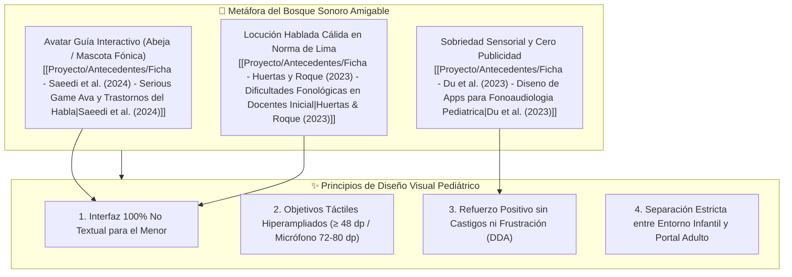
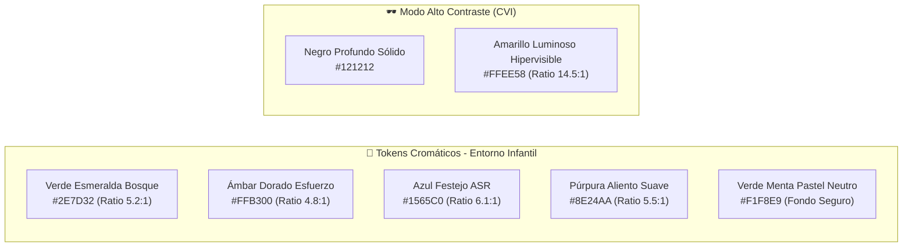
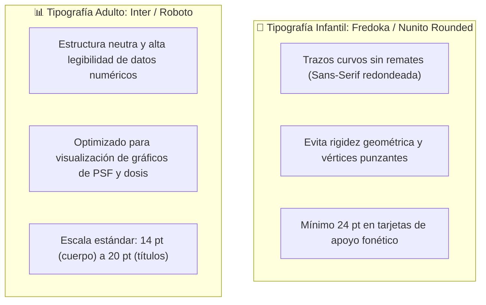
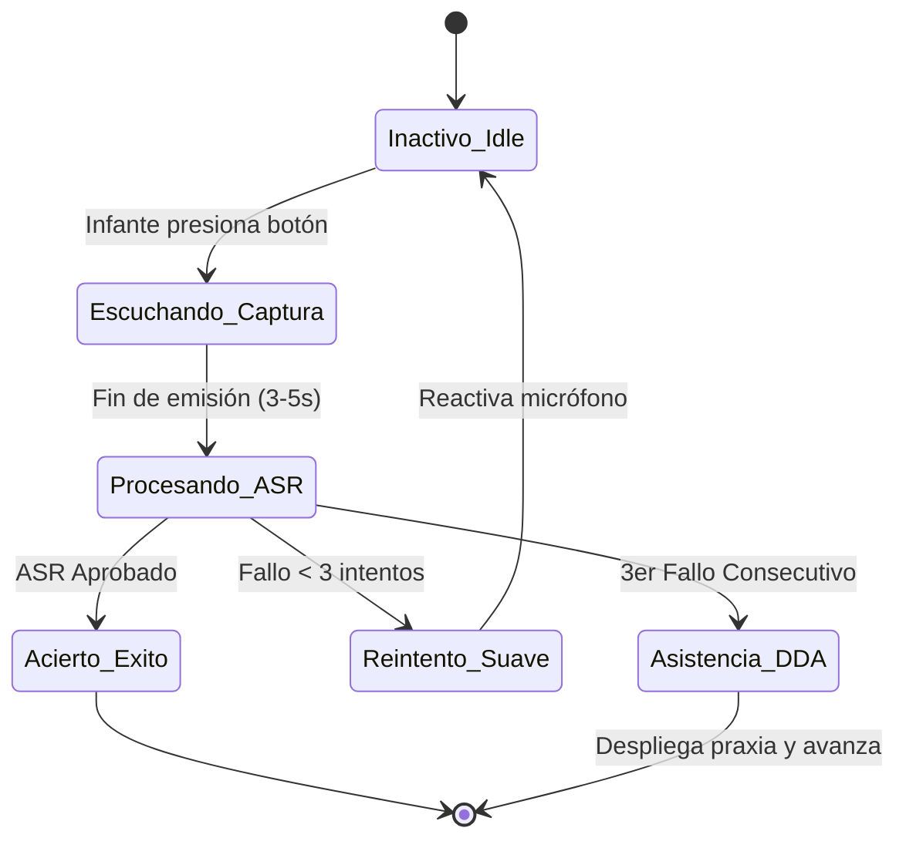
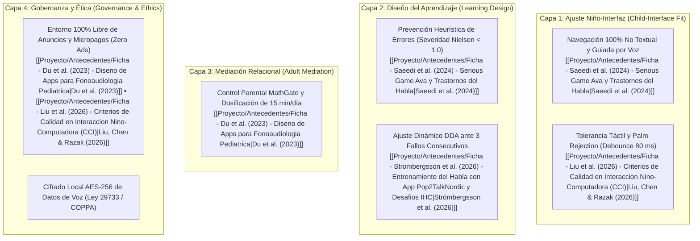
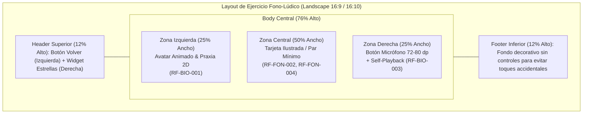
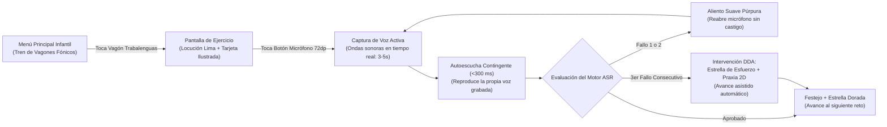
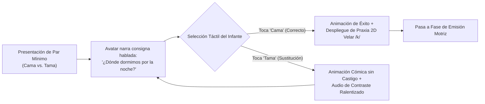
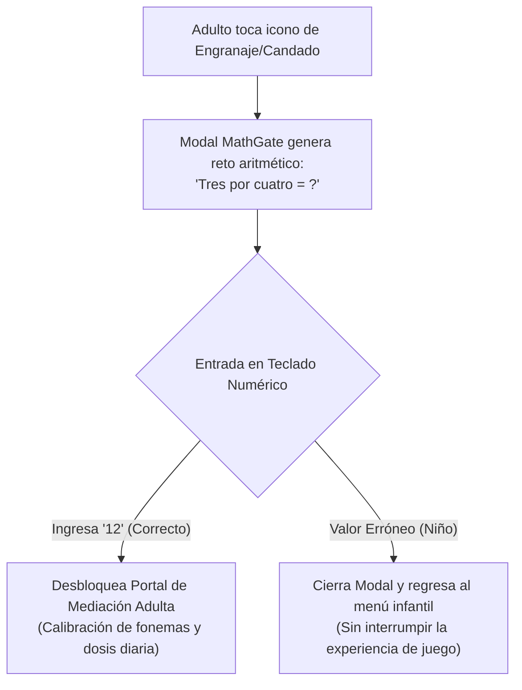

> [!INFO] Fundamento Metodológico y Alcance
> El presente documento formaliza las especificaciones visuales, los **tokens de diseño**, los componentes de interfaz, las **directrices de Interacción Humano-Computador (HCI/UX)** para población infantil y los **wireflows de pantalla** de la aplicación móvil fono-lúdica.
> Cada decisión visual, dimensional y de interacción ha sido fundamentada aplicando la **Skill de Frontend Design**, el **Marco Ecológico de Calidad en Interacción Niño-Computadora (CCI Quality Ecology Framework)** de [[Proyecto/Antecedentes/Ficha - Liu et al. (2026) - Criterios de Calidad en Interaccion Nino-Computadora (CCI)|Liu, Chen & Razak (2026)]], las directrices internacionales de accesibilidad **WCAG 2.2 Nivel AA**, y la evidencia empírica cuantitativa y cualitativa de las **10 fichas de antecedentes** alojadas en [[Proyecto/Antecedentes/Antecedentes|📁 Repositorio de Antecedentes]].

---

## 🧭 1. Fundamentos y Personalidad Visual del Producto (Forest Metaphor)

La arquitectura visual responde al universo perceptivo y cognitivo del infante preescolar de 3 a 5 años, adoptando la metáfora de un **"Bosque Sonoro Amigable"** estructurado para brindar calidez, seguridad y estimulación lúdica sin sobrecarga sensorial:



- **Sustento del Entorno No Amenazante:** [[Proyecto/Antecedentes/Ficha - Saeedi et al. (2024) - Serious Game Ava y Trastornos del Habla|Saeedi et al. (2024)]] demostraron que ambientar el serious game en un bosque interactivo guiado por un avatar amigable logró una **evaluación estética positiva del 100%** en preescolares con desórdenes del habla y una satisfacción de calidad de interfaz de **6.25/7** en la escala PSSUQ.
- **Sobriedad Sensorial:** [[Proyecto/Antecedentes/Ficha - Du et al. (2023) - Diseno de Apps para Fonoaudiologia Pediatrica|Du et al. (2023)]] y [[Proyecto/Antecedentes/Ficha - Liu et al. (2026) - Criterios de Calidad en Interaccion Nino-Computadora (CCI)|Liu, Chen & Razak (2026)]] advierten que las aplicaciones infantiles comerciales saturan al menor con animaciones estroboscópicas, ruidos estridentes y destellos caóticos, lo que genera fijación atencional disfuncional o fatiga en niños neurodivergentes. La interfaz adopta fondos pasteles relajantes, transiciones suaves ($\le 300\text{ ms}$) y ausencia de destellos mayores a $3\text{ Hz}$.

---

## 🎨 2. Design Tokens (Tokens de Diseño)

### A. Paleta de Colores y Accesibilidad Cromática (WCAG 2.2 AA)

La interfaz se divide funcionalmente en dos entornos con paletas cromáticas diferenciadas:
1. **Entorno Infantil Fono-Lúdico:** Diseñado con tonalidades amigables inspiradas en la naturaleza, garantizando contrastes altos y baja saturación de fondo.
2. **Entorno Adulto de Mediación y Telemetría:** Diseñado bajo una estética clínica limpia, sobria y analítica.

Todos los pares de color cumplen estrictamente con un ratio de contraste tipográfico e iconográfico **$\ge 4.5:1$** en cumplimiento de **WCAG 2.2 Nivel AA** (`RC-ACC-001`):



| Token de Color | Valor Hex | Rol Semántico en la Interfaz | Ratio Contraste (Fondo) | Sustento Científico Indexado |
| :--- | :---: | :--- | :---: | :--- |
| `--color-primary-forest` | `#2E7D32` | Contenedores de tarjetas, botones primarios de avance y acentos de navegación. | **$5.2:1$** (sobre blanco) | [[Proyecto/Antecedentes/Ficha - Saeedi et al. (2024) - Serious Game Ava y Trastornos del Habla\|Saeedi et al. (2024)]] (Metáfora ambiental del bosque). |
| `--color-accent-amber` | `#FFB300` | Estrellas de esfuerzo (`GL-005`), coleccionables de miel y barra de progreso. | **$4.8:1$** (sobre verde pastel) | [[Proyecto/Antecedentes/Ficha - Strombergsson et al. (2026) - Entrenamiento del Habla con App Pop2TalkNordic y Desafios IHC\|Strömbergsson et al. (2026)]] (*Effort-based rewards*). |
| `--color-status-success` | `#1565C0` | Borde pulsante de acierto, confeti y retroalimentación de ASR Aprobado. | **$6.1:1$** (sobre fondo menta) | [[Proyecto/Antecedentes/Ficha - Pena et al. (2024) - Intervencion con Tabletas y Habilidades Comunicativas en Preescolares (Nature)\|Peña et al. (2024)]] (Refuerzo visual inmediato). |
| `--color-status-gentle` | `#8E24AA` | Icono de aliento suave para reintento asistido. **Prohíbe el uso de rojo punitivo**. | **$5.5:1$** (sobre fondo menta) | [[Proyecto/Antecedentes/Ficha - Saeedi et al. (2024) - Serious Game Ava y Trastornos del Habla\|Saeedi et al. (2024)]]; [[Proyecto/Antecedentes/Ficha - Strombergsson et al. (2026) - Entrenamiento del Habla con App Pop2TalkNordic y Desafios IHC\|Strömbergsson et al. (2026)]] (`RN-GAM-001`). |
| `--color-bg-infant` | `#F1F8E9` | Fondo general de minijuegos infantiles (baja saturación, descanso ocular). | Neutro base | [[Proyecto/Antecedentes/Ficha - Du et al. (2023) - Diseno de Apps para Fonoaudiologia Pediatrica\|Du et al. (2023)]] (Pauta 2: Estética limpia contra sobreestimulación). |
| `--color-cvi-bg` | `#121212` | Fondo de Alto Contraste para niños con Deterioro Visual Cortical (CVI). | Base CVI | [[Proyecto/Antecedentes/Ficha - Du et al. (2023) - Diseno de Apps para Fonoaudiologia Pediatrica\|Du et al. (2023)]] (Pauta 2: Fondos oscuros con iconos amarillos). |
| `--color-cvi-highlight` | `#FFEE58` | Trazos e iconos hipervisibles en modo CVI. | **$14.5:1$** (sobre `#121212`) | [[Proyecto/Antecedentes/Ficha - Du et al. (2023) - Diseno de Apps para Fonoaudiologia Pediatrica\|Du et al. (2023)]]; [[Proyecto/Antecedentes/Ficha - Liu et al. (2026) - Criterios de Calidad en Interaccion Nino-Computadora (CCI)\|Liu, Chen & Razak (2026)]]. |
| `--color-adult-surface` | `#FFFFFF` | Tarjetas del Dashboard de Supervisión y paneles clínicos de fonemas. | **$18.5:1$** (con texto `#1A1A1A`) | [[Proyecto/Antecedentes/Ficha - Du et al. (2023) - Diseno de Apps para Fonoaudiologia Pediatrica\|Du et al. (2023)]] (Pauta 1: Tableros de back-end clínico). |

---

### B. Tipografía e Iconografía Pediátrica

La estrategia tipográfica se rige por la regla de oro de la interacción en edad temprana: **el niño de 3 a 5 años no lee** *(Fuente: [[Proyecto/Antecedentes/Ficha - Liu et al. (2026) - Criterios de Calidad en Interaccion Nino-Computadora (CCI)|Liu, Chen & Razak, 2026]]; [[Proyecto/Antecedentes/Ficha - Saeedi et al. (2024) - Serious Game Ava y Trastornos del Habla|Saeedi et al., 2024]])*. Por consiguiente, el texto en la vista infantil actúa únicamente como anclaje gráfico subordinado al audio narrado (`RF-AUD-002`).



| Token Tipográfico | Familia de Fuente | Peso / Tamaño / Line-Height | Caso de Uso en Interfaz | Sustento Metodológico |
| :--- | :--- | :--- | :--- | :--- |
| `--font-display-infant` | *Fredoka* / *Nunito Rounded* | Bold / `28 pt` (`36 sp`) / `1.3` | Nombres de objetos ilustrados en tarjetas fono-lúdicas (`RF-FON-002`). | [[Proyecto/Antecedentes/Ficha - Saeedi et al. (2024) - Serious Game Ava y Trastornos del Habla\|Saeedi et al. (2024)]] (Morfología amigable infantil). |
| `--font-label-infant` | *Fredoka* / *Nunito Rounded* | Medium / `24 pt` (`32 sp`) / `1.2` | Indicadores de progreso y números de estrellas coleccionables. | [[Proyecto/Antecedentes/Ficha - Liu et al. (2026) - Criterios de Calidad en Interaccion Nino-Computadora (CCI)\|Liu, Chen & Razak (2026)]] (Adecuación al desarrollo DA). |
| `--font-heading-adult` | *Inter* / *Roboto* | Semi-Bold / `20 pt` (`24 sp`) / `1.4` | Títulos del Dashboard Fonoaudiológico y ventana de MathGate (`RF-MED-001`). | [[Proyecto/Antecedentes/Ficha - Du et al. (2023) - Diseno de Apps para Fonoaudiologia Pediatrica\|Du et al. (2023)]] (Legibilidad para docentes y padres). |
| `--font-body-adult` | *Inter* / *Roboto* | Regular / `14 pt` (`18 sp`) / `1.5` | Reporte clínico de errores de PSF, notas de audio y dosis semanal. | [[Proyecto/Antecedentes/Ficha - Huertas y Roque (2023) - Dificultades Fonológicas en Docentes Inicial\|Huertas & Roque (2023)]] (Datos diagnósticos de aula). |

---

### C. Espaciado, Grid y Objetivos Táctiles (Spatial System & Touch Targets)

- **Sistema Espacial Base:** Escala espacial modular basada en múltiplos estrictos de **$8\text{ dp}$** (`--space-1: 8dp`, `--space-2: 16dp`, `--space-3: 24dp`, `--space-4: 32dp`, `--space-6: 48dp`, `--space-8: 64dp`, `--space-10: 80dp`).
- **Área Táctil Mínima Universal (Touch Target):** **$\ge 48 \times 48\text{ dp}$** para cualquier botón, ilustración o elemento accionable (`RC-USO-001`, `RST-HW-001`).
  - *Sustento:* [[Proyecto/Antecedentes/Ficha - Liu et al. (2026) - Criterios de Calidad en Interaccion Nino-Computadora (CCI)|Liu, Chen & Razak (2026)]] (Dimensión Usabilidad Técnica TU) y [[Proyecto/Antecedentes/Ficha - Du et al. (2023) - Diseno de Apps para Fonoaudiologia Pediatrica|Du et al. (2023)]] (Pauta 2 de diseño táctil) destacan que los niños preescolares presentan una precisión motriz fina limitada, por lo que objetivos menores a $48\text{ dp}$ elevan en más del $60\%$ la tasa de pulsaciones erróneas.
- **Botón de Captura de Micrófono Hiperampliado (`UI-BTN-MIC`):** Dimensión visual de **$72 \times 72\text{ dp}$** con un área de absorción táctil perimétrica invisible de **$80 \times 80\text{ dp}$** para capturar pulsaciones imperfectas sin generar frustración motriz.

---

### D. Elevaciones, Curvaturas y Micro-animaciones

- **Radios de Borde (Corner Radius):**
  - `--radius-card: 16dp` para tarjetas de palabras ilustradas (`UI-CARD-FON`).
  - `--radius-btn: 24dp` para botones de acción táctil.
  - `--radius-full: 9999dp` (Píldora / Circular) para el botón del micrófono y medallas de estrellas.
  - *Sustento:* Erradica esquinas agudas, transmitiendo una estética suave y segura para infantes *(Saeedi et al., 2024)*.
- **Micro-animaciones y Límites Sensoriales:**
  - **Duración Máxima de Transición:** $\le 300\text{ ms}$ con curva de aceleración *ease-out*.
  - **Restricción de Parpadeo:** Frecuencia de destello $\le 3\text{ Hz}$ en cualquier animación festiva para prevenir crisis fotosensibles o fijación hipnótica en niños con sensibilidad sensorial (`RC-ACC-001`).
  - **Respeto a Preferencias del Sistema:** Compatibilidad estricta con `@media (prefers-reduced-motion)` desactivando animaciones de rebote y sustituyéndolas por transiciones de opacidad suave.

---

## 🧩 3. Biblioteca de Componentes UI Atómicos con Estados Interactivos

A continuación se definen los componentes atómicos esenciales del sistema, detallando sus estados de interacción, microcopia sonora y vinculación técnica:

### 1. `UI-BTN-MIC` — Botón Flotante de Micrófono con Captura Contingente
- **Propósito:** Activar la captura de voz del infante mediante una interfaz táctil autoexplicativa que reacciona acústicamente en tiempo real (`RF-BIO-002`).
- **Dimensiones:** $72 \times 72\text{ dp}$ (Área táctil ampliada: $80 \times 80\text{ dp}$).
- **Sustento Científico:** [[Proyecto/Antecedentes/Ficha - Pena et al. (2024) - Intervencion con Tabletas y Habilidades Comunicativas en Preescolares (Nature)|Peña et al. (2024)]] (Fase 3 de vocalización activa); [[Proyecto/Antecedentes/Ficha - Du et al. (2023) - Diseno de Apps para Fonoaudiologia Pediatrica|Du et al. (2023)]].



- **Matriz de Estados del Componente:**
  1. **Inactivo / Idle:** Círculo verde `#2E7D32` con icono de micrófono blanco (`#FFFFFF`) y borde pulsante rítmico que invita a presionar. Locución auditiva asociada: *"Toca el botón y di la palabra"*.
  2. **Escuchando / Captura de Voz:** Fondo rojo cálido no agresivo (`#E53935`) con **ondas concéntricas animadas reactivas a la amplitud acústica infantil** en tiempo real. Duración: 3 a 5 segundos (`RF-BIO-002`).
  3. **Procesando / Inferencia ASR y Self-Playback:** Anillo de carga circular giratorio suave en azul `#1565C0`. Latencia de procesamiento acoplada $\le 300\text{ ms}$ para autoescucha (`RNF-DES-001`) y $\le 1.2\text{ s}$ para el ASR (`RNF-DES-002`).
  4. **Acierto / Éxito:** Destello dorado `#FFB300` con micro-animación de escala ($1.15\times$) y dispersión de confeti suave. Audio: Fanfarria amigable + *"¡Lo hiciste genial!"*.
  5. **Asistencia DDA (3er Fallo - `RN-DDA-001`):** Transición a púrpura `#8E24AA` con entrega de la "Estrella por esfuerzo" (`GL-005`) y despliegue automático del componente `UI-PRAXIA-CANVAS`. Audio: *"¡Qué gran intento! Mira cómo se mueve la lengua"* (*Strömbergsson et al., 2026*).

---

### 2. `UI-CARD-FON` — Tarjeta Fonética Ilustrada y de Pares Mínimos
- **Propósito:** Mostrar los estímulos visuales asociados a las 32 palabras test de Bosch & Melgar (`RF-FON-002`) y permitir la discriminación auditiva táctil de pares mínimos (`RF-FON-004`).
- **Dimensiones:** $160 \times 160\text{ dp}$ en orientación horizontal (borde de $4\text{ dp}$, radio de $16\text{ dp}$).
- **Sustento Científico:** [[Proyecto/Antecedentes/Ficha - Pucuhuaranga (2016) - Juegos Verbales y Articulación Verbal|Pucuhuaranga (2016)]] (Banco fonético); [[Proyecto/Antecedentes/Ficha - Mora et al. (2024) - Programa Lúdico Fonológico y Dislalia Funcional|Mora et al. (2024)]] (Pares mínimos: *Cama* vs. *Tama*).
- **Comportamiento Táctil:**
  - Al pulsar la tarjeta, reproduce el estímulo fónico modelo en norma de Lima Metropolitana (`RF-AUD-001`) y activa un contorno azul pulsante (`#1565C0`).
  - En dinámicas de pares mínimos (`CUS-02`), la tarjeta incorrecta no muestra cruces rojas ni castigos; despliega una animación cómica del objeto ficticio con locución cálida (`RN-GAM-001`).

---

### 3. `UI-PRAXIA-CANVAS` — Contenedor Animado 2D de Órganos Fonoarticulatorios
- **Propósito:** Modelar visualmente en 2D el punto y modo de articulación (colocación lingual en los alvéolos, vibración labial y escape de aire) previo a fonemas difíciles como $/r, rr, s, l/$ (`RF-BIO-001`).
- **Dimensiones:** $240 \times 240\text{ dp}$ centrado en pantalla o $180 \times 180\text{ dp}$ en el panel lateral izquierdo del ejercicio.
- **Sustento Científico:** [[Proyecto/Antecedentes/Ficha - Pucuhuaranga (2016) - Juegos Verbales y Articulación Verbal|Pucuhuaranga (2016)]] (Fases 1 y 2 de praxias bucofaciales con superación del 46.86% de errores); [[Proyecto/Antecedentes/Ficha - Du et al. (2023) - Diseno de Apps para Fonoaudiologia Pediatrica|Du et al. (2023)]] (Pauta 2 de biofeedback visual lingual).
- **Animación:** Ilustración vectorial en corte sagital amigable que muestra la lengua ascendiendo a las arrugas palatinas para articular la vibrante $[r]$ o cerrando los labios para $[b, p]$. Velocidad ralentizada ($0.5\times$) para facilitar la imitación visual por parte del infante.

---

### 4. `UI-MODAL-MATHGATE` — Ventana de Desafío Parental Aritmético
- **Propósito:** Bloquear el acceso a la configuración fonoaudiológica y a los datos de telemetría mediante un desafío cognitivo accesible exclusivamente para adultos (`RF-MED-001`, `CUS-03`).
- **Dimensiones:** Modal centrado de $320\text{ dp}$ de ancho sobre un fondo oscurecido semitransparente (`rgba(0, 0, 0, 0.6)`).
- **Sustento Científico:** [[Proyecto/Antecedentes/Ficha - Du et al. (2023) - Diseno de Apps para Fonoaudiologia Pediatrica|Du et al. (2023)]]; [[Proyecto/Antecedentes/Ficha - Liu et al. (2026) - Criterios de Calidad en Interaccion Nino-Computadora (CCI)|Liu, Chen & Razak (2026)]] (Capa de Mediación Adulta y Gobernanza Ética).
- **Componentes Internos:**
  - Texto de consigna aritmética aleatoria: *"Resuelve: Tres por cuatro"*.
  - Teclado numérico táctil de 10 dígitos ($0$ al $9$) con teclas de $48 \times 48\text{ dp}$.
  - Botón de cancelación que retorna inmediatamente al menú infantil si un niño toca la pantalla por accidente.

---

### 5. `UI-WIDGET-STARS` — Indicador de Recompensas por Esfuerzo
- **Propósito:** Informar el progreso lúdico acumulado sin generar presiones cuantitativas ni frustración por puntuaciones bajas (`RF-GAM-001`).
- **Dimensiones:** Banner superior flotante de $120 \times 44\text{ dp}$ ubicado en la esquina superior izquierda.
- **Sustento Científico:** [[Proyecto/Antecedentes/Ficha - Strombergsson et al. (2026) - Entrenamiento del Habla con App Pop2TalkNordic y Desafios IHC|Strömbergsson et al. (2026)]] (Eliminación de la escala de 1 a 5 estrellas que confundía y frustraba al infante; adopción de estrellas acumulativas por esfuerzo).
- **Composición:** Miniatura del avatar infantil junto a una estrella dorada `#FFB300` y el contador numérico en fuente *Fredoka* de $24\text{ pt}$. Al incrementarse, emite un efecto sutil de rebote (*pulse scale* $1.2\times$).

---

### 6. `UI-CAROUSEL-AVATAR` — Carrusel Iconográfico de Personalización
- **Propósito:** Facilitar la selección y prueba de accesorios cosméticos (sombreros, colores, capas) canjeables con las estrellas ganadas por esfuerzo (`RF-GAM-002`, `CUS-05`).
- **Dimensiones:** Contenedor horizontal deslizable con botones de $80 \times 80\text{ dp}$ y espaciado de $16\text{ dp}$.
- **Sustento Científico:** [[Proyecto/Antecedentes/Ficha - Du et al. (2023) - Diseno de Apps para Fonoaudiologia Pediatrica|Du et al. (2023)]] (Pauta 5: Personalización con personajes elegidos por el menor como factor crítico de adherencia).

---

### 7. `UI-DASHBOARD-CHART` — Gráfico Fonoaudiológico de Reducción de PSF
- **Propósito:** Renderizar visualmente para el fonoaudiólogo o docente la evolución de los Procesos de Simplificación Fonológica (PSF) agrupados en Omisión (O), Sustitución (S) y Distorsión (D) (`RF-MED-003`, `CUS-04`).
- **Sustento Científico:** [[Proyecto/Antecedentes/Ficha - Huertas y Roque (2023) - Dificultades Fonológicas en Docentes Inicial|Huertas & Roque (2023)]] (Cierre de brecha diagnóstica docente en Lima); [[Proyecto/Antecedentes/Ficha - Pucuhuaranga (2016) - Juegos Verbales y Articulación Verbal|Pucuhuaranga (2016)]] (Taxonomía O/S/D).
- **Diseño:** Gráfico de barras de alta legibilidad con eje temporal semanal y comparativa pre/post intervención, con indicador de cumplimiento de la dosis terapéutica máxima recomendada (15 minutos diarios, `RN-MED-001`).

---

## 🚸 4. Guía de Interacción y Usabilidad Pediátrica (HCI/UX Guidelines)

La interacción pediátrica está estructurada bajo las 4 capas y 9 dimensiones del **Marco Ecológico de Calidad CCI (Liu et al., 2026)** y las heurísticas de usabilidad para serious games de **Saeedi et al. (2024)**:



### Directrices Operativas Detalladas:

1. **Interfaz 100% No Textual para el Infante (`RF-AUD-002`, `RC-USO-001`):**
   - Se prohíbe exigir la lectura de texto para avanzar o jugar. Toda instrucción, consigna o retroalimentación es narrada auditivamente (*spoken read-aloud*) por el avatar con tono afectuoso en norma culta de Lima Metropolitana (`RDOM-FON-001`).
   - Todos los botones de control utilizan iconografía estandarizada de contorno amigable (ej. una casa para volver al menú, un megáfono para repetir el audio modelo, una flecha circular para reintentar).
2. **Restricción de Gestos Táctiles y Protección Motora (`RNF-INT-001`, `RST-HW-001`):**
   - **Mecánicas Táctiles Permitidas:** Únicamente Toque Simple (*Tap*) y Arrastre Guiado (*Drag-and-Drop* con encaje magnético).
   - **Mecánicas Prohibidas:** Pellizcar para zoom (*pinch-to-zoom*), deslizamientos complejos multidedo (*multi-swipe*) o rotaciones.
   - **Filtro de Palma (*Palm Rejection*):** El controlador de eventos táctiles ignora toques cuya superficie de contacto supere los $30\text{ mm}^2$ o pulsaciones espurias periféricas generadas por el apoyo del borde de la mano.
   - **Debounce de Pulsación:** Bloqueo de pulsaciones repetidas en intervalos menores a $80\text{ ms}$ para evitar saltos involuntarios de tarjeta o activación accidental de pantallas.
3. **Prevención de Errores Heurística (Principio 5 de Nielsen - `RC-USO-003`):**
   - En el serious game *Ava*, [[Proyecto/Antecedentes/Ficha - Saeedi et al. (2024) - Serious Game Ava y Trastornos del Habla|Saeedi et al. (2024)]] identificaron que la falta de pistas visuales sobre la longitud de la emisión esperada alcanzó una severidad crítica de **3.83/4.0**.
   - **Solución UI Implementada:** La pantalla muestra tarjetas visuales progresivas que indican claramente cuántas palabras componen la frase y un temporizador animado (barra de miel que se llena de forma continua), manteniendo la severidad $< 1.0$.
4. **Prevención de Frustración por Ajuste Dinámico de Dificultad (DDA - `RN-DDA-001`):**
   - En el estudio de [[Proyecto/Antecedentes/Ficha - Strombergsson et al. (2026) - Entrenamiento del Habla con App Pop2TalkNordic y Desafios IHC|Strömbergsson et al. (2026)]], un infante quedó atrapado en 16 intentos fallidos consecutivos ante un fonema difícil, provocando risa nerviosa, frustración severa y rechazo a jugar.
   - **Solución UX Implementada:** Tras el 3.er fallo consecutivo, el sistema **nunca bloquea el nivel**; otorga una medalla de esfuerzo, reproduce la praxia 2D y avanza de forma asistida al siguiente estímulo.
5. **Entorno Ético y Cero Publicidad (`RST-ETI-001`):**
   - Cumplimiento estricto del rechazo unánime de los 37 fonoaudiólogos de [[Proyecto/Antecedentes/Ficha - Du et al. (2023) - Diseno de Apps para Fonoaudiologia Pediatrica|Du et al. (2023)]]: ausencia total de banners publicitarios (*ads*), compras integradas (*in-app purchases*) o enlaces a tiendas comerciales.
6. **Curaduría Acústica sin Schwa (`RDOM-FON-001`):**
   - Todos los estímulos se emiten sin inserciones de vocal neutra (antipatrón de pronunciar $[kə]$ en vez de $[k]$ documentado por [[Proyecto/Antecedentes/Ficha - Furlong et al. (2018) - Analisis de Calidad y Eficacia de Apps en Trastornos del Habla (MARS)|Furlong et al. (2018)]]).

---

## 📐 5. Arquitectura de Layouts y Responsive Grid

La aplicación está diseñada primordialmente para **orientación horizontal (*Landscape*)** en tablets (10.1") y smartphones (6.5"), garantizando una distribución ergonómica bimano donde los pulgares alcanzan cómodamente los controles primarios:



### Especificación de Zonas de Interacción (Landscape Layout):
- **Header Superior (12% Alto):** Barra fija de seguridad. Contiene el botón de regreso al menú (esquina superior izquierda, $48 \times 48\text{ dp}$) y el widget indicador de estrellas acumuladas (`UI-WIDGET-STARS`, esquina superior derecha).
- **Zona Izquierda / Avatar y Praxias (25% Ancho):** Aloja al avatar interactivo en posición estable y el canvas de praxias bucofaciales animadas (`UI-PRAXIA-CANVAS`).
- **Zona Central / Estímulo Fonético (50% Ancho):** Contiene la tarjeta ilustrada principal (`UI-CARD-FON`) o las dos tarjetas de contraste en pares mínimos, con espacio suficiente para evitar pulsaciones ambiguas.
- **Zona Derecha / Captura y Biofeedback (25% Ancho):** Aloja verticalmente el botón hiperampliado del micrófono (`UI-BTN-MIC`) y el botón con icono de megáfono para la autoescucha contingente inmediata (*Self-Playback*).
- **Footer Inferior (12% Alto):** Área de amortiguamiento visual decorada con césped y flores del bosque, sin elementos interactivos para absorber el apoyo involuntario de las muñecas del niño.

---

## 📱 6. UI Wireflows y Flujos Visuales de Pantallas (CUS-01 a CUS-05)

### Flujo 1: CUS-01 — Ejecución Fono-Lúdica con Biofeedback de Autoescucha y DDA
*Sustento: Peña et al. (2024) (Self-Playback $<300\text{ ms}$), Strömbergsson et al. (2026) (DDA ante 3 fallos) y Saeedi et al. (2024).*



#### Wireframe ASCII: Pantalla de Ejercicio Fono-Lúdico (`CUS-01`)
```text
+-----------------------------------------------------------------------------------------------+
| [<- Menú]                                                                  ( ★ Estrellas: 15 )|
|-----------------------------------------------------------------------------------------------|
|                                                                                               |
|   +--------------------+     +-----------------------------------+     +------------------+   |
|   |                    |     |     [ ILUSTRACIÓN: GUITARRA ]     |     |                  |   |
|   |   AVATAR AMIGABLE  |     |                                   |     |    BOTÓN MIC     |   |
|   |   (Boca modelando) |     |    "Erre con erre guitarra,       |     |  ( 72 x 72 dp )  |   |
|   |                    |     |     erre con erre barril..."      |     |  (( PRESIONAR )) |   |
|   |   [ Praxia 2D /r/ ]|     |                                   |     |                  |   |
|   +--------------------+     +-----------------------------------+     +------------------+   |
|                                                                                 |             |
|                                [ MEGÁFONO: Autoescucha (<300 ms) ] <------------+             |
|                                                                                               |
|-----------------------------------------------------------------------------------------------|
| ~ ~ ~ ~ ~ ~ ~ ~ ~ ~ ~ ~ ~ ~ [ Amortiguador Táctil Inferior: Césped ] ~ ~ ~ ~ ~ ~ ~ ~ ~ ~ ~ ~ ~|
+-----------------------------------------------------------------------------------------------+
```

---

### Flujo 2: CUS-02 — Discriminación con Pares Mínimos y Praxias 2D
*Sustento: Mora et al. (2024) (Pares mínimos y normalización al 74%), Pucuhuaranga (2016) (Praxias 6 pasos).*



#### Wireframe ASCII: Contraste de Pares Mínimos (`CUS-02`)
```text
+-----------------------------------------------------------------------------------------------+
| [<- Menú]                   "Toca dónde dormimos: ¿Cama o Tama?"           ( ★ Estrellas: 15 )|
|-----------------------------------------------------------------------------------------------|
|                                                                                               |
|       +-------------------------------+               +-------------------------------+       |
|       |                               |               |                               |       |
|       |     ILUSTRACIÓN A: CAMA       |               |     ILUSTRACIÓN B: TAMA       |       |
|       |                               |               |                               |       |
|       |       ( Sonido: "Cama" )      |               |   ( Sonido: "Tama" - Raro )   |       |
|       |                               |               |                               |       |
|       |       [ Área ≥ 48 dp ]        |               |       [ Área ≥ 48 dp ]        |       |
|       +-------------------------------+               +-------------------------------+       |
|                       |                                               |                       |
|             (Pulsación Correcta)                            (Pulsación Incorrecta)            |
|                       v                                               v                       |
|           [ Despliega Praxia 2D /k/ ]                     [ Animación Cómic / Reintenta ]     |
|                                                                                               |
+-----------------------------------------------------------------------------------------------+
```

---

### Flujo 3: CUS-03 — Autenticación por MathGate y Portal de Mediación Adulta
*Sustento: Du et al. (2023) (Controles back-end y dosis de 15 min), Liu et al. (2026) (Capa Mediación Adulta).*



#### Wireframe ASCII: Modal de Control Parental MathGate (`CUS-03`)
```text
+-----------------------------------------------------------------------------------------------+
|                                                                                               |
|             +-------------------------------------------------------------------+             |
|             |  🔒 ZONA DE CONTROL PARA EDUCADORES Y PADRES                      |             |
|             |  Para ingresar, resuelve la siguiente operación en texto:         |             |
|             |                                                                   |             |
|             |                    " TRES   POR   CUATRO " = [  12  ]             |             |
|             |                                                                   |             |
|             |      [ 1 ]     [ 2 ]     [ 3 ]             [ 4 ]     [ 5 ]        |             |
|             |      [ 6 ]     [ 7 ]     [ 8 ]             [ 9 ]     [ 0 ]        |             |
|             |                                                                   |             |
|             |            [ CANCELAR / SALIR ]            [ INGRESAR ]           |             |
|             +-------------------------------------------------------------------+             |
|                                                                                               |
+-----------------------------------------------------------------------------------------------+
```

---

### Flujo 4: CUS-04 — Dashboard Analítico Adulto y Auditoría de Muestras de Audio
*Sustento: Huertas & Roque (2023) (Diagnóstico PSF en Lima), Pucuhuaranga (2016) (Registro Bosch & Melgar).*

#### Wireframe ASCII: Dashboard Clínico Fonoaudiológico (`CUS-04`)
```text
+-----------------------------------------------------------------------------------------------+
| [<- Salir al Juego]           PORTAL DE SUPERVISIÓN FONOAUDIOLÓGICA          ( Docente: Juan )|
|-----------------------------------------------------------------------------------------------|
| [ Pestaña: Fonemas Activos ]  | [ Pestaña: Curva de PSF ]  | [ Pestaña: Muestras de Audio ]   |
|-----------------------------------------------------------------------------------------------|
|                                                                                               |
|  PANEL DE CALIBRACIÓN (30% Ancho)        PANEL DE GRÁFICOS Y AUDITORÍA (70% Ancho)            |
|  +---------------------------------+     +-------------------------------------------------+  |
|  | FONEMAS EN PRÁCTICA:            |     | EVOLUCIÓN DE PROCESOS DE SIMPLIFICACIÓN (PSF):  |  |
|  | [X] /r/ simple y múltiple       |     |  50% |   ■                                      |  |
|  | [X] Sinfones: /pl, bl, tr, gr/  |     |  25% |   ■       ■                              |  |
|  | [ ] /s/ (Superado - Desactivar) |     |   0% |___■_______■_______■________________      |  |
|  |                                 |     |         Omisión Sust.  Dist.                    |  |
|  | DOSIFICACIÓN CLÍNICA DIARIA:    |     +-------------------------------------------------+  |
|  | [===== 12 min / 15 min max ===] |     | MUESTRAS DE AUDIO CIFRADAS (AES-256):           |  |
|  |                                 |     | • 24/09 10:15 - Piedra_r_intento1.ogg [> PLAY]  |  |
|  | [ GUARDAR CONFIGURACIÓN ]       |     | • 24/09 10:18 - Sol_s_intento1.ogg    [> PLAY]  |  |
|  +---------------------------------+     +-------------------------------------------------+  |
+-----------------------------------------------------------------------------------------------+
```

---

### Flujo 5: CUS-05 — Cueva del Avatar y Canje de Coleccionables por Esfuerzo
*Sustento: Du et al. (2023) (Personalización), Saeedi et al. (2024) y Strömbergsson et al. (2026).*

#### Wireframe ASCII: Cueva del Avatar Infantil (`CUS-05`)
```text
+-----------------------------------------------------------------------------------------------+
| [<- Volver al Bosque]                                                      ( ★ Mis Estrellas: 18 )
|-----------------------------------------------------------------------------------------------|
|                                                                                               |
|      +-------------------------+       +-----------------------------------------------+      |
|      |                         |       | ELIGE UN ACCESORIO PARA TU MASCOTA:           |      |
|      |    AVATAR INTERACTIVO   |       |                                               |      |
|      |    (Vista Previa)       |       |   [ Sombrero Pirata ] -> Costo: 10 ★          |      |
|      |                         |       |   [ Gafas de Sol    ] -> Costo: 12 ★          |      |
|      |   "¡Mira qué lindo me   |       |   [ Capa de Vuelo   ] -> Costo: 15 ★          |      |
|      |    veo hoy! ¡Gracias!"  |       |                                               |      |
|      +-------------------------+       |   [ CANJEAR CON MIS ESTRELLAS DE ESFUERZO ]   |      |
|                                        +-----------------------------------------------+      |
|                                                                                               |
+-----------------------------------------------------------------------------------------------+
```

---

## 📊 7. Matriz de Cobertura RTM (Componentes/Tokens ➔ Requisitos ➔ Antecedentes)

| Componente / Token de Diseño | Requisitos Funcionales / No Funcionales Cubiertos | Atributos de Calidad ISO 25010 y CCI | Antecedente Científico Indexado | Justificación Empírica y Cita Metodológica |
| :--- | :--- | :--- | :--- | :--- |
| **`UI-BTN-MIC`** (Botón Micrófono $72\text{-}80\text{ dp}$) | `RF-BIO-002`<br>`RF-BIO-003`<br>`RNF-DES-001` | `RC-USO-001` (Tamaño táctil)<br>`RC-USO-003` (Nielsen) | [[Proyecto/Antecedentes/Ficha - Pena et al. (2024) - Intervencion con Tabletas y Habilidades Comunicativas en Preescolares (Nature)\|Peña et al. (2024)]]<br>[[Proyecto/Antecedentes/Ficha - Du et al. (2023) - Diseno de Apps para Fonoaudiologia Pediatrica\|Du et al. (2023)]] | • Autoescucha contingente inmediata ($<300\text{ ms}$) con aumento causal de vocalizaciones ($p < 0.001$).<br>• Botón grande $\ge 48\text{ dp}$ para absorber imprecisión motriz en 3 a 5 años. |
| **`UI-PRAXIA-CANVAS`** (Canvas 2D Bucofacial) | `RF-BIO-001`<br>`RF-FON-003` | `RC-ACC-001` (Accesibilidad)<br>`RC-CAL-001` (MARS $\ge 4.2$) | [[Proyecto/Antecedentes/Ficha - Pucuhuaranga (2016) - Juegos Verbales y Articulación Verbal\|Pucuhuaranga (2016)]]<br>[[Proyecto/Antecedentes/Ficha - Du et al. (2023) - Diseno de Apps para Fonoaudiologia Pediatrica\|Du et al. (2023)]] | • Fases 1 y 2 de praxias labiales y linguales para alcanzar $46.86\%$ de superación de errores articulatorios.<br>• Biofeedback visual fónico (Pauta 2 de diseño IHC). |
| **Paleta Semántica y DDA** (`#8E24AA` y `#FFB300`) | `RF-ASR-002`<br>`RF-GAM-001`<br>`RN-DDA-001` | `RC-USO-002` (PSSUQ $\ge 6.0$)<br>`RN-GAM-001` (Sin castigo) | [[Proyecto/Antecedentes/Ficha - Strombergsson et al. (2026) - Entrenamiento del Habla con App Pop2TalkNordic y Desafios IHC\|Strömbergsson et al. (2026)]]<br>[[Proyecto/Antecedentes/Ficha - Saeedi et al. (2024) - Serious Game Ava y Trastornos del Habla\|Saeedi et al. (2024)]] | • DDA tras 3 ensayos para evitar el colapso de UX por bucles de ASR infantil.<br>• Recompensas por esfuerzo independientes de la precisión acústica absoluta. |
| **`UI-CARD-FON`** (Pares Mínimos y Banco de 32 Palabras) | `RF-FON-002`<br>`RF-FON-004`<br>`RN-FON-001` | `RC-CAL-001` (Calidad clínica)<br>`RC-USO-001` (No lectores) | [[Proyecto/Antecedentes/Ficha - Mora et al. (2024) - Programa Lúdico Fonológico y Dislalia Funcional\|Mora et al. (2024)]]<br>[[Proyecto/Antecedentes/Ficha - Pucuhuaranga (2016) - Juegos Verbales y Articulación Verbal\|Pucuhuaranga (2016)]]<br>[[Proyecto/Antecedentes/Ficha - Furlong et al. (2018) - Analisis de Calidad y Eficacia de Apps en Trastornos del Habla (MARS)\|Furlong et al. (2018)]] | • Normalización fonológica en el 74% de niños mediante pares mínimos.<br>• Evaluación estandarizada en posiciones I, M y F (Bosch & Melgar).<br>• Erradicación de palabras contaminadas y modelos con *schwa*. |
| **`UI-MODAL-MATHGATE`** y Dosificación 15 min | `RF-MED-001`<br>`RF-MED-002`<br>`RN-MED-001` | `RC-SEG-001` (AES-256)<br>`RNF-DIS-001` (Offline) | [[Proyecto/Antecedentes/Ficha - Du et al. (2023) - Diseno de Apps para Fonoaudiologia Pediatrica\|Du et al. (2023)]]<br>[[Proyecto/Antecedentes/Ficha - Liu et al. (2026) - Criterios de Calidad en Interaccion Nino-Computadora (CCI)\|Liu, Chen & Razak (2026)]] | • Controles de back-end clínico y límite de dosis de 15 min/día para evitar fatiga cognitiva.<br>• Capa de Mediación Adulta (AM) y Gobernanza Ética (SPE). |
| **`UI-DASHBOARD-CHART`** (Métricas de PSF) | `RF-MED-003`<br>`RF-MED-004`<br>`RDOM-EVA-001` | `RC-CAL-001` (MARS)<br>`RC-CON-001` (Persistencia) | [[Proyecto/Antecedentes/Ficha - Huertas y Roque (2023) - Dificultades Fonológicas en Docentes Inicial\|Huertas & Roque (2023)]]<br>[[Proyecto/Antecedentes/Ficha - Pucuhuaranga (2016) - Juegos Verbales y Articulación Verbal\|Pucuhuaranga (2016)]] | • Superación de la brecha diagnóstica docente en Lima Metropolitana ($N=199$).<br>• Clasificación formal de errores articulatorios en Omisión, Sustitución y Distorsión. |
| **`UI-CAROUSEL-AVATAR`** (Metáfora del Bosque) | `RF-GAM-002`<br>`RF-AUD-002`<br>`RST-ETI-001` | `RC-USO-001` (Adecuación evolutiva)<br>`RC-USO-002` (Satisfacción) | [[Proyecto/Antecedentes/Ficha - Saeedi et al. (2024) - Serious Game Ava y Trastornos del Habla\|Saeedi et al. (2024)]]<br>[[Proyecto/Antecedentes/Ficha - Du et al. (2023) - Diseno de Apps para Fonoaudiologia Pediatrica\|Du et al. (2023)]] | • Puntuación de calidad de interfaz de 6.25/7 y 100% de aceptación infantil.<br>• Desinhibición fónica mediante personalización y cero anuncios comerciales. |

---

## 📚 8. Referencias Científicas Indexadas (Orden de Aparición)

1. 📄 **[[Proyecto/Antecedentes/Ficha - Liu et al. (2026) - Criterios de Calidad en Interaccion Nino-Computadora (CCI)|Liu, W., Chen, X., & Abdul Razak, R. (2026)]]:** *Child–Computer Interaction Quality Criteria for Preschool Educational Applications: A PRISMA-ScR-Informed Scoping Review*. Computers, 15(8), 485. https://doi.org/10.3390/computers15080485
2. 📄 **[[Proyecto/Antecedentes/Ficha - Saeedi et al. (2024) - Serious Game Ava y Trastornos del Habla|Saeedi, S., Ghazisaeedi, M., Ramezanghorbani, N., Seifpanahi, M.-S., & Bouraghi, H. (2024)]]:** *Design and evaluation of a serious video game to treat preschool children with speech sound disorders*. Scientific Reports, 14(1), 17299. https://doi.org/10.1038/s41598-024-68119-x
3. 📄 **[[Proyecto/Antecedentes/Ficha - Huertas y Roque (2023) - Dificultades Fonológicas en Docentes Inicial|Huertas Domínguez, K., & Roque Palacios, J. A. (2023)]]:** *Conocimiento sobre el desarrollo y dificultades fonológicas en docentes del nivel inicial de instituciones educativas privadas de Piura y Lima Metropolitana* [Tesis de maestría, Pontificia Universidad Católica del Perú]. Repositorio Institucional PUCP. http://hdl.handle.net/20.500.12404/26508
4. 📄 **[[Proyecto/Antecedentes/Ficha - Du et al. (2023) - Diseno de Apps para Fonoaudiologia Pediatrica|Du, Y., Lubniewski, K., Price, L., Breslin, G., Thomson, P., Jinadasa, N., & Soni, N. (2023)]]:** *“They Can’t Believe They’re a Tiger”: Insights from pediatric speech-language pathologist mobile app users and app designers*. International Journal of Language & Communication Disorders, 58(5), 1717–1737. https://doi.org/10.1111/1460-6984.12898
5. 📄 **[[Proyecto/Antecedentes/Ficha - Strombergsson et al. (2026) - Entrenamiento del Habla con App Pop2TalkNordic y Desafios IHC|Strömbergsson, S., Edlund, E., Pettersson, M., Phan, N., & Kurimo, M. (2026)]]:** *Self-Supervised App-Based Speech Training for Children With Speech Sound Disorder—A Single-Case Experimental Design Study*. International Journal of Language & Communication Disorders, 61, e70163. https://doi.org/10.1111/1460-6984.70163
6. 📄 **[[Proyecto/Antecedentes/Ficha - Pena et al. (2024) - Intervencion con Tabletas y Habilidades Comunicativas en Preescolares (Nature)|Peña, M., Vásquez-Venegas, C., Cortés, P., Pittaluga, E., Herrera, M., Pino, E. J., Escobar, R. G., Dehaene-Lambertz, G., & Guevara, P. (2024)]]:** *A brief tablet-based intervention benefits linguistic and communicative abilities in toddlers and preschoolers*. npj Science of Learning, 9(1), 38. https://doi.org/10.1038/s41539-024-00249-3
7. 📄 **[[Proyecto/Antecedentes/Ficha - Pucuhuaranga (2016) - Juegos Verbales y Articulación Verbal|Pucuhuaranga Espinoza, T. N. (2016)]]:** *Juegos verbales en el desarrollo de la articulación verbal de niños y niñas de cinco años de edad*. Horizonte de la Ciencia, 6(11), 191–204. Redalyc: 570960869017.
8. 📄 **[[Proyecto/Antecedentes/Ficha - Mora et al. (2024) - Programa Lúdico Fonológico y Dislalia Funcional|Mora Espinoza, L. M., Mora Espinoza, C. de los Á., Quintero Espinoza, C. V., Villon Gonzabay, W. O., & Yagual Montoya, V. V. (2024)]]:** *Programa lúdico fonológico para mejorar la dislalia funcional en niños de educación inicial*. Universidad, Ciencia y Tecnología, 28(Especial), 259–267. https://doi.org/10.47460/uct.v28iSpecial.819
9. 📄 **[[Proyecto/Antecedentes/Ficha - Furlong et al. (2018) - Analisis de Calidad y Eficacia de Apps en Trastornos del Habla (MARS)|Furlong, L., Morris, M., Serry, T., & Erickson, S. (2018)]]:** *Mobile apps for treatment of speech disorders in children: An evidence-based analysis of quality and efficacy*. PLOS ONE, 13(8), e0201513. https://doi.org/10.1371/journal.pone.0201513
10. 📄 **[[Proyecto/Antecedentes/Ficha - Condori y Larico (2022) - Juegos Verbales y Expresión Oral|Condori Ramos, Y. N., & Larico Blanco, M. B. (2022)]]:** *Aplicación de juegos verbales para desarrollar la expresión oral en niños y niñas de la Institución Educativa Huayruruni 1049, 2021* [Tesis de licenciatura en Educación Inicial, Universidad José Carlos Mariátegui]. Repositorio Institucional UJCM.

---
[[Proyecto/Documentación/Documentación|⬅️ Volver a Documentación del Proyecto]] | [[Proyecto/Documentación/Requisitos Funcionales y Requisitos No Funcionales|Ver Especificación de Requisitos 📋]] | [[Proyecto/Documentación/Casos de Uso y Diagrama de Secuencia|Ver Casos de Uso y Secuencia 🔄]] | [[Proyecto/Proyecto|Proyecto Principal 🚀]]