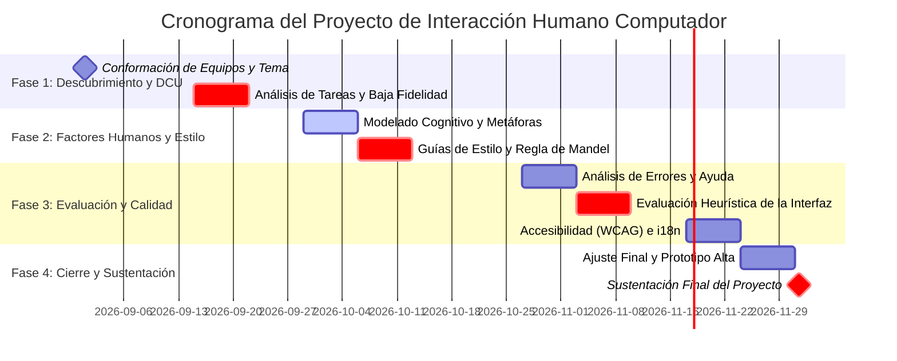
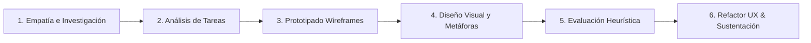

# 🚀 Proyecto de Asignatura: Diseño y Evaluación de Interfaces Centradas en el Usuario

> [!IMPORTANT] Peso en la Evaluación Continua ($N_2$)
> El proyecto de la asignatura constituye el componente medular de la **Evaluación Continua ($N_2$)**, la cual equivale al **40% del Promedio Final ($PF$)**.
> Se evalúa a través de la combinación ponderada de:
> - **Entregables ($Es$):** Documentación técnica, diagramas de tareas, guías de estilo, prototipos interactivos y matrices de evaluación.
> - **Defensas y Exposiciones ($DFs$):** Sustentaciones de avances y defensa del proyecto final ante el docente y compañeros.
> 
> $$\text{Proy} = \text{Ponderar}(Es, DFs)$$

---

## 🎯 Competencias Vinculadas

- **CT6.3 (Avanzado):** Aplica mediante un prototipo la idea del plan de negocio para construir soluciones de software innovadoras con responsabilidad social.
- **CT8.2 (Intermedio):** Aplica metodologías de Diseño Centrado en el Usuario (DCU), técnicas de prototipado y estándares de calidad de software.
- **RA2:** Diseña interfaces de usuario centradas en el usuario aplicando métodos, principios y herramientas de prototipado.
- **RA3:** Evalúa interfaces hombre-computador mediante inspección heurística y pruebas de usabilidad con métricas cuantitativas y cualitativas.
- **RA4:** Propone mejoras en el diseño considerando accesibilidad, internacionalización, modelos conceptuales y psicología de la interacción.

---

## 🛠️ Cronograma de Hitos y Entregables

### 📋 Matriz Detallada de Hitos y Revisiones

| Hito | Semana | Ponderación | Entregable / Actividad Principal | Estado |
| :---: | :---: | :---: | :--- | :---: |
| **H1** | **Semana 01** | Formativa | **Conformación de equipos y definición del problema:** Propuesta del dominio, usuarios objetivo y alcance preliminar de la aplicación. | 🔲 Pendiente |
| **H2** | **Semana 04** | Calificada | **Análisis de tareas y prototipos de baja fidelidad:** Diagramas HTA (*Hierarchical Task Analysis*), personas, escenarios y bocetos en papel/wireframes rápidos. | 🔲 Pendiente |
| **H3** | **Semana 05** | Formativa | **Revisión de factores humanos:** Análisis ergonómico, modelos mentales, paleta cromática accesible y carga cognitiva. | 🔲 Pendiente |
| **H4** | **Semana 06** | Calificada | **Metáforas de interfaz:** Definición de modelos conceptuales, metáforas operativas y aplicación al diseño inicial. | 🔲 Pendiente |
| **H5** | **Semana 07** | Calificada | **Guía de estilos y consistencia:** Aplicación de la Regla de Mandel, componentes UI, tipografía y exposición de avances. | 🔲 Pendiente |
| **H6** | **Semana 09** | Formativa | **Prevención y manejo de errores:** Identificación de deslices/equivocaciones, retroalimentación al usuario y microcopia de mensajes. | 🔲 Pendiente |
| **H7** | **Semana 11** | Calificada | **Evaluación Heurística Formal:** Informe de inspección heurística cruzada (Heurísticas de Nielsen/Tognazzini) con cálculo de severidad. | 🔲 Pendiente |
| **H8** | **Semana 13** | Formativa | **Accesibilidad e Internacionalización:** Auditoría de contraste, soporte para lectores de pantalla (ARIA), WCAG 2.2 y consideraciones l10n. | 🔲 Pendiente |
| **H9** | **Semana 14** | Formativa | **Ajustes finales de la propuesta:** Optimización responsive, microinteracciones y afinamiento del prototipo de alta fidelidad interactivo. | 🔲 Pendiente |
| **H10** | **Semana 15** | **Sumativa Final** | **Presentación y Sustentación Integral:** Demostración en vivo del prototipo navegable, informe final de investigación y defensa grupal. | 🔲 Pendiente |

---

## 👥 Datos del Equipo y del Artículo Científico

- **Título del Artículo / Proyecto:** *Aplicación fono-lúdica enfocada en la mejora de la articulación fonética en aplicaciones educativas en estudiantes de nivel preescolar de Lima Metropolitana*
- **Población Objetivo:** Niños y niñas en edad preescolar (3 a 5 años) de Lima Metropolitana.
- **Enfoque Fono-Lúdico:** Serious game móvil con reconocimiento de voz, dinámicas de juegos verbales (trabalenguas, rimas, adivinanzas) e interfaz basada en audio/animaciones para no lectores.
- **Enlace a Figma / Prototipo:** *(URL)*
- **Repositorio de Código / Documentación:** *(URL)*

### Integrantes y Roles
1. **Líder de Proyecto / UX Researcher:** *(Nombre y correo)*
2. **Diseñador de Interfaz (UI Designer):** *(Nombre y correo)*
3. **Analista de Tareas y Arquitecto de Información:** *(Nombre y correo)*
4. **Evaluador de Usabilidad y Calidad:** *(Nombre y correo)*

---

## 📋 Documentación Técnica y Requisitos de Software

- 📋 **[[Especificación Refinada de Requisitos de Software Aplicación Fono-Lúdica para la Articulación Fonética en Preescolares|Especificación Refinada de Requisitos de Software]]:** Especificación completa de Requisitos Funcionales (RF), No Funcionales (RNF), Requisitos de Calidad ISO/IEC 25010 (RC), Reglas de Negocio (RN), Restricciones (RST) y Matriz de Trazabilidad RTM con indexación de los 10 antecedentes.
- 🔄 **[[Especificación de Casos de Uso y Diagramas de Secuencia Aplicación Fono-Lúdica Pediátrica|Casos de Uso y Diagramas de Secuencia]]:** Casos de Uso del Sistema (CUS), transición AS-IS ➔ TO-BE, particiones swimlanes, 4 diagramas de secuencia Mermaid y matriz RTM.
- 🎨 **[[Sistema de Diseño (Design System), Tokens de Diseño, Directrices HCIUX y Wireflows Pediátricos|Sistema de Diseño, Tokens, Guía HCI/UX y Wireflows]]:** Design System pediátrico, tokens de color (WCAG 2.2 AA y modo CVI), componentes atómicos con estados, pautas de interacción del Marco Ecológico CCI y wireflows.
- 🎮 **[[Prototipo Interactivo Fono-Lúdico de Alta Fidelidad|Prototipo Interactivo de Alta Fidelidad (Bosque Sonoro)]]:** Prototipo navegable implementado al 100% (HTML5/CSS3/JS, Web Audio, praxias 2D, DDA, MathGate y Dashboard) desplegado localmente en `http://localhost:5173`.
- 📁 **[[Proyecto/Documentación/Documentación|MOC de Documentación Técnica]]**

---

## 📑 Antecedentes y Estado del Arte

Se ha estructurado un repositorio de antecedentes en la carpeta **[[Proyecto/Antecedentes/Antecedentes|📁 Antecedentes del Proyecto]]**, la redacción completa del manuscrito en **[[Proyecto/Artículo - Aplicación Fono-Lúdica para la Articulación Fonética en Preescolares|📄 Manuscrito Oficial del Artículo]]** y la guía metodológica de escritura en **[[Proyecto/Guía de Redacción - Introducción, Problemática y Antecedentes|📝 Guía de Redacción]]**:

- 📄 **[[Proyecto/Artículo - Aplicación Fono-Lúdica para la Articulación Fonética en Preescolares|Manuscrito Oficial del Artículo]]:** Documento completo con encabezado UNMSM, Resumen, Abstract, Introducción (I), Estado del Arte con 10 antecedentes (II), Problemática (III) y Referencias IEEE.
- 📝 **[[Proyecto/Guía de Redacción - Introducción, Problemática y Antecedentes|Guía de Redacción]]:** Pautas detalladas, esquemas en embudo, fórmulas de redacción de antecedentes y checklist.
- 📑 **[[Proyecto/Antecedentes/Antecedentes|Matriz Comparativa y Mapeo del Estado del Arte]]:** Síntesis de los tres pilares (contexto Lima, efectividad de juegos verbales y arquitectura móvil IHC).
- 📄 **[[Proyecto/Antecedentes/Ficha - Huertas y Roque (2023) - Dificultades Fonológicas en Docentes Inicial|Ficha 01 - Huertas & Roque (2023)]]:** Tesis de Maestría PUCP sobre desarrollo y dificultades fonológicas en preescolar (Lima Metropolitana y Piura).
- 📄 **[[Proyecto/Antecedentes/Ficha - Condori y Larico (2022) - Juegos Verbales y Expresión Oral|Ficha 02 - Condori & Larico (2022)]]:** Tesis UJCM que demuestra la correlación positiva ($r = 0.612$) entre juegos verbales y la dimensión fonológica.
- 📄 **[[Proyecto/Antecedentes/Ficha - Pucuhuaranga (2016) - Juegos Verbales y Articulación Verbal|Ficha 03 - Pucuhuaranga (2016)]]:** Estudio cuasiexperimental (*Horizonte de la Ciencia*) con 46.86% de superación de errores articulatorios y banco de 32 palabras test de Bosch & Melgar.
- 📄 **[[Proyecto/Antecedentes/Ficha - Saeedi et al. (2024) - Serious Game Ava y Trastornos del Habla|Ficha 04 - Saeedi et al. (2024)]]:** Publicación en *Nature Scientific Reports* sobre el serious game *Ava*, reconocimiento de voz y evaluación heurística de usabilidad (Nielsen y PSSUQ).
- 📄 **[[Proyecto/Antecedentes/Ficha - Mora et al. (2024) - Programa Lúdico Fonológico y Dislalia Funcional|Ficha 05 - Mora et al. (2024)]]:** Artículo científico experimental (*Universidad, Ciencia y Tecnología*) que valida un programa fono-lúdico alcanzando un 74% de habla normalizada en preescolares.
- 📄 **[[Proyecto/Antecedentes/Ficha - Du et al. (2023) - Diseno de Apps para Fonoaudiologia Pediatrica|Ficha 06 - Du et al. (2023)]]:** Estudio en *IJLCD* con 37 fonoaudiólogos que define 5 pautas de diseño IHC para apps de terapia del habla infantil.
- 📄 **[[Proyecto/Antecedentes/Ficha - Furlong et al. (2018) - Analisis de Calidad y Eficacia de Apps en Trastornos del Habla (MARS)|Ficha 07 - Furlong et al. (2018)]]:** Revisión sistemática en *PLOS ONE* de 132 apps con la escala MARS y catálogo de antipatrones fonéticos comerciales.
- 📄 **[[Proyecto/Antecedentes/Ficha - Strombergsson et al. (2026) - Entrenamiento del Habla con App Pop2TalkNordic y Desafios IHC|Ficha 08 - Strömbergsson et al. (2026)]]:** Estudio experimental SCED en *IJLCD* sobre la app *Pop2TalkNordic*, limitaciones del ASR, ajuste dinámico de dificultad (DDA) y prevención de frustración en niños.
- 📄 **[[Proyecto/Antecedentes/Ficha - Liu et al. (2026) - Criterios de Calidad en Interaccion Nino-Computadora (CCI)|Ficha 09 - Liu, Chen & Razak (2026)]]:** Revisión de alcance en *Computers (MDPI)* que establece el Marco Ecológico de Calidad en Interacción Niño-Computadora (CCI) en 4 capas y 9 dimensiones para apps preescolares.
- 📄 **[[Proyecto/Antecedentes/Ficha - Pena et al. (2024) - Intervencion con Tabletas y Habilidades Comunicativas en Preescolares (Nature)|Ficha 10 - Peña et al. (2024)]]:** Estudio experimental en *Nature npj Science of Learning* (N=152 preescolares) que demuestra ganancias causales en comprensión auditiva, vocalizaciones y retención a largo plazo con la batería TEPROSIF.

---

## 🔬 Fases Metodológicas del Proyecto

1. **Investigación de Usuarios (User Research):** Creación de *User Personas*, mapas de empatía y entrevistas para levantar necesidades reales.
2. **Arquitectura y Tareas (HTA):** Descomposición jerárquica de tareas, flujos de navegación (*user flows*) y wireflows.
3. **Prototipado Evolutivo:**
   - *Baja Fidelidad:* Papel, bocetos manuales, Balsamiq.
   - *Media Fidelidad:* Wireframes esquemáticos con jerarquía de contenidos.
   - *Alta Fidelidad:* Figma con componentes interactivos, auto-layout y variantes.
4. **Inspección y Evaluación de Usabilidad:**
   - Lista de chequeo heurística (10 heurísticas de Jakob Nielsen).
   - Matriz de severidad (0 = sin problema, 4 = catástrofe de usabilidad).
   - Pruebas con usuarios (*Think Aloud Protocol* / tiempo en tarea / tasa de éxito).
5. **Auditoría de Inclusión y Estándares:** Validación de criterios WCAG 2.2 nivel AA, contraste cromático, navegación por teclado y diseño adaptable.

---

## 🧰 Recursos y Herramientas Recomendadas

- **Diseño y Prototipado:** [Figma](https://www.figma.com/), [Penpot](https://penpot.app/).
- **Mapeo y Tareas:** [Miro](https://miro.com/), [Whimsical](https://whimsical.com/).
- **Evaluación y Accesibilidad:** [WAVE Web Accessibility Tool](https://wave.webaim.org/), [axe DevTools](https://www.deque.com/axe/devtools/), [Colour Contrast Analyser (CCA)](https://www.tpgi.com/color-contrast-checker/).
- **Guías y Normas:** [Nielsen Norman Group (NN/g)](https://www.nngroup.com/), [W3C Web Accessibility Guidelines (WCAG 2.2)](https://www.w3.org/TR/WCAG22/).

---
[[Interacción Humano Computador|⬅️ Volver a Interacción Humano Computador]] | [[Sesiones/Sesiones|Ir a Sesiones 📚]]
