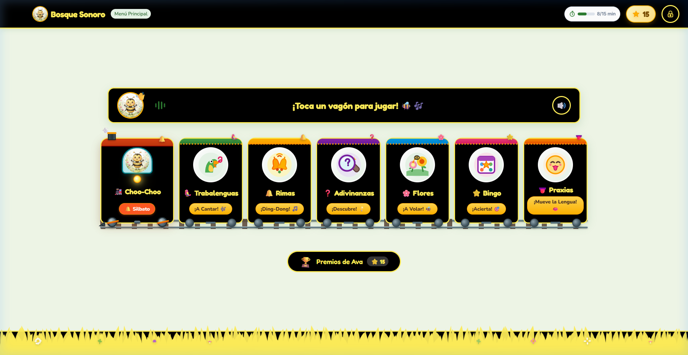
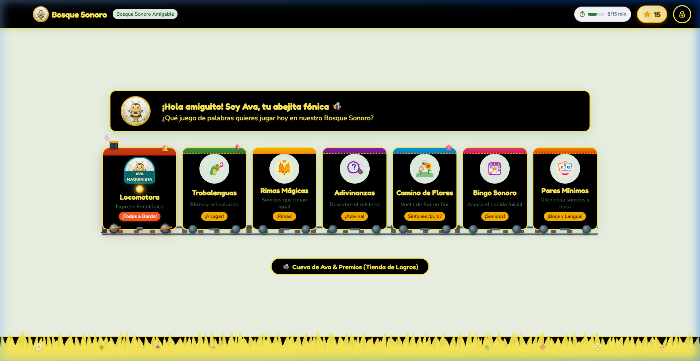
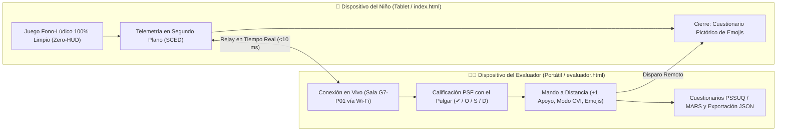

# 🗣️ Aplicación Fono-Lúdica Pediátrica
> **Estimulación y Mejora de la Articulación Fonética en Estudiantes de Nivel Preescolar de Lima Metropolitana**  
> *Proyecto Académico y de Investigación en Interacción Humano-Computador (IHC)*

[](https://opensource.org/licenses/MIT)
[](Proyecto/Documentación/Sistema%20de%20Diseño%20(Design%20System),%20Tokens%20de%20Diseño,%20Directrices%20HCIUX%20y%20Wireflows%20Pediátricos.md)
[](Proyecto/Antecedentes/Antecedentes.md)

---

## 🎯 Descripción General

La **Aplicación Fono-Lúdica** es un sistema digital interactivo diseñado bajo los principios de la **Interacción Niño-Computadora (CCI - *Child-Computer Interaction*)**, accesibilidad universal (**WCAG 2.2 Nivel AA**) y neurodesarrollo fonoaudiológico. Su propósito principal es apoyar a niños preescolares (3 a 5 años) en la prevención y tratamiento de dificultades fonético-fonológicas y dislalias funcionales (enfocado en fonemas críticos como `/r/`, `/rr/`, `/s/`, `/l/` y `/ch/`), combinando dinámicas de juego serio (*serious games*), biofeedback multimodal contingente (<300 ms), retroalimentación visual 2D de praxias bucofaciales y trazabilidad clínica automatizada.

El proyecto integra:
1. **Un Prototipo Interactivo de Alta Fidelidad** ejecutable en la web.
2. **Documentación Técnica y Metodológica Exhaustiva** fundamentada en 10 investigaciones científicas del estado del arte.
3. **Casos de Uso, Diagramas de Secuencia y Actividad** que modelan la transición de la terapia tradicional (*AS-IS*) hacia la solución tecnológica asistida (*TO-BE*).
4. **Sistema de Diseño (Design System) Pediátrico** con tokens de accesibilidad (modo estándar y modo alto contraste para Deficiencia Visual Cortical - CVI).

---

## 🗺️ Mapa de Conexión con la Documentación Técnica

Toda la documentación técnica se encuentra centralizada y enlazada de forma navegable. Puedes acceder directamente a cada documento desde los siguientes enlaces:

| Entregable / Módulo Técnico | Enlace Directo al Documento | Descripción y Contenido Clave |
| :--- | :--- | :--- |
| **📑 Índice Central de Documentación** | [Documentación.md](Proyecto/Documentación/Documentación.md) | Centro de comando y mapa MOC de las 4 carpetas técnicas del proyecto. |
| **🎭 Actividad 6: Metáforas de Interfaz** | [Actividad 6 - Metáforas](Proyecto/Documentación/Actividad%206%20-%20Metaforas/Actividad%206%20-%20Metáforas%20de%20Interfaz.md) | Marco conceptual (5+ artículos), modelos mentales, y operacionalización de los 4 tipos de metáforas. |
| **👑 Actividad 7: Principios y Guías de Estilo** | [Actividad 7 - Principios y Guía de Estilo](Proyecto/Documentación/Actividad%207%20-%20Principios,%20directrices,%20estándares%20y%20guías%20de%20estilo/Actividad%207%20-%20Principios,%20directrices,%20estándares%20y%20guías%20de%20estilo.md) | Tres reglas de Mandel, evolución v1➔v2➔v3, matriz de 9 decisiones, guía de estilo y catálogo de pantallas. |
| **🧪 Actividad 10: Usabilidad y Accesibilidad** | [Actividad 10 - Usabilidad y Accesibilidad](Proyecto/Documentación/Actividad%2010%20-%20Prueba%20de%20Usabilidad%20y%20Accesibilidad/Actividad%2010%20-%20Prueba%20de%20Usabilidad%20y%20Accesibilidad.md) | Plan y reporte ágil para dislalia funcional (audición normal), 3 tareas, Smileyometer, SUS y matriz IP_F. |
| **🌳 Contexto Maestro (SSOT)** | [Contexto Maestro Bosque Sonoro](Proyecto/Documentación/Recursos%20Compartidos/Contexto%20Maestro%20del%20Proyecto%20-%20Aplicación%20Fono-Lúdica%20Bosque%20Sonoro.md) | Repositorio canónico y memoria técnica del proyecto: clínica fonética, 10 antecedentes y arquitectura. |
| **🎨 Sistema de Diseño y Guía HCI/UX** | [Sistema de Diseño Pediátrico](Proyecto/Documentación/Recursos%20Compartidos/Sistema%20de%20Diseño%20(Design%20System),%20Tokens%20de%20Diseño,%20Directrices%20HCIUX%20y%20Wireflows%20Pediátricos.md) | Design tokens (WCAG 2.2 AA y Modo CVI), componentes atómicos para motricidad pediátrica y wireflows. |
| **🎮 Catálogo del Prototipo de Alta Fidelidad** | [Prototipo Interactivo](Proyecto/Documentación/Recursos%20Compartidos/Prototipo%20Interactivo%20Fono-Lúdico%20de%20Alta%20Fidelidad.md) | Sustento empírico de las 13 pantallas, biofeedback contingente (<300 ms), algoritmo DDA y dashboard. |
| **📋 Especificación de Requisitos de Software** | [Especificación de Requisitos](Proyecto/Documentación/Recursos%20Compartidos/Especificación%20Refinada%20de%20Requisitos%20de%20Software%20Aplicación%20Fono-Lúdica%20para%20la%20Articulación%20Fonética%20en%20Preescolares.md) | Catálogo de RF y RNF bajo ISO/IEC 25010, criterios de aceptación BDD (Gherkin/PAR) y matriz RTM. |
| **🔄 Casos de Uso y Diagramas de Secuencia** | [Casos de Uso y Secuencia](Proyecto/Documentación/Recursos%20Compartidos/Especificación%20de%20Casos%20de%20Uso%20y%20Diagramas%20de%20Secuencia%20Aplicación%20Fono-Lúdica%20Pediátrica.md) | Modelado AS-IS ➔ TO-BE, CUS textuales estructurados, diagramas de actividades y 4 diagramas Mermaid. |
| **📚 Repositorio de Antecedentes y Estado del Arte** | [Antecedentes.md](Proyecto/Antecedentes/Antecedentes.md) | Análisis sistemático, matriz comparativa de brechas y 10 fichas bibliográficas RAE completas. |
| **🚀 Nota General del Proyecto** | [Proyecto.md](Proyecto/Proyecto.md) | Planificación del curso, competencias curriculares (CT6.3, CT8.2, RA2-RA4), cronograma Gantt y rúbricas de evaluación continua. |

---

## 📸 Evidencia Visual del Prototipo

El prototipo cuenta con 13 interfaces de alta fidelidad documentadas con capturas de pantalla de alta resolución en [`Proyecto/Documentación/Recursos Compartidos/capturas/`](Proyecto/Documentación/Recursos Compartidos/capturas/):

| Interfaz | Vista Previa |
| :---: | :---: |
| **Menú Principal Lúdico (El Bosque de los Sonidos)** |  |
| **Ejercicio de Pronunciación Fonética y Biofeedback** |  |
| **Minijuego: Carrera Fónica (Control por Fonación)** |  |
| **Simulador de Praxias Bucofaciales 2D** |  |
| **Dashboard Clínico-Docente (TEPROSIF-R & PSF)** |  |
| **Modo Alto Contraste y Accesibilidad CVI** |  |

*(Para ver la totalidad de las 13 capturas e inspección técnica paso a paso, consulta el [Catálogo del Prototipo](Proyecto/Documentación/Recursos%20Compartidos/Prototipo%20Interactivo%20Fono-Lúdico%20de%20Alta%20Fidelidad.md)).*

---

## 💻 Ejecución del Prototipo Interactivo

El proyecto cuenta con dos entornos de prototipado:
1. **Nuevo Prototipo Móvil Refactorizado (Proyecto/Prototipo_Refactorización) [RECOMENDADO]**: Migrado a Vite 6 + Capacitor 6 para generación de APK Android, reconocimiento de voz dual (VAD + Web Speech / Plugin Nativo), avatar vectorial dinámico multicapa de Ava, praxias bucofaciales con metáforas visuales, telemetría clínica con triple toque, consola remota de evaluación y banco fonético pregrabado en norma culta de Lima.
2. **Prototipo Clásico de Referencia (Proyecto/Prototipo)**: Prototipo web original en Vanilla HTML5/CSS3 preservado intacto.

---

### 🚀 Prototipo Refactorizado (Vite + Capacitor / Android)

#### Requisitos Previos
- [Node.js](https://nodejs.org/) (versión 18, 20 o superior recomendada).
- Navegador moderno (Google Chrome, Microsoft Edge o Firefox) con permisos de micrófono habilitados.
- *(Para compilar el APK Android)*: [Java Development Kit (JDK 17 o 21)](https://adoptium.net/) y Android SDK (o [Android Studio](https://developer.android.com/studio)).

#### Pasos para Ejecutar Localmente en Web (Modo Desarrollo)

1. **Abrir la terminal e ingresar a la carpeta del prototipo:**
   ```bash
   cd Proyecto/Prototipo_Refactorización
   ```

2. **Instalar dependencias de Node.js:**
   ```bash
   npm install
   ```

3. **Iniciar el servidor local de desarrollo (Vite con soporte de red local):**
   ```bash
   npm run dev
   ```

4. **Abrir en el navegador:**
   - **Aplicación del Niño:** [http://localhost:5173](http://localhost:5173) (o la IP LAN indicada en terminal).
   - **Consola Remota del Evaluador:** [http://localhost:5173/evaluador.html](http://localhost:5173/evaluador.html).
   > 💡 **Tip:** Concede permisos de micrófono en el navegador para habilitar la captación fonética en los minijuegos.

---

### 📱 Descargable / Instalable Móvil (APK Android) y Compilación

#### ⚡ Descarga Directa del APK Precompilado (Recomendado)
Para instalar y probar directamente en cualquier tablet o teléfono Android sin necesidad de compilar código fuente ni instalar Android Studio:
- **Archivo APK oficial listo para instalar:**  
  📁 [**`Proyecto/Prototipo_Refactorización/Bosque_Sonoro.apk`**](Proyecto/Prototipo_Refactorización/Bosque_Sonoro.apk)  
  *(~9.71 MB, arquitectura universal ARM/x86 con soporte de red local, conectividad Zero-HUD y locución neural de Ava).*

#### Guía para Compilar el APK desde el Código Fuente
Si deseas realizar modificaciones en el código fuente o generar tu propio build:

##### 1. Preparar el build de producción y sincronizar con Capacitor:
```bash
cd Proyecto/Prototipo_Refactorización
npm run build
npm run cap:sync
```
> Esto compila los assets web en `dist/` y los copia automáticamente al proyecto nativo en `android/app/src/main/assets/public`.

##### 2. Compilar el archivo APK:

###### Opción A: Por Línea de Comandos (Recomendado)
*El proyecto se encuentra estandarizado con Gradle Wrapper 8.2.1, compatibilidad de rutas Windows (`android.overridePathCheck=true`) y tráfico local HTTP habilitado (`android:usesCleartextTraffic="true"`).*

- **En Windows (PowerShell / CMD):**
  ```powershell
  cd android
  .\gradlew.bat assembleDebug
  ```

- **En Linux / macOS (Bash):**
  ```bash
  cd android
  ./gradlew assembleDebug
  ```

- **Ubicación del APK generado tras el build:**
  ```text
  Proyecto/Prototipo_Refactorización/android/app/build/outputs/apk/debug/app-debug.apk
  ```
  *(Puedes copiarlo como `Bosque_Sonoro.apk` en la raíz de `Prototipo_Refactorización`).*

###### Opción B: Usando Android Studio (Interfaz Gráfica)
1. Abre el proyecto Android con:
   ```bash
   npm run cap:open:android
   ```
   *(O abre manualmente la carpeta `Proyecto/Prototipo_Refactorización/android` desde Android Studio).*
2. Espera a que termine la sincronización de Gradle (*Gradle Sync*).
3. En la barra superior, ve al menú:  
   **Build** ➔ **Build Bundle(s) / APK(s)** ➔ **Build APK(s)**.
4. Al finalizar la compilación, pulsa en la notificación emergente sobre el enlace **locate** para acceder al archivo `app-debug.apk`.
5. Transfiere el archivo a la tablet o dispositivo Android mediante cable USB, Google Drive o WhatsApp, e instálalo habilitando *"Instalar aplicaciones de fuentes desconocidas"*.

---

### 🧪 Guía Rápida: Modo Evaluación Micro-SCED (Actividad 10)

El sistema implementa una **Arquitectura Desacoplada Zero-HUD** (*Saeedi et al., 2024; Strömbergsson et al., 2025*): el infante juega en una pantalla **100% limpia** (sin cronómetros ni recuadros invasivos), mientras que el evaluador califica las emisiones vocales y controla la prueba en tiempo real desde su propio portátil o smartphone.



#### 👶 1. En la Tablet o Dispositivo del Niño (`index.html` o APK `Bosque_Sonoro.apk`)

1. **Abrir la aplicación del niño:**  
   - Si usas el **APK instalado en el celular/tablet:** Abre la aplicación *Bosque Sonoro*.
   - Si usas el **navegador web:** Ingresa a [http://localhost:5173](http://localhost:5173) (o la IP LAN del servidor).
2. **Acceso a la configuración de sesión (solo antes de empezar la prueba):**
   - **En PC / Laptop:** Presiona el atajo `Ctrl + Alt + E`.
   - **En Tablet / Celular táctil:** Realiza un **triple toque rápido** sobre el medallón de Ava en la esquina superior izquierda (`#headerAppLogo`).
   - *(Alternativa)*: Toca el candado de *MathGate* en la esquina superior derecha, resuelve la operación matemática y ve a la pestaña **`Modo Evaluación (Act. 10)`**.
3. **Vincular el APK con la Laptop del Evaluador (si juegas desde el APK móvil):**
   - Asegúrate de que el celular/tablet y la laptop estén conectados a la **misma red Wi-Fi** (puede ser la zona portátil del celular).
   - En el campo **"💻 Vincular con Laptop del Evaluador"**, escribe la IP de la laptop (ejemplo: `10.44.87.221` o `10.44.87.221:5173`).
   - Pulsa el botón **`⚡ Enlazar`**. Verás el estado en verde: *`🟢 Conectado con Laptop`*.
4. **Confirmar parámetros de prueba e iniciar:**
   - Selecciona el chip del participante (`P01` a `P04`, anónimo bajo Ley N.° 29733), la edad (`3–6 años`) y el modo visual (*Estándar Biofílico* o *Modo CVI*).
   - Haz clic en **`🚀 Iniciar Prueba Infantil (Pantalla Limpia Zero-HUD)`**.
5. **Durante la prueba:**  
   Entrega el dispositivo al niño. La pantalla estará completamente despejada (Zero-HUD). Gracias al enfoque **Mobile-First adaptativo**, ningún botón ni tarjeta es ocluido por el césped inferior en celulares landscape (`max-height: 520px`).
6. **Cierre de sesión infantil con Emojis y Voz Neural:**  
   Al terminar la sesión (o al recibir el comando remoto del evaluador), se activa el **Cuestionario Pictórico de Emojis** (3 preguntas de usabilidad infantil). Ava narra cada pregunta con su **voz neural oficial (`es-PE-CamilaNeural`)** sin caídas en síntesis robótica, y despide al infante con una estrella dorada.

#### 🧑‍💻 2. En el Portátil o Celular del Evaluador (`evaluador.html`)

La consola de evaluación fue completamente refactorizada bajo las **3 Reglas de Oro de Theo Mandel** (Control del Usuario, Reducción de Carga de Memoria y Consistencia de Diseño):

1. **Abrir la consola remota:**  
   En la laptop conectada a la red Wi-Fi, abre en el navegador:  
   `http://localhost:5173/evaluador.html?room=G7-P01`  
   *(O si usas otro celular evaluador: `http://<IP-LAN-DE-LAPTOP>:5173/evaluador.html?room=G7-P01`).*
2. **Atajos de Teclado Ergonómicos (Theo Mandel - Regla 1):**
   El evaluador no necesita usar el ratón para calificar en vivo:
   | Atajo | Acción Inmediata |
   | :---: | :--- |
   | `1` o `C` | Marca la emisión como **✔ Correcta**. |
   | `2` o `O` | Registra Proceso de Simplificación Fonológica: **Omisión (O)**. |
   | `3` o `S` | Registra Proceso de Simplificación Fonológica: **Sustitución (S)**. |
   | `4` o `D` | Registra Proceso de Simplificación Fonológica: **Distorsión (D)**. |
   | `A` | Registra **+1 Apoyo Verbal/Fonoaudiológico (CA)**. |
   | `←` / `→` | Navega entre las últimas emisiones fonéticas registradas. |
   | `Alt + 1..4` | Cambia al instante entre las 4 pestañas de la consola. |
   | `?` | Despliega el cajón lateral con la ayuda interactiva de comandos. |
   | `Esc` | Cierra cualquier diálogo modal activo. |
3. **Pestaña 1 (🎛️ Mando en Vivo & PSF):**
   - **Calificación fónica en tiempo real:** Muestra la palabra estímulo, el fonema blanco, el veredicto automático de la app (`⭐ Aprobó` vs. `🔄 Reintento/DDA`) y permite la calificación perceptiva humana con código semántico de colores (Verde=Correcto, Rojo=Omisión, Ámbar=Sustitución, Púrpura=Distorsión).
   - **Botón `🏁 Cerrar Prueba y Lanzar Emojis al Niño`:** Cuenta con un modal de confirmación previa para evitar cierres accidentales (Theo Mandel / Prevención de Errores Nielsen H5).
4. **Pestaña 2 (🗣️ Ficha Bosch & Melgar):**  
   Incorpora una **barra de filtros rápidos** (`Ver Todos`, `Solo PSF`, `Discrepancias ASR vs. Humano`) para auditar anomalías fonéticas sin sobrecarga de memoria de trabajo (Theo Mandel - Regla 2).
5. **Pestaña 3 (👩‍🏫 Mediador: PSSUQ & MARS):**  
   Cuestionarios estandarizados con **anclajes verbales explícitos** (*1: Totalmente en desacuerdo • 4: Neutral • 7: Totalmente de acuerdo*) para evaluación de mediadores (docentes de inicial y fonoaudiólogos).
6. **Pestaña 4 (📊 Nielsen, 12 KPIs & Exportar):**  
   Inspección heurística cruzada (severidades de 0: Sin problema a 4: Catastrófico), verificación de pureza acústica (0% *schwa* `[ə]`) y descarga en un clic de los datasets estructurados en `.json` (protocolo SCED) y `.csv`.

---

### 🏛️ Prototipo Clásico Web (Proyecto/Prototipo)

Si deseas ejecutar la versión clásica original de referencia:

1. **Navegar a la carpeta:**
   ```bash
   cd Proyecto/Prototipo
   ```

2. **Instalar dependencias y ejecutar:**
   ```bash
   npm install
   npm run dev
   ```

3. **Abrir en:** [http://localhost:5173](http://localhost:5173).

---

## 🔬 Fundamentación Científica y Estado del Arte

El diseño de la aplicación y sus mecánicas lúdicas están directamente sustentados en 10 investigaciones especializadas (2016-2026), entre las que destacan:
- **Liu et al. (2026):** Criterios de calidad e interacción niño-computadora (CCI).
- **Strömbergsson et al. (2026):** Retroalimentación de habla y desafíos IHC en interfaces foniátricas.
- **Peña et al. (2024, *Nature*):** Eficacia de intervenciones con tabletas en el desarrollo comunicativo preescolar.
- **Saeedi et al. (2024):** Juegos serios y persistencia motivacional en terapia del habla infantil.
- **Du et al. (2023):** Pautas de diseño ergonómico y visual para fonoaudiología pediátrica.

Para profundizar en la síntesis y análisis metodológico de cada antecedente, revisa la [Matriz de Antecedentes](Proyecto/Antecedentes/Antecedentes.md).

---

## 👥 Equipo y Créditos

- **Asignatura:** Interacción Humano-Computador (IHC)
- **Institución:** Universidad Nacional Mayor de San Marcos (UNMSM)
- **Repositorio Oficial:** [https://github.com/MasaruC/App_Fono-Ludica.git](https://github.com/MasaruC/App_Fono-Ludica.git)
- **Licencia:** MIT (Ver archivo [LICENSE](LICENSE) o package.json).
