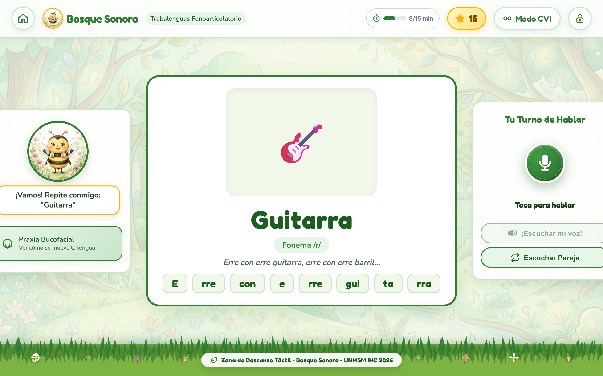
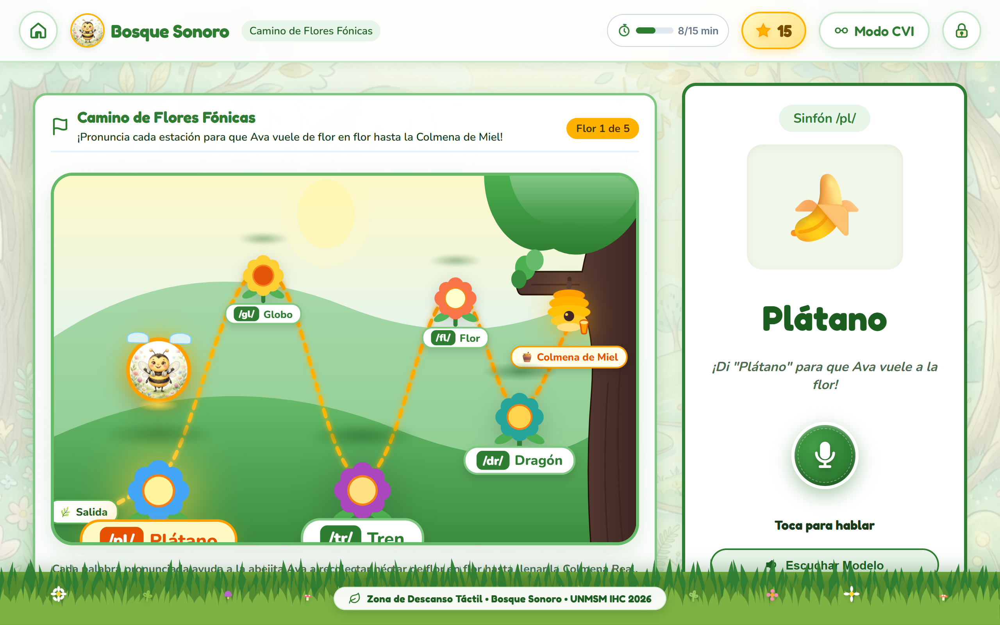
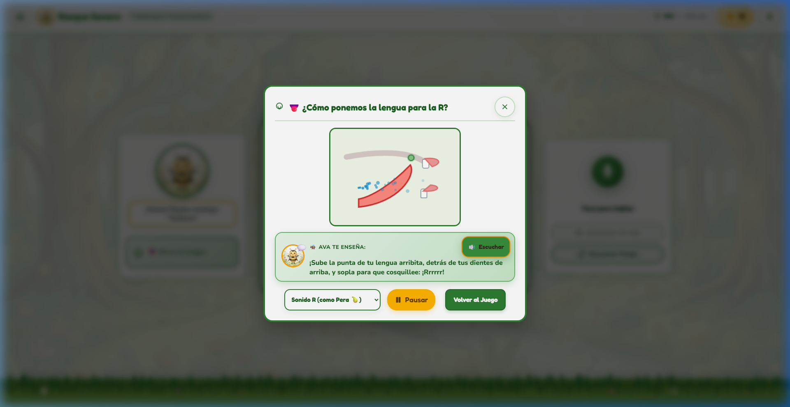
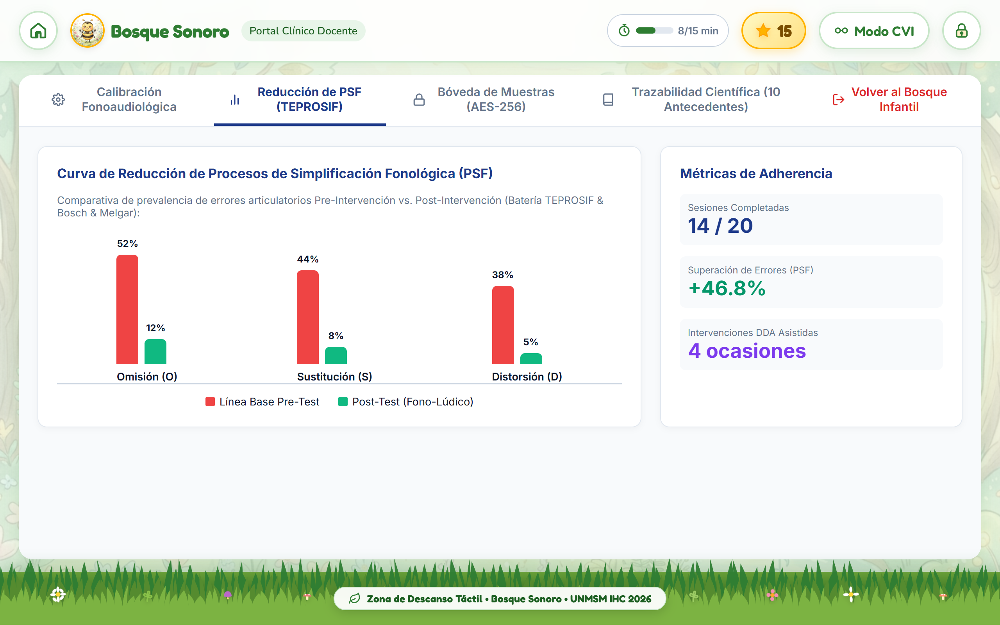

# 🗣️ Aplicación Fono-Lúdica Pediátrica
> **Estimulación y Mejora de la Articulación Fonética en Estudiantes de Nivel Preescolar de Lima Metropolitana**  
> *Proyecto Académico y de Investigación en Interacción Humano-Computador (IHC)*

[](https://opensource.org/licenses/MIT)
[](Proyecto/Documentación/Sistema%20de%20Diseño%20(Design%20System),%20Tokens%20de%20Diseño,%20Directrices%20HCIUX%20y%20Wireflows%20Pediátricos.md)
[](Proyecto/Antecedentes/Antecedentes.md)

---

## 🎯 Descripción General

La **Aplicación Fono-Lúdica** es un sistema digital interactivo diseñado bajo los principios de la **Interacción Niño-Computadora (CCI - *Child-Computer Interaction*)**, accesibilidad universal (**WCAG 2.2 Nivel AA**) y neurodesarrollo fonoaudiológico. Su propósito principal es apoyar a niños preescolares (3 a 5 años) en la prevención y tratamiento de dificultades fonético-fonológicas y dislalias funcionales (enfocado en fonemas críticos como `/r/`, `/rr/`, `/s/`, `/l/` y `/ch/`), combinando dinámicas de juego serio (*serious games*), biofeedback multimodal contingente (<300 ms), retroalimentación visual 2D de praxias bucofaciales y trazabilidad clínica automatizada.

El proyecto integra:
1. **Un Prototipo Interactivo de Alta Fidelidad** ejecutable en la web.
2. **Documentación Técnica y Metodológica Exhaustiva** fundamentada en 10 investigaciones científicas del estado del arte.
3. **Casos de Uso, Diagramas de Secuencia y Actividad** que modelan la transición de la terapia tradicional (*AS-IS*) hacia la solución tecnológica asistida (*TO-BE*).
4. **Sistema de Diseño (Design System) Pediátrico** con tokens de accesibilidad (modo estándar y modo alto contraste para Deficiencia Visual Cortical - CVI).

---

## 🗺️ Mapa de Conexión con la Documentación Técnica

Toda la documentación técnica se encuentra centralizada y enlazada de forma navegable. Puedes acceder directamente a cada documento desde los siguientes enlaces:

| Entregable / Módulo Técnico | Enlace Directo al Documento | Descripción y Contenido Clave |
| :--- | :--- | :--- |
| **📑 Índice Central de Documentación** | [Documentación.md](Proyecto/Documentación/Documentación.md) | Centro de comando y mapa MOC de todos los documentos técnicos del proyecto. |
| **📋 Especificación de Requisitos de Software** | [Especificación Refinada de Requisitos.md](Proyecto/Documentación/Especificación%20Refinada%20de%20Requisitos%20de%20Software%20Aplicación%20Fono-Lúdica%20para%20la%20Articulación%20Fonética%20en%20Preescolares.md) | Catálogo de RF y RNF bajo ISO/IEC 25010, criterios de aceptación BDD (Gherkin/PAR), matriz RTM e indexación de antecedentes científicos. |
| **🔄 Casos de Uso y Diagramas de Secuencia** | [Especificación de Casos de Uso.md](Proyecto/Documentación/Especificación%20de%20Casos%20de%20Uso%20y%20Diagramas%20de%20Secuencia%20Aplicación%20Fono-Lúdica%20Pediátrica.md) | Modelado AS-IS ➔ TO-BE, CUS textuales estructurados, diagramas de actividades con swimlanes y 4 diagramas de secuencia Mermaid. |
| **🎨 Sistema de Diseño y Guía HCI/UX** | [Sistema de Diseño, Tokens y Wireflows.md](Proyecto/Documentación/Sistema%20de%20Diseño%20(Design%20System),%20Tokens%20de%20Diseño,%20Directrices%20HCIUX%20y%20Wireflows%20Pediátricos.md) | Design tokens (WCAG 2.2 AA y Modo CVI), componentes atómicos para motricidad pediátrica (botones $\ge 56\text{ px}$), directrices CCI y wireflows. |
| **🎮 Catálogo del Prototipo de Alta Fidelidad** | [Prototipo Interactivo de Alta Fidelidad.md](Proyecto/Documentación/Prototipo%20Interactivo%20Fono-Lúdico%20de%20Alta%20Fidelidad.md) | Sustento empírico de las 13 pantallas, biofeedback contingente (<300 ms), algoritmo de Dificultad Dinámica (DDA) y dashboard de fonometría. |
| **👑 Aplicación de Reglas de Mandel y Estándares** | [Aplicación de Principios y Reglas de Mandel.md](Proyecto/Documentación/Aplicación%20de%20Principios,%20Reglas%20de%20Mandel,%20Est%C3%A1ndares%20y%20Gu%C3%ADa%20de%20Estilo%20en%20Prototipos%20de%20Alta%20Fidelidad.md) | Ficha de usuario/tarea/contexto, contraste evolutivo v1 vs v2 vs v3 (100% No Textual y Voice-First), matriz de 9 decisiones justificadas, guía de estilo y plan de pruebas. |
| **📖 Marco Teórico de Adaptación Pediátrica** | [Marco de Adaptación Teórica.md](Proyecto/Documentación/Marco%20Conceptual/Fundamentaci%C3%B3n%20Te%C3%B3rica%20y%20Adaptaci%C3%B3n%20de%20Directrices%20IHC,%20Reglas%20de%20Mandel%20y%20Est%C3%A1ndares%20de%20Accesibilidad%20en%20Fonoaudiolog%C3%ADa%20Pedi%C3%A1trica.md) | Investigación y justificación científica sobre superación del sesgo adultocéntrico de Mandel, ISO 9241 y WCAG 2.2 en preescolares. |
| **🎭 Marco de Metáforas de Diseño** | [Aplicación de Metáforas de Diseño](Proyecto/Documentación/Marco%20Conceptual/Aplicación%20de%20Metáforas%20de%20Diseño%20en%20los%20Prototipos.md) | Operacionalización de metáforas visuales, funcionales, organizacionales y de interacción bajo el modelo de Nielsen y Mandell. |
| **📚 Repositorio de Antecedentes y Estado del Arte** | [Antecedentes.md](Proyecto/Antecedentes/Antecedentes.md) | Análisis sistemático, matriz comparativa de brechas y 10 fichas bibliográficas RAE completas de literatura científica especializada. |
| **🚀 Nota General del Proyecto** | [Proyecto.md](Proyecto/Proyecto.md) | Planificación del curso, competencias curriculares (CT6.3, CT8.2, RA2-RA4), cronograma Gantt y rúbricas de evaluación continua. |

---

## 📸 Evidencia Visual del Prototipo

El prototipo cuenta con 13 interfaces de alta fidelidad documentadas con capturas de pantalla de alta resolución en [`Proyecto/Documentación/capturas/`](Proyecto/Documentación/capturas/):

| Interfaz | Vista Previa |
| :---: | :---: |
| **Menú Principal Lúdico (El Bosque de los Sonidos)** |  |
| **Ejercicio de Pronunciación Fonética y Biofeedback** |  |
| **Minijuego: Carrera Fónica (Control por Fonación)** |  |
| **Simulador de Praxias Bucofaciales 2D** |  |
| **Dashboard Clínico-Docente (TEPROSIF-R & PSF)** |  |
| **Modo Alto Contraste y Accesibilidad CVI** |  |

*(Para ver la totalidad de las 13 capturas e inspección técnica paso a paso, consulta el [Catálogo del Prototipo](Proyecto/Documentación/Prototipo%20Interactivo%20Fono-Lúdico%20de%20Alta%20Fidelidad.md)).*

---

## 💻 Ejecución del Prototipo Interactivo

El prototipo funcional de alta fidelidad está desarrollado en Vanilla HTML5, CSS3 moderno y JavaScript (Web Audio API y Canvas 2D), sin requerir configuraciones complejas de compilación:

### Requisitos Previos
- [Node.js](https://nodejs.org/) (versión 18 o superior recomendada).
- Navegador moderno con soporte para Web Audio API (Chrome, Edge o Firefox).

### Pasos para Ejecutar Localmente

1. **Navegar a la carpeta del prototipo:**
   ```bash
   cd Proyecto/Prototipo
   ```

2. **Instalar dependencias locales de servicio:**
   ```bash
   npm install
   ```

3. **Iniciar el servidor local de desarrollo:**
   ```bash
   npm run dev
   ```

4. **Abrir en el navegador:**
   Accede a [http://localhost:5173](http://localhost:5173).

---

## 🔬 Fundamentación Científica y Estado del Arte

El diseño de la aplicación y sus mecánicas lúdicas están directamente sustentados en 10 investigaciones especializadas (2016-2026), entre las que destacan:
- **Liu et al. (2026):** Criterios de calidad e interacción niño-computadora (CCI).
- **Strömbergsson et al. (2026):** Retroalimentación de habla y desafíos IHC en interfaces foniátricas.
- **Peña et al. (2024, *Nature*):** Eficacia de intervenciones con tabletas en el desarrollo comunicativo preescolar.
- **Saeedi et al. (2024):** Juegos serios y persistencia motivacional en terapia del habla infantil.
- **Du et al. (2023):** Pautas de diseño ergonómico y visual para fonoaudiología pediátrica.

Para profundizar en la síntesis y análisis metodológico de cada antecedente, revisa la [Matriz de Antecedentes](Proyecto/Antecedentes/Antecedentes.md).

---

## 👥 Equipo y Créditos

- **Asignatura:** Interacción Humano-Computador (IHC)
- **Institución:** Universidad Nacional Mayor de San Marcos (UNMSM)
- **Repositorio Oficial:** [https://github.com/MasaruC/App_Fono-Ludica.git](https://github.com/MasaruC/App_Fono-Ludica.git)
- **Licencia:** MIT (Ver archivo [LICENSE](LICENSE) o package.json).
